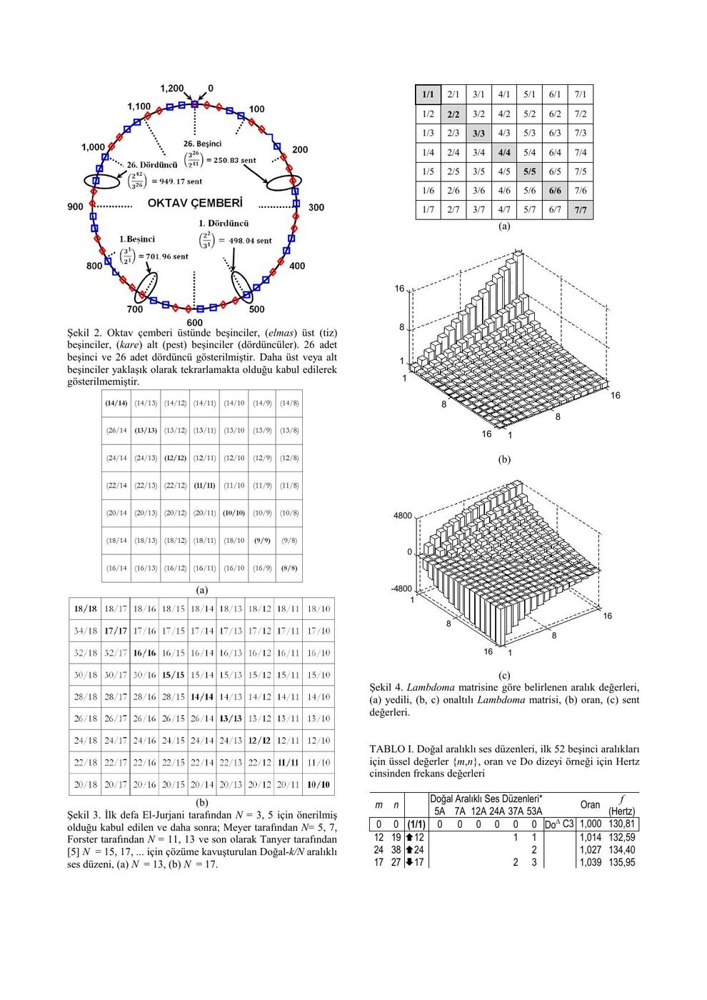

Süleyman Gökhun Tanyer (Başkent Üniversitesi Elektrik ve Elektronik Mühendisliği) tarafından hazırlanan bu dört sayfalık bildiri, Ocak 2014 tarihli PDF sürümünden aktarıldı. Metindeki kaynakça SİU 2014 başvurularını anıyor; bu dosyadan kabul/yayın durumu ayrıca doğrulanamıyor. Orijinal PDF yazının sonunda indirilebilir.

*Bu içerik üçüncü taraf bir kaynağa aittir; arşiv ve nostalji amacıyla kaynak belirtilerek paylaşılmıştır. Hak sahibinin talebi hâlinde kaldırılır.*

## Amaç

“Müzik İşaretlerinde Öznitelik Belirlenmesi: Doğal, Eşitlenmiş ve Yuvarlatılmış Ses Düzenleri” başlıklı bildiri, ses dosyalarının tanınması ve sınıflandırılması için kuramsal müzik aralıklarının kullanılmasını önerir. Batı ve Doğu müzikleri ile farklı mod ve makamların frekans oranlarında ayırt edici bilgi aranır.

## Oktav ve beşinciler

Müzikte tek tek mutlak frekanslar kadar, frekansların oranları da önemlidir. Eşses 1/1, oktav 2/1, beşinci 3/2 oranıyla ifade edilir. Bir oktavın 1200 sent olması, farklı frekanslardaki aynı oranı aynı uzaklıkla göstermeye yarar.

Doğal aralıklı sistemler, tamsayı oranlarından oluşur. Bildiri beşinci doğuşkanlarına dayalı sistemleri ve diğer doğal aralıklı sistemleri ayrı ayrı inceler. Doğal-5A, Doğal-7A, Doğal-12A, Doğal-24A, Doğal-37A ve Doğal-53A kümeleri karşılaştırılır.

## Lambdoma matrisi

Lambdoma tablosunda satır ve sütunlar tamsayı oranlarını oluşturur. Köşegende 1/1, 2/2, 3/3 gibi eşses değerleri bulunur. Aynı oranların farklı kesirlerle temsil edilebilmesi, sadeleştirme ve tekrarları ayıklama ihtiyacını doğurur.

Bildirinin üç gösterimi vardır: oran tablosu, oranların üç boyutlu yüzeyi ve sent cinsinden yüzey. Böylece aralıkların sayısal düzeni ile logaritmik algı arasındaki ilişki görselleştirilir.

## Eşitlenmiş ve yuvarlatılmış düzenler

Oktav N eşit parçaya bölündüğünde adım oranı y=2^(1/N) olur. N=12 için her yarım adım 100 senttir. Doğal beşinci yaklaşık 701,955 sent iken eşitlenmiş beşinci 700 senttir.

Bildiride Bohlen–Pierce düzeni için oktav yerine tritav (3/1) aralığının N eşit parçaya bölünmesi y=3^(1/N) biçiminde verilir. Yuvarlatılmış düzenlerde ise bazı doğal aralıklar korunurken başka aralıklar ayarlanır.

## Öznitelikler ve sonuç

Aralıkların sent değerleri, frekans oranları, oktav çemberindeki konumları ve perde kümeleri sınıflandırmada aday özniteliklerdir. Bildiri, DG ve DG# gibi yuvarlatılmış değerleri doğal sistemlerle tablo halinde karşılaştırır; kullanılan akort düzeninin kayıtlar arasında fark yaratabileceğini vurgular.

Çalışmanın sonucu, müzik tanıma için yalnız ses kaydının sayısal özelliklerinin değil, ses düzeninin kuramsal özelliklerinin de kullanılabileceğidir. Tablolar ve matrislerin tamamı orijinal PDF'dedir.
