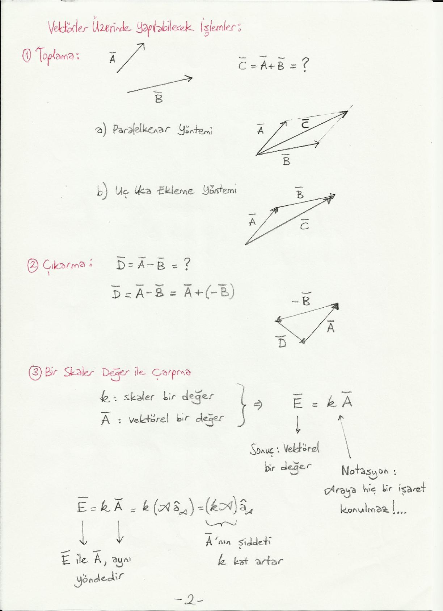
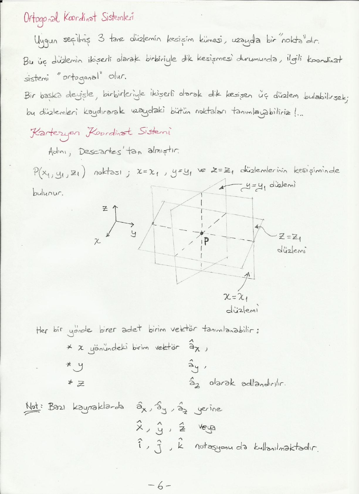
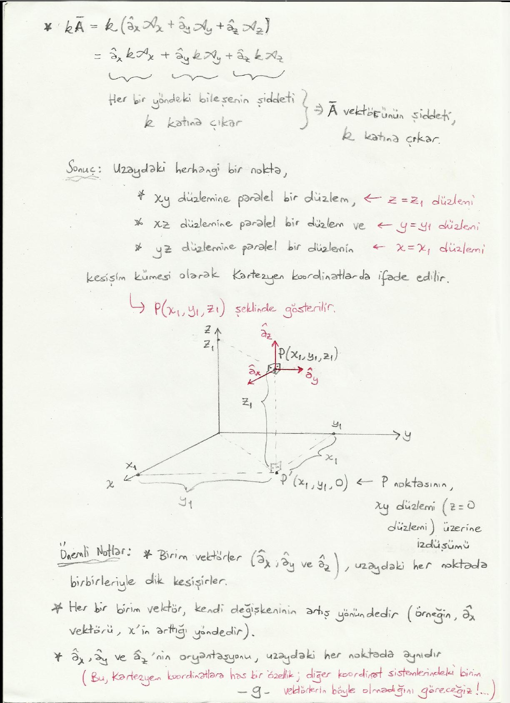

This post is the first part of the handwritten lecture notes for **EEM224 Electromagnetics I** at Başkent University, titled **"Vector Analysis"** (9 pages). The note does not state the author's name or a date; the file has been in the course folder of the Dropbox archive since 2015. Below, the headings, definitions, and formulas have been transcribed into text; images of the relevant pages are included for the drawings. The original PDF of the scanned note can be downloaded at the end of the post.

## Vector and its notation

A vector is defined by its direction and its magnitude:

- Ā = â_A A
- â_A: the direction, i.e. the **unit vector** (a vector whose magnitude is 1)
- A: the magnitude (size, amplitude); it is a scalar quantity

From this, A = |Ā| and â_A = Ā / |Ā| = Ā / A are written.

**General notation:**

| | Handwritten | In textbooks |
|---|---|---|
| Vector quantities | Ā or A⃗ (with a "bar" or an "arrow" on top) | **A** (boldface), Ā, A⃗ or A with a wavy underline (especially in mathematics books) |
| Unit vector | â_A (with a "hat" on top) | boldface **a**_A or â_A |
| Scalar quantities | A (plain) | *A* (italic, slanted typeface) |

In a graph, a vector is shown by an arrow: the length of the arrow is |Ā| = A, and the short arrow in the same direction is the unit vector with |â_A| = 1.

## Operations that can be performed on vectors

### 1. Addition

C̄ = Ā + B̄ is found by two methods:

- **a) Parallelogram method:** Ā and B̄ are drawn starting from the same point; the diagonal of the resulting parallelogram is C̄.
- **b) Head-to-tail method:** B̄ is attached to the tip of Ā; the vector from the start of Ā to the tip of B̄ is C̄.

### 2. Subtraction

D̄ = Ā − B̄ = Ā + (−B̄)

### 3. Multiplication by a scalar

If k is a scalar and Ā is a vector quantity, the result Ē = kĀ is a vector. Notation: no symbol is placed between them.

Ē = kĀ = k(A â_A) = (kA) â_A

Ē and Ā point in the same direction; the magnitude of Ā is increased by a factor of k.



### 4. Scalar product

If Ā and B̄ are vector quantities, the result c = Ā · B̄ is a **scalar**. Notation: a "·" symbol is placed between them; hence it is also called the *dot product*.

If |Ā| = A and |B̄| = B, then

c = Ā · B̄ = A B cos θ_AB

Here θ_AB is the angle between Ā and B̄ (the one smaller than 180°). B cos θ_AB is the projection of B̄ onto Ā.

**Physical meaning:**

- If θ_AB = 0° or 180°, the value of Ā · B̄ is quite large.
- If θ_AB = 90°, Ā · B̄ = 0.
- The result of the scalar product gives an idea of how much the two vectors "coincide" with, i.e. align with, each other.

**Properties:**

- Ā · B̄ = B̄ · Ā (commutative property)
- Ā · Ā = A²

 product and its physical meaning")

### 5. Vector product

If Ā and B̄ are vector quantities, the result D̄ = Ā × B̄ is a **vector**. Notation: a "×" symbol is placed between them; hence it is also called the *cross product*.

- The vector Ā × B̄ does not lie in the plane defined by Ā and B̄.
- The vector Ā × B̄ is perpendicular to the plane defined by Ā and B̄. Its direction is found by the **right-hand rule**.

In the example, Ā is drawn pointing to the right and B̄ pointing up and to the right; D̄ = Ā × B̄ points out of the page.

**How can we find the direction of Ā × B̄?**

- **Method 1:** As we rotate our right hand from Ā toward B̄, the direction our thumb points gives the direction of Ā × B̄.
- **Method 2:** When we place the thumb of our right hand along Ā and the index finger along B̄, the direction pointing outward from the palm gives the direction of Ā × B̄.

 product and the right-hand rule")

Magnitude and direction together:

D̄ = Ā × B̄ = â_n A B sin θ_AB

Here â_n is the unit vector in the direction perpendicular to the plane containing the vectors Ā and B̄ (the direction found by the right-hand rule).

**Physical meaning:** If θ_AB = 0° or 180°, Ā × B̄ = 0; if θ_AB = 90°, the magnitude of Ā × B̄ is at its maximum. The result of the vector product gives an idea of how "perpendicular" the two vectors are to each other.

**Properties:**

- B̄ × Ā ≠ Ā × B̄: it is not commutative!
- B̄ × Ā = −Ā × B̄ (easily seen with the right-hand rule)
- Ā × Ā = 0

### Examples of products of three or more vectors

| Expression | Result |
|---|---|
| Ā · (B̄ × C̄) | scalar (vector · vector) |
| Ā × (B̄ × C̄) | vector (vector × vector) |
| (Ā × B̄) × (C̄ × D̄) | vector |
| (Ā · B̄) C̄ | vector (scalar × vector) |

One must pay close attention to parentheses and notation!

## Orthogonal coordinate systems

The intersection set of 3 suitably chosen planes is a "point" in space. If these three planes intersect one another pairwise at right angles, the corresponding coordinate system is **orthogonal**. In other words, if we can find three planes that intersect each other pairwise at right angles, then by sliding these planes we can define all the points in space.

## Cartesian coordinate system

It takes its name from Descartes. The point P(x₁, y₁, z₁) lies at the intersection of the planes x = x₁, y = y₁, and z = z₁.

One unit vector can be defined in each direction: the unit vector in the x direction is called â_x, in the y direction â_y, and in the z direction â_z. In some sources, the notation x̂, ŷ, ẑ or î, ĵ, k̂ is also used instead of â_x, â_y, â_z.



Therefore any vector in space can be expressed in terms of â_x, â_y, and â_z:

Ā = â_x A_x + â_y A_y + â_z A_z

This is the sum of three vectors: â_x A_x is the component of Ā in the x direction (a vector), and the others are the components in the y and z directions. Since each term is the product of a vector (â_z) and a scalar (A_z), there is no symbol between them.

## Representation of vector operations in Cartesian coordinates

If Ā = â_x A_x + â_y A_y + â_z A_z and B̄ = â_x B_x + â_y B_y + â_z B_z, then:

**Addition:**

Ā + B̄ = â_x (A_x + B_x) + â_y (A_y + B_y) + â_z (A_z + B_z)

**Scalar product:**

Ā · B̄ = A_x B_x + A_y B_y + A_z B_z

The reason is the relationship among â_x, â_y, and â_z:

- Since they are perpendicular to one another, â_x · â_y = 0, â_x · â_z = 0, â_y · â_z = 0
- Since they are unit vectors, â_x · â_x = |â_x|² = 1, â_y · â_y = 1, â_z · â_z = 1

When the product is expanded, the term (â_x · â_x) A_x B_x remains, while mixed terms such as (â_x · â_y) A_x B_y vanish.

**Vector product:** First, the relationships among the unit vectors:

- â_x × â_y = â_z; â_y × â_z = â_x; â_z × â_x = â_y
- â_y × â_x = −â_z; â_z × â_y = −â_x; â_x × â_z = −â_y
- â_x × â_x = 0; â_y × â_y = 0; â_z × â_z = 0

Tip: to remember easily, use the cycle x → y → z → x; going clockwise is +, the reverse is −.

After expanding the nine terms and dropping the zero ones:

Ā × B̄ = (A_y B_z − A_z B_y) â_x + (A_z B_x − A_x B_z) â_y + (A_x B_y − A_y B_x) â_z

The result obtained is seen to be equal to the determinant of the following matrix:

```
        | â_x  â_y  â_z |
Ā × B̄ = | A_x  A_y  A_z |
        | B_x  B_y  B_z |
```

In the note, the determinant is expanded using the cross-multiplication (Sarrus) rule by rewriting the first two rows below: A_y B_z â_x + A_x B_y â_z + A_z B_x â_y − A_y B_x â_z − A_z B_y â_x − A_x B_z â_y.

**Multiplication by a scalar:**

kĀ = k(â_x A_x + â_y A_y + â_z A_z) = â_x kA_x + â_y kA_y + â_z kA_z

The magnitude of the component in each direction is multiplied by k, so the magnitude of the vector Ā is multiplied by k.

## Conclusion: A point in Cartesian coordinates

Any point in space is expressed in Cartesian coordinates as the intersection set of

- a plane parallel to the xy plane (the z = z₁ plane),
- a plane parallel to the xz plane (the y = y₁ plane), and
- a plane parallel to the yz plane (the x = x₁ plane),

and is denoted P(x₁, y₁, z₁). P'(x₁, y₁, 0) is the projection of P onto the xy plane (the z = 0 plane).



**Important notes:**

- The unit vectors (â_x, â_y, and â_z) intersect one another at right angles at every point in space.
- Each unit vector points in the direction of increase of its own variable (for example, the vector â_x points in the direction in which x increases).
- The orientation of â_x, â_y, and â_z is the same at every point in space. This is a property specific to Cartesian coordinates; we will see that the unit vectors in other coordinate systems are not like this!
