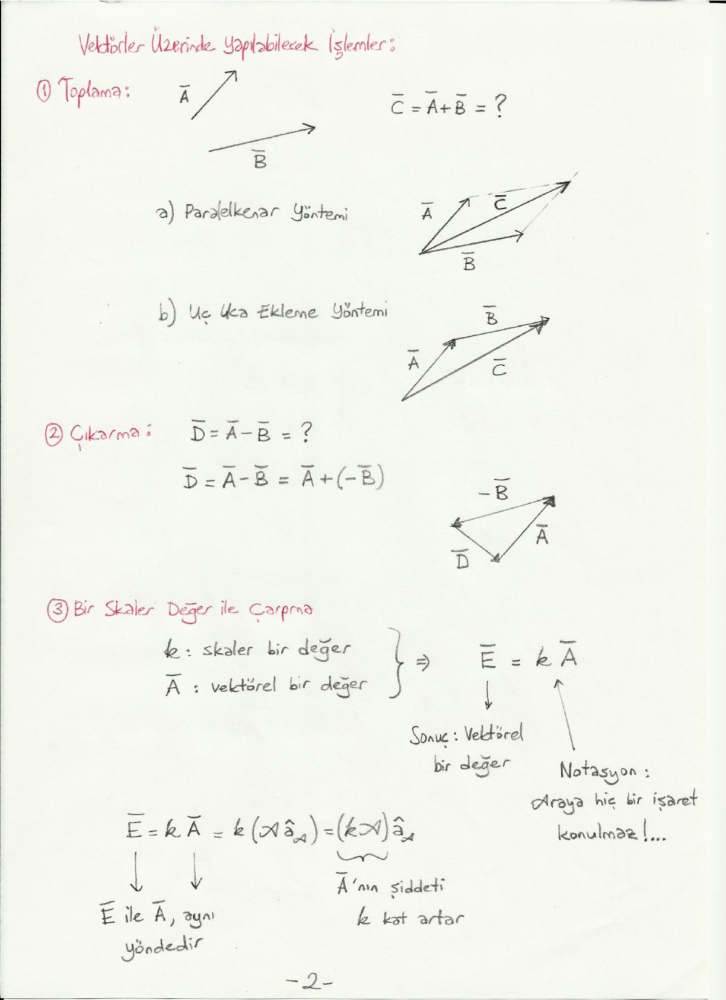
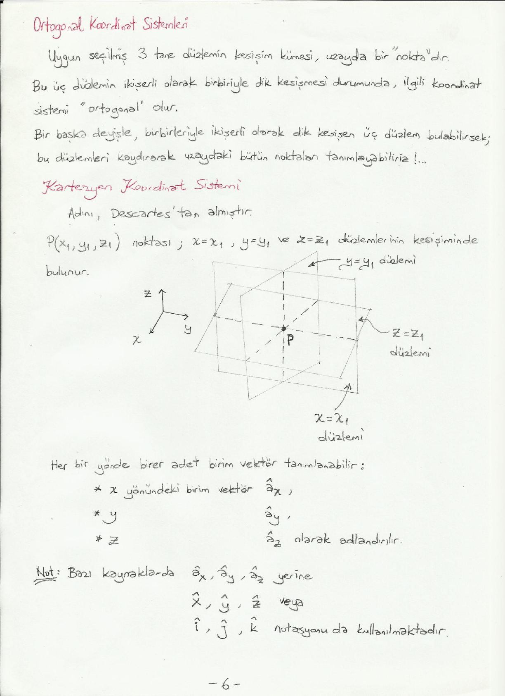
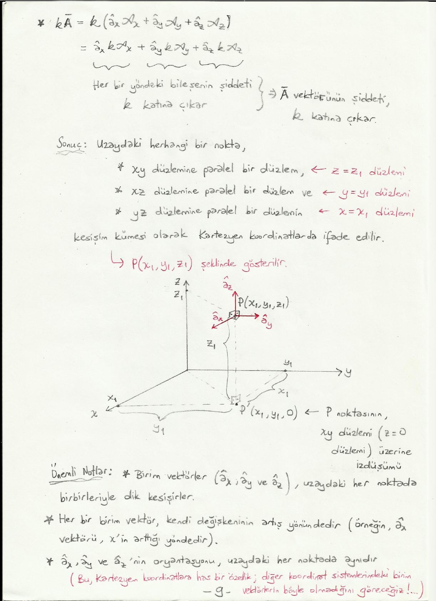

Bu yazı, Başkent Üniversitesi **EEM224 Elektromanyetik I** dersine ait el yazısı ders notlarının ilk bölümü olan **"Vektör Analizi"** notudur (9 sayfa). Notta hazırlayanın adı ve tarih yazmıyor; dosya Dropbox arşivinde ders klasöründe 2015'ten beri duruyor. Aşağıda başlıklar, tanımlar ve formüller metne döküldü; çizimler için ilgili sayfaların görselleri eklendi. Taranmış notun orijinal PDF'i yazının sonunda indirilebilir.

## Vektör ve gösterimi

Bir vektör, yönü ve şiddeti ile tanımlanır:

- Ā = â_A A
- â_A: yön, yani **birim vektör** (büyüklüğü 1 olan vektör)
- A: şiddet (büyüklük, genlik); skaler bir değerdir

Buradan A = |Ā| ve â_A = Ā / |Ā| = Ā / A yazılır.

**Genel gösterim (notasyon):**

| | El yazısı ile | Kitaplarda |
|---|---|---|
| Vektörel değerler | Ā veya A⃗ (üzerinde "çizgi" veya "ok") | **A** (kalın yazı tipi), Ā, A⃗ veya altı dalgalı A (özellikle matematik kitaplarında) |
| Birim vektör | â_A (üzerinde "şapka") | kalın **a**_A veya â_A |
| Skaler değerler | A (normal) | *A* (italik, eğik yazı tipi) |

Grafikte bir vektör ok ile gösterilir: okun uzunluğu |Ā| = A, aynı yöndeki kısa ok ise |â_A| = 1 olan birim vektördür.

## Vektörler üzerinde yapılabilecek işlemler

### 1. Toplama

C̄ = Ā + B̄ iki yöntemle bulunur:

- **a) Paralelkenar yöntemi:** Ā ve B̄ aynı noktadan başlatılır; oluşan paralelkenarın köşegeni C̄'dir.
- **b) Uç uca ekleme yöntemi:** B̄, Ā'nın ucuna eklenir; Ā'nın başlangıcından B̄'nin ucuna giden vektör C̄'dir.

### 2. Çıkarma

D̄ = Ā − B̄ = Ā + (−B̄)

### 3. Bir skaler değer ile çarpma

k skaler, Ā vektörel bir değer ise Ē = kĀ sonucu vektöreldir. Notasyon: araya hiçbir işaret konulmaz.

Ē = kĀ = k(A â_A) = (kA) â_A

Ē ile Ā aynı yöndedir; Ā'nın şiddeti k kat artar.



### 4. Skaler çarpım

Ā ve B̄ vektörel büyüklükler ise c = Ā · B̄ sonucu **skaler** bir değerdir. Notasyon: araya "·" işareti konulur; bu nedenle *dot product* adı da verilir.

|Ā| = A ve |B̄| = B ise

c = Ā · B̄ = A B cos θ_AB

Burada θ_AB, Ā ile B̄ arasındaki (180°'den küçük olan) açıdır. B cos θ_AB, B̄'nin Ā üzerindeki izdüşümüdür.

**Fiziksel anlamı:**

- θ_AB = 0° veya 180° ise Ā · B̄ değeri oldukça büyük olur.
- θ_AB = 90° ise Ā · B̄ = 0 olur.
- Skaler çarpımın sonucu, iki vektörün birbiri ile ne kadar "çakışık" olduğuna dair bir fikir verir.

**Özellikler:**

- Ā · B̄ = B̄ · Ā (değişme özelliği)
- Ā · Ā = A²

 çarpım ve fiziksel anlamı")

### 5. Vektörel çarpım

Ā ve B̄ vektörel değerler ise D̄ = Ā × B̄ sonucu **vektörel** bir değerdir. Notasyon: araya "×" işareti konulur; bu nedenle *cross product* adı da verilir.

- Ā × B̄ vektörü, Ā ve B̄'nin belirttiği düzlemde bulunmaz.
- Ā × B̄ vektörü, Ā ve B̄'nin belirttiği düzleme dik olur. Yönü **sağ el kuralı** ile bulunur.

Örnekte Ā sağa, B̄ yukarı-sağa doğru çizilmiş; D̄ = Ā × B̄ kâğıdın dışına doğrudur.

**Ā × B̄'nin yönünü nasıl bulabiliriz?**

- **Yöntem 1:** Sağ elimizi Ā'dan B̄'ye doğru çevirirken baş parmağımızın gösterdiği yön, Ā × B̄'nin yönünü verir.
- **Yöntem 2:** Sağ elimizin baş parmağını Ā, işaret parmağını da B̄ üzerine koyduğumuzda avuç içimizden dışarı doğru olan yön, Ā × B̄'nin yönünü verir.

 çarpım ve sağ el kuralı")

Şiddet ve yön birlikte:

D̄ = Ā × B̄ = â_n A B sin θ_AB

Burada â_n, Ā ve B̄ vektörlerinin bulunduğu düzleme dik olan yönde (sağ el kuralı ile bulunan yönde) birim vektördür.

**Fiziksel anlamı:** θ_AB = 0° veya 180° ise Ā × B̄ = 0 olur; θ_AB = 90° ise Ā × B̄'nin şiddeti maksimum olur. Vektörel çarpımın sonucu, iki vektörün birbirine ne kadar "dik" olduğuna dair bir fikir verir.

**Özellikler:**

- B̄ × Ā ≠ Ā × B̄: değişme özelliği yok!
- B̄ × Ā = −Ā × B̄ (sağ el kuralı ile kolayca görülebilir)
- Ā × Ā = 0

### Üç veya daha fazla vektörün çarpımı ile ilgili örnekler

| İfade | Sonuç |
|---|---|
| Ā · (B̄ × C̄) | skaler (vektör · vektör) |
| Ā × (B̄ × C̄) | vektörel (vektör × vektör) |
| (Ā × B̄) × (C̄ × D̄) | vektörel |
| (Ā · B̄) C̄ | vektörel (skaler × vektör) |

Parantezlere ve notasyona çok dikkat etmek gerekir!

## Ortogonal koordinat sistemleri

Uygun seçilmiş 3 tane düzlemin kesişim kümesi, uzayda bir "nokta"dır. Bu üç düzlemin ikişerli olarak birbiriyle dik kesişmesi durumunda ilgili koordinat sistemi **ortogonal** olur. Bir başka deyişle, birbirleriyle ikişerli olarak dik kesişen üç düzlem bulabilirsek, bu düzlemleri kaydırarak uzaydaki bütün noktaları tanımlayabiliriz.

## Kartezyen koordinat sistemi

Adını Descartes'tan almıştır. P(x₁, y₁, z₁) noktası; x = x₁, y = y₁ ve z = z₁ düzlemlerinin kesişiminde bulunur.

Her bir yönde birer adet birim vektör tanımlanabilir: x yönündeki birim vektör â_x, y yönündeki â_y, z yönündeki â_z olarak adlandırılır. Bazı kaynaklarda â_x, â_y, â_z yerine x̂, ŷ, ẑ veya î, ĵ, k̂ notasyonu da kullanılmaktadır.



Dolayısıyla uzaydaki herhangi bir vektör â_x, â_y ve â_z cinsinden ifade edilebilir:

Ā = â_x A_x + â_y A_y + â_z A_z

Bu, üç vektörün toplamıdır: â_x A_x, Ā'nın x yönündeki bileşenidir (vektör), diğerleri de y ve z yönündeki bileşenlerdir. Her bir terim bir vektör (â_z) ile bir skalerin (A_z) çarpımı olduğu için arada herhangi bir işaret yoktur.

## Vektör işlemlerinin Kartezyen koordinatlarda gösterimi

Ā = â_x A_x + â_y A_y + â_z A_z ve B̄ = â_x B_x + â_y B_y + â_z B_z ise:

**Toplama:**

Ā + B̄ = â_x (A_x + B_x) + â_y (A_y + B_y) + â_z (A_z + B_z)

**Skaler çarpım:**

Ā · B̄ = A_x B_x + A_y B_y + A_z B_z

Sebebi â_x, â_y ve â_z arasındaki ilişkidir:

- Birbirlerine dik oldukları için â_x · â_y = 0, â_x · â_z = 0, â_y · â_z = 0
- Birim vektör oldukları için â_x · â_x = |â_x|² = 1, â_y · â_y = 1, â_z · â_z = 1

Çarpım açıldığında (â_x · â_x) A_x B_x terimi kalır, (â_x · â_y) A_x B_y gibi karışık terimler sıfır olur.

**Vektörel çarpım:** Önce birim vektörler arasındaki ilişki:

- â_x × â_y = â_z; â_y × â_z = â_x; â_z × â_x = â_y
- â_y × â_x = −â_z; â_z × â_y = −â_x; â_x × â_z = −â_y
- â_x × â_x = 0; â_y × â_y = 0; â_z × â_z = 0

İpucu: kolay hatırlamak için x → y → z → x döngüsü; saat yönünde gidiş +, tersi −.

Dokuz terim açılıp sıfır olanlar atılınca:

Ā × B̄ = (A_y B_z − A_z B_y) â_x + (A_z B_x − A_x B_z) â_y + (A_x B_y − A_y B_x) â_z

Elde edilen sonucun aşağıdaki matrisin determinantına eşit olduğu görülür:

```
        | â_x  â_y  â_z |
Ā × B̄ = | A_x  A_y  A_z |
        | B_x  B_y  B_z |
```

Notta determinant, ilk iki satır alta tekrar yazılarak çapraz çarpım (Sarrus) kuralıyla açılıyor: A_y B_z â_x + A_x B_y â_z + A_z B_x â_y − A_y B_x â_z − A_z B_y â_x − A_x B_z â_y.

**Skaler ile çarpma:**

kĀ = k(â_x A_x + â_y A_y + â_z A_z) = â_x kA_x + â_y kA_y + â_z kA_z

Her bir yöndeki bileşenin şiddeti k katına çıkar, dolayısıyla Ā vektörünün şiddeti k katına çıkar.

## Sonuç: Kartezyen koordinatlarda bir nokta

Uzaydaki herhangi bir nokta, Kartezyen koordinatlarda

- xy düzlemine paralel bir düzlem (z = z₁ düzlemi),
- xz düzlemine paralel bir düzlem (y = y₁ düzlemi) ve
- yz düzlemine paralel bir düzlemin (x = x₁ düzlemi)

kesişim kümesi olarak ifade edilir ve P(x₁, y₁, z₁) şeklinde gösterilir. P'(x₁, y₁, 0), P noktasının xy düzlemi (z = 0 düzlemi) üzerine izdüşümüdür.



**Önemli notlar:**

- Birim vektörler (â_x, â_y ve â_z) uzaydaki her noktada birbirleriyle dik kesişirler.
- Her bir birim vektör kendi değişkeninin artış yönündedir (örneğin â_x vektörü, x'in arttığı yöndedir).
- â_x, â_y ve â_z'nin oryantasyonu uzaydaki her noktada aynıdır. Bu Kartezyen koordinatlara has bir özelliktir; diğer koordinat sistemlerindeki birim vektörlerin böyle olmadığını göreceğiz!
