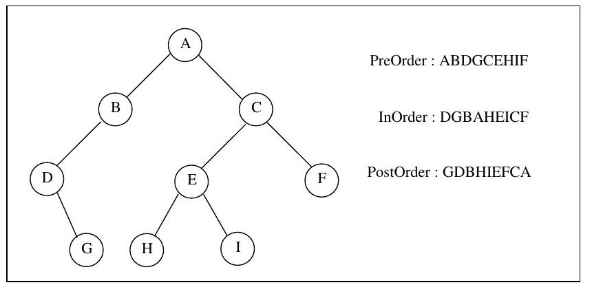

This post introduces the **"Data Structures Lecture Notes"** that sit in the week 3 folder of the EEM227 Data Structures course as a reference. The notes are by **Asst. Prof. Dr. Aybars Uğur** of the **Ege University Faculty of Engineering, Department of Computer Engineering** (August 2002, Fall 2002–2003 term, 86 pages). Since the document is long, the section titles, main concepts, and a few short examples are given below. The original PDF can be downloaded at the end of the post.

*This content belongs to a third-party source; it is shared for archival and nostalgic purposes with the source credited. It will be removed at the request of the rights holder.*

## Contents

| Section | Page |
|---|---|
| Data Structures – Introduction | 1 |
| 1. C Programming | 2 |
| 2. Java Programming | 8 |
| 3. Recursion | 28 |
| 4. Trees | 40 |
| 5. Stack | 49 |
| 6. Queues | 57 |
| 7. Lists and Linked Lists | 60 |
| 8. Comparing Algorithms | 67 |
| 9. Sorting | 72 |
| 10. Graphs and Their Applications | 78 |
| Built-in Data Structures and Collections in Java (Appendix) | 81 |

## Introduction: data, structure, and algorithm

- **Algorithm:** A sequence of commands used to solve a problem; when expressed in a programming language, it is called a *program*.
- **Data:** The most basic elements that algorithms process (numerical and textual information, images, sounds…).
- **Data structures:** Building blocks that determine how data is organized. When the structure is designed well, it becomes easier to develop algorithms that are efficient, correct, understandable, and use few resources.
- Data types (integer, real number, character) → composite data types (array, structure/record) → data structures (list, stack, queue, tree, graph).
- A **list** keeps elements in linear order with no restriction on access; a **stack** is a LIFO-access list and a **queue** is a FIFO-access list. Data structures are divided into static and dynamic.

## Section 1: C programming examples

Before moving on to data structures, the course reviews basic examples in C: printing to the screen, the four arithmetic operations and remainder with two integers, reading grades until −1 is entered and computing the class average, a `kare` (square) function, Bubble Sort, character string operations with `strcpy`/`strncpy` and `strcat`/`strncat`, two-dimensional arrays, and sorting character strings alphabetically with Selection Sort.

```
Veriler orjinal sıralarında listeleniyor
   2   6   4   8  10  12  89  68  45  37
Sıralanmış veriler listeleniyor
   2   4   6   8  10  12  37  45  68  89
```

## Section 2: Java programming

### Java Programming I

Compiling with `javac Ornek1.java` (byte code, `Ornek1.class`) and running with `java Ornek1`; then variables, methods, arrays, control structures, and GUI examples: a method that sums array elements, listing a String array in reverse, searching for a name in an array (`equals`), listing a 2×4 matrix, the difference between a String and a character array, String operations such as `indexOf`, `substring`, and `concat`, input and message boxes with `JOptionPane`, rolling a die 1000 times and showing the face frequencies in a `JTextArea`, `JApplet` examples, and Bubble Sort inside an applet.

```java
public static boolean ara(String dizi[], String aranan)
{
    for(int i=0; i<dizi.length; ++i)
        if(aranan.equals(dizi[i])) return true;
    return false;
}
```

The section ends with exercises: finding which element of the array a name is and how many times it is repeated, deleting a number from a sorted array and inserting a number into a sorted array, adding two matrices, and transferring row sums into an array.

### Java Programming II: object-oriented programming

Basic terms, illustrated with the `Yolcu` (passenger) class:

- **Class:** Brings together both the data of an abstract data type and the operations on that data.
- **Object:** A variable of the class type (`yolcu1`).
- **Method:** A class member that performs an operation; the **constructor** is called when the object is created with `new` and has the same name as the class.
- **Class members:** Variables (`ad`, `soyad`, `yasi`) and methods.

Next come `java.util.Vector` examples (`addElement`, `elementAt`, traversal with `Enumeration`), storing Yolcu objects in a vector, and a simple telephone keypad interface using `JFrame`/`JButton`/`GridLayout`.

## Section 3: Recursion

Functions that call themselves directly or indirectly are called recursive functions. The examples covered in the notes:

- **Factorial:** n! = 1 (n = 0), n! = n·(n − 1)! (n > 0). Iterative and recursive C versions; placing local variables on the stack at each call; checking invalid calls such as `fact(-1)`.
- **Fibonacci sequence:** fib(n) = n (n = 0 or 1), fib(n) = fib(n − 2) + fib(n − 1) (n ≥ 2); 0, 1, 1, 2, 3, 5, 8, 13, 21, 34, …
- **Binary search:** Look at the middle of the sorted array and continue the search in the appropriate half. While searching for 17 in the array 1, 3, 4, 5, 17, 18, 31, 33, the steps are mid = 3 (5), mid = 5 (18), mid = 4 (17).
- **Towers of Hanoi:** Move n − 1 disks to the auxiliary tower, place the largest disk on the destination, move the n − 1 disks to the destination.
- **Printing a linked list in reverse order** (RevPrint) and a **recursion chain** (a calling b, b calling a).

```c
void towers(int n, char frompeg, char topeg, char auxpeg)
{
    if(n==1) {
        printf("\n%d%s%c%s%c%s",n,". diski ",frompeg," kulesinden alıp ",
               topeg," kulesine yerleştir");
        return;
    }
    towers(n-1, frompeg, auxpeg, topeg);   // moving n-1 disks to the auxiliary tower
    printf("\n%d%s%c%s%c%s",n,". diski ",frompeg," kulesinden alıp ",
           topeg," kulesine yerleştir");
    towers(n-1, auxpeg, topeg, frompeg);   // moving n-1 disks to the destination tower
}
```

Output for n = 3:

```
1. diski A kulesinden alıp C kulesine yerleştir
2. diski A kulesinden alıp B kulesine yerleştir
1. diski C kulesinden alıp B kulesine yerleştir
3. diski A kulesinden alıp C kulesine yerleştir
1. diski B kulesinden alıp A kulesine yerleştir
2. diski B kulesinden alıp C kulesine yerleştir
1. diski A kulesinden alıp C kulesine yerleştir
```

**Recursion and iteration:** The iterative version is generally more efficient in time and space (there is no call entry/exit overhead). On the other hand, recursion is more natural for problems whose structure suits it; where a stack is required, writing a non-recursive solution becomes harder. Iteration terminates when the loop condition fails, and recursion terminates when it reaches the simplest case (base case).

## Section 4: Trees

Linked lists, stacks, and queues are linear; trees are non-linear, two-dimensional data structures. Definitions: **binary tree** (each node is linked to at most two nodes), **node**, **root** (level 0), **child**, **parent**, **level/depth**, **depth of the tree**, **leaf**, **sibling**, **ancestor/descendant**, **full binary tree** (with n leaves, 2n − 1 nodes), **complete binary tree**, **general tree**, and **binary search tree** (all keys on the left are smaller than the root, those on the right are larger).

### Traversal

1. **Preorder:** visit the root, traverse the left subtree, traverse the right subtree.
1. **Inorder:** left subtree, root, right subtree.
1. **Postorder:** left subtree, right subtree, root.



PreOrder: ABDGCEHIF, InOrder: DGBAHEICF, PostOrder: GDBHIEFCA.

### Binary search trees

The tree formed by inserting 47, 25, 43, 77, 65, 68, 93, 11, 17, 44, 31, 7 in that order:

```
                47
           /          \
         25            77
        /   \         /   \
      11     43     65     93
     /  \   /  \      \
    7   17 31   44     68
```

Searching for 44 goes 47 → 25 → 43 → 44 (4 comparisons, found); searching for 90 goes 47 → 77 → 93 → NULL (not found). If the tree is kept balanced, there are at most log₂n levels for n elements; in a tree of 1000 elements at most 10 comparisons suffice (2¹⁰ = 1024 > 1000), whereas a linked list may require 1000. The depth of a complete binary tree with n nodes is d = log₂(n + 1) − 1 (3 for 15 nodes). Traversing a binary search tree inorder yields the elements in sorted order from smallest to largest; the tree is also useful for preventing duplicate data. The section ends with a Java program that uses `TreeNode`/`Tree` classes to perform insertion and the three traversals.

## Section 5: Stack

A data structure in which insertion and removal of elements are done at the top: **LIFO** (Last In First Out). Operations: **push(s, i)**, **i = pop(s)**, **empty(s)**, **stacktop(s)** (peek). Trying to remove an element from an empty stack is an **underflow** condition; `empty(s)` must be checked first.

- **Parenthesis checking:** At the end of the expression the parenthesis count must be 0 and must never be negative at any point. If there are different types of parentheses ( ), [ ], { }, a stack is used: an opening parenthesis is pushed onto the stack, on a closing parenthesis the top is popped and checked for a match, and at the end the stack must be empty.
- **Stack in Java:** The `StackChar` class using an array (printing "Merhaba" in reverse) and the built-in `java.util.Stack` class.
- **Infix, postfix, prefix:** A+B is infix, +AB is prefix, AB+ is postfix. Operator precedence: exponentiation, multiplication/division, addition/subtraction; operators of equal precedence are evaluated left to right (right to left for exponentiation). For example, A+B*C → ABC*+. Postfix notation requires no parentheses.
- **Evaluating postfix expressions:** Operands are pushed onto the stack; at an operator, the top two elements are popped, the operation is performed, and the result is pushed back. 3*2+5*6 → "3 2 * 5 6 * +" → 36.
- **Function calls:** Compilers store the calling function's local variables and return address on the stack.

## Section 6: Queues

Insertion is done at the rear and removal at the front: **FIFO**. Queues are used in areas such as simulating queues at banks and toll booths, processor/printer/disk job queues, and packet routing in networks. Operations: **insert(q, x)** (enqueue), **x = remove(q)** (dequeue).

**Priority queue:** The removal order is determined not by insertion order but by the elements' own ordering. In an ascending priority queue the smallest element is removed (`pqmindelete`), and in a descending priority queue the largest. The section includes a `Kuyruk` (queue) Java class using a circular array (`ekle`, `cikar`, `bosMu`) and a test program.

## Section 7: Lists and linked lists

List operations: EmptyList, FullList, LengthList, InsertElement, DeleteElement, DestroyList, GetNextItem, RetrieveElement.

**Linked list:** Each node holds an information field and the address of the next node (self-referential structure); the `next` field of the last node is NULL. The fixed memory allocation and overflow problems of arrays disappear; no shifting is needed when inserting in the middle or deleting from the middle, but reaching the nth element requires passing through the previous n − 1 nodes.

- Implementing a priority queue with a linked list (sorted and unsorted lists; keeping the list sorted is more efficient)
- Implementing stacks and queues with linked lists
- **Circular linked list**, **doubly linked list**, and **circular doubly linked list**
- The `Dugum` (node) and `BListe` (linked list) classes in Java: `basaEkle`, `bul`, `sil`, `listele`

```
Bastan Sona Liste :  1 2 3 4 5 6 7 8 9
5 Bulundu
Bastan Sona Liste :  1 2 3 4 6 7 8 9
```

## Section 8: Comparing algorithms

A program's performance is measured by the time (**time complexity**) and memory (**space complexity**) required to run it. Since measuring running times depends on the computer, one counts how many times the dominant operation is repeated in the algorithm (n − 1 additions to sum n elements).

- **Worst-case running time:** The longest time for each input size; for sequential search, T(n) ≤ n.
- **Average-case running time:** The average over all inputs; for sequential search, (n + 1)/2.
- **Big-O:** An upper bound on a function's growth rate; f(n) = n⁴ + 100n² + 10n + 50 = O(n⁴).
- Sum from 1 to n: O(n) with a loop, O(1) with the formula n(n + 1)/2.

| Function | Name | Example |
|---|---|---|
| 1 | constant | assignment to the ith element of an array |
| log n | logarithmic | binary search in a sorted array |
| n | linear | search in an unsorted list |
| n log n | n log n | quick sorting algorithms |
| n² | quadratic | selection sort |
| n³ | cubic | incrementing every element of a three-dimensional table |
| 2ⁿ | exponential | |
| n! | factorial | |

## Section 9: Sorting

Sorting is internal if the elements are in memory and external if some of them are in secondary storage. Since there is no universal method that suits every case, one first decides whether sorting is needed at all, and then which method to use.

- **Bubble sort:** At most n − 1 passes; (n − 1)² comparisons in the unimproved version, O(n²). The data 25 57 48 37 12 92 86 33 is sorted in the 5th pass.
- **Quicksort:** An element x is chosen, smaller elements are gathered to its left and larger ones to its right, and the process is repeated for the two parts. Average O(n log₂n), worst case O(n²).
- **Straight selection sort:** n(n − 1)/2 comparisons in total, O(n²).
- **Simple insertion sort:** O(n) if the data is already sorted, O(n²) if it is in reverse order. Selection sort makes fewer assignments but more comparisons; the insertion sort logic suits linked lists. Beyond roughly 30 elements, quicksort is more efficient.
- **Merge sort:** Proceeds by merging two sorted groups; log₂n passes, O(n log₂n) comparisons, but requires an extra `aux` array and many assignments.

## Section 10: Graphs

A graph G = (V, E) is a non-linear data structure consisting of vertices and the edges connecting them. Definitions: undirected and directed edge, adjacent vertices, incident, vertex degree, indegree and outdegree, undirected graph, directed graph (digraph), loop, weighted graph, path, simple path, length, connected graph, subgraph, cycle, tree (a connected undirected graph with no cycles), spanning tree, forest, complete graph (n(n − 1)/2 edges), and complete directed graph (n(n − 1) edges). Application areas: computer networks, electrical circuits, molecular structures, transportation networks, planning.

*Note: The document defines a connected graph as "a tree with at least one path between every pair of vertices"; the correct wording is "a **graph** with…" (a tree is a connected graph with no cycles).*

## Appendix: Built-in data structures and collections in Java

The collection interfaces in the `java.util` package: **List** (ordered, may contain duplicates; `ArrayList`, `LinkedList`, `Vector`), **Set** (no duplicates; `HashSet`, `TreeSet`), and **Map**. Examples: sorting and binary search with `Arrays.sort` and `Arrays.binarySearch` (the position of 4 in the sorted array 1, 2, 4, 6, 7, 8, 9, 11, 15 is 2), and a sorted set with `TreeSet` (`headSet`, `tailSet`, `first`, `last`).

```
Set:
black green grey orange red tan white yellow
orange'dan öncekiler :black green grey
orange'dan sonrakiler:orange red tan white yellow
İlk eleman :black
Son eleman :yellow
```
