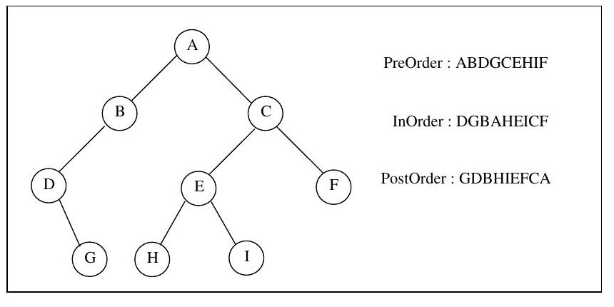

Bu yazı, EEM227 Veri Yapıları dersinin 3. hafta klasöründe kaynak olarak duran **"Veri Yapıları Ders Notları"**nı tanıtıyor. Notlar **Ege Üniversitesi Mühendislik Fakültesi Bilgisayar Mühendisliği Bölümü**'nden **Yrd. Doç. Dr. Aybars Uğur**'a ait (Ağustos 2002, Güz 2002–2003 dönemi, 86 sayfa). Belge uzun olduğu için aşağıda bölüm başlıkları, ana kavramlar ve birkaç kısa örnek aktarıldı. Orijinal PDF yazının sonunda indirilebilir.

*Bu içerik üçüncü taraf bir kaynağa aittir; arşiv ve nostalji amacıyla kaynak belirtilerek paylaşılmıştır. Hak sahibinin talebi hâlinde kaldırılır.*

## İçindekiler

| Bölüm | Sayfa |
|---|---|
| Veri Yapıları – Giriş | 1 |
| 1. C Programlama | 2 |
| 2. Java Programlama | 8 |
| 3. Özyineleme (Recursion) | 28 |
| 4. Ağaçlar (Trees) | 40 |
| 5. Yığıt (Stack) | 49 |
| 6. Kuyruklar (Queues) | 57 |
| 7. Listeler ve Bağlı Listeler (Linked Lists) | 60 |
| 8. Algoritmaların Karşılaştırılması | 67 |
| 9. Sıralama | 72 |
| 10. Çizgeler (Graphs) ve Uygulamaları | 78 |
| Java'da Hazır Veri Yapıları ve Koleksiyonlar (Ek) | 81 |

## Giriş: veri, yapı ve algoritma

- **Algoritma:** Bir problemin çözümünde kullanılan komutlar dizisi; bir programlama dilinde ifade edildiğinde *program* adını alır.
- **Veri:** Algoritmaların işlediği en temel elemanlar (sayısal ve metinsel bilgiler, resimler, sesler…).
- **Veri yapıları:** Verilerin düzenlenme biçimini belirleyen yapıtaşları. Yapı iyi tasarlandığında etkin, doğru, anlaşılır ve az kaynak kullanan algoritma geliştirmek kolaylaşır.
- Veri tipleri (tamsayı, gerçel sayı, karakter) → bileşik veri tipleri (dizi, yapı/kayıt) → veri yapıları (liste, yığıt, kuyruk, ağaç, çizge).
- **Liste** elemanları doğrusal sırada tutar, erişimde sınırlama yoktur; **yığıt** LIFO, **kuyruk** FIFO erişimli listelerdir. Veri yapıları statik ve dinamik olarak ikiye ayrılır.

## Bölüm 1: C programlama örnekleri

Ders, veri yapılarına geçmeden önce C ile temel örnekleri tekrar ediyor: ekrana yazdırma, iki tamsayıyla dört işlem ve kalan, −1 girilene kadar not okuyup sınıf ortalaması bulma, `kare` fonksiyonu, kabarcık sıralaması (Bubble Sort), `strcpy`/`strncpy` ve `strcat`/`strncat` ile karakter dizisi işlemleri, iki boyutlu diziler ve karakter dizilerini seçmeli sıralama (Selection Sort) ile alfabetik sıraya dizme.

```
Veriler orjinal sıralarında listeleniyor
   2   6   4   8  10  12  89  68  45  37
Sıralanmış veriler listeleniyor
   2   4   6   8  10  12  37  45  68  89
```

## Bölüm 2: Java programlama

### Java Programlama I

`javac Ornek1.java` ile derleme (byte code, `Ornek1.class`) ve `java Ornek1` ile çalıştırma; ardından değişkenler, metotlar, diziler, denetim yapıları ve GUI örnekleri: dizi elemanlarını toplayan metot, String dizisini tersten listeleme, dizide isim arama (`equals`), 2×4 matris listeleme, String ile karakter dizisi farkı, `indexOf`, `substring`, `concat` gibi String işlemleri, `JOptionPane` ile girdi ve mesaj kutuları, zarın 1000 kez atılıp yüzlerin frekansının `JTextArea`'da gösterilmesi, `JApplet` örnekleri ve applet içinde Bubble Sort.

```java
public static boolean ara(String dizi[], String aranan)
{
    for(int i=0; i<dizi.length; ++i)
        if(aranan.equals(dizi[i])) return true;
    return false;
}
```

Bölümün sonunda alıştırmalar var: bir ismin dizide kaçıncı eleman olduğunu ve kaç kez tekrarlandığını bulma, sıralı diziden sayı silme ve sıralı diziye sayı ekleme, iki matrisi toplama, satır toplamlarını diziye aktarma.

### Java Programlama II: nesneye yönelik programlama

`Yolcu` sınıfı üzerinden temel terimler:

- **Sınıf (class):** Soyut bir veri tipinin hem verilerini hem de bu veriler üzerindeki işlemleri bir araya getirir.
- **Nesne (object):** Sınıf tipindeki değişken (`yolcu1`).
- **Metot:** Bir işlemi gerçekleştiren sınıf üyesi; **yapıcı metot (constructor)** nesne `new` ile yaratılırken çağrılır ve sınıfla aynı adı taşır.
- **Sınıf üyeleri:** Değişkenler (`ad`, `soyad`, `yasi`) ve metotlar.

Ardından `java.util.Vector` örnekleri (`addElement`, `elementAt`, `Enumeration` ile dolaşma), Yolcu nesnelerini vektörde tutma ve `JFrame`/`JButton`/`GridLayout` ile basit bir telefon tuş takımı arayüzü geliyor.

## Bölüm 3: Özyineleme (recursion)

Kendini doğrudan ya da dolaylı olarak çağıran fonksiyonlara özyineli fonksiyon denir. Notlarda işlenen örnekler:

- **Faktöryel:** n! = 1 (n = 0), n! = n·(n − 1)! (n > 0). Yinelemeli ve özyineli C sürümleri; her çağrıda yerel değişkenlerin yığıta konması; `fact(-1)` gibi hatalı çağrıların denetimi.
- **Fibonacci dizisi:** fib(n) = n (n = 0 ya da 1), fib(n) = fib(n − 2) + fib(n − 1) (n ≥ 2); 0, 1, 1, 2, 3, 5, 8, 13, 21, 34, …
- **İkili arama (binary search):** Sıralı dizinin ortasına bakıp uygun yarıda aramayı sürdürme. 1, 3, 4, 5, 17, 18, 31, 33 dizisinde 17 aranırken mid = 3 (5), mid = 5 (18), mid = 4 (17) adımları.
- **Hanoi kuleleri:** n − 1 diski yardımcı kuleye taşı, en büyük diski hedefe koy, n − 1 diski hedefe taşı.
- **Bağlı listeyi ters sırada yazdırma** (RevPrint) ve **özyineleme zinciri** (a'nın b'yi, b'nin a'yı çağırması).

```c
void towers(int n, char frompeg, char topeg, char auxpeg)
{
    if(n==1) {
        printf("\n%d%s%c%s%c%s",n,". diski ",frompeg," kulesinden alıp ",
               topeg," kulesine yerleştir");
        return;
    }
    towers(n-1, frompeg, auxpeg, topeg);   // n-1 diskin yardımcı kuleye konulması
    printf("\n%d%s%c%s%c%s",n,". diski ",frompeg," kulesinden alıp ",
           topeg," kulesine yerleştir");
    towers(n-1, auxpeg, topeg, frompeg);   // n-1 diskin hedef kuleye konulması
}
```

n = 3 için çıktı:

```
1. diski A kulesinden alıp C kulesine yerleştir
2. diski A kulesinden alıp B kulesine yerleştir
1. diski C kulesinden alıp B kulesine yerleştir
3. diski A kulesinden alıp C kulesine yerleştir
1. diski B kulesinden alıp A kulesine yerleştir
2. diski B kulesinden alıp C kulesine yerleştir
1. diski A kulesinden alıp C kulesine yerleştir
```

**Özyineleme ve iterasyon:** Yinelemeli sürüm zaman ve yer bakımından genelde daha etkindir (her çağrıda giriş/çıkış yükü olmaz). Buna karşın yapısı uygun problemlerde özyineleme daha doğaldır; yığıt gerektiren durumlarda özyinelemesiz çözüm yazmak zorlaşır. İterasyon döngü koşulu bozulunca, özyineleme en basit duruma (base case) ulaşınca sonlanır.

## Bölüm 4: Ağaçlar

Bağlı listeler, yığıtlar ve kuyruklar doğrusal; ağaçlar doğrusal olmayan, iki boyutlu veri yapılarıdır. Tanımlar: **ikili ağaç** (her düğüm en fazla iki düğüme bağlı), **düğüm**, **kök** (düzey 0), **çocuk**, **parent**, **düzey/derinlik**, **ağacın derinliği**, **yaprak**, **kardeş**, **ancestor/descendant**, **full binary tree** (n yapraklı ise 2n − 1 düğüm), **complete binary tree**, **genel ağaç** ve **ikili arama ağacı** (soldaki tüm anahtarlar kökten küçük, sağdakiler büyük).

### Dolaşma (traversal)

1. **Preorder:** köke uğra, sol alt ağacı dolaş, sağ alt ağacı dolaş.
1. **Inorder:** sol alt ağaç, kök, sağ alt ağaç.
1. **Postorder:** sol alt ağaç, sağ alt ağaç, kök.



PreOrder: ABDGCEHIF, InOrder: DGBAHEICF, PostOrder: GDBHIEFCA.

### İkili arama ağaçları

47, 25, 43, 77, 65, 68, 93, 11, 17, 44, 31, 7 sırasıyla eklenince oluşan ağaç:

```
                47
           /          \
         25            77
        /   \         /   \
      11     43     65     93
     /  \   /  \      \
    7   17 31   44     68
```

44 aranırken 47 → 25 → 43 → 44 (4 karşılaştırma, bulundu); 90 aranırken 47 → 77 → 93 → NULL (bulunamadı). Ağaç dengeli tutulursa n elemanda en fazla log₂n düzey olur; 1000 elemanlı ağaçta en fazla 10 karşılaştırma yeter (2¹⁰ = 1024 > 1000), bağlı listede ise 1000 gerekebilir. n düğümlü complete binary tree'nin derinliği d = log₂(n + 1) − 1'dir (15 düğümde 3). İkili arama ağacı inorder dolaşılınca elemanlar küçükten büyüğe sıralı gelir; ağaç tekrar eden verileri önlemek için de kullanışlıdır. Bölüm, `TreeNode`/`Tree` sınıflarıyla ekleme ve üç dolaşmayı yapan bir Java programıyla bitiyor.

## Bölüm 5: Yığıt (stack)

Eleman ekleme ve çıkarmanın en üstten (top) yapıldığı veri yapısı: **LIFO** (Last In First Out). İşlemler: **push(s, i)**, **i = pop(s)**, **empty(s)**, **stacktop(s)** (peek). Boş yığıttan eleman çıkarmaya çalışmak **underflow** durumudur; önce `empty(s)` denetlenmelidir.

- **Parantez denetimi:** İfade sonunda parantez sayısı 0 olmalı ve hiçbir noktada negatif olmamalı. Farklı parantez türleri ( ), [ ], { } varsa yığıt kullanılır: açılan parantez yığıta konur, kapanan parantezde yığıttan çıkarılıp eşleşmesine bakılır, sonda yığıt boş olmalıdır.
- **Java'da yığıt:** Dizi ile `StackChar` sınıfı ("Merhaba"yı tersten yazdırma) ve hazır `java.util.Stack` sınıfı.
- **Infix, postfix, prefix:** A+B infix, +AB prefix, AB+ postfix. İşlem önceliği: üs alma, çarpma/bölme, toplama/çıkarma; aynı öncelikte soldan sağa (üs almada sağdan sola). Örneğin A+B*C → ABC*+. Postfix gösterimde parantez gerekmez.
- **Postfix ifade değerlendirme:** Operand yığıta konur; operatörde üstteki iki eleman çıkarılıp işlem yapılır ve sonuç yığıta geri konur. 3*2+5*6 → "3 2 * 5 6 * +" → 36.
- **Fonksiyon çağrıları:** Derleyiciler çağıran fonksiyonun yerel değişkenlerini ve geri dönüş adresini yığıtta saklar.

## Bölüm 6: Kuyruklar (queues)

Ekleme sondan (rear), çıkarma baştan (front) yapılır: **FIFO**. Bankalardaki, gişelerdeki kuyrukların benzetimi, işlemci/yazıcı/disk iş sıraları ve ağlarda paket yönlendirme gibi alanlarda kullanılır. İşlemler: **insert(q, x)** (enqueue), **x = remove(q)** (dequeue).

**Öncelik kuyruğu:** Çıkarma sırası eklenme sırasına değil elemanların kendi sırasına göre belirlenir. Artan öncelik kuyruğunda en küçük (`pqmindelete`), azalan öncelik kuyruğunda en büyük eleman çıkarılır. Bölümde dairesel dizi kullanan bir `Kuyruk` Java sınıfı (`ekle`, `cikar`, `bosMu`) ve test programı var.

## Bölüm 7: Listeler ve bağlı listeler

Liste işlemleri: EmptyList, FullList, LengthList, InsertElement, DeleteElement, DestroyList, GetNextItem, RetrieveElement.

**Bağlı liste:** Her düğümde bilgi alanı ve bir sonraki düğümün adresi tutulur (self-referential structure); son düğümün `next` alanı NULL'dır. Dizilerdeki sabit bellek ayırma ve taşma sorunları ortadan kalkar; araya ekleme ve aradan silmede kaydırma gerekmez, ama n. elemana ulaşmak için önceki n − 1 düğümden geçmek gerekir.

- Öncelik kuyruğunun bağlı liste ile gerçekleştirimi (sıralı ve sırasız liste; sıralı tutmak daha etkin)
- Yığıt ve kuyrukların bağlı liste ile gerçekleştirimi
- **Dairesel bağlı liste**, **çift bağlı liste** ve **dairesel çift bağlı liste**
- Java'da `Dugum` ve `BListe` sınıfları: `basaEkle`, `bul`, `sil`, `listele`

```
Bastan Sona Liste :  1 2 3 4 5 6 7 8 9
5 Bulundu
Bastan Sona Liste :  1 2 3 4 6 7 8 9
```

## Bölüm 8: Algoritmaların karşılaştırılması

Bir programın performansı, işletimi için gereken zaman (**zaman karmaşıklığı**) ve bellek (**yer karmaşıklığı**) ile ölçülür. İşletim sürelerini ölçmek bilgisayara bağlı olduğundan, algoritmada egemen işlemin kaç kez tekrarlandığı sayılır (n elemanı toplamak için n − 1 toplama).

- **Worst-case running time:** Her girdi boyutunda en uzun süre; sıralı aramada T(n) ≤ n.
- **Average-case running time:** Tüm girdilerin ortalaması; sıralı aramada (n + 1)/2.
- **Big-O:** Fonksiyonun artış oranının üst sınırı; f(n) = n⁴ + 100n² + 10n + 50 = O(n⁴).
- 1'den n'e toplam: döngüyle O(n), n(n + 1)/2 formülüyle O(1).

| Fonksiyon | Ad | Örnek |
|---|---|---|
| 1 | sabit | dizinin i. elemanına atama |
| log n | logaritmik | sıralı dizide ikili arama |
| n | doğrusal | sıralı olmayan listede arama |
| n log n | n log n | hızlı sıralama algoritmaları |
| n² | ikinci dereceden | selection sort |
| n³ | kübik | üç boyutlu tablonun her elemanını artırma |
| 2ⁿ | üstel | |
| n! | faktöriyel | |

## Bölüm 9: Sıralama

Sıralama, elemanlar bellekteyse içsel (internal), bir kısmı ikincil bellekteyse dışsal (external) sıralamadır. Her duruma uyan evrensel bir yöntem olmadığından önce sıralamanın gerekip gerekmediğine, sonra yönteme karar verilir.

- **Bubble sort:** En fazla n − 1 tur; iyileştirilmemiş sürümde (n − 1)² karşılaştırma, O(n²). 25 57 48 37 12 92 86 33 verisi 5. turda sıralanıyor.
- **Quicksort:** Bir x elemanı seçilip küçükler soluna, büyükler sağına toplanır ve iki parça için tekrarlanır. Ortalama O(n log₂n), en kötü durumda O(n²).
- **Straight selection sort:** Toplam n(n − 1)/2 karşılaştırma, O(n²).
- **Simple insertion sort:** Veriler sıralıysa O(n), ters sıralıysa O(n²). Selection sort daha az atama ama daha çok karşılaştırma yapar; bağlı listelerde insertion sort mantığı uygundur. Yaklaşık 30 elemandan sonra quicksort daha etkindir.
- **Merge sort:** Sıralı iki grubu birleştirerek ilerler; log₂n tur, O(n log₂n) karşılaştırma, ama ek `aux` dizisi ve fazla atama gerektirir.

## Bölüm 10: Çizgeler (graphs)

Çizge G = (V, E): köşeler (vertices) ve köşeleri bağlayan kenarlardan (edges) oluşan, doğrusal olmayan veri yapısı. Tanımlar: yönsüz ve yönlü kenar, komşu köşeler, bağlantı (incident), köşe derecesi, indegree ve outdegree, yönsüz çizge, yönlü çizge (digraph), döngü (loop), ağırlıklı çizge, yol, basit yol, uzunluk, bağlı çizge, alt çizge, devir (cycle), ağaç (devir içermeyen yönsüz bağlı çizge), spanning tree, orman (forest), tam çizge (n(n − 1)/2 kenar) ve tam yönlü çizge (n(n − 1) kenar). Kullanım alanları: bilgisayar ağları, elektrik devreleri, molekül yapıları, ulaşım ağları, planlama.

*Not: Belgede bağlı çizge "her köşe çifti arasında en az bir yol olan ağaç" diye tanımlanmış; doğrusu "…olan **çizge**"dir (ağaç, devir içermeyen bağlı çizgedir).*

## Ek: Java'da hazır veri yapıları ve koleksiyonlar

`java.util` paketindeki koleksiyon arayüzleri: **List** (sıralı, tekrar içerebilir; `ArrayList`, `LinkedList`, `Vector`), **Set** (tekrarsız; `HashSet`, `TreeSet`) ve **Map**. Örnekler: `Arrays.sort` ve `Arrays.binarySearch` ile sıralama ve ikili arama (sıralı 1, 2, 4, 6, 7, 8, 9, 11, 15 dizisinde 4'ün konumu 2), `TreeSet` ile sıralı küme (`headSet`, `tailSet`, `first`, `last`).

```
Set:
black green grey orange red tan white yellow
orange'dan öncekiler :black green grey
orange'dan sonrakiler:orange red tan white yellow
İlk eleman :black
Son eleman :yellow
```
