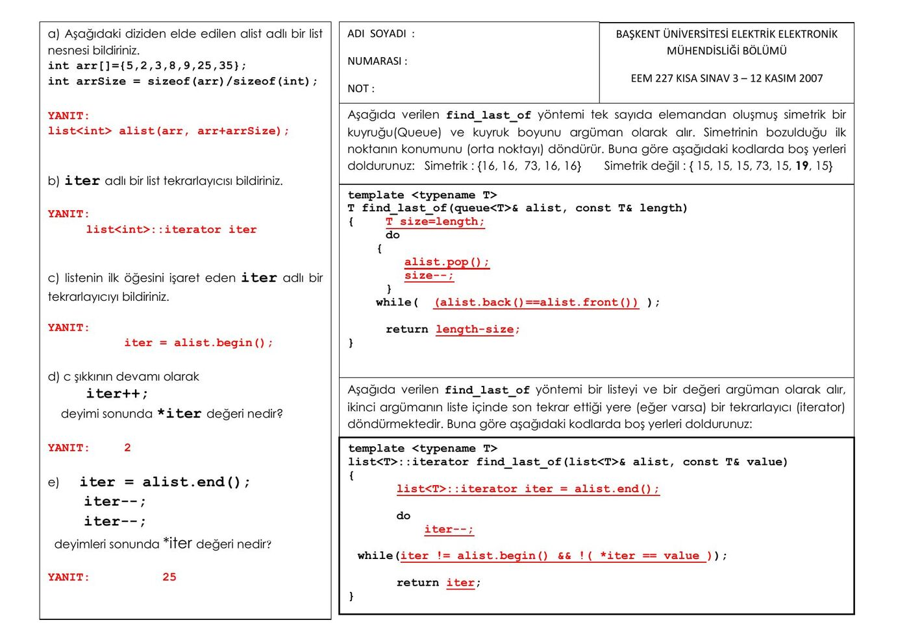

This post contains two quizzes from the Fall 2007 semester of the **EEM227 Data Structures** course at Başkent University. **Quiz 2** (October 2007) is the blank exam paper: fill-in-the-blank questions on the copy constructor, operator overloading, and vector operations in C++. **Quiz 3** (November 12, 2007) comes with an answer key: the STL list object, iterators, and template functions. The original PDFs of the exam papers can be downloaded as a ZIP at the end of the post.

## Quiz 2

At the top of the paper there are "Name Surname" and "Number" fields. Instructions: **Fill in the missing parts appropriately.** The dotted places and the empty function bodies are the parts the student is expected to fill in.

```cpp
#include <iostream>
using namespace std;
class deneme
{
private:
        int x,y;
public:

deneme(......................................);
//copy constructor

deneme();
// constructor without parameters

deneme(......................................);
// constructor with parameters

 .............................................;
// destructor

deneme& deneme::operator+(...................);
// overloading for the + operator

..... ostream& operator<<(................................);

..... istream& operator>>(................................);
};

istream& operator>>(......................................)
{
  oku>>nesne.x>>nesne.y;
  return oku;
}

ostream& operator<<(........................................)
{ yaz<<nesne.x<<':'<<nesne.y<<endl;
   return yaz; }

// overloading for the + operator
.............................................(deneme& s)
{
   [empty box]
}

deneme::deneme(int a,int b) // constructor with parameters
{
   [empty box]
}

deneme::deneme()
   {
     x=5;
     y=10;
   }

deneme::deneme(deneme &alias)// copy constructor
{
   [empty box]
}

deneme::~deneme()
{ cout<<"Yikici fonksiyon calisti.."; }

int main()
{ deneme d,e;

 ..............;
// create the object c, constructed with the values 3 and 2
  e=d+c;

 e=..............;
// express the operation in the line above in a different way

 ................;
// create an object named x
  d=c;

   x=....................;
// write the operation that can add the objects d and c

return 0;
}
```

The class in the quiz is the same as the `deneme` class in the Week 3 lecture notes (the example with a copy constructor, the + operator, and the << and >> operators overloaded); the answers to the blanks can be seen in that example. For instance, the copy constructor is `deneme(deneme &)`, the destructor is `~deneme()`, and the stream operators are declared as `friend`; in `main`, one writes `deneme c(3,2);`, `e=d.operator+(c);`, `deneme x;`, and `x=d+c;`.

### Question 1: vector operations

The following code is given. What should go in the blanks next to the code?

```cpp
int arr[]={3,5,2,7,9};
int arrSize = sizeof(arr)/sizeof(int);
vector<int> v, w(arr, arr+arrSize);
v.push_back(8); // v=(8), w={3,5,2,7,9}
v.push_back(10); // v = {8,10}, w={3,5,2,7,9}
w.pop_back(); // v = {8,10}, w={3,5,2,7}
w.pop_back(); // v = {8,10}, w = {3,5,2}
cout << v.back(); // Output: 10
cout << w.size(); // Output: 3
w.push_back(18); // v = {8,10}, w = {3,5,2,18}
w.resize(7); // v = {8,10}, w = {3,5,2,18,0,0,0}
```

On the paper, the values in the comment lines (the contents of the vectors at each step and the outputs) are written out.

## Quiz 3 (November 12, 2007) and its answers



### List and iterator questions

**a)** Declare a list object named `alist` created from the following array.

```cpp
int arr[]={5,2,3,8,9,25,35};
int arrSize = sizeof(arr)/sizeof(int);
```

Answer: `list<int> alist(arr, arr+arrSize);`

**b)** Declare a list iterator named `iter`.

Answer: `list<int>::iterator iter`

**c)** Declare an iterator named `iter` that points to the first element of the list.

Answer: `iter = alist.begin();`

**d)** Continuing from part c, what is the value of `*iter` after the statement `iter++;`?

Answer: **2**

**e)** What is the value of `*iter` after the statements `iter = alist.end(); iter--; iter--;`?

Answer: **25**

### find_last_of on a symmetric queue

The `find_last_of` method given below takes as arguments a queue consisting of an odd number of elements, which is symmetric, and the queue length. It returns the position of the first point where the symmetry breaks (the middle point). Accordingly, fill in the blanks in the following code. Symmetric: {16, 16, 73, 16, 16}; not symmetric: {15, 15, 15, 73, 15, 19, 15}.

The version filled in with the answers:

```cpp
template <typename T>
T find_last_of(queue<T>& alist, const T& length)
{     T size=length;
      do
      {
          alist.pop();
          size--;
      }
      while( (alist.back()==alist.front()) );

      return length-size;
}
```

For example, for {16, 16, 73, 16, 16}, after two elements are removed the front of the queue holds 73, and since the front and back elements are no longer equal, the loop ends; the function returns 5 – 3 = 2, that is, the position of 73.

### Last occurrence of a value in a list

The `find_last_of` method given below takes a list and a value as arguments and returns an iterator to the place where the second argument last occurs in the list (if it exists). Accordingly, fill in the blanks in the following code.

The version filled in with the answers:

```cpp
template <typename T>
list<T>::iterator find_last_of(list<T>& alist, const T& value)
{
       list<T>::iterator iter = alist.end();

       do
           iter--;

  while(iter != alist.begin() && !( *iter == value ));

       return iter;
}
```

The list is scanned from back to front; the scan stops when the sought value is encountered or the beginning of the list is reached.

*Note: If the value is not in the list at all, the function returns `alist.begin()`; the caller must separately check whether the value at the returned position is actually the sought value. Also, because the type is dependent within a template, `typename list<T>::iterator` must be written in current compilers.*
