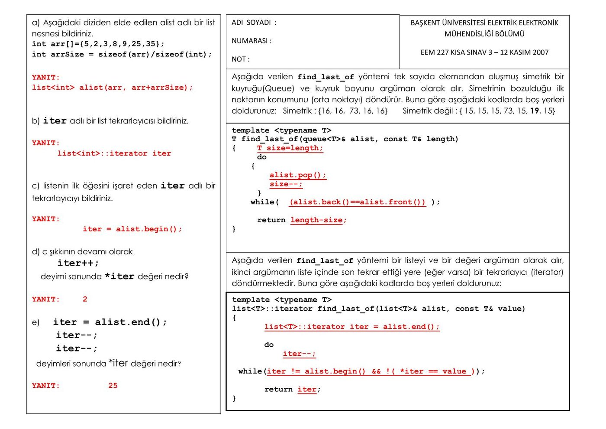

Bu yazı, Başkent Üniversitesi **EEM227 Veri Yapıları** dersinin 2007 güz döneminde yapılan iki kısa sınavını içeriyor. **Kısa Sınav 2** (Ekim 2007) boş sınav kâğıdıdır: C++'ta kopyalama kurucusu, operatör yükleme ve vector işlemleri üzerine boşluk doldurma soruları. **Kısa Sınav 3** (12 Kasım 2007) ise cevap anahtarıyla birlikte: STL list nesnesi, tekrarlayıcılar (iterator) ve şablon fonksiyonlar. Sınav kâğıtlarının orijinal PDF'leri yazının sonunda ZIP olarak indirilebilir.

## Kısa Sınav 2

Kâğıdın başında "Adı Soyadı" ve "Numarası" alanları var. Yönerge: **Eksik bırakılan yerleri uygun şekilde doldurunuz.** Noktalı yerler ve boş bırakılan fonksiyon gövdeleri öğrencinin dolduracağı kısımlar.

```cpp
#include <iostream>
using namespace std;
class deneme
{
private:
        int x,y;
public:

deneme(......................................);
//kopyalama kurucusu (copy constructor)

deneme();
// parametresiz kurucu fonksiyon (constructor)

deneme(......................................);
// parametreli kurucu fonksiyon

 .............................................;
// yıkıcı(destructor)

deneme& deneme::operator+(...................);
// + operatorü için overloading

..... ostream& operator<<(................................);

..... istream& operator>>(................................);
};

istream& operator>>(......................................)
{
  oku>>nesne.x>>nesne.y;
  return oku;
}

ostream& operator<<(........................................)
{ yaz<<nesne.x<<':'<<nesne.y<<endl;
   return yaz; }

// + operatorü için overloading
.............................................(deneme& s)
{
   [boş kutu]
}

deneme::deneme(int a,int b) // parametreli kurucu fonksiyon
{
   [boş kutu]
}

deneme::deneme()
   {
     x=5;
     y=10;
   }

deneme::deneme(deneme &alias)// kopyalama kurucusu
{
   [boş kutu]
}

deneme::~deneme()
{ cout<<"Yikici fonksiyon calisti.."; }

int main()
{ deneme d,e;

 ..............;
// 3 ve 2 değerleri ile kurulan c nesnesini yaratın
  e=d+c;

 e=..............;
// üst satırdaki işlemi farklı şekilde ifade edin

 ................;
// x isimli bir nesne yaratın
  d=c;

   x=....................;
// d ve c nesnesini toplayabilen işlemi yazın

return 0;
}
```

Sınavdaki sınıf, 3. hafta ders notundaki `deneme` sınıfının (kopyalama kurucusu, + operatörü ve << >> operatörleri yüklenmiş örnek) aynısı; boşlukların cevapları o örnekte görülebilir. Örneğin kopyalama kurucusu `deneme(deneme &)`, yıkıcı `~deneme()`, stream operatörleri `friend` olarak bildiriliyor; `main` içinde `deneme c(3,2);`, `e=d.operator+(c);`, `deneme x;` ve `x=d+c;` yazılıyor.

### Soru 1: vector işlemleri

Aşağıdaki kodlar veriliyor. Kodların yanlarında verilen boş yerlere ne gelmelidir?

```cpp
int arr[]={3,5,2,7,9};
int arrSize = sizeof(arr)/sizeof(int);
vector<int> v, w(arr, arr+arrSize);
v.push_back(8); // v=(8), w={3,5,2,7,9}
v.push_back(10); // v = {8,10}, w={3,5,2,7,9}
w.pop_back(); // v = {8,10}, w={3,5,2,7}
w.pop_back(); // v = {8,10}, w = {3,5,2}
cout << v.back(); // Output: 10
cout << w.size(); // Output: 3
w.push_back(18); // v = {8,10}, w = {3,5,2,18}
w.resize(7); // v = {8,10}, w = {3,5,2,18,0,0,0}
```

Kâğıtta yorum satırlarındaki değerler (vektörlerin her adımdaki içeriği ve çıktılar) yazılı olarak duruyor.

## Kısa Sınav 3 (12 Kasım 2007) ve cevapları



### List ve tekrarlayıcı soruları

**a)** Aşağıdaki diziden elde edilen `alist` adlı bir list nesnesi bildiriniz.

```cpp
int arr[]={5,2,3,8,9,25,35};
int arrSize = sizeof(arr)/sizeof(int);
```

Yanıt: `list<int> alist(arr, arr+arrSize);`

**b)** `iter` adlı bir list tekrarlayıcısı bildiriniz.

Yanıt: `list<int>::iterator iter`

**c)** Listenin ilk öğesini işaret eden `iter` adlı bir tekrarlayıcıyı bildiriniz.

Yanıt: `iter = alist.begin();`

**d)** c şıkkının devamı olarak `iter++;` deyimi sonunda `*iter` değeri nedir?

Yanıt: **2**

**e)** `iter = alist.end(); iter--; iter--;` deyimleri sonunda `*iter` değeri nedir?

Yanıt: **25**

### Simetrik kuyrukta find_last_of

Aşağıda verilen `find_last_of` yöntemi tek sayıda elemandan oluşmuş simetrik bir kuyruğu (queue) ve kuyruk boyunu argüman olarak alır. Simetrinin bozulduğu ilk noktanın konumunu (orta noktayı) döndürür. Buna göre aşağıdaki kodlarda boş yerleri doldurunuz. Simetrik: {16, 16, 73, 16, 16}; simetrik değil: {15, 15, 15, 73, 15, 19, 15}.

Cevaplarla doldurulmuş hâli:

```cpp
template <typename T>
T find_last_of(queue<T>& alist, const T& length)
{     T size=length;
      do
      {
          alist.pop();
          size--;
      }
      while( (alist.back()==alist.front()) );

      return length-size;
}
```

Örneğin {16, 16, 73, 16, 16} için iki eleman çıkarıldıktan sonra kuyruğun başında 73 kalır ve baştaki ile sondaki eleman artık eşit olmadığından döngü biter; fonksiyon 5 – 3 = 2 döndürür, yani 73'ün konumunu.

### Listede bir değerin son geçtiği yer

Aşağıda verilen `find_last_of` yöntemi bir listeyi ve bir değeri argüman olarak alır, ikinci argümanın liste içinde son tekrar ettiği yere (eğer varsa) bir tekrarlayıcı (iterator) döndürmektedir. Buna göre aşağıdaki kodlarda boş yerleri doldurunuz.

Cevaplarla doldurulmuş hâli:

```cpp
template <typename T>
list<T>::iterator find_last_of(list<T>& alist, const T& value)
{
       list<T>::iterator iter = alist.end();

       do
           iter--;

  while(iter != alist.begin() && !( *iter == value ));

       return iter;
}
```

Liste sondan başa doğru taranıyor; aranan değere rastlanınca ya da listenin başına gelinince duruluyor.

*Not: Değer listede hiç yoksa fonksiyon `alist.begin()` döndürür; çağıran tarafın, dönen konumdaki değerin gerçekten aranan değer olup olmadığını ayrıca kontrol etmesi gerekir. Ayrıca şablon içinde bağımlı tür olduğu için güncel derleyicilerde `typename list<T>::iterator` yazılmalıdır.*
