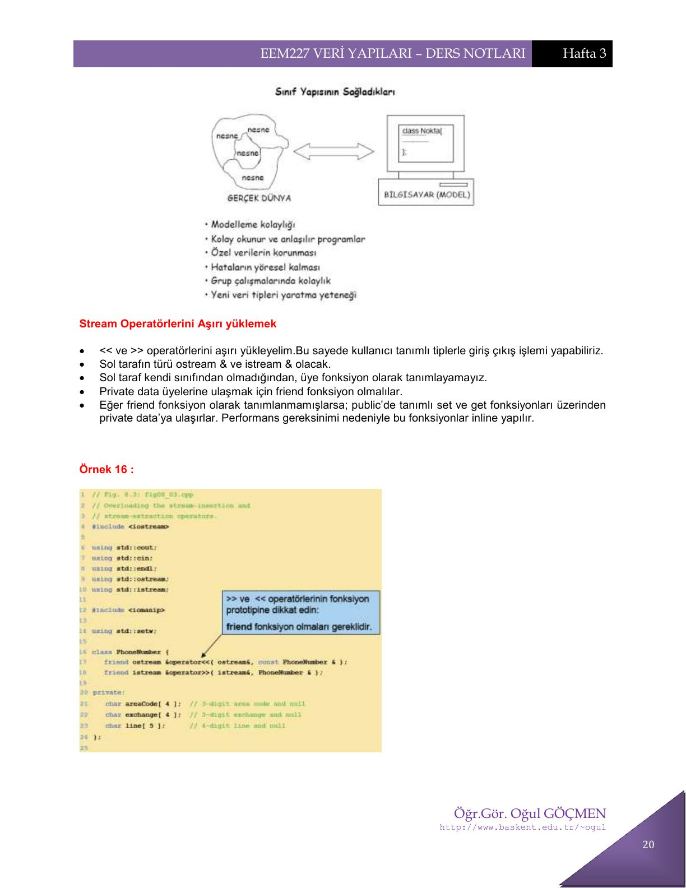
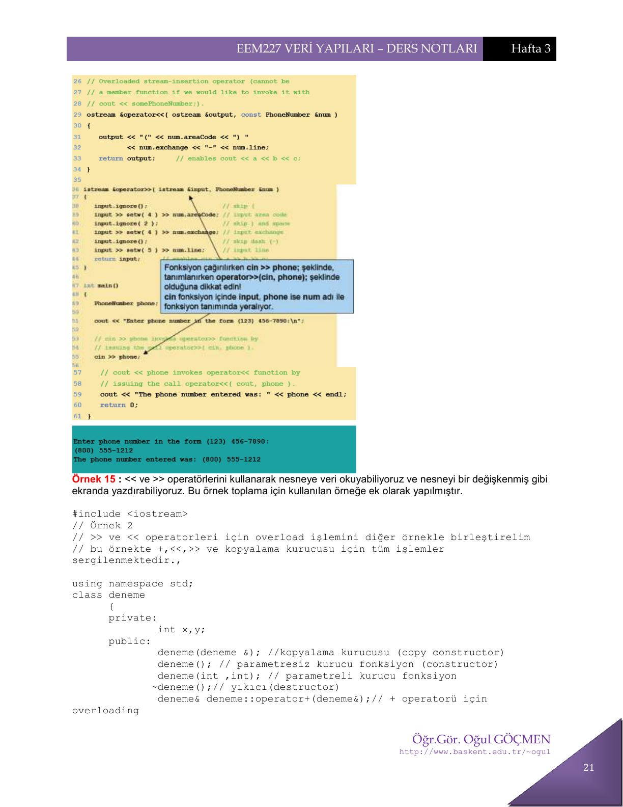

This post is the week 3 lecture note of the Başkent University **EEM227 Data Structures** course, fall semester 2007. It was prepared by **Lecturer Oğul Göçmen**, dated 5 October 2007. That year the course was taught in C++ (the 2014 EEM227 posts in the archive belong to the Java era). The topic is **operator overloading** in C++. The explanations and example programs from the notes are given below as text. The original PDF of the lecture note can be downloaded at the end of the post.

## What is operator overloading?

In C++, you can write functions for the built-in operators (+, -, *, /, !, <<, ++, etc.) so that these operators perform operations you define. Operator functions can also be members of a class. This way, operators that act on objects created from that class are defined. In C++, using an operator corresponds to a function call. Everything that can be done by overloading operators can also be done with ordinary functions. Using operators instead of function names can make a program easier to write and read. For this reason, overloading an operator should be preferred if it will make the program easier to read and understand.

### Restrictions

- Operators that do not exist in C++ cannot be overloaded. For example, no function can be assigned to the `^` symbol or the `**` symbol for exponentiation.
- Some of the operators that exist in C++ cannot be overloaded either. These are: the dot operator `.`, the scope resolution operator `::`, the conditional operator `? :` and the size operator `sizeof`.
- C++ operators can be divided into two groups: unary and binary. Unary operators take a single operand (for example `-a`, `a++`, `!a`); binary operators take two operands (such as `a+b`, `a/b`).
- The number of operands cannot be changed when overloading operators.
- The precedence of operators cannot be changed.
- Operators that act on the compiler's built-in data types cannot be overloaded. For example, the + operator that adds two integers cannot be changed.
- At least one operand of a created operator must be of a class type.

### Operator functions: member or friend?

- If the `( )`, `[ ]`, `->` or assignment operators are being overloaded, a member function must be used.
- If a member function is used, the left side of the operator must be an object of its own class. If the left side is not an object of its own class, the operator function cannot be a member.
- If it will not be a member function and it needs to access public or private members, it must be a friend function; it must have the right to access its operands.

## Copy constructor

Before starting on these operations, let us get to know the copy constructor. The copy constructor is another kind of constructor function. Its only difference is that it lets us create a new object of the class using the values of an object created before it; it is a kind of cloning. The rule for overloaded functions defined within a class applies here too: depending on how you create the object, the compiler automatically determines which constructor will run.

### Example 1

```cpp
#include <iostream>
// Bu örnek içerisinde copy constructor kullanımı gösterilmiştir...
using namespace std;
class deneme
      {
      private:
              int x,y;
      public:
              deneme(deneme &); //kopyalama kurucusu (copy constructor)
              deneme(); // parametresiz kurucu fonksiyon (constructor)
              deneme(int ,int); // parametreli kurucu fonksiyon
             ~deneme();// yıkıcı(destructor)
      };
deneme::deneme(int a,int b)
{
     cout<<"Parametreli kurucu fonksiyon calisti.."<<endl;
     x=a;
     y=b;
     cout<<"x="<<x<<endl;
     cout<<"y="<<y<<endl;
}
deneme::deneme()
   {
     cout<<"Kurucu fonksiyon calisti.."<<endl;
     x=5;
     y=10;
     cout<<"x="<<x<<endl;
     cout<<"y="<<y<<endl;
   }
deneme::deneme(deneme &alias)
{
   cout<<"Kopyalama kurucusu calisti"<<endl;
   x=alias.x;
   y=alias.y;
   cout<<"x="<<x<<endl;
   cout<<"y="<<y<<endl;
}
deneme::~deneme()
{
   cout<<"Yikici fonksiyon calisti..";
}
int main()
{
      cout<<"d diye bir nesne yaratacagim ve c de onun kopyasi olacak\n";
      deneme d,c(d); // c nesnesi d nin değerleri ile doğuyor...
      cout<<"simdi e yi c nesnesini kullanarak kopyaliyoruz...\n";
      deneme e(c); // e nesnesi kopyalanmış c den doğdu.
      cout<<"alt kisimda f nesnesini 3 ve 4 ilk degerleri ile yaratiyoruz..\n";
      deneme f(3,4); // parametre alarak yaratılan f nesnesi
      cout<<"g nesnesi ise f den kopyalaniyor, klonlaniyor...\n";
      deneme g(f); // ve görüldüğü gibi bunun kopyası olan g...
// dikkat ! nesnenin yaşam alanı biterse yıkıcı fonksiyon çalışacak ve
// nesneyi hafızadan silecektir, kopyalama kurucusunu kullanırken buna
// dikkat etmeyi unutmayınız...
      system("pause");
      return 0;
      }
```

Program output:

```
d diye bir nesne yaratacagim ve c de onun kopyasi olacak
Kurucu fonksiyon calisti..
x=5
y=10
Kopyalama kurucusu calisti
x=5
y=10
simdi e yi c nesnesini kullanarak kopyaliyoruz...
Kopyalama kurucusu calisti
x=5
y=10
alt kisimda f nesnesini 3 ve 4 ilk degerleri ile yaratiyoruz..
Parametreli kurucu fonksiyon calisti..
x=3
y=4
g nesnesi ise f den kopyalaniyor, klonlaniyor...
Kopyalama kurucusu calisti
x=3
y=4
Press any key to continue . . .
```

## Overloading unary operators

Examples of unary operators: increment (`++`), decrement (`--`), negation (`-5`), logical complement (`!`), etc. When the functions for these operators are written as members of a class, they take no parameters, because they operate on the object on which they are called. These operators normally appear to the left of the object: `!n`, `-n`, `++n`.

### Example 2: prefix ++ that returns no value

This program increments the value as a prefix, but since the function is void it cannot return a value.

```cpp
// countpp1.cpp
// ++ operatörü ile değer arttırma. Ör: ++sayac
#include <iostream>
using namespace std;
////////////////////////////////////////////////////////////////
class Counter
   {
   private:
      unsigned int count;              //count
   public:
      Counter() : count(0)             //constructor
         { }
      unsigned int get_count()         //return count
         { return count; }
      void operator ++ ()              //arttır ön ek (prefix)
         {
         ++count;
         }
   };
////////////////////////////////////////////////////////////////
int main()
   {
   Counter c1, c2;                     //define and initialize
   cout << "\nc1=" << c1.get_count();             //göster
   cout << "\nc2=" << c2.get_count();
   ++c1;                                //increment c1
   ++c2;                                //increment c2
   ++c2;                                //increment c2
   cout << "\nc1=" << c1.get_count(); //tekrar göster
   cout << "\nc2=" << c2.get_count() << endl;
   system("pause");
   return 0;
   }
```

```
c1=0
c2=0
c1=1
c2=2
```

One disadvantage of this example is that an assignment such as `c2=++c1` cannot be performed. Let us see how to solve this.

### Example 3: incrementing with ++ and returning the value

```cpp
#include <iostream>
using namespace std;
class Counter
   {
   private:
      unsigned int count;               //count
   public:
      Counter() : count(0)              //constructor
           { }
        unsigned int get_count() //return count
           { return count; }
        Counter operator ++ ()           //increment count
           {
           ++count;                      //increment count
           Counter temp;                 //make a temporary Counter
           temp.count = count;           //give it same value as this obj
           return temp;                  //return the copy
           }
   };
int main()
   {
   Counter c1, c2;                                 //c1=0, c2=0
   cout << "\nc1=" << c1.get_count();              //display
   cout << "\nc2=" << c2.get_count();
   ++c1;                                           //c1=1
   c2 = ++c1;                                      //c1=2, c2=2 Artık bu tarz işlem OK!
   cout << "\nc1=" << c1.get_count();    //display again
   cout << "\nc2=" << c2.get_count() << endl;
   return 0;
   }
```

```
c1=0
c2=0
c1=2
c2=2
```

### Example 4: returning an unnamed temporary object

The way to solve this problem at its root is to increment the `count` variable with the ++ operator, pass the value on, and use unnamed temporary objects. Here, a constructor that takes a value was added as well.

```cpp
// countpp3.cpp
#include <iostream>
using namespace std;
////////////////////////////////////////////////////////////////
class Counter
   {
   private:
      unsigned int count;        //count değişkeni
   public:
      Counter() : count(0)    //constructor değer almayan {count=0;} ile aynı
         { }
      Counter(int c)            //constructor, bir değer alan
         { count=c; }
      int get_count()            //return count
         { return count; }
      Counter operator ++ ()     //count değerini arttır
         {
         ++count;                // count değerini arttır ve
         return Counter(count); // geçici bir tampon obje döndür
         }                       // ve objeyi tek değer alan kurucu ile kur
   };
////////////////////////////////////////////////////////////////
int main()
   {
   Counter c1, c2;                                    //c1=0, c2=0
    cout << "\nc1=" << c1.get_count();                //göster
    cout << "\nc2=" << c2.get_count();
    ++c1;                                             //c1=1
    c2 = ++c1;                                        //c1=2, c2=2
    cout << "\nc1=" << c1.get_count();    //tekrar göster
    cout << "\nc2=" << c2.get_count() << endl;
    return 0;
    }
```

```
c1=0
c2=0
c1=2
c2=2
```

### Prefix and postfix for the ++ operator (++i, i++)

In the class below, the ++ operator is overloaded as both prefix and postfix and returns the value; assignments such as `c2=++c1;` or `c2=c1++;` can be performed.

```cpp
#include <iostream>
using namespace std;
class Counter
   {
   private:
      unsigned int count;         //count
   public:
      Counter() : count(0)        //constructor no args
         { }
      Counter(int c) : count(c)   //constructor, one arg
         { }
      unsigned int get_count() const //return count
         { return count; }
        Counter operator ++ ()      //count değerini arttır (prefix)
           {
           return Counter(++count); //isimsiz geçici obje döndür
           }                        //ve count değerini initialize et
        Counter operator ++ (int)   //(postfix)
           {                        //isimsiz geçici obje döndür
           return Counter(count++); //bu count değeri ile objeyi initialize et
           }                        //count değerini arttır
   };
int main()
   {
   Counter c1, c2;                                    //c1=0, c2=0
   cout << "\nc1=" << c1.get_count();                 //display
   cout << "\nc2=" << c2.get_count();
   ++c1;                                              //c1=1
   c2 = ++c1;                                         //c1=2, c2=2 (prefix)
   cout << "\nc1=" << c1.get_count();    //display
   cout << "\nc2=" << c2.get_count();
   c2 = c1++;                            //c1=3, c2=2 (postfix)
   cout << "\nc1=" << c1.get_count();    //display again
   cout << "\nc2=" << c2.get_count() << endl;
   return 0;    }
```

```
c1=0
c2=0
c1=2
c2=2
c1=3
c2=2
```

### Example 5: ++ that increments the real part of a complex number

In the following example, the ++ operator is given the function of increasing the real part of a complex number by 0.1.

```cpp
void ComplexT::operator++()
{
  re=re+0.1;
}
int main()
{
ComplexT z(1.2, 0.5);
++z; // operator++ fonksiyonu canlanir
z.goster();
return 0;
}
```

### Example 6: returning a reference to the object

If this operator is to be used in an assignment statement, the function for the operator must return a reference to the object (in addition to the usage in Example 4, it can also be done this way).

```cpp
  //  ++ operatörüne yeni bir işlev yüklenmesi
  // Operatör karmaşık sayıların reel kısmını 0.1 kadar arttırmaktadır.
  #include <iostream>
  using namespace std;
  // Karmaşık (Kompleks) sayıları tanımlamak için oluşturulan sınıf
  class ComplexT{
      double re,im;            // reel ve sanal kısımlar
   public:
      ComplexT(double re_in=0,double im_in=1): re(re_in),im(im_in)
          {};                  // Kurucu (gövdesi boş)
       const ComplexT& operator++( );      // ++ Operatörü
       void goster() const;
  };
  // ++ operatörü
  // Karmaşık sayıların reel kısmını 0.1 kadar arttırmaktadır.
  const ComplexT & ComplexT::operator++()
  {
     re=re+0.1;                 // reel kısım arttırılıyor
     return *this;              // Nesnenin referansı döndürülüyor
  }
  // Nesne ile ilgili bilgileri ekrana çıkaran metot
  void ComplexT::goster() const
  {
    cout << "re=" << re << " im=" << im << endl;
  }
  //---- Ana Program -----
  int main()
  {
    ComplexT z1(1.2,0.5),z2;
    z1.goster();
    z2= ++z1;
    z1.goster();
    z2.goster();
    return 0;
  }
```

```
re=1.2 im=0.5
re=1.3 im=0.5
re=1.3 im=0.5
```

As is well known, the ++ and -- operators can be written either to the left or to the right of their operands. When they are used together with an assignment statement, the way the operators are written matters. Accordingly, they mean pre-increment (decrement) or post-increment (decrement):

```cpp
z2= ++ z1; // önceden arttırma
z2 = z1++; // sonradan arttırma
z2= -- z1; // önceden azaltma
z2 = z1--; // sonradan azaltma
```

If the operator function is written without parameters as `operator++()`, the pre-increment operator is overloaded. To overload the post-increment operator, the function is written with one parameter: `operator++(int)`. The only purpose of this parameter is to distinguish the two functions from each other. No parameter is passed when the function is called.

### Example 7: prefix and postfix ++ for complex numbers

```cpp
// ++ operatörünün hem önceden hem de sonradan arttırma için kullanılması
// Operatör karmaşık sayıların reel kısmını 0.1 kadar arttırmaktadır.
#include <iostream>
using namespace std;
// Karmaşık (Kompleks) sayıları tanımlamak için oluşturulan sınıf
class ComplexT{
      double re,im;     // reel ve sanal kısımlar
 public:
      ComplexT(double re_in=0,double im_in=1): re(re_in),im(im_in)
      {};               // Kurucu (gövdesi boş)
      const ComplexT& operator++();       // önceden arttırma ++ operatörü
      ComplexT operator++(int);           // sonradan arttırma ++ operatörü
      void goster() const;
};
// Önceden arttırma ++ operatörü
// Karmaşık sayıların reel kısmını 0.1 kadar arttırmaktadır.
const ComplexT & ComplexT::operator++()
{
      re=re+0.1;                    // reel kısım arttırılıyor
      return *this;                 // Nesnenin referansı döndürülüyor
}
// Sonradan arttırma ++ operatörü
// Karmaşık sayıların reel kısmını 0.1 kadar arttırmaktadır.
ComplexT ComplexT::operator++(int)     // sonradan arttırma operatörü
{
      ComplexT gecici;
   gecici = *this;      // nesnenin orijinal değeri
   re=re+0.1;           // reel kısım arttırılıyor
   return gecici;       // eski (artmamış) değer döndürülüyor
}
// Nesne ile ilgili bilgileri ekrana çıkaran metot
void ComplexT::goster() const
{
      cout << "re=" << re << " im=" << im << endl;
}
//---- Ana Program -----
int main()
{
      ComplexT z1(1.2,0.5),z2;
      z2= ++z1;          // operator ++() çalışır
      z1.goster();
      z2.goster();
      z2= z1++;          // operator ++(int) çalışır
      z1.goster();
      z2.goster();
      return 0;
}
```

```
re=1.3 im=0.5
re=1.3 im=0.5
re=1.4 im=0.5
re=1.3 im=0.5
```

*Note: In the screen output of the lecture note there is an additional "re=1.2 im=0.5" line at the very beginning; however, in this program the first `goster()` call comes after `++z1`, so that line is not printed (it appears to be left over from the output of Example 6).*

## Overloading the + operator

### Example 8: adding two objects with +

In this example there will be two objects holding integer values, and we will have the + operator add them as if it were adding integers. The copy constructor was also used.

```cpp
// + operatörüne yeni bir işlev yüklenmesi. Kopyalama kurucusu da kullanıldı…
#include <iostream>
using namespace std;
class deneme
      {
      private:
              int x,y;
      public:
              deneme(deneme &); //kopyalama kurucusu (copy constructor)
              deneme(); // parametresiz kurucu fonksiyon (constructor)
              deneme(int ,int); // parametreli kurucu fonksiyon
             ~deneme();// yıkıcı(destructor)
              deneme& deneme::operator+(deneme&);// + operatorü için overloading
      };
// bu sayede nesneleri sanki sayıymış gibi toplayabileceğiz...
deneme& deneme::operator+(deneme& s)
{
  cout<<"+ operatoru calisti"<<endl;
  int xx,yy;
  xx=x+s.x;
  yy=y+s.y;
  cout<<" xx= "<<xx<<" yy= "<<yy<<endl;
}
deneme::deneme(int a,int b)
{
     cout<<"Parametreli kurucu fonksiyon calisti.."<<endl;
     x=a;
     y=b;
     cout<<"x="<<x<<endl;
     cout<<"y="<<y<<endl;
}
deneme::deneme()
   {
     cout<<"Kurucu fonksiyon calisti.."<<endl;
     x=5;
     y=10;
     cout<<"x="<<x<<endl;
     cout<<"y="<<y<<endl;
   }
deneme::deneme(deneme &alias)
{
    cout<<"Kopyalama kurucusu calisti"<<endl;
    x=alias.x;
    y=alias.y;
    cout<<"x="<<x<<endl;
    cout<<"y="<<y<<endl;
}
deneme::~deneme()
{
   cout<<"Yikici fonksiyon calisti..";
}
int main()
{
    deneme d,c(3,2),e; // c nesnesi d nin değerleri ile doğuyor...
     e=d+c;
     // aslinda alt kisim ile ust kisim ayni isi yapiyor...
     e=d.operator+(c);
     deneme x; // yeni bir nesne oluşturalım
     // eğer sınıf içerisinde pointer yoksa; eşittir işlemi için
     // ek olarak operator overload etmenize gerek yoktur...
     d=c; // gördüğünüz gibi bu işlem nesneleri birbirine sorunsuzca eşitliyor.
     x=d+c;
     system("pause");
     return 0;     }
```

```
Kurucu fonksiyon calisti..
x=5
y=10
Parametreli kurucu fonksiyon calisti..
x=3
y=2
Kurucu fonksiyon calisti..
x=5
y=10
+ operatoru calisti
 xx= 8 yy= 12
+ operatoru calisti
 xx= 8 yy= 12
Kurucu fonksiyon calisti..
x=5
y=10
+ operatoru calisti
 xx= 6 yy= 4
```

*Note: In this example the `operator+` function declares that it returns `deneme&` but contains no `return` statement; it only prints the sum to the screen. Assigning the result to an object with `e=d+c` is undefined behavior. Also, the `deneme::` qualifier in the declaration `deneme& deneme::operator+(deneme&);` inside the class body is redundant; modern compilers treat it as an error.*

### Example 9: adding complex numbers with +

```cpp
//     + operatörüne yeni bir işlev yüklenmesi
#include <iostream>
using namespace std;
// Karmaşık (Kompleks) sayıları tanımlamak için oluşturulan sınıf
class ComplexT{
       double re,im;                                  // reel ve sanal kısımlar
 public:
       ComplexT(double re_in=0,double im_in=1);      // Kurucu
       ComplexT operator+(const ComplexT & ) const; // + operatörünün fonksiyonu
       void goster() const;
};
//Parametresiz çağırılabilen kurucu. Çünkü ilk değerleri var.
ComplexT::ComplexT(double re_in,double im_in)
{
       re=re_in;
       im=im_in;
       cout<< endl << "Kurucu calisti. ";
}
// + operatörü
ComplexT ComplexT::operator+(const ComplexT &c) const
{
       double yeni_re, yeni_im;
       yeni_re=re+c.re;
       yeni_im=im+c.im;
       return ComplexT(yeni_re,yeni_im);
}
// Nesne ile ilgili bilgileri ekrana çıkaran metot
void ComplexT::goster() const
{
       cout << endl << "re=" << re << " im=" << im;
}
int main()
{
       ComplexT z1(1,1),z2(2,2),z3;
       z3=z1+z2;                             // z3=z1.operator+(z2);  yapmakla aynıdır
       z3.goster();
       return 0;
}
```

```
Kurucu calisti.
Kurucu calisti.
Kurucu calisti.
Kurucu calisti.
re=3 im=3
```

In this example, a method for the + operator has been added to the ComplexT class. In this way the + operator is made to add complex numbers.

## Overloading the assignment operator (=)

```cpp
void ComplexT::operator=(const ComplexT& z) // Gereksiz
{
re = z.re;
im = z.im;
}
```

If this function had not been written, the function the compiler would supply would do the same job. If a class has an assignment function, the compiler uses this function for all assignments from then on.

### Example 10

```cpp
//     Atama operatörüne yeni bir işlev yüklenmesi
// Karmaşık sayılar sınıfı ComplexT'ye = operatörü için bir metot eklenmiştir.
// Bu sınıf için bu metodun yazılması gereksizdir.
// Bu fonksiyon sınıftan kaldırılsa da ana program doğru olarak çalışır.
// Bu program sadece atama fonksiyonunun yazılımını göstermek için hazırlanmıştır.
#include <iostream>
using namespace std;
// Karmaşık (Kompleks) sayıları tanımlamak için oluşturulan sınıf
class ComplexT{
       double re,im; // reel ve sanal kısımlar
 public:
       ComplexT(double re_in=0,double im_in=1): re(re_in),im(im_in)
       {};    // Kurucu (gövdesi boş)
       void operator=(const ComplexT & ); // = Operatörü
       void goster() const;
};
// = operatörü
void ComplexT::operator=(const ComplexT &c)
{
       re = c.re;                              // Atamalar yapılıyor
       im = c.im;
       cout << "Atama fonksiyonu calisti" << endl; // Çalıştığını ekranda görmek için
}
// Nesne ile ilgili bilgileri ekrana çıkaran metot
void ComplexT::goster() const
{
       cout << "re=" << re << " im=" << im << endl;
}
int main()
{
       ComplexT z1(1,2),z2;
       z2.goster(); // Atamadan önceki içerik
       z2=z1;
       z2.goster(); // Atamadan sonraki içerik
       return 0;
}
```

```
re=0 im=1
Atama fonksiyonu calisti
re=1 im=2
```

Since assignment is used very frequently in programs, the C++ compiler supplies every class with a function for the assignment operator. The function supplied by the compiler copies the data of an object member by member into the data fields of another existing object. If this member-by-member assignment is sufficient for the class, the programmer does not need to write a function for the assignment operator. For classes that contain no pointers, the function supplied by the compiler is generally sufficient. For example, the assignment function shown above is unnecessary for complex numbers.

However, the assignment function supplied by the compiler may not be sufficient for every class. Especially in classes that contain pointers, the programmer may need to write the function for the assignment operator. There is a problem here similar to the one with the copy constructor. Below, an assignment function is written for an example String class.

```cpp
class String{     // Örnek (karakter katarı) String sınıfı
   int boy;       // Katarın boyu
   char *icerik; // Katarın içeriği
public:
   String();      // Parametresiz kurucu
   String(const char *);            // Kurucu
   String(const String &);          // Kopyalama kurucusu
   void operator=(const String &); // Atama operatörü
   void goster();                  // Katarları ekrana çıkaran üye fonksiyon
 ~String();                        // Yok edici fonksiyon
};
// Atama Operatörü
void String::operator=(const String &gelen_nesne)
{
cout<< "Atama operatoru calisti" << endl;
boy = gelen_nesne.boy;
delete [] icerik;               // Eski içerik belleğe iade ediliyor
icerik = new char[boy + 1];     // +1 null karakteri icin
strcpy(icerik, gelen_nesne.icerik);
}
```

This assignment function does not return a value (void). For this reason it is not possible to chain this operator in cascade (like `a = b = c`). To be able to chain operators in cascade, the function for the operator must return a reference to the object being operated on. If the return type of operator functions is written as void, these operators cannot be chained one after another.

```cpp
// Atama Operatörü
const String& String::operator=(const String &gelen_nesne)
{
cout<< "Atama operatoru calisti" << endl;
boy = gelen_nesne.boy;
delete [] icerik; // Eski içerik belleğe iade ediliyor
icerik = new char[boy + 1]; // +1 null karakteri icin
strcpy(icerik, gelen_nesne.icerik);
return *this; // Kendi adresini geri gönderiyor
}
```

Although the assignment operator and the copy constructor do similar jobs, they are invoked at different times. The copy constructor is invoked when a new object is being created and copies the information from an old object into the new object. The assignment operator, on the other hand, is invoked when values from another object are being assigned to an existing object.

### Example 11: assignment operator for the String class

```cpp
// Atama operatörünün "=" Katar dizileri (String) için yüklenmesi
#include <iostream>
#include <cstring>                       // string fonksiyonları için
using namespace std;
class String{                  // Örnek (karakter katarı) String sınıfı
   int boy;              // Katarın boyu
   char *icerik;         // Katarın içeriği
 public:
   String();                    // Parametresiz kurucu
   String(const char *);        // Kurucu
   String(const String &);     // Kopyalama kurucusu
   const String& operator=(const String &);      // Atama operatörü
   void goster();    // Katarları ekrana çıkaran üye fonksiyon
   ~String();        // Yok edici fonksiyon
};
// Parametresiz Kurucu Fonksiyon
// Sadece NULL içeren bir boş katar oluşturur
String::String()
{
  cout<< "Parametresiz Kurucu calisti" << endl;
  boy = 0;                     // boş katarın boyu sıfır
  icerik = new char[1];        // icerik için yer ayrıldı, null icin
  strcpy(icerik, "");          // boş katar
}
// Kurucu Fonksiyon
// Parametre olarak aldığı katarı nesnenin içeriğine kopyalar
String::String(const char *gelen_veri)
{
cout<< "Kurucu calisti" << endl;
boy = strlen(gelen_veri); // gelen katarın boyu hesaplandı
icerik = new char[boy +1]; // icerik için yer ayrıldı, +1 null icin
strcpy(icerik, gelen_veri);//gelenveri icerik'in gosterdigi yere kopyalanıyor
}
// Kopyalama kurucusu
String::String(const String &gelen_nesne)
{
  cout<< "Kopyalama Kurucusu calisti" << endl;
  boy = gelen_nesne.boy;
  icerik = new char[boy + 1];         // +1 null karakteri icin
  strcpy(icerik, gelen_nesne.icerik);
}
// Atama Operatörü
const String& String::operator=(const String &gelen_nesne)
{
  cout<< "Atama operatoru calisti" << endl;
  boy = gelen_nesne.boy;
  delete [] icerik;      // Eski içerik belleğe iade ediliyor
  icerik = new char[boy + 1];         // +1 null karakteri icin
  strcpy(icerik, gelen_nesne.icerik);
  return *this;          // Kendi adresini geri gönderiyor
}
void String::goster()
{
  cout<< icerik << ", " << boy << endl;      // Katar ve boyu ekrana yazılıyor
}
// Yok edici Fonksiyon
// icerik tarafından isaret edilen bellek geri veriliyor
String::~String()
{
       cout<< "Yok edici calisti" << endl;
       delete[] icerik;
}
//-------- Ana Program ----------------
int main()               // Ana fonksiyon
{
   String s1("Katar 1");
      String s2 = s1;          // Kopyalama kurucusu çalışır
      s2.goster();
      String s3 , s4;
      s3 = s4= s2;             // Atama operatörü 2 defa çalışır
      s3.goster();
      s4.goster();
   return 0;
 }
```

```
Kurucu calisti
Kopyalama Kurucusu calisti
Katar 1, 7
Parametresiz Kurucu calisti
Parametresiz Kurucu calisti
Atama operatoru calisti
Atama operatoru calisti
Katar 1, 7
Katar 1, 7
```

## Overloading the subscript operator ([ ])

Since the same rules apply to all operator functions, there is no need to explain each one separately; however, some operators that may be interesting and useful are explained. One of them is the subscript operator. The function for this operator can have two different forms:

```cpp
class C{
dönüş tipi & operator [] (parametre tipi);
ya da
const dönüş tipi & operator [] (parametre tipi) const; };
```

The first form is used if the object's data will be modified with this operator; in this case the operator can appear to the left of an assignment operator. In the second form the function is defined as constant; in this case the object's data can only be read with the operator. For an object c, the expression `c[i]` means `c.operator[](i)`.

### Example 12

A function will be overloaded onto the subscript operator for use in the String class. This operator will provide access to the i-th character of a string. If i is given as less than zero, the first element of the string is accessed; if i is given as greater than the length of the string, the last element of the string is accessed.

```cpp
// İndis operatörünün "[]" Katar dizileri (String) için yüklenmesi
#include <iostream>
#include <cstring>                        // string fonksiyonları için
using namespace std;
class String{           // Örnek (karakter katarı) String sınıfı
        int boy;       // Katarın boyu
        char *icerik; // Katarın içeriği
 public:
        String(const char *);      // Kurucu
        char & operator[](int i); // İndis operatörü
        void goster();            // Katarları ekrana çıkaran üye fonksiyon
        ~String();               // Yok edici fonksiyon
};
// Kurucu Fonksiyon
// Parametre olarak aldığı katarı nesnenin içeriğine kopyalar
String::String(const char *gelen_veri)
{
        cout<< "Kurucu calisti" << endl;
        boy = strlen(gelen_veri); // gelen katarın boyu hesaplandı
        icerik = new char[boy +1];// icerik için yer ayrıldı, +1 null icin
        strcpy(icerik, gelen_veri);// gelen veri icerik'in gosterdigi yere kopyalanıyor
}
// İndis Operatörü
char& String::operator[](int i)
{
       cout << "Indis operatoru calisti" << endl;
       if(i < 0)
              return icerik[0];          // İlk eleman gönderiliyor
       if(i >= boy)
              return icerik[boy-1];      // Son eleman gönderiliyor
       return icerik[i];                // i. eleman gönderiliyor
}
void String::goster()
{
        cout<< icerik << ", " << boy << endl;              // Katar ve boyu ekrana yazılıyor
}
// Yok edici Fonksiyon
// icerik tarafından isaret edilen bellek geri veriliyor
String::~String()
{
        cout<< "Yok edici calisti" << endl;
        delete[] icerik;
}
//-------- Ana Program ----------------
int main()                 // Ana fonksiyon
{
   String s1("Katar 1");
       s1[1] = 'X';               // Katarın 2. karakteri 'X' oldu
       s1.goster();
       cout << "Katarin 3 numarali elemani = " << s1[3] << endl;
   return 0;
}
```

```
Kurucu calisti
Indis operatoru calisti
KXtar 1, 7
Indis operatoru calisti
Katarin 3 numarali elemani = a
```

## Overloading the function call operator ( () )

What distinguishes this operator from the others is that the number of operands can be determined by the programmer. The function for this operator has the following form:

```cpp
class C
{
   dönüş tipi operator () (parametre tipleri);
};
```

For an object c, the expression `c(i,j,k)` means `c.operator()(i,j,k)`.

### Example 13: () operator without parameters

In the following example, the function call operator is given the function of printing complex numbers to the screen. In this example the operator takes no parameters.

```cpp
// () operatörüne yeni bir işlev yüklenmesi
// Bu örnekte () operatörü karmaşık sayıları ekrana çıkarmak
// için kullanılmaktadır. Operatörün fonksiyonu parametre almamaktadır.
#include <iostream>
using namespace std;
// Karmaşık (Kompleks) sayıları tanımlamak için oluşturulan sınıf
class ComplexT{
      double re,im;           // reel ve sanal kısımlar
public:
 ComplexT(double re_in=0,double im_in=0):re(re_in),im(im_in)
                  {};         // Kurucu, gövdesi boş
 ComplexT operator+(const ComplexT & ) const;    // + operatörünün fonksiyonu
 void operator()() const;     // () operatörünün fonksiyonu
};
// + operatörü
ComplexT ComplexT::operator+(const ComplexT &c) const
{
      double yeni_re, yeni_im;
      yeni_re=re+c.re;
      yeni_im=im+c.im;
      return ComplexT(yeni_re,yeni_im);
}
// () operatörü
// Parametresiz fonksiyon çağırma operatörü, karmaşık sayıları ekrana yazar
void ComplexT::operator()() const
{
      cout << "re=" << re << " im=" << im << endl ;
}
int main()
{
      ComplexT z1(1,1),z2(2,2),z3;
      z1();
      z2();
      z3=z1+z2;
      z3();
      return 0;
}
```

```
re=1 im=1
re=2 im=2
re=3 im=3
```

### Example 14: () operator with two parameters

This example shows the use of the function call operator with parameters. The operator in the example copies a desired amount of a character string (String) to a desired memory region; it takes 2 parameters.

```cpp
// Fonksiyon çağırma operatörünün "()" Katar dizileri (String) için yüklenmesi
// Operatör, katarın bir kısmını istenen bir bellek bölgesine kopyalar
#include <iostream>
#include <cstring>               // string fonksiyonları için
using namespace std;
class String{               // Örnek (karakter katarı) String sınıfı
         int boy;           // Katarın boyu
         char *icerik;      // Katarın içeriği
  public:
         String();                // Parametresiz kurucu
         String(const char *);    // Kurucu
         void operator()(char *, int) const;    // () operatörü
         ~String();              // Yok edici fonksiyon
};
// Parametresiz Kurucu Fonksiyon
// Sadece NULL içeren bir boş katar oluşturur
String::String()
{
       cout<< "Parametresiz Kurucu calisti" << endl;
       boy = 0;                        // boş katarın boyu sıfır
       icerik = new char[1];           // icerik için yer ayrıldı, null icin
       strcpy(icerik, "");             // boş katar
}
// Kurucu Fonksiyon
// Parametre olarak aldığı katarı nesnenin içeriğine kopyalar
String::String(const char *gelen_veri)
{
  cout<< "Kurucu calisti" << endl;
  boy = strlen(gelen_veri);        // gelen katarın boyu hesaplandı
  icerik = new char[boy +1];       // icerik için yer ayrıldı, +1 null icin
  strcpy(icerik, gelen_veri);      // gelen veri icerik'in gosterdigi yere kopyalanıyor
}
// Fonksiyon çağırma operatörü(): Bir katarın içeriğinin belli bir kısmını
// verilen bir bellek bölgesine kopyalar
// Parametre olarak hedef belleğin adresini ve kopyalanacak karakter sayısını alır
void String::operator()(char * hedef, int sayi) const
{
       if (sayi>boy) sayi=boy;                 // sayi katarın boyundan uzunsa
       for (int k=0; k< sayi; k++) hedef[k]= icerik[k];
}
// Yok edici Fonksiyon
// icerik tarafından isaret edilen bellek geri veriliyor
String::~String()
{
        cout<< "Yok edici calisti" << endl;
        delete[] icerik;
}
//-------- Ana Program ----------------
int main()                 // Ana fonksiyon
{
  String s1("Ornek Program");
  char *c = new char[8];          // Hedef bellek bölgesi
  s1(c,7);                        // 7 karakter kopyalandı
  c[7]='\0';                      // Katar sonunu belirtmek için (null)
  cout << c << endl;              // Kopyalanan karakterler ekrana yazılıyor
  delete c;                       // Alınan bellek bölgesi iade ediliyor
  return 0;
}
```

```
Kurucu calisti
Ornek P
```

*Note: The array obtained with `new char[8]` should be released with `delete[] c;`; the note has `delete c;`.*

## Overloading the Stream Operators (<< and >>)



Before this section, the lecture notes include a diagram: representing real-world objects on a computer with a class (a model). What the class structure provides:

- Ease of modeling
- Programs that are easy to read and understand
- Protection of private data
- Errors remain localized
- Ease of teamwork
- The ability to create new data types

By overloading the << and >> operators, we can perform input and output with user-defined types.

- The type of the left operand must be `ostream &` and `istream &`.
- Since the left operand is not of our own class, we cannot define them as member functions.
- To access private data members, they must be friend functions.
- If they are not defined as friend functions, they access the private data through the set and get functions defined in the public section. For performance reasons, these functions are made inline.

### Example 16: The PhoneNumber class

Example 16 is given in the notes as a code screenshot: a `PhoneNumber` class that stores a telephone number as area code, exchange, and line number. `operator<<` and `operator>>` are declared as friend functions; `operator>>` skips the parenthesis, space, and hyphen in the input with `ignore()` and reads the parts with `setw`. The callout boxes in the notes: "Note the function prototypes of the << and >> operators: they must be friend functions." and "Note that the call is written as `cin >> phone;`, while the definition is written as `operator>>(cin, phone);`! Inside the function, cin appears as input and phone appears under the name num in the function definition."



```
Enter phone number in the form (123) 456-7890:
(800) 555-1212
The phone number entered was: (800) 555-1212
```

### Example 15: Reading data into an object and printing it with << and >>

Using the << and >> operators, we can read data into an object and print the object to the screen as if it were a variable. This example extends the addition example (Example 8); all operations for +, <<, >>, and the copy constructor are demonstrated.

```cpp
#include <iostream>
// Let's combine the overloading of the >> and << operators with the other example
// In this example, all operations for +,<<,>> and the copy constructor are demonstrated.
using namespace std;
class deneme
      {
      private:
               int x,y;
      public:
               deneme(deneme &); //copy constructor
               deneme(); // constructor without parameters
               deneme(int ,int); // constructor with parameters
              ~deneme();// destructor
               deneme& deneme::operator+(deneme&);// overloading for the + operator
/* Note!
  ------
  To overload the << and >> operators, you must define them as friend functions...
  Depending on the internal structure of the object, the values to be taken
  as input or shown on the screen during input and output operations are up to the programmer...
    */
              friend ostream& operator<<(ostream& yaz, deneme& );
              friend istream& operator>>(istream& oku, deneme&);
         };
istream& operator>>(istream& oku, deneme& nesne)
{
oku>>nesne.x>>nesne.y;
return oku;
}
ostream& operator<<(ostream& yaz,deneme& nesne)
{
   yaz<<nesne.x<<':'<<nesne.y<<endl;
   return yaz;
}
// this way we will be able to add objects as if they were numbers...
deneme& deneme::operator+(deneme& s)
{
  cout<<"+ operatoru calisti"<<endl;
  int xx,yy;
  xx=x+s.x;
  yy=y+s.y;
cout<<endl;
  cout<<" xx= "<<xx<<"   yy= "<<yy<<endl;
}
deneme::deneme(int a,int b)
{
     cout<<"Parametreli kurucu fonksiyon calisti.."<<endl;
     x=a;
     y=b;
     cout<<"x="<<x<<endl;
     cout<<"y="<<y<<endl;
}
deneme::deneme()
   {
     cout<<"Kurucu fonksiyon calisti.."<<endl;
     x=5;
     y=10;
     cout<<"x="<<x<<endl;
     cout<<"y="<<y<<endl;
   }
deneme::deneme(deneme &alias)
{
   cout<<"Kopyalama kurucusu calisti"<<endl;
   x=alias.x;
   y=alias.y;
   cout<<"x="<<x<<endl;
   cout<<"y="<<y<<endl;
}
deneme::~deneme()
{
   cout<<"Yikici fonksiyon calisti..";
}
int main()
{
    deneme d,c(3,2),e; // the object c is born with the values of d...
    e=d+c;
    // actually the lower part and the upper part do the same job...
    e=d.operator+(c);
    deneme x; // let's create a new object
    // if there is no pointer inside the class, there is no need to
    // overload an additional operator for the assignment operation...
    d=c; // as you can see, this operation assigns objects to each other without problems.
    x=d+c;
    cout<<c;
    cin>>c;
    cout<<c;
    system("pause");
    return 0;
    }
```

Screen output (the values 111 and 6789 were entered from the keyboard; a `:` is inserted between them when printing):

```
Kurucu fonksiyon calisti..
x=5
y=10
Parametreli kurucu fonksiyon calisti..
x=3
y=2
Kurucu fonksiyon calisti..
x=5
y=10
+ operatoru calisti

 xx= 8   yy= 12
+ operatoru calisti

 xx= 8   yy= 12
Kurucu fonksiyon calisti..
x=5
y=10
+ operatoru calisti

 xx= 6   yy= 4
3:2
111
6789
111:6789
Press any key to continue . . .
```

*Note: As in Example 8, here too `operator+` does not return a value (there is no `return`); it only prints the sum to the screen.*
