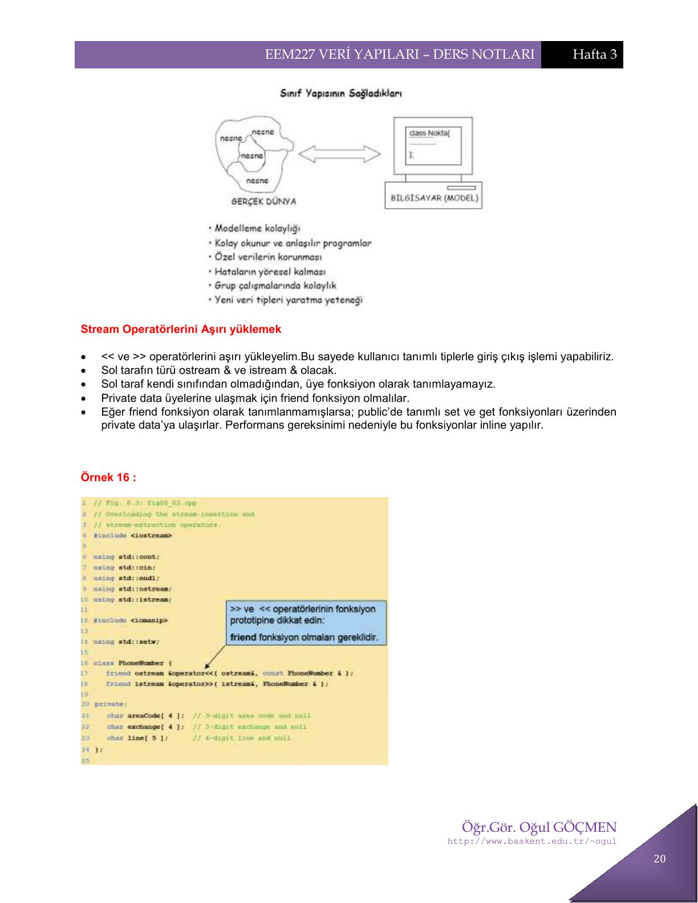
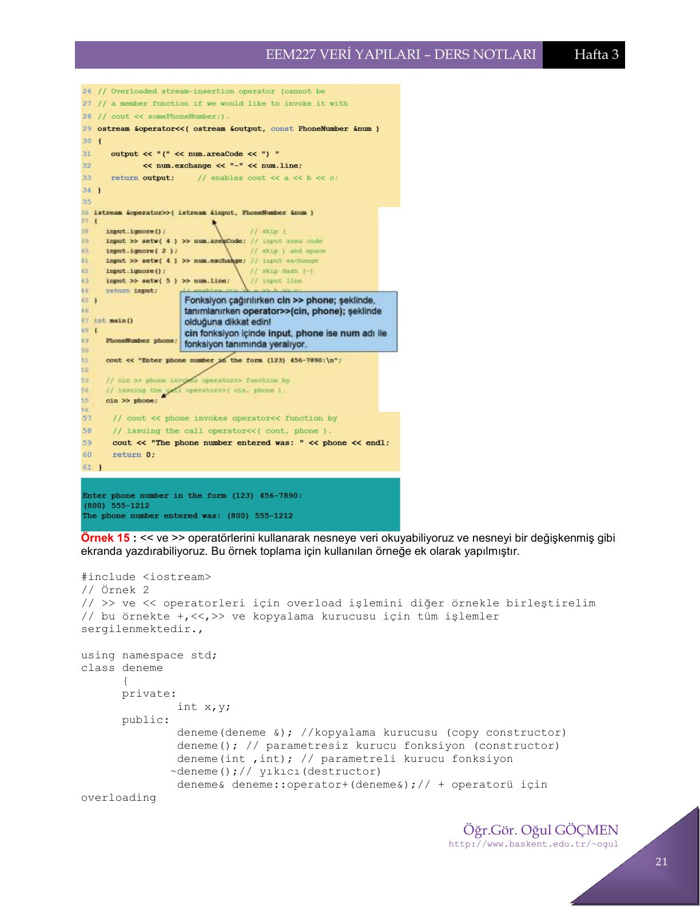

Bu yazı, Başkent Üniversitesi **EEM227 Veri Yapıları** dersinin 2007 güz dönemi 3. hafta ders notudur. Hazırlayan **Öğr. Gör. Oğul Göçmen**, tarih 5 Ekim 2007. O yıl ders C++ ile işleniyordu (arşivdeki 2014 tarihli EEM227 yazıları ise Java dönemine ait). Konu, C++'ta **operatörlere yeni işlevler yüklenmesi** (operator overloading). Notlardaki açıklamalar ve örnek programlar aşağıda metin olarak verildi. Ders notunun orijinal PDF'i yazının sonunda indirilebilir.

## Operatör yükleme nedir?

C++'da hazır olarak var olan operatörlere (+, -, *, /, !, <<, ++ vs.) ilişkin fonksiyonlar yazarak bu operatörlerin sizin belirlediğiniz işlemleri yapmasını sağlayabilirsiniz. Operatör fonksiyonları bir sınıfın üyesi de olabilirler. Böylece o sınıftan yaratılan nesneler üzerinde işlemler yapan operatörler tanımlanmış olur. C++'da operatör kullanımı fonksiyon çağrılarına karşı düşmektedir. Operatörlere yeni işlevler yükleyerek yapılabilecek her şey normal fonksiyonlar ile de yapılabilir. Fonksiyon isimleri yerine operatörleri kullanmak programın yazılmasını ve okunmasını kolaylaştırabilir. Bu nedenle bir operatöre işlev yüklemek, eğer program daha kolay okunur ve anlaşılır olacaksa tercih edilmelidir.

### Sınırlamalar

- C++'da olmayan operatörlere işlev yüklenemez. Örneğin üs alma işlemi için `^` simgesine ya da `**` simgesine bir işlev yüklenemez.
- C++'da var olan operatörlerden bazılarına da yeni işlev yüklenemez. Bunlar: nokta operatörü `.`, yaşam alanı belirleme operatörü `::`, koşul operatörü `? :` ve boyut operatörü `sizeof`.
- C++ operatörleri birli ve ikili olmak üzere iki gruba ayrılabilir. Birli operatörler tek operand alırlar (örneğin `-a`, `a++`, `!a`); ikili operatörler ise iki operand alırlar (`a+b`, `a/b` gibi).
- Operatörlere işlev yüklerken operand sayısı değiştirilemez.
- Operatörlerin öncelikleri değiştirilemez.
- Derleyicinin hazır veri tipleri üzerinde işlem yapan operatörlere yeni işlev yüklenemez. Örneğin iki tamsayıyı toplayan + operatörü değiştirilemez.
- Oluşturulan operatörlerin en az bir operandının tipi bir sınıf olmalıdır.

### Operatör fonksiyonlar: üye mi, friend mi?

- `( )`, `[ ]`, `->` ya da atama operatörleri aşırı yükleniyorsa mutlaka üye fonksiyon kullanılmalı.
- Üye fonksiyon kullanılacaksa, operatörün sol tarafı mutlaka kendi sınıfından bir nesne olmalıdır. Eğer sol taraf kendi sınıfından bir nesne değilse, operatör fonksiyonu kesinlikle üye olamaz.
- Üye fonksiyon olmayacaksa ve public ya da private üyelere erişilmesi gerekiyorsa mutlaka friend fonksiyon olmalıdır; operandlarına ulaşma hakkı olmalıdır.

## Kopyalama kurucusu (copy constructor)

Bu işlemlere başlamadan önce kopyalama kurucusunu tanıyalım. Kopyalama kurucusu başka bir çeşit kurucu fonksiyondur. Tek farkı, kendinden önce yaratılmış nesnenin değerleri ile yeni nesneyi sınıftan oluşturmamızı sağlamasıdır; bir nevi klonlama işlemidir. Bir sınıf içerisinde tanımlanan fonksiyonların aşırı yüklenmesi durumundaki kural burada da geçerlidir: nesneyi oluşturma biçiminize göre derleyici hangi kurucunun çalışacağını otomatik olarak kendisi belirler.

### Örnek 1

```cpp
#include <iostream>
// Bu örnek içerisinde copy constructor kullanımı gösterilmiştir...
using namespace std;
class deneme
      {
      private:
              int x,y;
      public:
              deneme(deneme &); //kopyalama kurucusu (copy constructor)
              deneme(); // parametresiz kurucu fonksiyon (constructor)
              deneme(int ,int); // parametreli kurucu fonksiyon
             ~deneme();// yıkıcı(destructor)
      };
deneme::deneme(int a,int b)
{
     cout<<"Parametreli kurucu fonksiyon calisti.."<<endl;
     x=a;
     y=b;
     cout<<"x="<<x<<endl;
     cout<<"y="<<y<<endl;
}
deneme::deneme()
   {
     cout<<"Kurucu fonksiyon calisti.."<<endl;
     x=5;
     y=10;
     cout<<"x="<<x<<endl;
     cout<<"y="<<y<<endl;
   }
deneme::deneme(deneme &alias)
{
   cout<<"Kopyalama kurucusu calisti"<<endl;
   x=alias.x;
   y=alias.y;
   cout<<"x="<<x<<endl;
   cout<<"y="<<y<<endl;
}
deneme::~deneme()
{
   cout<<"Yikici fonksiyon calisti..";
}
int main()
{
      cout<<"d diye bir nesne yaratacagim ve c de onun kopyasi olacak\n";
      deneme d,c(d); // c nesnesi d nin değerleri ile doğuyor...
      cout<<"simdi e yi c nesnesini kullanarak kopyaliyoruz...\n";
      deneme e(c); // e nesnesi kopyalanmış c den doğdu.
      cout<<"alt kisimda f nesnesini 3 ve 4 ilk degerleri ile yaratiyoruz..\n";
      deneme f(3,4); // parametre alarak yaratılan f nesnesi
      cout<<"g nesnesi ise f den kopyalaniyor, klonlaniyor...\n";
      deneme g(f); // ve görüldüğü gibi bunun kopyası olan g...
// dikkat ! nesnenin yaşam alanı biterse yıkıcı fonksiyon çalışacak ve
// nesneyi hafızadan silecektir, kopyalama kurucusunu kullanırken buna
// dikkat etmeyi unutmayınız...
      system("pause");
      return 0;
      }
```

Programın çıktısı:

```
d diye bir nesne yaratacagim ve c de onun kopyasi olacak
Kurucu fonksiyon calisti..
x=5
y=10
Kopyalama kurucusu calisti
x=5
y=10
simdi e yi c nesnesini kullanarak kopyaliyoruz...
Kopyalama kurucusu calisti
x=5
y=10
alt kisimda f nesnesini 3 ve 4 ilk degerleri ile yaratiyoruz..
Parametreli kurucu fonksiyon calisti..
x=3
y=4
g nesnesi ise f den kopyalaniyor, klonlaniyor...
Kopyalama kurucusu calisti
x=3
y=4
Press any key to continue . . .
```

## Bir operandlı (unary) operatörlere işlev yükleme

Birli operatörlere örnekler: arttırma (`++`), azaltma (`--`), eksileme (`-5`), mantıksal tümleme (`!`) vs. Bu operatörlere ilişkin fonksiyonlar bir sınıfın üyesi olarak yazıldıklarında hiç parametre almazlar, çünkü üzerinde çağrıldıkları nesne üzerinde işlem yaparlar. Bu operatörler normalde nesnenin solunda yer alırlar: `!n`, `-n`, `++n` gibi.

### Örnek 2: değer döndürmeyen önek ++

Bu program önek (prefix) olarak değeri arttırır, fakat fonksiyon void olduğu için geriye değer döndüremez.

```cpp
// countpp1.cpp
// ++ operatörü ile değer arttırma. Ör: ++sayac
#include <iostream>
using namespace std;
////////////////////////////////////////////////////////////////
class Counter
   {
   private:
      unsigned int count;              //count
   public:
      Counter() : count(0)             //constructor
         { }
      unsigned int get_count()         //return count
         { return count; }
      void operator ++ ()              //arttır ön ek (prefix)
         {
         ++count;
         }
   };
////////////////////////////////////////////////////////////////
int main()
   {
   Counter c1, c2;                     //define and initialize
   cout << "\nc1=" << c1.get_count();             //göster
   cout << "\nc2=" << c2.get_count();
   ++c1;                                //increment c1
   ++c2;                                //increment c2
   ++c2;                                //increment c2
   cout << "\nc1=" << c1.get_count(); //tekrar göster
   cout << "\nc2=" << c2.get_count() << endl;
   system("pause");
   return 0;
   }
```

```
c1=0
c2=0
c1=1
c2=2
```

Bu örneğin bir dezavantajı `c2=++c1` şeklinde bir atama işlemi yapılamamasıdır. Şimdi bunu nasıl çözeceğimize bakalım.

### Örnek 3: ++ ile arttırma ve değeri geri döndürme

```cpp
#include <iostream>
using namespace std;
class Counter
   {
   private:
      unsigned int count;               //count
   public:
      Counter() : count(0)              //constructor
           { }
        unsigned int get_count() //return count
           { return count; }
        Counter operator ++ ()           //increment count
           {
           ++count;                      //increment count
           Counter temp;                 //make a temporary Counter
           temp.count = count;           //give it same value as this obj
           return temp;                  //return the copy
           }
   };
int main()
   {
   Counter c1, c2;                                 //c1=0, c2=0
   cout << "\nc1=" << c1.get_count();              //display
   cout << "\nc2=" << c2.get_count();
   ++c1;                                           //c1=1
   c2 = ++c1;                                      //c1=2, c2=2 Artık bu tarz işlem OK!
   cout << "\nc1=" << c1.get_count();    //display again
   cout << "\nc2=" << c2.get_count() << endl;
   return 0;
   }
```

```
c1=0
c2=0
c1=2
c2=2
```

### Örnek 4: isimsiz geçici nesne döndürme

Bu işlemi kökten çözmenin yöntemi: `count` değişkenini ++ operatörü ile arttırma, değer aktarma ve isimsiz geçici nesneler kullanma. Burada ek olarak bir de değer alan kurucu kondu.

```cpp
// countpp3.cpp
#include <iostream>
using namespace std;
////////////////////////////////////////////////////////////////
class Counter
   {
   private:
      unsigned int count;        //count değişkeni
   public:
      Counter() : count(0)    //constructor değer almayan {count=0;} ile aynı
         { }
      Counter(int c)            //constructor, bir değer alan
         { count=c; }
      int get_count()            //return count
         { return count; }
      Counter operator ++ ()     //count değerini arttır
         {
         ++count;                // count değerini arttır ve
         return Counter(count); // geçici bir tampon obje döndür
         }                       // ve objeyi tek değer alan kurucu ile kur
   };
////////////////////////////////////////////////////////////////
int main()
   {
   Counter c1, c2;                                    //c1=0, c2=0
    cout << "\nc1=" << c1.get_count();                //göster
    cout << "\nc2=" << c2.get_count();
    ++c1;                                             //c1=1
    c2 = ++c1;                                        //c1=2, c2=2
    cout << "\nc1=" << c1.get_count();    //tekrar göster
    cout << "\nc2=" << c2.get_count() << endl;
    return 0;
    }
```

```
c1=0
c2=0
c1=2
c2=2
```

### ++ operatörü için önek ve sonek (++i, i++)

Aşağıdaki sınıfta ++ operatörü hem önek hem sonek olarak yüklenmiş ve değeri döndürüyor; `c2=++c1;` veya `c2=c1++;` gibi eşitleme işlemleri yapılabilir.

```cpp
#include <iostream>
using namespace std;
class Counter
   {
   private:
      unsigned int count;         //count
   public:
      Counter() : count(0)        //constructor no args
         { }
      Counter(int c) : count(c)   //constructor, one arg
         { }
      unsigned int get_count() const //return count
         { return count; }
        Counter operator ++ ()      //count değerini arttır (prefix)
           {
           return Counter(++count); //isimsiz geçici obje döndür
           }                        //ve count değerini initialize et
        Counter operator ++ (int)   //(postfix)
           {                        //isimsiz geçici obje döndür
           return Counter(count++); //bu count değeri ile objeyi initialize et
           }                        //count değerini arttır
   };
int main()
   {
   Counter c1, c2;                                    //c1=0, c2=0
   cout << "\nc1=" << c1.get_count();                 //display
   cout << "\nc2=" << c2.get_count();
   ++c1;                                              //c1=1
   c2 = ++c1;                                         //c1=2, c2=2 (prefix)
   cout << "\nc1=" << c1.get_count();    //display
   cout << "\nc2=" << c2.get_count();
   c2 = c1++;                            //c1=3, c2=2 (postfix)
   cout << "\nc1=" << c1.get_count();    //display again
   cout << "\nc2=" << c2.get_count() << endl;
   return 0;    }
```

```
c1=0
c2=0
c1=2
c2=2
c1=3
c2=2
```

### Örnek 5: karmaşık sayının reel kısmını arttıran ++

Aşağıdaki örnekte ++ operatörüne, karmaşık sayıların reel kısmını 0.1 arttırma işlevi yüklenmiştir.

```cpp
void ComplexT::operator++()
{
  re=re+0.1;
}
int main()
{
ComplexT z(1.2, 0.5);
++z; // operator++ fonksiyonu canlanir
z.goster();
return 0;
}
```

### Örnek 6: nesnenin referansını döndürme

Eğer bu operatörün bir atama deyiminde kullanılması isteniyorsa, operatöre ilişkin fonksiyon nesnenin referansını geri döndürmelidir (Örnek 4'teki kullanıma ek olarak böyle de yapılabilir).

```cpp
  //  ++ operatörüne yeni bir işlev yüklenmesi
  // Operatör karmaşık sayıların reel kısmını 0.1 kadar arttırmaktadır.
  #include <iostream>
  using namespace std;
  // Karmaşık (Kompleks) sayıları tanımlamak için oluşturulan sınıf
  class ComplexT{
      double re,im;            // reel ve sanal kısımlar
   public:
      ComplexT(double re_in=0,double im_in=1): re(re_in),im(im_in)
          {};                  // Kurucu (gövdesi boş)
       const ComplexT& operator++( );      // ++ Operatörü
       void goster() const;
  };
  // ++ operatörü
  // Karmaşık sayıların reel kısmını 0.1 kadar arttırmaktadır.
  const ComplexT & ComplexT::operator++()
  {
     re=re+0.1;                 // reel kısım arttırılıyor
     return *this;              // Nesnenin referansı döndürülüyor
  }
  // Nesne ile ilgili bilgileri ekrana çıkaran metot
  void ComplexT::goster() const
  {
    cout << "re=" << re << " im=" << im << endl;
  }
  //---- Ana Program -----
  int main()
  {
    ComplexT z1(1.2,0.5),z2;
    z1.goster();
    z2= ++z1;
    z1.goster();
    z2.goster();
    return 0;
  }
```

```
re=1.2 im=0.5
re=1.3 im=0.5
re=1.3 im=0.5
```

Bilindiği gibi ++ ve -- operatörleri operandların hem soluna hem de sağına yazılabilirler. Bir atama deyimi ile birlikte kullanıldıklarında operatörlerin yazılma şekli önemli olur. Buna göre önceden arttırma (azaltma) ya da sonradan arttırma (azaltma) anlamına gelirler:

```cpp
z2= ++ z1; // önceden arttırma
z2 = z1++; // sonradan arttırma
z2= -- z1; // önceden azaltma
z2 = z1--; // sonradan azaltma
```

Operatör fonksiyonu `operator++()` şeklinde parametresiz olarak yazılırsa, önceden arttırma operatörüne bir işlev yüklenmiş olur. Sonradan arttırma operatörüne bir işlev yüklemek için fonksiyon bir parametreli olarak yazılır: `operator++(int)`. Buradaki parametrenin amacı sadece iki fonksiyonu birbirinden ayırmaktır. Fonksiyon çağrılırken herhangi bir parametre gönderilmez.

### Örnek 7: karmaşık sayılarda önek ve sonek ++

```cpp
// ++ operatörünün hem önceden hem de sonradan arttırma için kullanılması
// Operatör karmaşık sayıların reel kısmını 0.1 kadar arttırmaktadır.
#include <iostream>
using namespace std;
// Karmaşık (Kompleks) sayıları tanımlamak için oluşturulan sınıf
class ComplexT{
      double re,im;     // reel ve sanal kısımlar
 public:
      ComplexT(double re_in=0,double im_in=1): re(re_in),im(im_in)
      {};               // Kurucu (gövdesi boş)
      const ComplexT& operator++();       // önceden arttırma ++ operatörü
      ComplexT operator++(int);           // sonradan arttırma ++ operatörü
      void goster() const;
};
// Önceden arttırma ++ operatörü
// Karmaşık sayıların reel kısmını 0.1 kadar arttırmaktadır.
const ComplexT & ComplexT::operator++()
{
      re=re+0.1;                    // reel kısım arttırılıyor
      return *this;                 // Nesnenin referansı döndürülüyor
}
// Sonradan arttırma ++ operatörü
// Karmaşık sayıların reel kısmını 0.1 kadar arttırmaktadır.
ComplexT ComplexT::operator++(int)     // sonradan arttırma operatörü
{
      ComplexT gecici;
   gecici = *this;      // nesnenin orijinal değeri
   re=re+0.1;           // reel kısım arttırılıyor
   return gecici;       // eski (artmamış) değer döndürülüyor
}
// Nesne ile ilgili bilgileri ekrana çıkaran metot
void ComplexT::goster() const
{
      cout << "re=" << re << " im=" << im << endl;
}
//---- Ana Program -----
int main()
{
      ComplexT z1(1.2,0.5),z2;
      z2= ++z1;          // operator ++() çalışır
      z1.goster();
      z2.goster();
      z2= z1++;          // operator ++(int) çalışır
      z1.goster();
      z2.goster();
      return 0;
}
```

```
re=1.3 im=0.5
re=1.3 im=0.5
re=1.4 im=0.5
re=1.3 im=0.5
```

*Not: Ders notundaki ekran çıktısında en başta bir de "re=1.2 im=0.5" satırı var; ancak bu programda ilk `goster()` çağrısı `++z1`'den sonra geldiği için o satır basılmaz (Örnek 6'nın çıktısından kalmış görünüyor).*

## + operatörüne yeni bir işlev yüklenmesi

### Örnek 8: iki nesneyi + ile toplamak

Bu örnekte basit olarak iki tamsayı değerli nesne olacak ve biz bunları sanki tamsayı topluyormuş gibi + operatörü ile toplatacağız. Kopyalama kurucusu da kullanıldı.

```cpp
// + operatörüne yeni bir işlev yüklenmesi. Kopyalama kurucusu da kullanıldı…
#include <iostream>
using namespace std;
class deneme
      {
      private:
              int x,y;
      public:
              deneme(deneme &); //kopyalama kurucusu (copy constructor)
              deneme(); // parametresiz kurucu fonksiyon (constructor)
              deneme(int ,int); // parametreli kurucu fonksiyon
             ~deneme();// yıkıcı(destructor)
              deneme& deneme::operator+(deneme&);// + operatorü için overloading
      };
// bu sayede nesneleri sanki sayıymış gibi toplayabileceğiz...
deneme& deneme::operator+(deneme& s)
{
  cout<<"+ operatoru calisti"<<endl;
  int xx,yy;
  xx=x+s.x;
  yy=y+s.y;
  cout<<" xx= "<<xx<<" yy= "<<yy<<endl;
}
deneme::deneme(int a,int b)
{
     cout<<"Parametreli kurucu fonksiyon calisti.."<<endl;
     x=a;
     y=b;
     cout<<"x="<<x<<endl;
     cout<<"y="<<y<<endl;
}
deneme::deneme()
   {
     cout<<"Kurucu fonksiyon calisti.."<<endl;
     x=5;
     y=10;
     cout<<"x="<<x<<endl;
     cout<<"y="<<y<<endl;
   }
deneme::deneme(deneme &alias)
{
    cout<<"Kopyalama kurucusu calisti"<<endl;
    x=alias.x;
    y=alias.y;
    cout<<"x="<<x<<endl;
    cout<<"y="<<y<<endl;
}
deneme::~deneme()
{
   cout<<"Yikici fonksiyon calisti..";
}
int main()
{
    deneme d,c(3,2),e; // c nesnesi d nin değerleri ile doğuyor...
     e=d+c;
     // aslinda alt kisim ile ust kisim ayni isi yapiyor...
     e=d.operator+(c);
     deneme x; // yeni bir nesne oluşturalım
     // eğer sınıf içerisinde pointer yoksa; eşittir işlemi için
     // ek olarak operator overload etmenize gerek yoktur...
     d=c; // gördüğünüz gibi bu işlem nesneleri birbirine sorunsuzca eşitliyor.
     x=d+c;
     system("pause");
     return 0;     }
```

```
Kurucu fonksiyon calisti..
x=5
y=10
Parametreli kurucu fonksiyon calisti..
x=3
y=2
Kurucu fonksiyon calisti..
x=5
y=10
+ operatoru calisti
 xx= 8 yy= 12
+ operatoru calisti
 xx= 8 yy= 12
Kurucu fonksiyon calisti..
x=5
y=10
+ operatoru calisti
 xx= 6 yy= 4
```

*Not: Bu örnekte `operator+` fonksiyonu `deneme&` döndüreceğini bildirdiği hâlde hiçbir `return` deyimi içermiyor; toplamı yalnızca ekrana yazıyor. Sonucun `e=d+c` ile bir nesneye atanması tanımsız davranıştır. Ayrıca sınıf içindeki `deneme& deneme::operator+(deneme&);` bildirimindeki `deneme::` niteleyicisi sınıf gövdesinde fazladır; güncel derleyiciler bunu hata sayar.*

### Örnek 9: karmaşık sayıları + ile toplamak

```cpp
//     + operatörüne yeni bir işlev yüklenmesi
#include <iostream>
using namespace std;
// Karmaşık (Kompleks) sayıları tanımlamak için oluşturulan sınıf
class ComplexT{
       double re,im;                                  // reel ve sanal kısımlar
 public:
       ComplexT(double re_in=0,double im_in=1);      // Kurucu
       ComplexT operator+(const ComplexT & ) const; // + operatörünün fonksiyonu
       void goster() const;
};
//Parametresiz çağırılabilen kurucu. Çünkü ilk değerleri var.
ComplexT::ComplexT(double re_in,double im_in)
{
       re=re_in;
       im=im_in;
       cout<< endl << "Kurucu calisti. ";
}
// + operatörü
ComplexT ComplexT::operator+(const ComplexT &c) const
{
       double yeni_re, yeni_im;
       yeni_re=re+c.re;
       yeni_im=im+c.im;
       return ComplexT(yeni_re,yeni_im);
}
// Nesne ile ilgili bilgileri ekrana çıkaran metot
void ComplexT::goster() const
{
       cout << endl << "re=" << re << " im=" << im;
}
int main()
{
       ComplexT z1(1,1),z2(2,2),z3;
       z3=z1+z2;                             // z3=z1.operator+(z2);  yapmakla aynıdır
       z3.goster();
       return 0;
}
```

```
Kurucu calisti.
Kurucu calisti.
Kurucu calisti.
Kurucu calisti.
re=3 im=3
```

Bu örnekte ComplexT sınıfına + operatörü için bir metot eklenmiştir. Böylece + operatörünün karmaşık sayıları toplaması sağlanmıştır.

## Atama operatörüne (=) yeni bir işlev yüklenmesi

```cpp
void ComplexT::operator=(const ComplexT& z) // Gereksiz
{
re = z.re;
im = z.im;
}
```

Bu fonksiyon yazılmasaydı derleyicinin yerleştireceği fonksiyon da aynı işi yapardı. Eğer sınıfta bir atama fonksiyonu varsa, artık derleyici tüm atama işleri için bu fonksiyonu kullanır.

### Örnek 10

```cpp
//     Atama operatörüne yeni bir işlev yüklenmesi
// Karmaşık sayılar sınıfı ComplexT'ye = operatörü için bir metot eklenmiştir.
// Bu sınıf için bu metodun yazılması gereksizdir.
// Bu fonksiyon sınıftan kaldırılsa da ana program doğru olarak çalışır.
// Bu program sadece atama fonksiyonunun yazılımını göstermek için hazırlanmıştır.
#include <iostream>
using namespace std;
// Karmaşık (Kompleks) sayıları tanımlamak için oluşturulan sınıf
class ComplexT{
       double re,im; // reel ve sanal kısımlar
 public:
       ComplexT(double re_in=0,double im_in=1): re(re_in),im(im_in)
       {};    // Kurucu (gövdesi boş)
       void operator=(const ComplexT & ); // = Operatörü
       void goster() const;
};
// = operatörü
void ComplexT::operator=(const ComplexT &c)
{
       re = c.re;                              // Atamalar yapılıyor
       im = c.im;
       cout << "Atama fonksiyonu calisti" << endl; // Çalıştığını ekranda görmek için
}
// Nesne ile ilgili bilgileri ekrana çıkaran metot
void ComplexT::goster() const
{
       cout << "re=" << re << " im=" << im << endl;
}
int main()
{
       ComplexT z1(1,2),z2;
       z2.goster(); // Atamadan önceki içerik
       z2=z1;
       z2.goster(); // Atamadan sonraki içerik
       return 0;
}
```

```
re=0 im=1
Atama fonksiyonu calisti
re=1 im=2
```

Atama işlemi programlarda çok sık kullanıldığından C++ derleyicisi her sınıfa atama operatörü için bir fonksiyon yerleştirir. Derleyicinin yerleştirdiği fonksiyon bir nesnenin verilerini var olan başka bir nesnenin veri alanlarına bire bir kopyalar. Eğer bu bire bir atama işlemi o sınıf için yeterli ise programcının atama operatörü için bir fonksiyon yazmasına gerek kalmaz. İçinde işaretçi olmayan sınıflar için genellikle derleyicinin sağladığı fonksiyon yeterlidir. Örneğin karmaşık sayılar için yukarıda gösterilen atama fonksiyonu gereksizdir.

Ancak her sınıf için derleyicinin sağladığı atama fonksiyonu yeterli olmayabilir. Özellikle içinde işaretçi olan sınıflarda programcının atama operatörüne ilişkin fonksiyonu yazması gerekebilir. Kopyalama kurucusundakine benzer bir problem burada da vardır. Aşağıda örnek String sınıfı için atama fonksiyonu yazılmıştır.

```cpp
class String{     // Örnek (karakter katarı) String sınıfı
   int boy;       // Katarın boyu
   char *icerik; // Katarın içeriği
public:
   String();      // Parametresiz kurucu
   String(const char *);            // Kurucu
   String(const String &);          // Kopyalama kurucusu
   void operator=(const String &); // Atama operatörü
   void goster();                  // Katarları ekrana çıkaran üye fonksiyon
 ~String();                        // Yok edici fonksiyon
};
// Atama Operatörü
void String::operator=(const String &gelen_nesne)
{
cout<< "Atama operatoru calisti" << endl;
boy = gelen_nesne.boy;
delete [] icerik;               // Eski içerik belleğe iade ediliyor
icerik = new char[boy + 1];     // +1 null karakteri icin
strcpy(icerik, gelen_nesne.icerik);
}
```

Bu atama fonksiyonu geriye bir değer döndürmemektedir (void). Bu nedenle bu operatörü kaskad olarak yazmak (`a = b = c` gibi) mümkün değildir. Operatörleri kaskad bağlayabilmek için operatöre ilişkin fonksiyon, üzerinde işlem yapılan nesnenin referansını geri göndermelidir. Eğer operatör fonksiyonlarının geri dönüş değeri tipleri void olarak yazılırsa bu operatörler peş peşe bağlanamaz.

```cpp
// Atama Operatörü
const String& String::operator=(const String &gelen_nesne)
{
cout<< "Atama operatoru calisti" << endl;
boy = gelen_nesne.boy;
delete [] icerik; // Eski içerik belleğe iade ediliyor
icerik = new char[boy + 1]; // +1 null karakteri icin
strcpy(icerik, gelen_nesne.icerik);
return *this; // Kendi adresini geri gönderiyor
}
```

Atama operatörü ile kopyalama kurucusu benzer işler yapmakla beraber farklı zamanlarda canlanırlar. Kopyalama kurucusu yeni bir nesne yaratılırken canlanır ve eski bir nesnedeki bilgileri yeni nesneye kopyalar. Atama operatörü ise var olan bir nesneye başka bir nesnedeki değerler atanırken canlanır.

### Örnek 11: String sınıfı için atama operatörü

```cpp
// Atama operatörünün "=" Katar dizileri (String) için yüklenmesi
#include <iostream>
#include <cstring>                       // string fonksiyonları için
using namespace std;
class String{                  // Örnek (karakter katarı) String sınıfı
   int boy;              // Katarın boyu
   char *icerik;         // Katarın içeriği
 public:
   String();                    // Parametresiz kurucu
   String(const char *);        // Kurucu
   String(const String &);     // Kopyalama kurucusu
   const String& operator=(const String &);      // Atama operatörü
   void goster();    // Katarları ekrana çıkaran üye fonksiyon
   ~String();        // Yok edici fonksiyon
};
// Parametresiz Kurucu Fonksiyon
// Sadece NULL içeren bir boş katar oluşturur
String::String()
{
  cout<< "Parametresiz Kurucu calisti" << endl;
  boy = 0;                     // boş katarın boyu sıfır
  icerik = new char[1];        // icerik için yer ayrıldı, null icin
  strcpy(icerik, "");          // boş katar
}
// Kurucu Fonksiyon
// Parametre olarak aldığı katarı nesnenin içeriğine kopyalar
String::String(const char *gelen_veri)
{
cout<< "Kurucu calisti" << endl;
boy = strlen(gelen_veri); // gelen katarın boyu hesaplandı
icerik = new char[boy +1]; // icerik için yer ayrıldı, +1 null icin
strcpy(icerik, gelen_veri);//gelenveri icerik'in gosterdigi yere kopyalanıyor
}
// Kopyalama kurucusu
String::String(const String &gelen_nesne)
{
  cout<< "Kopyalama Kurucusu calisti" << endl;
  boy = gelen_nesne.boy;
  icerik = new char[boy + 1];         // +1 null karakteri icin
  strcpy(icerik, gelen_nesne.icerik);
}
// Atama Operatörü
const String& String::operator=(const String &gelen_nesne)
{
  cout<< "Atama operatoru calisti" << endl;
  boy = gelen_nesne.boy;
  delete [] icerik;      // Eski içerik belleğe iade ediliyor
  icerik = new char[boy + 1];         // +1 null karakteri icin
  strcpy(icerik, gelen_nesne.icerik);
  return *this;          // Kendi adresini geri gönderiyor
}
void String::goster()
{
  cout<< icerik << ", " << boy << endl;      // Katar ve boyu ekrana yazılıyor
}
// Yok edici Fonksiyon
// icerik tarafından isaret edilen bellek geri veriliyor
String::~String()
{
       cout<< "Yok edici calisti" << endl;
       delete[] icerik;
}
//-------- Ana Program ----------------
int main()               // Ana fonksiyon
{
   String s1("Katar 1");
      String s2 = s1;          // Kopyalama kurucusu çalışır
      s2.goster();
      String s3 , s4;
      s3 = s4= s2;             // Atama operatörü 2 defa çalışır
      s3.goster();
      s4.goster();
   return 0;
 }
```

```
Kurucu calisti
Kopyalama Kurucusu calisti
Katar 1, 7
Parametresiz Kurucu calisti
Parametresiz Kurucu calisti
Atama operatoru calisti
Atama operatoru calisti
Katar 1, 7
Katar 1, 7
```

## İndis operatörüne ([ ]) yeni bir işlev yüklenmesi

Tüm operatör fonksiyonları için aynı kurallar geçerli olduğundan hepsini ayrı ayrı anlatmaya gerek yoktur; ancak ilginç ve yararlı olabilecek bazı operatörler açıklanmıştır. Bunlardan biri de indis (subscript) operatörüdür. Bu operatöre ilişkin fonksiyon iki farklı yapıda olabilir:

```cpp
class C{
dönüş tipi & operator [] (parametre tipi);
ya da
const dönüş tipi & operator [] (parametre tipi) const; };
```

Birinci yazım şekli, eğer bu operatör ile nesnenin verileri değiştirilecekse kullanılır; bu durumda operatör bir atama operatörünün solunda yer alabilir. İkinci yazım şeklinde ise fonksiyon sabit olarak tanımlanmıştır; bu durumda operatör ile nesnenin verileri sadece okunabilir. c bir nesne olmak üzere `c[i]` ifadesi `c.operator[](i)` anlamına gelir.

### Örnek 12

İndis operatörüne String sınıfında kullanılmak üzere bir işlev yüklenecektir. Bu operatör bir katardaki i. karaktere erişilmesini sağlayacaktır. Eğer i sıfırdan küçük verilirse katardaki ilk elemana, eğer i katarın boyundan büyük verilirse katardaki son elemana erişilmiş olacaktır.

```cpp
// İndis operatörünün "[]" Katar dizileri (String) için yüklenmesi
#include <iostream>
#include <cstring>                        // string fonksiyonları için
using namespace std;
class String{           // Örnek (karakter katarı) String sınıfı
        int boy;       // Katarın boyu
        char *icerik; // Katarın içeriği
 public:
        String(const char *);      // Kurucu
        char & operator[](int i); // İndis operatörü
        void goster();            // Katarları ekrana çıkaran üye fonksiyon
        ~String();               // Yok edici fonksiyon
};
// Kurucu Fonksiyon
// Parametre olarak aldığı katarı nesnenin içeriğine kopyalar
String::String(const char *gelen_veri)
{
        cout<< "Kurucu calisti" << endl;
        boy = strlen(gelen_veri); // gelen katarın boyu hesaplandı
        icerik = new char[boy +1];// icerik için yer ayrıldı, +1 null icin
        strcpy(icerik, gelen_veri);// gelen veri icerik'in gosterdigi yere kopyalanıyor
}
// İndis Operatörü
char& String::operator[](int i)
{
       cout << "Indis operatoru calisti" << endl;
       if(i < 0)
              return icerik[0];          // İlk eleman gönderiliyor
       if(i >= boy)
              return icerik[boy-1];      // Son eleman gönderiliyor
       return icerik[i];                // i. eleman gönderiliyor
}
void String::goster()
{
        cout<< icerik << ", " << boy << endl;              // Katar ve boyu ekrana yazılıyor
}
// Yok edici Fonksiyon
// icerik tarafından isaret edilen bellek geri veriliyor
String::~String()
{
        cout<< "Yok edici calisti" << endl;
        delete[] icerik;
}
//-------- Ana Program ----------------
int main()                 // Ana fonksiyon
{
   String s1("Katar 1");
       s1[1] = 'X';               // Katarın 2. karakteri 'X' oldu
       s1.goster();
       cout << "Katarin 3 numarali elemani = " << s1[3] << endl;
   return 0;
}
```

```
Kurucu calisti
Indis operatoru calisti
KXtar 1, 7
Indis operatoru calisti
Katarin 3 numarali elemani = a
```

## Fonksiyon çağırma operatörüne ( () ) yeni bir işlev yüklenmesi

Bu operatörü diğerlerinden ayıran özellik, operand sayısının programcı tarafından belirlenebilmesidir. Bu operatöre ilişkin fonksiyon aşağıdaki yapıda olur:

```cpp
class C
{
   dönüş tipi operator () (parametre tipleri);
};
```

c bir nesne olmak üzere `c(i,j,k)` ifadesi `c.operator()(i,j,k)` anlamına gelir.

### Örnek 13: parametresiz () operatörü

Aşağıdaki örnekte fonksiyon çağırma operatörüne, karmaşık sayıları ekrana çıkarma işlevi yüklenmiştir. Bu örnekte operatör parametre almamaktadır.

```cpp
// () operatörüne yeni bir işlev yüklenmesi
// Bu örnekte () operatörü karmaşık sayıları ekrana çıkarmak
// için kullanılmaktadır. Operatörün fonksiyonu parametre almamaktadır.
#include <iostream>
using namespace std;
// Karmaşık (Kompleks) sayıları tanımlamak için oluşturulan sınıf
class ComplexT{
      double re,im;           // reel ve sanal kısımlar
public:
 ComplexT(double re_in=0,double im_in=0):re(re_in),im(im_in)
                  {};         // Kurucu, gövdesi boş
 ComplexT operator+(const ComplexT & ) const;    // + operatörünün fonksiyonu
 void operator()() const;     // () operatörünün fonksiyonu
};
// + operatörü
ComplexT ComplexT::operator+(const ComplexT &c) const
{
      double yeni_re, yeni_im;
      yeni_re=re+c.re;
      yeni_im=im+c.im;
      return ComplexT(yeni_re,yeni_im);
}
// () operatörü
// Parametresiz fonksiyon çağırma operatörü, karmaşık sayıları ekrana yazar
void ComplexT::operator()() const
{
      cout << "re=" << re << " im=" << im << endl ;
}
int main()
{
      ComplexT z1(1,1),z2(2,2),z3;
      z1();
      z2();
      z3=z1+z2;
      z3();
      return 0;
}
```

```
re=1 im=1
re=2 im=2
re=3 im=3
```

### Örnek 14: iki parametreli () operatörü

Bu örnekte fonksiyon çağırma operatörünün parametreli olarak kullanımı gösterilmiştir. Örnekteki operatör, bir karakter katarının (String) istenen bir miktarını istenen bir bellek bölgesine kopyalamaktadır; 2 adet parametre almaktadır.

```cpp
// Fonksiyon çağırma operatörünün "()" Katar dizileri (String) için yüklenmesi
// Operatör, katarın bir kısmını istenen bir bellek bölgesine kopyalar
#include <iostream>
#include <cstring>               // string fonksiyonları için
using namespace std;
class String{               // Örnek (karakter katarı) String sınıfı
         int boy;           // Katarın boyu
         char *icerik;      // Katarın içeriği
  public:
         String();                // Parametresiz kurucu
         String(const char *);    // Kurucu
         void operator()(char *, int) const;    // () operatörü
         ~String();              // Yok edici fonksiyon
};
// Parametresiz Kurucu Fonksiyon
// Sadece NULL içeren bir boş katar oluşturur
String::String()
{
       cout<< "Parametresiz Kurucu calisti" << endl;
       boy = 0;                        // boş katarın boyu sıfır
       icerik = new char[1];           // icerik için yer ayrıldı, null icin
       strcpy(icerik, "");             // boş katar
}
// Kurucu Fonksiyon
// Parametre olarak aldığı katarı nesnenin içeriğine kopyalar
String::String(const char *gelen_veri)
{
  cout<< "Kurucu calisti" << endl;
  boy = strlen(gelen_veri);        // gelen katarın boyu hesaplandı
  icerik = new char[boy +1];       // icerik için yer ayrıldı, +1 null icin
  strcpy(icerik, gelen_veri);      // gelen veri icerik'in gosterdigi yere kopyalanıyor
}
// Fonksiyon çağırma operatörü(): Bir katarın içeriğinin belli bir kısmını
// verilen bir bellek bölgesine kopyalar
// Parametre olarak hedef belleğin adresini ve kopyalanacak karakter sayısını alır
void String::operator()(char * hedef, int sayi) const
{
       if (sayi>boy) sayi=boy;                 // sayi katarın boyundan uzunsa
       for (int k=0; k< sayi; k++) hedef[k]= icerik[k];
}
// Yok edici Fonksiyon
// icerik tarafından isaret edilen bellek geri veriliyor
String::~String()
{
        cout<< "Yok edici calisti" << endl;
        delete[] icerik;
}
//-------- Ana Program ----------------
int main()                 // Ana fonksiyon
{
  String s1("Ornek Program");
  char *c = new char[8];          // Hedef bellek bölgesi
  s1(c,7);                        // 7 karakter kopyalandı
  c[7]='\0';                      // Katar sonunu belirtmek için (null)
  cout << c << endl;              // Kopyalanan karakterler ekrana yazılıyor
  delete c;                       // Alınan bellek bölgesi iade ediliyor
  return 0;
}
```

```
Kurucu calisti
Ornek P
```

*Not: `new char[8]` ile alınan dizi `delete[] c;` ile geri verilmelidir; notta `delete c;` yazıyor.*

## Stream operatörlerini (<< ve >>) aşırı yüklemek



Ders notunda bu bölümden önce bir şema yer alıyor: gerçek dünyadaki nesnelerin bilgisayarda bir sınıfla (modelle) temsil edilmesi. Sınıf yapısının sağladıkları:

- Modelleme kolaylığı
- Kolay okunur ve anlaşılır programlar
- Özel verilerin korunması
- Hataların yöresel kalması
- Grup çalışmalarında kolaylık
- Yeni veri tipleri yaratma yeteneği

<< ve >> operatörlerini aşırı yükleyerek kullanıcı tanımlı tiplerle giriş çıkış işlemi yapabiliriz.

- Sol tarafın türü `ostream &` ve `istream &` olacak.
- Sol taraf kendi sınıfından olmadığından, üye fonksiyon olarak tanımlayamayız.
- Private veri üyelerine ulaşmak için friend fonksiyon olmalılar.
- Eğer friend fonksiyon olarak tanımlanmamışlarsa, public'te tanımlı set ve get fonksiyonları üzerinden private veriye ulaşırlar. Performans gereksinimi nedeniyle bu fonksiyonlar inline yapılır.

### Örnek 16: PhoneNumber sınıfı

Örnek 16, notta kod görüntüsü olarak verilmiş: telefon numarasını alan kodu, santral ve hat numarası olarak tutan bir `PhoneNumber` sınıfı. `operator<<` ve `operator>>` friend fonksiyon olarak bildiriliyor; `operator>>` girişteki parantez, boşluk ve tireyi `ignore()` ile atlayıp parçaları `setw` ile okuyor. Nottaki açıklama kutuları: "<< ve >> operatörlerinin fonksiyon prototipine dikkat edin: friend fonksiyon olmaları gereklidir." ve "Fonksiyon çağırılırken `cin >> phone;` şeklinde, tanımlanırken `operator>>(cin, phone);` şeklinde olduğuna dikkat edin! cin fonksiyon içinde input, phone ise num adı ile fonksiyon tanımında yeralıyor."



```
Enter phone number in the form (123) 456-7890:
(800) 555-1212
The phone number entered was: (800) 555-1212
```

### Örnek 15: << ve >> ile nesneye veri okuma ve yazdırma

<< ve >> operatörlerini kullanarak nesneye veri okuyabiliyoruz ve nesneyi bir değişkenmiş gibi ekrana yazdırabiliyoruz. Bu örnek, toplama için kullanılan örneğe (Örnek 8) ek olarak yapılmıştır; +, <<, >> ve kopyalama kurucusu için tüm işlemler sergilenmektedir.

```cpp
#include <iostream>
// >> ve << operatorleri için overload işlemini diğer örnekle birleştirelim
// bu örnekte +,<<,>> ve kopyalama kurucusu için tüm işlemler sergilenmektedir.
using namespace std;
class deneme
      {
      private:
               int x,y;
      public:
               deneme(deneme &); //kopyalama kurucusu (copy constructor)
               deneme(); // parametresiz kurucu fonksiyon (constructor)
               deneme(int ,int); // parametreli kurucu fonksiyon
              ~deneme();// yıkıcı(destructor)
               deneme& deneme::operator+(deneme&);// + operatorü için overloading
/* Not!
  ------
  << ve >> operatorlerini overload etmek için friend function olarak
  tanımlamalısın...
  Nesnenin iç yapısına göre input ve output işlemlerinde alınacak veya ekranda
  gösterilecek değerler programcıya kalmıştır...
    */
              friend ostream& operator<<(ostream& yaz, deneme& );
              friend istream& operator>>(istream& oku, deneme&);
         };
istream& operator>>(istream& oku, deneme& nesne)
{
oku>>nesne.x>>nesne.y;
return oku;
}
ostream& operator<<(ostream& yaz,deneme& nesne)
{
   yaz<<nesne.x<<':'<<nesne.y<<endl;
   return yaz;
}
// bu sayede nesneleri sanki sayıymış gibi toplayabileceğiz...
deneme& deneme::operator+(deneme& s)
{
  cout<<"+ operatoru calisti"<<endl;
  int xx,yy;
  xx=x+s.x;
  yy=y+s.y;
cout<<endl;
  cout<<" xx= "<<xx<<"   yy= "<<yy<<endl;
}
deneme::deneme(int a,int b)
{
     cout<<"Parametreli kurucu fonksiyon calisti.."<<endl;
     x=a;
     y=b;
     cout<<"x="<<x<<endl;
     cout<<"y="<<y<<endl;
}
deneme::deneme()
   {
     cout<<"Kurucu fonksiyon calisti.."<<endl;
     x=5;
     y=10;
     cout<<"x="<<x<<endl;
     cout<<"y="<<y<<endl;
   }
deneme::deneme(deneme &alias)
{
   cout<<"Kopyalama kurucusu calisti"<<endl;
   x=alias.x;
   y=alias.y;
   cout<<"x="<<x<<endl;
   cout<<"y="<<y<<endl;
}
deneme::~deneme()
{
   cout<<"Yikici fonksiyon calisti..";
}
int main()
{
    deneme d,c(3,2),e; // c nesnesi d nin değerleri ile doğuyor...
    e=d+c;
    // aslinda alt kisim ile ust kisim ayni isi yapiyor...
    e=d.operator+(c);
    deneme x; // yeni bir nesne oluşturalım
    // eğer sınıf içerisinde pointer yoksa; eşittir işlemi için
    // ek olarak operator overload etmenize gerek yoktur...
    d=c; // gördüğünüz gibi bu işlem nesneleri birbirine sorunsuzca eşitliyor.
    x=d+c;
    cout<<c;
    cin>>c;
    cout<<c;
    system("pause");
    return 0;
    }
```

Ekran çıktısı (111 ve 6789 değerleri klavyeden girilmiş; ekrana yazdırırken araya `:` konmuş):

```
Kurucu fonksiyon calisti..
x=5
y=10
Parametreli kurucu fonksiyon calisti..
x=3
y=2
Kurucu fonksiyon calisti..
x=5
y=10
+ operatoru calisti

 xx= 8   yy= 12
+ operatoru calisti

 xx= 8   yy= 12
Kurucu fonksiyon calisti..
x=5
y=10
+ operatoru calisti

 xx= 6   yy= 4
3:2
111
6789
111:6789
Press any key to continue . . .
```

*Not: Örnek 8'deki gibi burada da `operator+` bir değer döndürmüyor (`return` yok); yalnızca toplamı ekrana yazıyor.*
