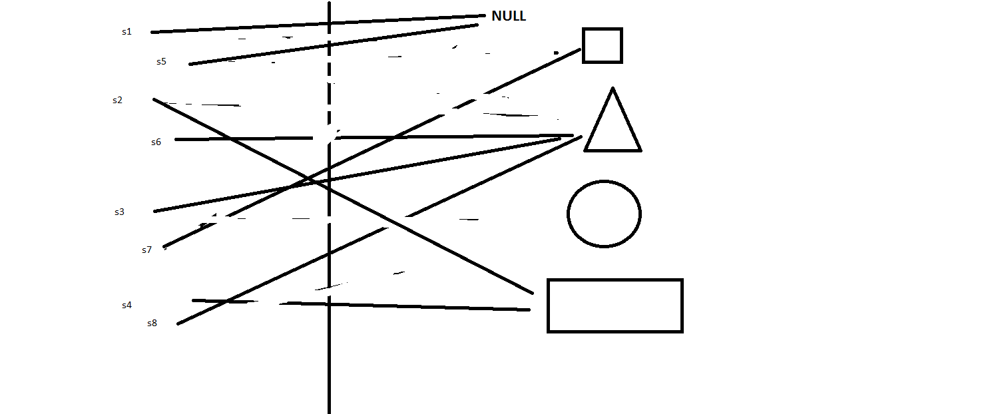

This post collects the 2013–2015 quiz solutions for the **EEM227 Data Structures** course at Başkent University. The main topic is **references** in Java: in class, reference variables were explained as "remote controls" pointing to an object. Switching a remote control to another object does not change the object; it only changes what the remote control points to. The original BlueJ projects and the solution drawing are available at the end of the post as a ZIP download.

## Quiz 1: Leap year

A year is a leap year if it is divisible by 4; but if it is divisible by 100 and not divisible by 400, it is not.

```java
public class Quiz1Question1
{
    public static void main()
    {
        Quiz1Question1 q1 = new Quiz1Question1();
        q1.artikYil(1200);
        q1.artikYil(1201);
        q1.artikYil(1888);
        q1.artikYil(1892);
        q1.artikYil(1896);
        q1.artikYil(1904);
        q1.artikYil(1988);
        q1.artikYil(1992);
        q1.artikYil(1996);
        q1.artikYil(2004);
        q1.artikYil(2000);
        q1.artikYil(1900);
    }

    public void artikYil ( int yil )
    {
        // Your code here
        if (yil % 4 == 0)
        {
            if (yil % 400 == 0)
            {
                System.out.println("Yıl :" + yil + ", artık yıldır.");
            }
            else if (yil % 100 == 0)
            {
                System.out.println("Yıl :" + yil + ", artık yıl değildir.");
            }
            else
            {
                System.out.println("Yıl :" + yil + ", artık yıldır.");
            }
        }
        else
        {
                System.out.println("Yıl :" + yil + ", artık yıl değildir.");
        }
    }
}
```

Result: 1201 and 1900 are not leap years; all other years in the list (including 1200 and 2000) are leap years.

## Quiz 2: What is the output of the code?

```java
public class Quiz2KodCikti
{
    public static void main(String[] args) {
        int count=1;
        System.out.print(count++);
        System.out.print(++count);
        System.out.print(count++);
    }
}
```

```
133
```

`count++` uses the value first and then increments it (prints 1, count becomes 2); `++count` increments first and then uses the value (count becomes 3, prints 3); the last `count++` again prints 3 and count becomes 4.

## Is the number even?

```java
public class QuizSayiCiftMi
{
    public boolean sayiCiftMi ( int sayi )
     {
         if (sayi % 2 == 0)
         {
             return true;
         }
         else
         {
             return false;
         }
     }
}
```

## Remote control question: shapes

Four shape objects are created and eight references ("remote controls") are assigned to one another among them. Question: in the end, which object does each remote control point to?

```java
public class UzaktanKumandaSekilQuiz
{
    private String sekilAdi ;
     public UzaktanKumandaSekilQuiz( String pSekilAdi )
     {
         sekilAdi = pSekilAdi ;
     }

     public String toString ()
     {
         return "" + sekilAdi ;
     }

     public static void main( String [ ] args )
    {
        UzaktanKumandaSekilQuiz s1=new UzaktanKumandaSekilQuiz("Kare") ;
        UzaktanKumandaSekilQuiz s2=new UzaktanKumandaSekilQuiz("Ucgen") ;
        UzaktanKumandaSekilQuiz s3=new UzaktanKumandaSekilQuiz("Daire") ;
        UzaktanKumandaSekilQuiz s4=new UzaktanKumandaSekilQuiz("Dikdortgen") ;

        UzaktanKumandaSekilQuiz s5=s1 ;
        UzaktanKumandaSekilQuiz s6=s2 ;
        UzaktanKumandaSekilQuiz s7=null ;
        UzaktanKumandaSekilQuiz s8=s3 ;

        s7 = s5 ;
        s5 = s2 ;
        s8 = s2 ;
        s1 = null ;
        s3 = s8 ;
        s5 = s1 ;
        s2 = s4 ;

        System.out.println( s1 ) ;
        System.out.println( s2 ) ;
        System.out.println( s3 ) ;
        System.out.println( s4 ) ;
        System.out.println( s5 ) ;
        System.out.println( s6 ) ;
        System.out.println( s7 ) ;
        System.out.println( s8 ) ;
    }
}
```

```
null
Dikdortgen
Ucgen
Dikdortgen
null
Ucgen
Kare
Ucgen
```



A subtle detail in the drawing: **no remote control is left pointing to the circle.** That object can no longer be reached; in Java, the garbage collector cleans it up from memory.

## Remote control question: array of squares

The same idea is asked again, this time with the elements of an array.

```java
public class Kare
{
    public int Kenar;
}
```

```java
public class Program
{
    public static void main()
    {
        Kare[] kareDizisi = new Kare[5];
        int uzunluk = kareDizisi.length /2 +2;

        for(int i=0;i<uzunluk;i++)
        {
            kareDizisi[i] = new Kare();
            kareDizisi[i].Kenar = i * i + 10;
        }

        kareDizisi[4] = kareDizisi[2];
        kareDizisi[3] = kareDizisi[1];
        kareDizisi[1] = kareDizisi[3];
        kareDizisi[2] = kareDizisi[2];
        kareDizisi[1] = kareDizisi[4];

        for(Kare k : kareDizisi)
        {
            if (k != null)
            {
                System.out.println(k.Kenar);
            }
        }
    }
}
```

```
10
14
14
11
14
```

Since `uzunluk` is 5 / 2 + 2 = 4, objects are created only for the first four elements (sides 10, 11, 14, 19). After the assignments, no element points to the square with side 19; the square with side 14 is pointed to by three separate elements.

*Note: The outputs were computed by tracing the code line by line, since Java is not installed on the server; the result of the shape question is exactly the same as the course's solution drawing.*
