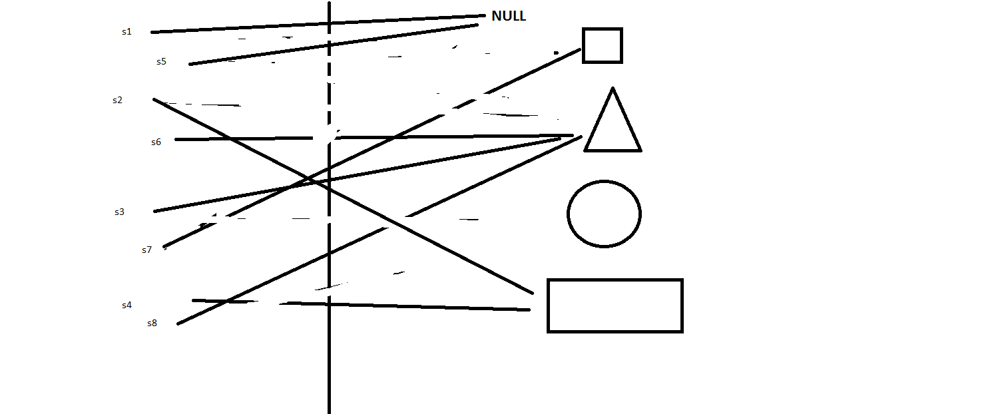

Bu yazı, Başkent Üniversitesi **EEM227 Veri Yapıları** dersinin 2013–2015 yıllarına ait quiz çözümlerini bir araya getiriyor. Öne çıkan konu Java'da **referanslar**: derste referans değişkenleri, nesneyi gösteren birer "uzaktan kumanda" gibi anlatılıyordu. Bir kumandayı başka bir nesneye çevirmek nesneyi değiştirmez; yalnızca kumandanın neyi gösterdiğini değiştirir. Orijinal BlueJ projeleri ve çözüm çizimi yazının sonunda ZIP olarak indirilebilir.

## Quiz 1: Artık yıl

Bir yıl 4'e bölünüyorsa artık yıldır; ama 100'e bölünüp 400'e bölünmüyorsa değildir.

```java
public class Quiz1Question1
{
    public static void main()
    {
        Quiz1Question1 q1 = new Quiz1Question1();
        q1.artikYil(1200);
        q1.artikYil(1201);
        q1.artikYil(1888);
        q1.artikYil(1892);
        q1.artikYil(1896);
        q1.artikYil(1904);
        q1.artikYil(1988);
        q1.artikYil(1992);
        q1.artikYil(1996);
        q1.artikYil(2004);
        q1.artikYil(2000);
        q1.artikYil(1900);
    }

    public void artikYil ( int yil )
    {
        // Kodunuz buraya
        if (yil % 4 == 0)
        {
            if (yil % 400 == 0)
            {
                System.out.println("Yıl :" + yil + ", artık yıldır.");
            }
            else if (yil % 100 == 0)
            {
                System.out.println("Yıl :" + yil + ", artık yıl değildir.");
            }
            else
            {
                System.out.println("Yıl :" + yil + ", artık yıldır.");
            }
        }
        else
        {
                System.out.println("Yıl :" + yil + ", artık yıl değildir.");
        }
    }
}
```

Sonuç: 1201 ve 1900 artık yıl değil; listedeki diğer bütün yıllar (1200 ve 2000 dahil) artık yıl.

## Quiz 2: Kodun çıktısı ne?

```java
public class Quiz2KodCikti
{
    public static void main(String[] args) {
        int count=1;
        System.out.print(count++);
        System.out.print(++count);
        System.out.print(count++);
    }
}
```

```
133
```

`count++` önce değeri kullanır sonra artırır (1 yazar, count 2 olur); `++count` önce artırır sonra kullanır (count 3 olur, 3 yazar); son `count++` yine 3 yazar ve count 4 olur.

## Sayı çift mi?

```java
public class QuizSayiCiftMi
{
    public boolean sayiCiftMi ( int sayi )
     {
         if (sayi % 2 == 0)
         {
             return true;
         }
         else
         {
             return false;
         }
     }
}
```

## Uzaktan kumanda sorusu: şekiller

Dört şekil nesnesi oluşturuluyor ve sekiz referans ("kumanda") bunlar arasında birbirine atanıyor. Soru: sonunda her kumanda neyi gösteriyor?

```java
public class UzaktanKumandaSekilQuiz
{
    private String sekilAdi ;
     public UzaktanKumandaSekilQuiz( String pSekilAdi )
     {
         sekilAdi = pSekilAdi ;
     }

     public String toString ()
     {
         return "" + sekilAdi ;
     }

     public static void main( String [ ] args )
    {
        UzaktanKumandaSekilQuiz s1=new UzaktanKumandaSekilQuiz("Kare") ;
        UzaktanKumandaSekilQuiz s2=new UzaktanKumandaSekilQuiz("Ucgen") ;
        UzaktanKumandaSekilQuiz s3=new UzaktanKumandaSekilQuiz("Daire") ;
        UzaktanKumandaSekilQuiz s4=new UzaktanKumandaSekilQuiz("Dikdortgen") ;

        UzaktanKumandaSekilQuiz s5=s1 ;
        UzaktanKumandaSekilQuiz s6=s2 ;
        UzaktanKumandaSekilQuiz s7=null ;
        UzaktanKumandaSekilQuiz s8=s3 ;

        s7 = s5 ;
        s5 = s2 ;
        s8 = s2 ;
        s1 = null ;
        s3 = s8 ;
        s5 = s1 ;
        s2 = s4 ;

        System.out.println( s1 ) ;
        System.out.println( s2 ) ;
        System.out.println( s3 ) ;
        System.out.println( s4 ) ;
        System.out.println( s5 ) ;
        System.out.println( s6 ) ;
        System.out.println( s7 ) ;
        System.out.println( s8 ) ;
    }
}
```

```
null
Dikdortgen
Ucgen
Dikdortgen
null
Ucgen
Kare
Ucgen
```



Çizimdeki ince ayrıntı: **daireyi gösteren hiçbir kumanda kalmıyor.** O nesneye artık ulaşılamaz; Java'da çöp toplayıcı (garbage collector) onu bellekten temizler.

## Uzaktan kumanda sorusu: kare dizisi

Aynı fikir bu kez bir dizinin elemanlarıyla soruluyor.

```java
public class Kare
{
    public int Kenar;
}
```

```java
public class Program
{
    public static void main()
    {
        Kare[] kareDizisi = new Kare[5];
        int uzunluk = kareDizisi.length /2 +2;

        for(int i=0;i<uzunluk;i++)
        {
            kareDizisi[i] = new Kare();
            kareDizisi[i].Kenar = i * i + 10;
        }

        kareDizisi[4] = kareDizisi[2];
        kareDizisi[3] = kareDizisi[1];
        kareDizisi[1] = kareDizisi[3];
        kareDizisi[2] = kareDizisi[2];
        kareDizisi[1] = kareDizisi[4];

        for(Kare k : kareDizisi)
        {
            if (k != null)
            {
                System.out.println(k.Kenar);
            }
        }
    }
}
```

```
10
14
14
11
14
```

`uzunluk` 5 / 2 + 2 = 4 olduğu için yalnız ilk dört eleman için nesne oluşturulur (kenarları 10, 11, 14, 19). Atamalardan sonra kenarı 19 olan kareyi gösteren eleman kalmaz; 14'lük kareyi ise üç ayrı eleman gösterir.

*Not: Çıktılar, sunucuda Java kurulu olmadığı için kod satır satır izlenerek hesaplandı; şekil sorusunun sonucu dersin çözüm çizimiyle birebir aynı.*
