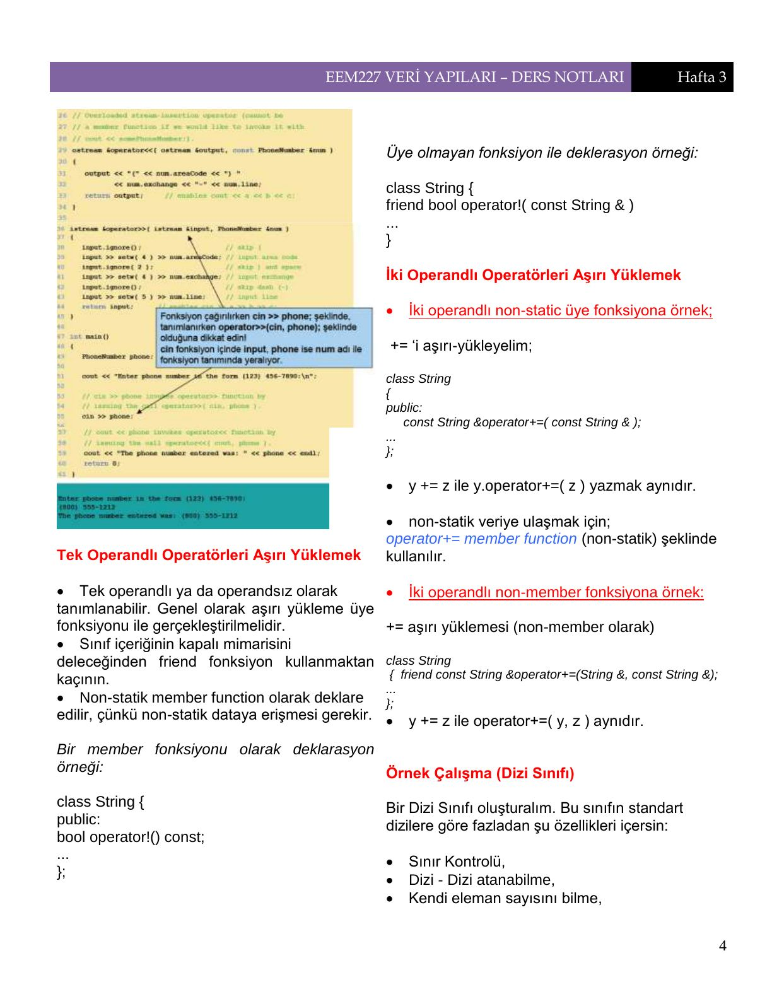
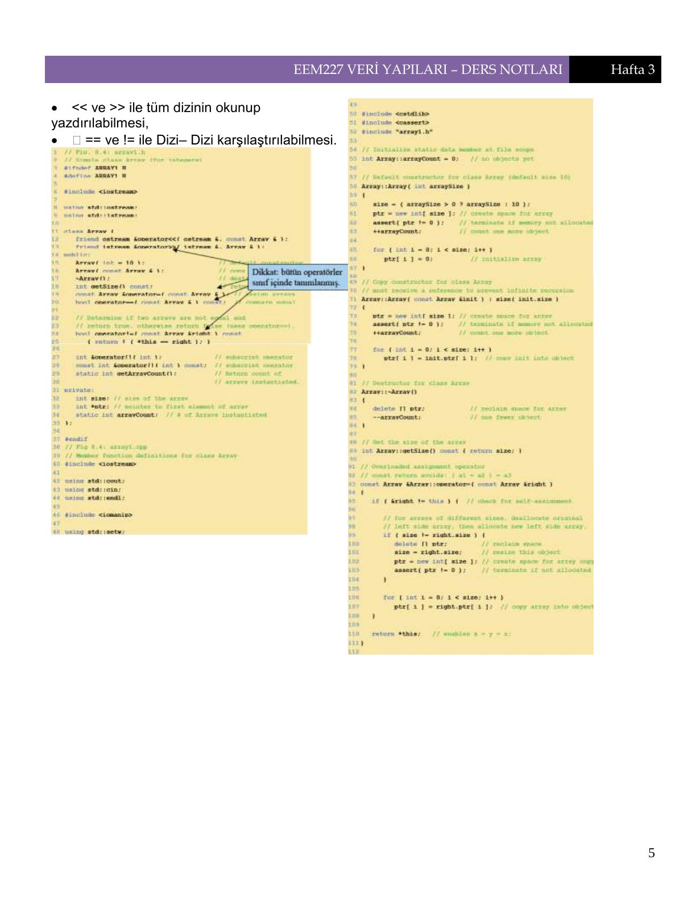
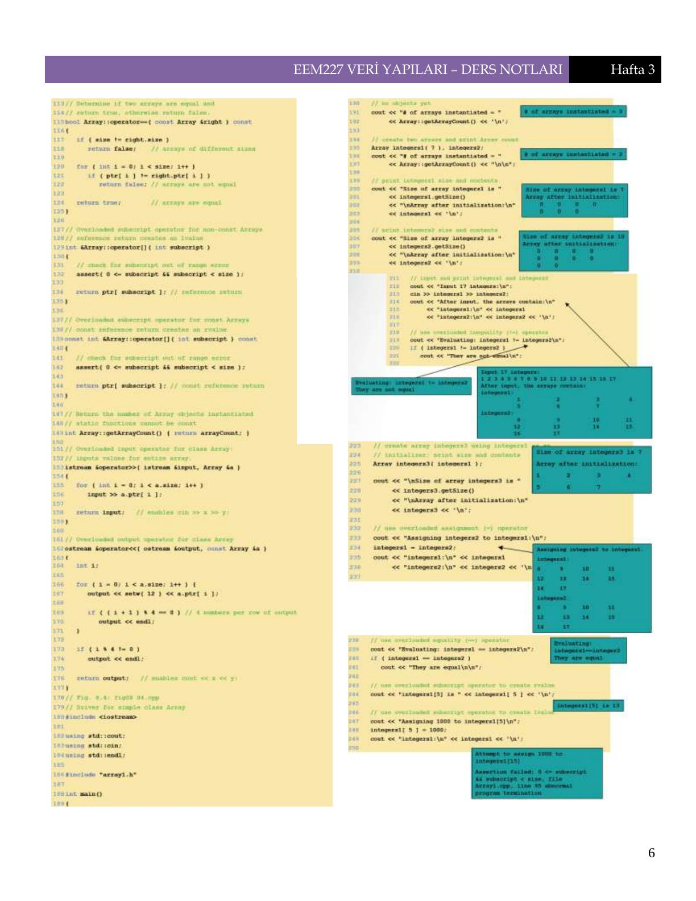
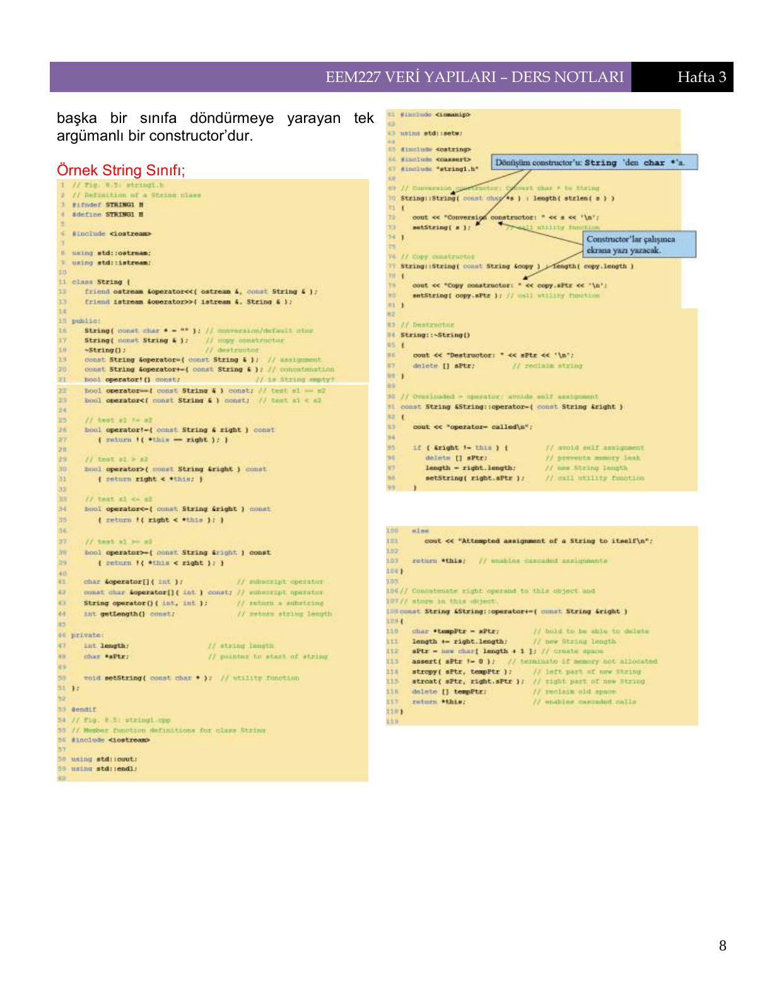
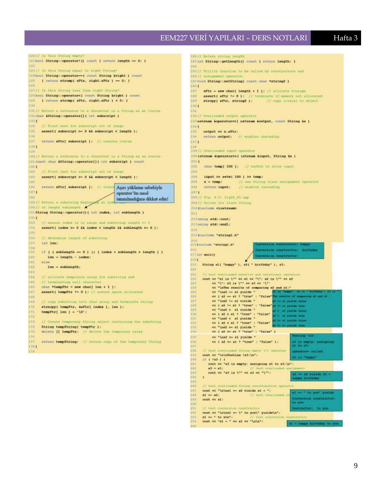
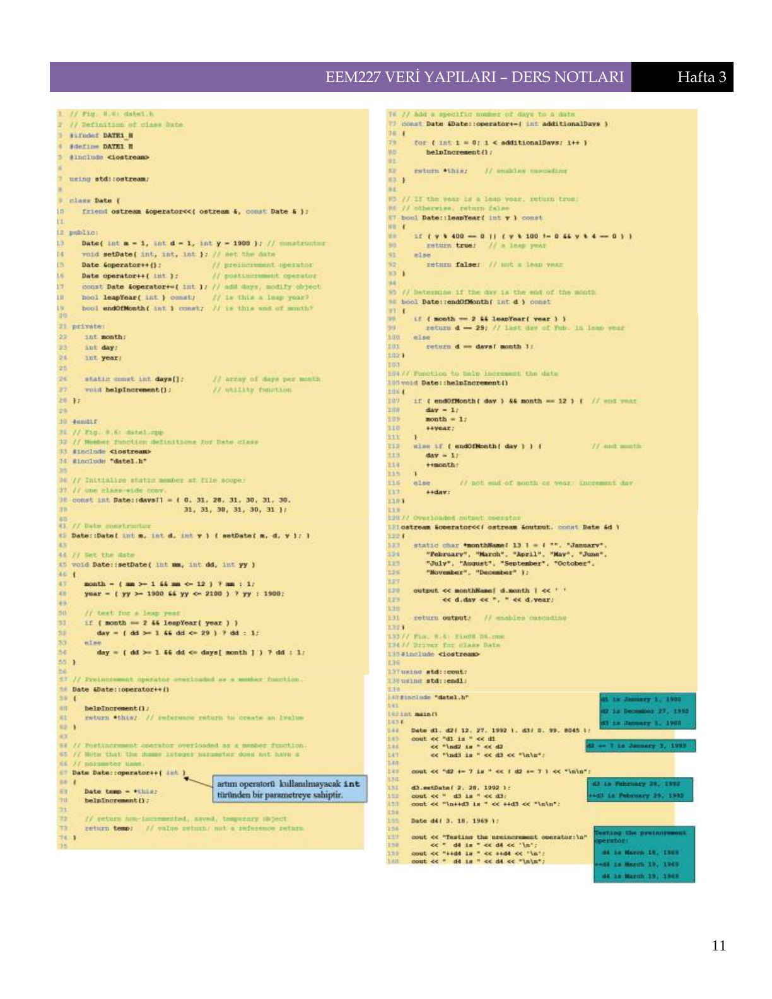

This post contains the **supplementary lecture notes** for week 3 of the fall 2007 semester of the **EEM227 Data Structures** course at Başkent University (October 5, 2007). The notes are a two-column summary: first the basic concepts of data structures, then data abstraction and operator overloading rules in C++. Since the code for the worked examples (the Array, String and Date classes) appears in the notes as images of book pages, it is given here as page images. For the main lecture notes of the same week, see the post "Adding New Functions to Operators" (Operatörlere Yeni İşlevler Yüklenmesi). The original PDF of the supplementary notes can be downloaded at the end of the post.

## Data structures

Data structures are structures used for storing and processing data efficiently in a computer environment. In general, the chosen data structure is important for the algorithm to run efficiently.

**Algorithm:** A sequence of instructions used to solve a problem. It is a precise method developed to solve a problem. When an algorithm is expressed in a programming language (such as C or Pascal), it is called a program.

**Data:** The most basic elements processed by algorithms (numerical information, textual information, images, sounds, and other information used as input, output, or in intermediate computations). For an algorithm to be efficient, understandable, and correct, the data it will process must be organized.

**Data structures:** The building blocks that determine how data is organized. Even a program variable can be regarded as a simple data structure. Different algorithms may require data to be organized in data structures such as arrays, stacks, queues, trees, and graphs.

### Data, structure and algorithm

In a program, data, structure, and algorithm are inseparable components, and each of them is important. The ways data is organized are important because, when the structure is well designed, it becomes easier to develop an algorithm that is efficient, correct, understandable, fast, and uses few resources.

### From data types to data structures

- **Data types:** Integer, real number, character...
- **Composite data types:** Array, structure (record), ...
- **Data structures:** List, stack, queue, tree, graph, etc.

**List:** A data structure consisting of a finite number of elements arranged in linear order. There is no restriction on access to any of its elements.

**Stack:** A list-like data structure with restricted access to its elements. A LIFO list.

**Queue:** A list-like data structure with restricted access to its elements. A FIFO list.

**Database:** Briefly, it can be defined as an information bank made up of data to be processed and data that has been processed. Data structures, that is, the ways data is organized, are also important for databases. For example, the records of the customers of a bank, the faculty members, employees, and courses of a university... are kept and processed in databases.

Data structures can be **static data structures** or **dynamic data structures**.

### What is an abstract data type?

Abstract data types are data structures for which what kind of thing they are and which operations are defined on them, and in what way, are specified, but how they will be stored in the computer environment is not. The tree structure or priority queues are examples of this. Others:

- String
- List
- Linked list
- Stack
- Queue
- Binary search tree
- Priority queue
- Complex number
- Associative array
- Multimap

## Data abstraction and information hiding

Data abstraction and information hiding make it possible to write programs that do not depend heavily on the contents of classes and functions, and prevent usage errors. Classes and functions are made available for use by showing only the necessary details (the LIFO [last-in, first-out] structure).

- int and float can be given as examples of abstract data types (ADTs).
- For example, int: its meaning in mathematics is different, and the integer in the computer is different.
- C++ is a language that can be extended by creating new data types.

### Example: abstract array data type

A programmer can create an ADT array and add new capabilities to the standard array structure:

- Range checking
- Ability for the array to start from any number
- Array-to-array assignment
- Array-to-array comparison
- Array input/output operations
- Knowing its own size
- Ability to grow to hold more elements

### Example: abstract string data type

- C++ has no built-in string type. This is for maximum performance.
- However, mechanisms exist for creating and completing the string abstract data type.
- C++ also has a string class in the ANSI/ISO standards.

### Example: queue ADT

It is similar to waiting in a line: first in, first out (FIFO).

- **Enqueue:** Puts one element at the back of the queue at a time.
- **Dequeue:** Takes one element from the front of the queue at a time.
- The details of the operations are hidden. The data structure cannot be accessed directly while using it.
- Only the queue member functions can access the hidden internal structure.

### What are we aiming for?

The most important advantage of object-oriented programming (OOP) is that the written code can be reused to the maximum extent. To achieve this, the general structure is abstracted and information is hidden. People who use the structure cannot write programs tightly bound to your code, even if they want to. This gives the programmers who write the objects the ability to change the entire internal structure whenever they wish without changing the objects' interfaces. In use, it makes programming easier by presenting a standard interface to different objects.

## Operator overloading

Operator overloading gives C++ the ability for operators to work on objects as well. In this way, conventional operators can also work with user-defined objects. However, it requires great care; the program can easily become difficult to understand.

C++ already has overloaded operators:

- `<<` works both as the stream insertion operator and as the bitwise shift operator.
- Operators such as `+` and `–` work with different types.

### How is it done?

- Write a function as you normally would.
- Give the function name as the operator name, attached to the `operator` keyword. For example, a function named `operator+` overloads the `+` operator.
- In use: when working with objects, all operators except `=` and `&` must be overloaded.

At this point the notes include a table of operators that can and cannot be overloaded. The operators that cannot be overloaded are: `.`, `.*`, `::`, `?:` and `sizeof`.

### Rules

- The `&`, `*`, `+`, `-` operators have unary and binary versions, and they are overloaded separately.
- Operator precedence cannot be changed by overloading.
- The associativity of operators cannot be changed.
- The number of operands cannot be changed: binary operators cannot be made unary, and unary operators cannot be made binary.
- New operators cannot be defined. Only existing ones can be overloaded.
- Operators cannot be overloaded for existing types. For example, the way two integers are added cannot be changed; the compiler gives an error.

### Operator functions: member or friend function?

- If the `( )`, `[ ]`, `->` or assignment operators are being overloaded, a member function must be used.
- If a member function is to be used, the left side of the operator must be an object of its own class. If the left side is not an object of its own class, the operator function cannot be a member.
- If it will not be a member function and it needs access to public or private members, it must be a friend function; it must have the right to access its operands.

### Overloading stream operators

By overloading the << and >> operators, we can perform input and output with user-defined types.

- The type of the left side will be `ostream &` and `istream &`.
- Since the left side is not of its own class, we cannot define them as member functions.
- To reach private data members, they must be friend functions.
- If they are not defined as friend functions, they reach the private data through the public set and get functions. For performance reasons, these functions are made inline.

As an example program, the notes give a `PhoneNumber` class that reads and writes a phone number in the form `(800) 555-1212` (this example is also in the main lecture notes).



### Overloading unary operators

- They can be defined with one operand or with no operand. In general, overloading should be done with a member function.
- Avoid using a friend function, since it would break the closed architecture of the class contents.
- It is declared as a non-static member function, because it needs to access non-static data.

Example of declaration as a member function:

```cpp
class String {
public:
bool operator!() const;
...
};
```

Example of declaration with a non-member function:

```cpp
class String {
friend bool operator!( const String & )
...
}
```

### Overloading binary operators

Let us overload `+=` as an example of a binary non-static member function:

```cpp
class String
{
public:
    const String &operator+=( const String & );
...
};
```

Writing `y += z` is the same as writing `y.operator+=( z )`. To reach non-static data, `operator+=` is used as a non-static member function.

As an example of a binary non-member function, overloading `+=` (as a non-member):

```cpp
class String
 { friend const String &operator+=(String &, const String &);
...
};
```

`y += z` is the same as `operator+=( y, z )`.

## Worked example: Array class

Let us create an Array class. In addition to standard arrays, this class should have the following features:

- Bounds checking
- Array-to-array assignment
- Knowing its own number of elements
- Reading and printing the whole array with `<<` and `>>`
- Array-to-array comparison with `==` and `!=`

In the notes, the header file of the `Array` class (array1.h), its member functions (array1.cpp), and the driver program (fig08_04.cpp) appear as code images. One of the callout boxes says: "Note: all operators are defined inside the class." The driver program creates two arrays (with 7 and 10 elements) and prints their sizes and contents, reads 17 integers from the keyboard, compares them with `!=` and `==`, performs the assignment `integers1 = integers2`, reads the element `integers1[5]` and sets it to 1000, and finally shows that when the out-of-range assignment to `integers1[15]` is attempted, the program terminates with `assert`.





## Type conversion

**Cast operator:**

- Forces conversion to standard types.
- Defines the conversion relationship between standard types and user-defined types.
- The conversion operator (or cast operator) must be a non-static member function; it cannot be a friend.
- It cannot have a return type. The type is the type of the object being converted.
- For a user-defined class A, `A::operator char *() const;` defines a conversion function that converts an A object to a `char *`.
- Conversion between built-in data types is done with cast operators; but what happens with user-defined data types?
- User-defined types → built-in types is done with conversion constructors.
- `A::operator int() const;` defines a conversion function that converts an A object to an integer.
- `A::operator otherClass() const;` defines a conversion function that converts an A object to the class otherClass.
- Type conversion can remove the need for overloading.

*Note: The direction seems to be mixed up here: it is the conversion operators described right after (such as `operator int()`) that convert a user-defined type to a built-in type. A conversion constructor does the opposite, that is, it converts from another type (for example `char *`) to the user-defined type.*

## Worked example: String class

If the object s of type string is used in a place where data of type `char *` is normally expected, such as `cout << s;`, the compiler calls the conversion function (`operator char *`) to convert s to the `char *` type and uses it.

The C++ standard library already has a string class, but we can write our own string class by using overloading.

**Conversion constructor function:** A single-argument constructor that serves to convert an object to another class.

In the notes, the header file of the `String` class (string1.h), its member functions (string1.cpp), and the driver program (fig08_05.cpp) appear as code images. The callout boxes read: "Conversion constructor: from String to char *", "The operation of the constructors is printed to the screen", "Note how the operator is defined because of overloading!". The driver program demonstrates the comparison operators (`==`, `!=`, `>`, `<`, `>=`, `<=`) with the strings "happy" and " birthday", the empty-string test (`!`), concatenation with `+=`, taking a substring with the `()` operator, and changing characters with `[]`; at the end, an attempt to use an out-of-range subscript terminates the program with `assert`.





## Overloading (++ and --)

We can also overload the pre- and post-increment/decrement operators. However, there is a difference between the pre- and post-increment/decrement operators.

Pre-operation operators are defined like other unary operators:

```cpp
d1.operator++(); // for ++d1
Date &operator++();    // example (member function)
```

When the compiler sees post-operation operators, it looks for a function like the following:

```cpp
d1.operator++( 0 ); // for d1++
Date operator++( int );    // example (member function)
```

The value 0 here is so that the compiler can distinguish between the pre and post versions.

## Worked example: Date class

We will create a Date class with the following features:

- The day, month, and year values will change with an overloaded increment operator,
- An overloaded `+=` operator,
- A function to test for a leap year,
- A function to test whether a day is the last day of any month.

In the notes, date1.h, date1.cpp and fig08_06.cpp appear as code images. The callout box for the postfix `operator++( int )` reads: "has a parameter of type int that the increment operator will not use." The leap-year test is performed with the condition `y % 400 == 0 || ( y % 100 != 0 && y % 4 == 0 )`.



Screen output of the driver program:

```
d1 is January 1, 1900
d2 is December 27, 1992
d3 is January 1, 1900

d2 += 7 is January 3, 1993

  d3 is February 28, 1992
++d3 is February 29, 1992

Testing the preincrement operator:
  d4 is March 18, 1969
++d4 is March 19, 1969
  d4 is March 19, 1969

Testing the postincrement operator:
  d4 is March 19, 1969
d4++ is March 19, 1969
  d4 is March 20, 1969
```
