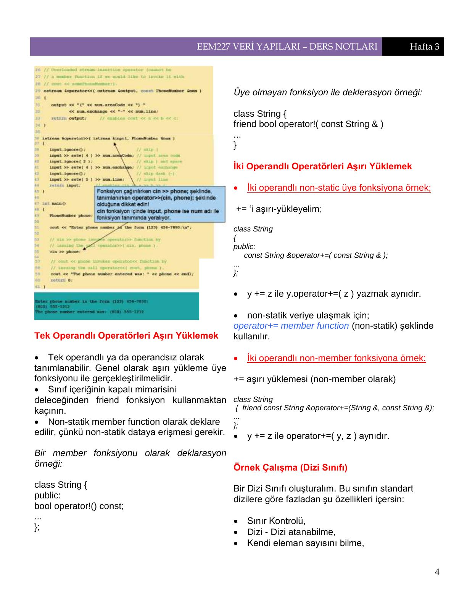
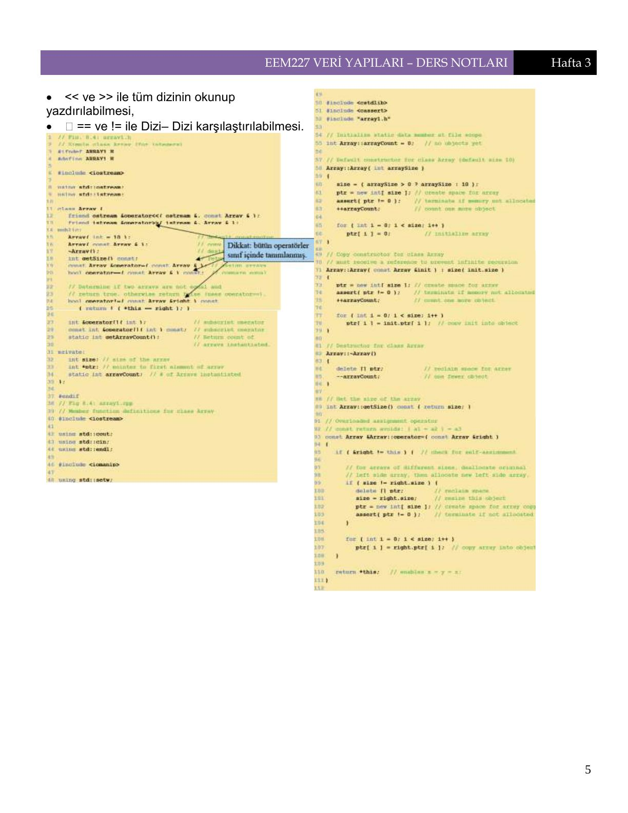
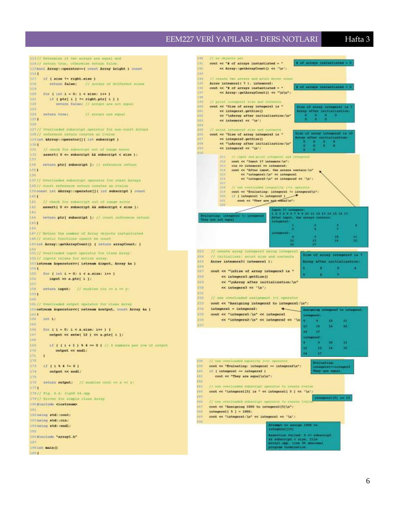
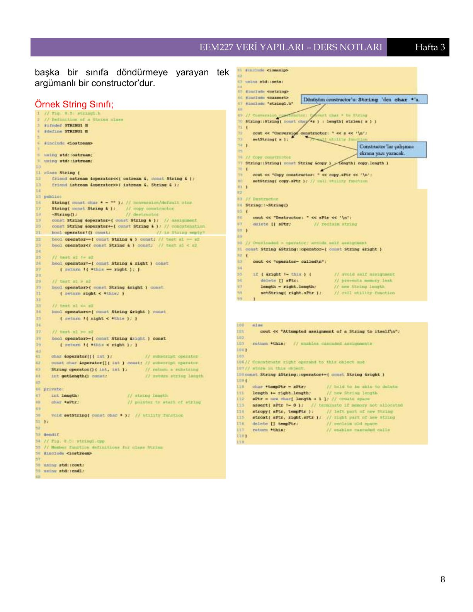
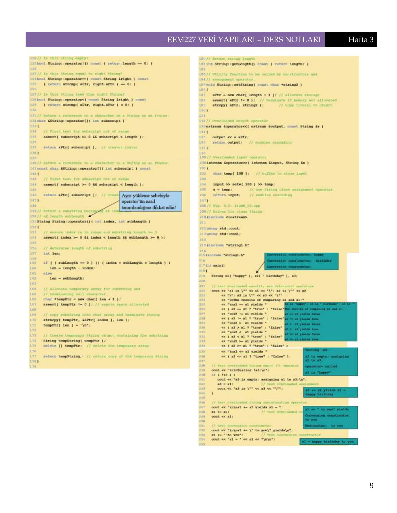
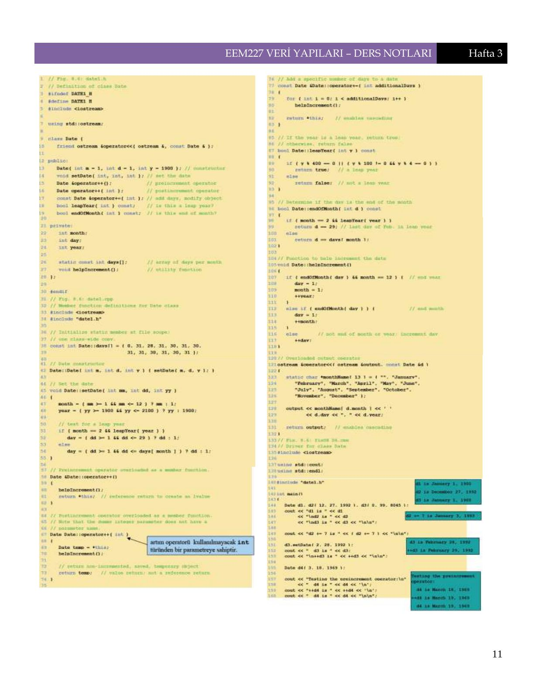

Bu yazı, Başkent Üniversitesi **EEM227 Veri Yapıları** dersinin 2007 güz dönemi 3. haftasına ait **ek ders notudur** (5 Ekim 2007). Not iki sütunlu bir özet biçiminde: önce veri yapılarının temel kavramlarını, sonra C++'ta veri soyutlama ve operatör aşırı yükleme kurallarını anlatıyor. Örnek çalışmaların (Dizi, String ve Date sınıfları) kodları notta kitap sayfası görüntüsü olarak yer aldığı için burada sayfa görselleriyle verildi. Aynı haftanın ana ders notu için "Operatörlere Yeni İşlevler Yüklenmesi" yazısına bakabilirsiniz. Ek notun orijinal PDF'i yazının sonunda indirilebilir.

## Veri yapıları

Bilgisayar ortamında verilerin etkin olarak depolanması ve işlenmesi için kullanılan yapılardır. Genellikle seçilen veri yapısı, algoritmanın etkin çalışabilmesi için önemlidir.

**Algoritma:** Bir problemin çözümünde kullanılan komutlar dizisi. Bir problemi çözmek için geliştirilmiş kesin bir yöntemdir. Bir algoritma, bir programlama dilinde (C, Pascal gibi) ifade edildiğinde program adını alır.

**Veri:** Algoritmalar tarafından işlenen en temel elemanlar (sayısal bilgiler, metinsel bilgiler, resimler, sesler ve girdi, çıktı olarak veya ara hesaplamalarda kullanılan diğer bilgiler). Bir algoritmanın etkin, anlaşılır ve doğru olabilmesi için, algoritmanın işleyeceği verilerin düzenlenmesi gerekir.

**Veri yapıları:** Verilerin düzenlenme biçimini belirleyen yapıtaşlarıdır. Bir program değişkeni bile basit bir veri yapısı olarak kabul edilebilir. Değişik algoritmalarda verilerin diziler, yığıtlar, kuyruklar, ağaçlar ve çizgeler gibi veri yapıları şeklinde düzenlenmesi gerekebilir.

### Veri, yapı ve algoritma

Bir programda veri, yapı ve algoritma birbirinden ayrılmaz bileşenlerdir ve her biri önemlidir. Verilerin düzenlenme biçimleri önemlidir, çünkü yapı iyi tasarlandığında etkin, doğru, anlaşılır ve hızlı çalışıp az kaynak kullanan algoritma geliştirmek kolaylaşır.

### Veri tiplerinden veri yapılarına

- **Veri tipleri:** Tamsayı, gerçel sayı, karakter...
- **Bileşik veri tipleri:** Dizi, yapı (kayıt), ...
- **Veri yapıları:** Liste, yığıt, kuyruk, ağaç, çizge vb.

**Liste:** Sonlu sayıda elemandan oluşan ve elemanları doğrusal sırada yerleştirilmiş veri yapısı. Herhangi bir elemanına erişimde sınırlama yoktur.

**Yığıt:** Elemanlarına erişim sınırlaması olan, liste uyarlı veri yapısı. LIFO listesi.

**Kuyruk:** Elemanlarına erişim sınırlaması olan, liste uyarlı veri yapısı. FIFO listesi.

**Veri tabanı (database):** Kısaca, işlenecek ve işlenmiş verilerden oluşan bilgi bankası olarak tanımlanabilir. Veri yapıları, yani verilerin düzenlenme biçimleri, veri tabanları için de önemlidir. Örnek olarak bir bankadaki müşterilerin bilgileri, bir üniversitenin öğretim elemanları, çalışanları, dersleri... veri tabanlarında tutulup işlenir.

Veri yapıları **statik veri yapıları** ve **dinamik veri yapıları** tipinde olabilir.

### Soyut veri yapısı (abstract data type) nedir?

Nasıl bir şey olduğu, üzerinde hangi işlemlerin ne şekilde tanımlandığı belli olan ama bilgisayar ortamında nasıl tutulacağı belirtilmeyen veri yapılarıdır. Ağaç yapısı ya da öncelik kuyrukları (priority queue) buna örnek olarak verilebilir. Diğerleri:

- String
- List
- Linked list
- Stack
- Queue
- Binary search tree
- Priority queue
- Complex number
- Associative array
- Multimap

## Veri soyutlamak ve bilgi gizlemek

Veri soyutlamak ve bilgi gizlemek (data abstraction and information hiding), sınıf ve fonksiyonların içeriğine fazla bağımlı olmayan programlar yazılabilmesini sağlar, kullanım hatalarını önler. Sadece gerekli detaylar (LIFO [last-in, first-out] yapısı) gösterilerek kullanılmaları sağlanır.

- Soyut veri tiplerine (ADT) int, float örnek olarak verilebilir.
- Örneğin int: matematikteki anlamı farklı, bilgisayardaki integer farklıdır.
- C++ yeni veri türleri oluşturularak genişleyebilen bir dildir.

### Örnek: soyut dizi veri türü

Programcı bir ADT dizisi oluşturabilir ve standart dizi yapısına yeni kapasiteler ilave eder:

- Aralık kontrolü
- Dizinin herhangi bir sayıdan başlayabilmesi
- Dizi–dizi ataması yapabilme
- Dizi–dizi karşılaştırması yapabilme
- Dizi giriş/çıkış işlemleri
- Kendi büyüklüğünü bilme
- Daha fazla elemanı kapsamak için genişleyebilme

### Örnek: soyut string veri türü

- C++'da hazır string tipi yoktur. Bu, maksimum performans içindir.
- Ancak string soyut veri türünü oluşturmak ve tamamlamak için mekanizmalar mevcuttur.
- C++'da ANSI/ISO standartlarında string sınıfı da vardır.

### Örnek: queue ADT tipi

Bir kuyrukta beklemeye benzer: ilk giren ilk çıkar (FIFO [first in, first out]).

- **Enqueue:** Her seferinde bir elemanı kuyruğun arkasına koyar.
- **Dequeue:** Her seferinde bir elemanı kuyruğun önünden alır.
- İşlemlerin ayrıntısı gizlidir. Kullanırken veri yapısına doğrudan erişilemez.
- Sadece queue üye fonksiyonları gizli iç yapıya erişebilirler.

### Ne amaçlıyoruz?

Nesne yönelimli programlamanın (OOP) en önemli avantajı, yazılan kodun maksimum miktarda tekrar kullanılabilir olmasıdır. Bunu sağlamak için genel yapı soyutlanır, bilgiler gizlenir. Yapıyı kullanan kişiler, isteseler bile, kodunuza sıkı sıkıya bağlı programlar yazamazlar. Bu ise nesneleri yazan programcılara, istedikleri zaman nesnelerin ara yüzlerini değiştirmeden tüm iç yapıyı değiştirebilme olanağı sağlar. Kullanımda ise değişik nesnelere standart bir ara yüz sunarak programlamayı kolaylaştırır.

## Operatör aşırı yüklemesi (operator overloading)

Operatör aşırı yüklemesi C++'a operatörlerin nesneler üzerinde de çalışabilmesi yeteneğini sağlar. Bu sayede geleneksel operatörler, kullanıcıların tanımladığı nesnelerle de çalışabilir. Ancak çok özen gerektirir; program kolayca anlaşılmaz bir hâl alabilir.

C++'ta zaten aşırı yüklenmiş operatörler vardır:

- `<<` hem stream girişi operatörü hem de bitwise shift operatörü olarak çalışır.
- `+`, `–` vb. operatörler değişik türlerle çalışır.

### Nasıl yapılır?

- Normalde olduğu gibi bir fonksiyon yazın.
- Fonksiyon ismini `operator` anahtar kelimesine bitişik olarak operatör ismi olarak verin. Mesela `operator+` adlı fonksiyon `+` operatörünü aşırı yükler.
- Kullanırken: nesnelerle çalışırken `=` ve `&` dışındaki tüm operatörlerin aşırı yüklenmesi zorunludur.

Notta bu noktada aşırı yüklenebilen ve yüklenemeyen operatörlerin tablosu var. Aşırı yüklenemeyen operatörler: `.`, `.*`, `::`, `?:` ve `sizeof`.

### Kurallar

- `&`, `*`, `+`, `-` operatörlerinin unary ve binary versiyonları vardır ve ayrı ayrı aşırı yüklenirler.
- Operatör öncelikleri aşırı yükleme ile değiştirilemez.
- Operatörlerin işlem yönü değiştirilemez.
- Operand sayısı değiştirilemez: iki operandlı operatörler tek operandlı, tek operandlı operatörler iki operandlı yapılamaz.
- Yeni operatör tanımlanamaz. Sadece var olanlar aşırı yüklenebilir.
- Var olan tipler için operatörler aşırı yüklenemez. Mesela iki integer'ın toplanma yöntemi değiştirilemez; derleyici hata verir.

### Operatör fonksiyonlar: üye ya da friend fonksiyon?

- `( )`, `[ ]`, `->` ya da atama operatörleri aşırı yükleniyorsa mutlaka üye fonksiyon kullanılmalı.
- Üye fonksiyon kullanılacaksa, operatörün sol tarafı mutlaka kendi sınıfından bir nesne olmalıdır. Eğer sol taraf kendi sınıfından bir nesne değilse, operatör fonksiyonu kesinlikle üye olamaz.
- Üye fonksiyon olmayacaksa ve public ya da private üyelere erişilmesi gerekiyorsa mutlaka friend fonksiyon olmalıdır; operandlarına ulaşma hakkı olmalıdır.

### Stream operatörlerini aşırı yüklemek

<< ve >> operatörlerini aşırı yükleyerek kullanıcı tanımlı tiplerle giriş çıkış işlemi yapabiliriz.

- Sol tarafın türü `ostream &` ve `istream &` olacak.
- Sol taraf kendi sınıfından olmadığından üye fonksiyon olarak tanımlayamayız.
- Private veri üyelerine ulaşmak için friend fonksiyon olmalılar.
- Eğer friend fonksiyon olarak tanımlanmamışlarsa, public'te tanımlı set ve get fonksiyonları üzerinden private veriye ulaşırlar. Performans gereksinimi nedeniyle bu fonksiyonlar inline yapılır.

Örnek program olarak notta telefon numarasını `(800) 555-1212` biçiminde okuyup yazan `PhoneNumber` sınıfı veriliyor (bu örnek ana ders notunda da var).



### Tek operandlı operatörleri aşırı yüklemek

- Tek operandlı ya da operandsız olarak tanımlanabilir. Genel olarak aşırı yükleme üye fonksiyonu ile gerçekleştirilmelidir.
- Sınıf içeriğinin kapalı mimarisini deleceğinden friend fonksiyon kullanmaktan kaçının.
- Non-statik üye fonksiyon olarak bildirilir, çünkü non-statik veriye erişmesi gerekir.

Bir üye fonksiyonu olarak bildirim örneği:

```cpp
class String {
public:
bool operator!() const;
...
};
```

Üye olmayan fonksiyon ile bildirim örneği:

```cpp
class String {
friend bool operator!( const String & )
...
}
```

### İki operandlı operatörleri aşırı yüklemek

İki operandlı non-static üye fonksiyona örnek olarak `+=`'i aşırı yükleyelim:

```cpp
class String
{
public:
    const String &operator+=( const String & );
...
};
```

`y += z` ile `y.operator+=( z )` yazmak aynıdır. Non-statik veriye ulaşmak için `operator+=` non-statik üye fonksiyon şeklinde kullanılır.

İki operandlı non-member fonksiyona örnek, `+=` aşırı yüklemesi (non-member olarak):

```cpp
class String
 { friend const String &operator+=(String &, const String &);
...
};
```

`y += z` ile `operator+=( y, z )` aynıdır.

## Örnek çalışma: Dizi sınıfı

Bir Dizi sınıfı oluşturalım. Bu sınıf standart dizilere göre fazladan şu özellikleri içersin:

- Sınır kontrolü
- Dizi–dizi atanabilme
- Kendi eleman sayısını bilme
- `<<` ve `>>` ile tüm dizinin okunup yazdırılabilmesi
- `==` ve `!=` ile dizi–dizi karşılaştırılabilmesi

Notta `Array` sınıfının başlık dosyası (array1.h), üye fonksiyonları (array1.cpp) ve sürücü programı (fig08_04.cpp) kod görüntüsü olarak yer alıyor. Açıklama kutusundan biri: "Dikkat: bütün operatörler sınıf içinde tanımlanmış." Sürücü program iki diziyi (7 ve 10 elemanlı) oluşturup boyutlarını ve içeriklerini yazdırıyor, klavyeden 17 tamsayı okuyor, `!=` ve `==` ile karşılaştırıyor, `integers1 = integers2` ataması yapıyor, `integers1[5]` elemanını okuyup 1000 yapıyor ve son olarak aralık dışı `integers1[15]` ataması denendiğinde programın `assert` ile sonlandığını gösteriyor.





## Tipler arası dönüşüm

**Tip operatörü:**

- Standart tiplere dönüştürmeye zorlar.
- Standart tiplerle kullanıcının tanımladığı türler arasındaki dönüşüm ilişkisini tanımlar.
- Dönüşüm operatörü (veya cast operatörü) statik olmayan bir üye fonksiyon olmalıdır; friend olamaz.
- Dönüş türü olamaz. Bu tür, dönüştürülen nesnenin türüdür.
- Kullanıcı tarafından tanımlanan A sınıfı için `A::operator char *() const;` A nesnesini bir `char *`'a dönüştüren tip dönüşüm fonksiyonu tanımlanıyor.
- Built-in veri tiplerini birbirine dönüştürme işlemi cast operatörleriyle yapılır; ama kullanıcının tanımladığı veri tiplerinde durum ne olacak?
- User-defined types → built-in types bu iş conversion constructor'ları (dönüşüm constructor) ile yapılır.
- `A::operator int() const;` A nesnesini bir integer'a dönüştüren tip dönüşüm fonksiyonu tanımlanıyor.
- `A::operator otherClass() const;` A nesnesini otherClass sınıfına dönüştüren tip dönüşüm fonksiyonu tanımlanıyor.
- Tip dönüşümü aşırı yükleme zorunluluğunu kaldırabilir.

*Not: Burada yön karışmış görünüyor: kullanıcı tanımlı bir türü built-in türe çeviren, hemen ardından anlatılan dönüşüm operatörleridir (`operator int()` gibi). Dönüşüm constructor'ı ise tersini, yani başka bir türden (örneğin `char *`) kullanıcı tanımlı türe dönüşümü yapar.*

## Örnek çalışma: String sınıfı

`cout << s;` gibi normalde `char *` tipinde veri beklenen bir yerde string tipinden olan s nesnesi kullanılırsa, derleyici tip dönüşüm fonksiyonunu (`operator char *`) çağırarak s'yi `char *` tipine çevirerek kullanır.

Zaten C++ standart kütüphanesinde bir string sınıfı vardır, ama aşırı yükleme ile kendi string sınıfımızı yazabiliriz.

**Dönüşüm constructor fonksiyonu:** bir nesneyi başka bir sınıfa döndürmeye yarayan tek argümanlı bir constructor'dur.

Notta `String` sınıfının başlık dosyası (string1.h), üye fonksiyonları (string1.cpp) ve sürücü programı (fig08_05.cpp) kod görüntüsü olarak yer alıyor. Açıklama kutuları: "Dönüşüm constructor'ı: String'den char *'a", "Constructor'ların çalışması ekrana yazılıyor", "Aşırı yükleme sebebiyle operatör'ün nasıl tanımlandığına dikkat edin!". Sürücü program "happy" ve " birthday" dizgileriyle karşılaştırma operatörlerini (`==`, `!=`, `>`, `<`, `>=`, `<=`), boş dizgi testini (`!`), `+=` ile birleştirmeyi, `()` operatörüyle alt dizgi almayı ve `[]` ile karakter değiştirmeyi gösteriyor; sonunda aralık dışı indis denemesi `assert` ile programı sonlandırıyor.





## Aşırı yükleme (++ ve --)

Önce ya da sonra artıran/eksilten operatörleri de aşırı yükleyebiliriz. Ancak önce ya da sonra artıran/eksilten operatörlerin arasında fark vardır.

Önce işlem yapan türde operatörler diğer tek operandlı operatörler gibi tanımlanırlar:

```cpp
d1.operator++(); // for ++d1
Date &operator++();    // örnek (member function)
```

Sonra işlem yapan türde operatörleri görünce derleyici şu şekilde bir fonksiyon arar:

```cpp
d1.operator++( 0 ); // for d1++
Date operator++( int );    // örnek (member function)
```

Buradaki 0 değeri, önce ve sonra versiyonları arasında derleyicinin ayırım yapabilmesi içindir.

## Örnek çalışma: Date sınıfı

Aşağıdaki özelliklere sahip bir Date sınıfı oluşturacağız:

- Aşırı yüklenmiş bir artım operatörü ile gün, ay ve yıl değerleri değişecek,
- Aşırı yüklenmiş `+=` operatörü,
- Artık yılı test etmek için bir fonksiyon,
- Herhangi bir ayın son günü olup olmadığını sınayan bir fonksiyon olacak.

Notta date1.h, date1.cpp ve fig08_06.cpp kod görüntüsü olarak yer alıyor. Sonek `operator++( int )` için açıklama kutusu: "artım operatörü kullanmayacak int türünden bir parametreye sahiptir." Artık yıl testi `y % 400 == 0 || ( y % 100 != 0 && y % 4 == 0 )` koşuluyla yapılıyor.



Sürücü programın ekran çıktısı:

```
d1 is January 1, 1900
d2 is December 27, 1992
d3 is January 1, 1900

d2 += 7 is January 3, 1993

  d3 is February 28, 1992
++d3 is February 29, 1992

Testing the preincrement operator:
  d4 is March 18, 1969
++d4 is March 19, 1969
  d4 is March 19, 1969

Testing the postincrement operator:
  d4 is March 19, 1969
d4++ is March 19, 1969
  d4 is March 20, 1969
```
