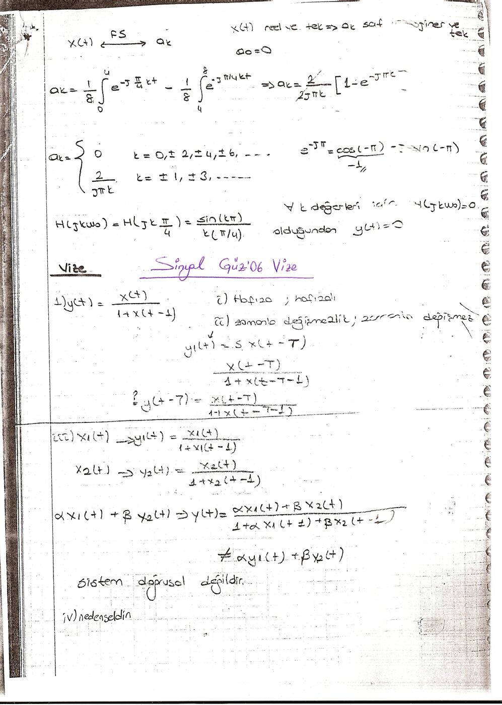
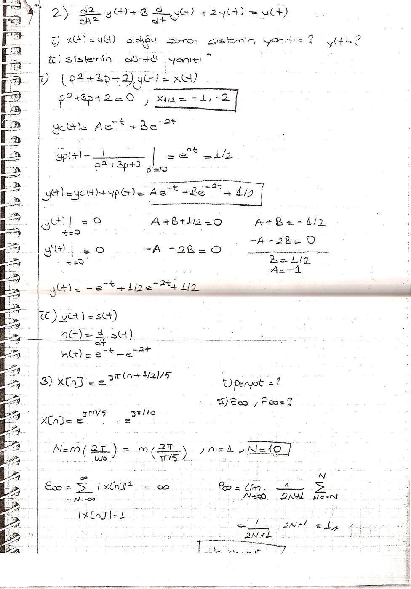
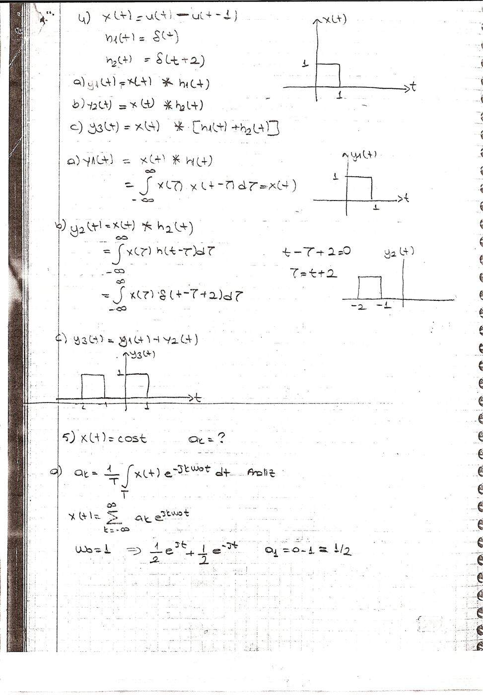

This post contains a student's notebook solutions to the **Fall 2006 midterm** questions of the Başkent University course **EEM301 Signals and Systems I** ("Signal Fall'06 Midterm"). Four scanned notebook pages contain the midterm questions, their solutions, and fragments of lecture notes from before and after them. The headings, main steps, and results are transcribed below as text. The scans can be downloaded as a ZIP at the end of the post.

## Example before the midterm: Fourier series and filter

At the top of the page is the end of an example from before the midterm: for a real and odd square wave with period 8,

- a_k = (1/8)∫₀⁴ e^(−jπkt/4) dt − (1/8)∫₄⁸ e^(−jπkt/4) dt ⇒ a_k = (2/(2jπk))[1 − e^(−jπk)]
- a_k = 0 (k = 0, ±2, ±4, …), a_k = 2/(jπk) (k = ±1, ±3, …); since the signal is real and odd, the coefficients are purely imaginary and odd
- Since H(jkω₀) = H(jkπ/4) = sin(kπ)/(kπ/4) is zero for all k ≠ 0 (and a₀ = 0), the output is y(t) = 0

## Question 1: y(t) = x(t) / (1 + x(t − 1))

- **Memory:** Since it depends on x(t − 1), the system has memory.
- **Time invariance:** The response to the input x(t − T) is x(t − T)/(1 + x(t − T − 1)) = y(t − T); the system is time-invariant.
- **Linearity:** The input αx₁(t) + βx₂(t) gives (αx₁(t) + βx₂(t))/(1 + αx₁(t − 1) + βx₂(t − 1)), which is not equal to αy₁(t) + βy₂(t). **The system is not linear.**
- **Causality:** It depends only on present and past values; it is causal.

## Question 2: y″(t) + 3y′(t) + 2y(t) = u(t)

1. What is the response y(t) of the system when x(t) = u(t)?
1. What is the impulse response of the system?

**Solution:** (p² + 3p + 2)y(t) = x(t), roots −1 and −2.

- y_c(t) = Ae^(−t) + Be^(−2t), y_p(t) = 1/(p² + 3p + 2)|_(p=0) = 1/2
- y(0) = 0: A + B + 1/2 = 0; y′(0) = 0: −A − 2B = 0 ⇒ A = −1, B = 1/2
- Step response: **y(t) = s(t) = −e^(−t) + ½e^(−2t) + ½**
- Impulse response: h(t) = ds(t)/dt = **e^(−t) − e^(−2t)** (t ≥ 0)

## Question 3: x[n] = e^(jπ(n + 1/2)/5)

1. Period?
1. E∞ and P∞?

**Solution:** x[n] = e^(jπn/5)·e^(jπ/10); N = m(2π/ω₀) = m(2π/(π/5)), and for m = 1, **N = 10**. Since |x[n]| = 1, E∞ = Σ|x[n]|² = ∞ and P∞ = lim (1/(2N + 1)) Σ_{n=−N}^{N} 1 = **1**.

## Question 4: Convolution with an impulse

For x(t) = u(t) − u(t − 1), h₁(t) = δ(t), h₂(t) = δ(t + 2):

- y₁(t) = x(t) ∗ h₁(t) = x(t) (a rectangle of height 1 between 0 and 1)
- y₂(t) = x(t) ∗ h₂(t) = x(t + 2) (a rectangle between −2 and −1)
- y₃(t) = x(t) ∗ [h₁(t) + h₂(t)] = y₁(t) + y₂(t)

## Question 5: x(t) = cos t

- a_k = (1/T)∫_T x(t)e^(−jkω₀t) dt (analysis), x(t) = Σ a_k e^(jkω₀t) (synthesis)
- ω₀ = 1: cos t = ½e^(jt) + ½e^(−jt) ⇒ **a₁ = a₋₁ = 1/2**
- (b) y(t) = x(t − t₀) + x(t + t₀): by the time-shift property, b_k = (e^(−jkω₀t₀) + e^(jkω₀t₀))a_k = **2a_k cos(kω₀t₀)** (here ω₀ = 1)

## Impulse train and introduction to the discrete-time Fourier series

The last page begins the post-midterm lecture notes:

- For the impulse train x(t) = Σ δ(t − kT), a_k = (1/T)∫_{−T/2}^{T/2} δ(t)e^(−jk2πt/T) dt = **1/T** (for all k)
- **Fourier series representation of discrete-time periodic signals:** x[n] = x[n + N]; harmonics φ_k[n] = e^(jk(2π/N)n), k = 0, ±1, ±2, …
- Discrete-time complex exponentials are equal at whole multiples of 2π: φ₀[n] = φ_N[n], φ₁[n] = φ_(N+1)[n], φ₂[n] = φ_(N+2)[n], …; because e^(j(N+1)(2π/N)n) = e^(j2πn)·e^(j(2π/N)n) = e^(j(2π/N)n)

