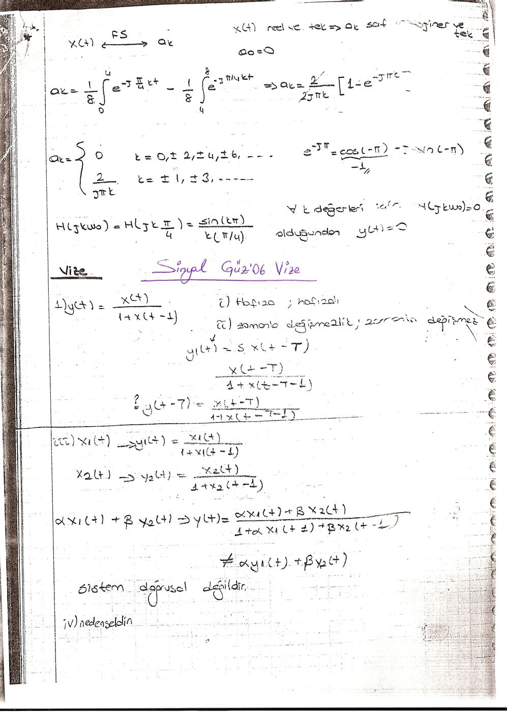
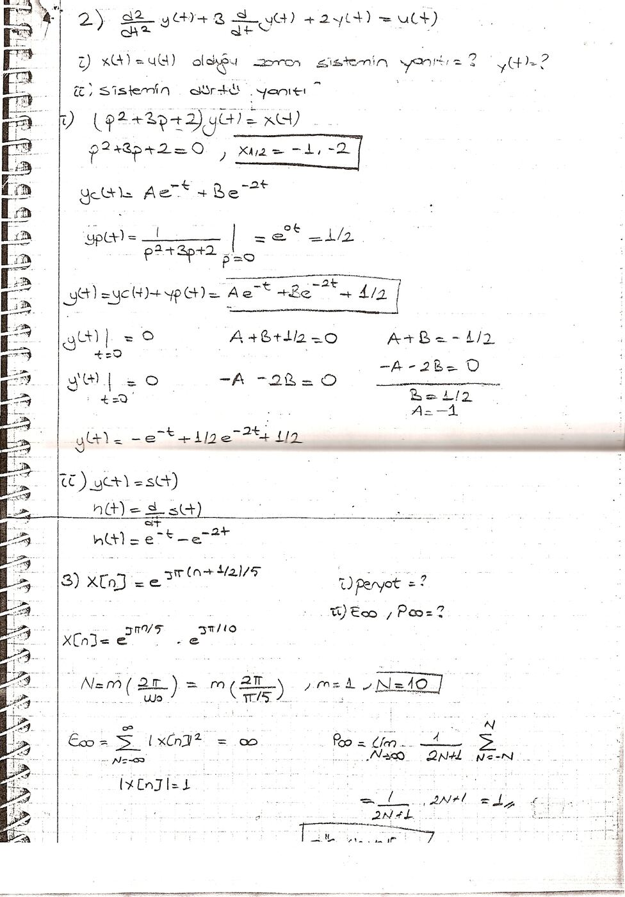
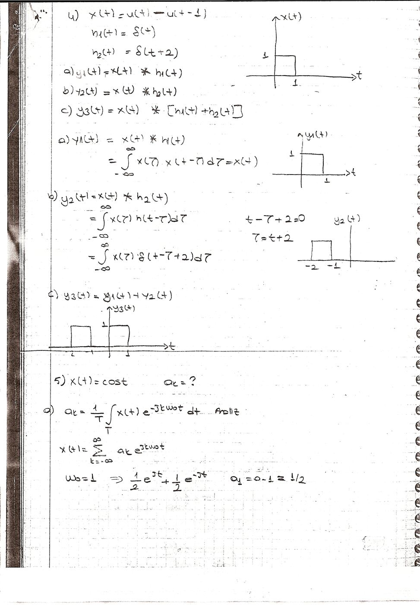
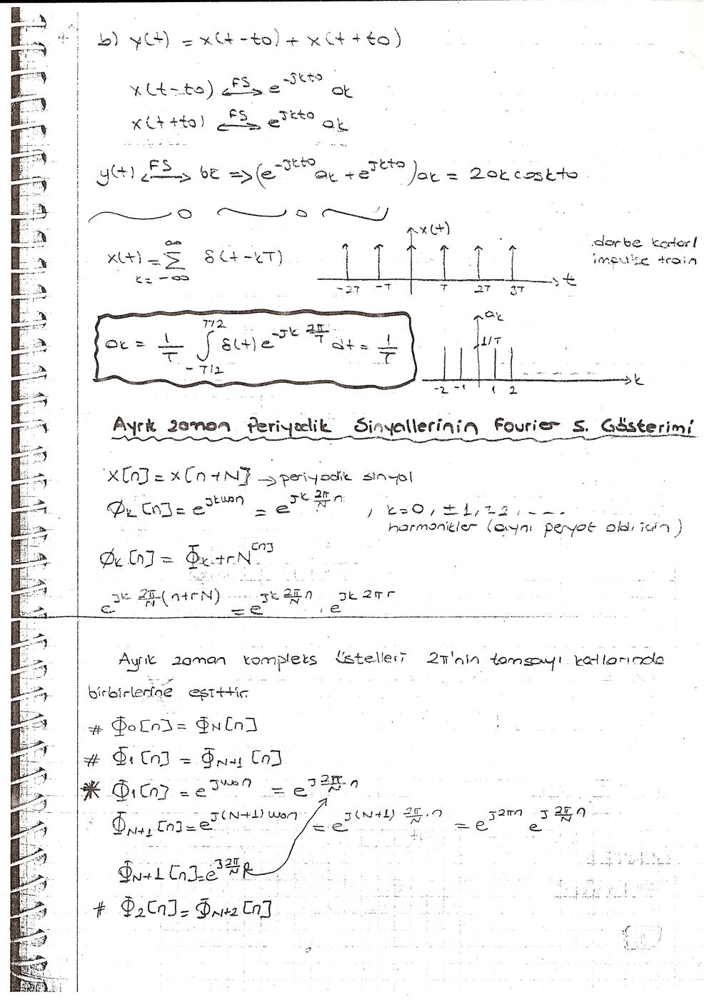

Bu yazı, Başkent Üniversitesi **EEM301 Sinyaller ve Sistemler I** dersinin **Güz 2006 vize** sorularının bir öğrenci defterinde çözülmüş hâlini içeriyor ("Sinyal Güz'06 Vize"). Dört taranmış defter sayfasında vize soruları, çözümleri ve öncesindeki/sonrasındaki ders notlarından parçalar var. Başlıklar, ana adımlar ve sonuçlar aşağıya metin olarak aktarıldı. Taramalar yazının sonunda ZIP olarak indirilebilir.

## Vizeden önceki örnek: Fourier serisi ve süzgeç

Sayfanın üstünde, vizeden önceki bir örneğin sonu var: periyodu 8 olan gerçel ve tek bir kare dalga için

- a_k = (1/8)∫₀⁴ e^(−jπkt/4) dt − (1/8)∫₄⁸ e^(−jπkt/4) dt ⇒ a_k = (2/(2jπk))[1 − e^(−jπk)]
- a_k = 0 (k = 0, ±2, ±4, …), a_k = 2/(jπk) (k = ±1, ±3, …); sinyal gerçel ve tek olduğundan katsayılar saf sanal ve tek
- H(jkω₀) = H(jkπ/4) = sin(kπ)/(kπ/4) bütün k ≠ 0 için sıfır olduğundan (ve a₀ = 0) çıkış y(t) = 0

## Soru 1: y(t) = x(t) / (1 + x(t − 1))

- **Hafıza:** x(t − 1)'e bağlı olduğundan sistem hafızalıdır.
- **Zamanla değişmezlik:** x(t − T) girişine yanıt x(t − T)/(1 + x(t − T − 1)) = y(t − T); zamanla değişmezdir.
- **Doğrusallık:** αx₁(t) + βx₂(t) girişi (αx₁(t) + βx₂(t))/(1 + αx₁(t − 1) + βx₂(t − 1)) verir; bu αy₁(t) + βy₂(t)'ye eşit değildir. **Sistem doğrusal değildir.**
- **Nedensellik:** Yalnız şimdiki ve geçmiş değerlere bağlı; nedenseldir.

## Soru 2: y″(t) + 3y′(t) + 2y(t) = u(t)

1. x(t) = u(t) olduğunda sistemin yanıtı y(t) = ?
1. Sistemin dürtü yanıtı?

**Çözüm:** (p² + 3p + 2)y(t) = x(t), kökler −1 ve −2.

- y_c(t) = Ae^(−t) + Be^(−2t), y_p(t) = 1/(p² + 3p + 2)|_(p=0) = 1/2
- y(0) = 0: A + B + 1/2 = 0; y′(0) = 0: −A − 2B = 0 ⇒ A = −1, B = 1/2
- Basamak yanıtı: **y(t) = s(t) = −e^(−t) + ½e^(−2t) + ½**
- Dürtü yanıtı: h(t) = ds(t)/dt = **e^(−t) − e^(−2t)** (t ≥ 0)

## Soru 3: x[n] = e^(jπ(n + 1/2)/5)

1. Periyot?
1. E∞ ve P∞?

**Çözüm:** x[n] = e^(jπn/5)·e^(jπ/10); N = m(2π/ω₀) = m(2π/(π/5)), m = 1 için **N = 10**. |x[n]| = 1 olduğundan E∞ = Σ|x[n]|² = ∞ ve P∞ = lim (1/(2N + 1)) Σ_{n=−N}^{N} 1 = **1**.

## Soru 4: Dürtüyle konvolüsyon

x(t) = u(t) − u(t − 1), h₁(t) = δ(t), h₂(t) = δ(t + 2) için:

- y₁(t) = x(t) ∗ h₁(t) = x(t) (0–1 arasında yüksekliği 1 olan dikdörtgen)
- y₂(t) = x(t) ∗ h₂(t) = x(t + 2) (−2 ile −1 arasında dikdörtgen)
- y₃(t) = x(t) ∗ [h₁(t) + h₂(t)] = y₁(t) + y₂(t)

## Soru 5: x(t) = cos t

- a_k = (1/T)∫_T x(t)e^(−jkω₀t) dt (analiz), x(t) = Σ a_k e^(jkω₀t) (sentez)
- ω₀ = 1: cos t = ½e^(jt) + ½e^(−jt) ⇒ **a₁ = a₋₁ = 1/2**
- (b) y(t) = x(t − t₀) + x(t + t₀): zaman kaydırma özelliğiyle b_k = (e^(−jkω₀t₀) + e^(jkω₀t₀))a_k = **2a_k cos(kω₀t₀)** (burada ω₀ = 1)

## Dürtü katarı ve ayrık zamanlı Fourier serisine giriş

Son sayfada vize sonrası ders notları başlıyor:

- Dürtü katarı x(t) = Σ δ(t − kT) için a_k = (1/T)∫_{−T/2}^{T/2} δ(t)e^(−jk2πt/T) dt = **1/T** (bütün k)
- **Ayrık zaman periyodik sinyallerinin Fourier serisi gösterimi:** x[n] = x[n + N]; harmonikler φ_k[n] = e^(jk(2π/N)n), k = 0, ±1, ±2, …
- Ayrık zamanlı karmaşık üsteller 2π'nin tam katlarında birbirine eşittir: φ₀[n] = φ_N[n], φ₁[n] = φ_(N+1)[n], φ₂[n] = φ_(N+2)[n], …; çünkü e^(j(N+1)(2π/N)n) = e^(j2πn)·e^(j(2π/N)n) = e^(j(2π/N)n)

