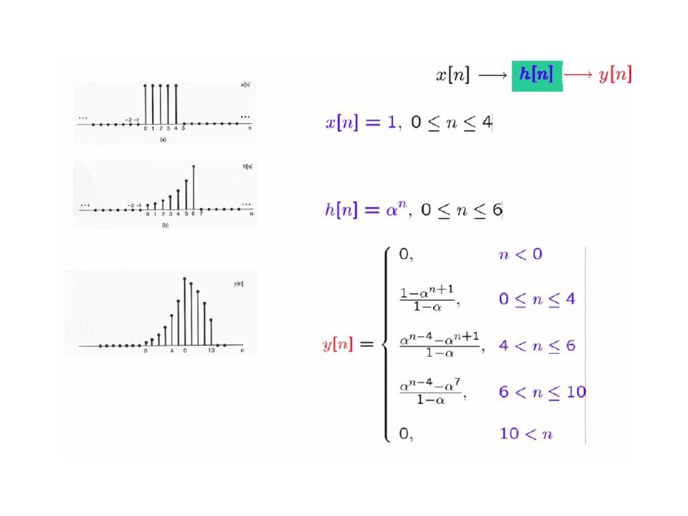
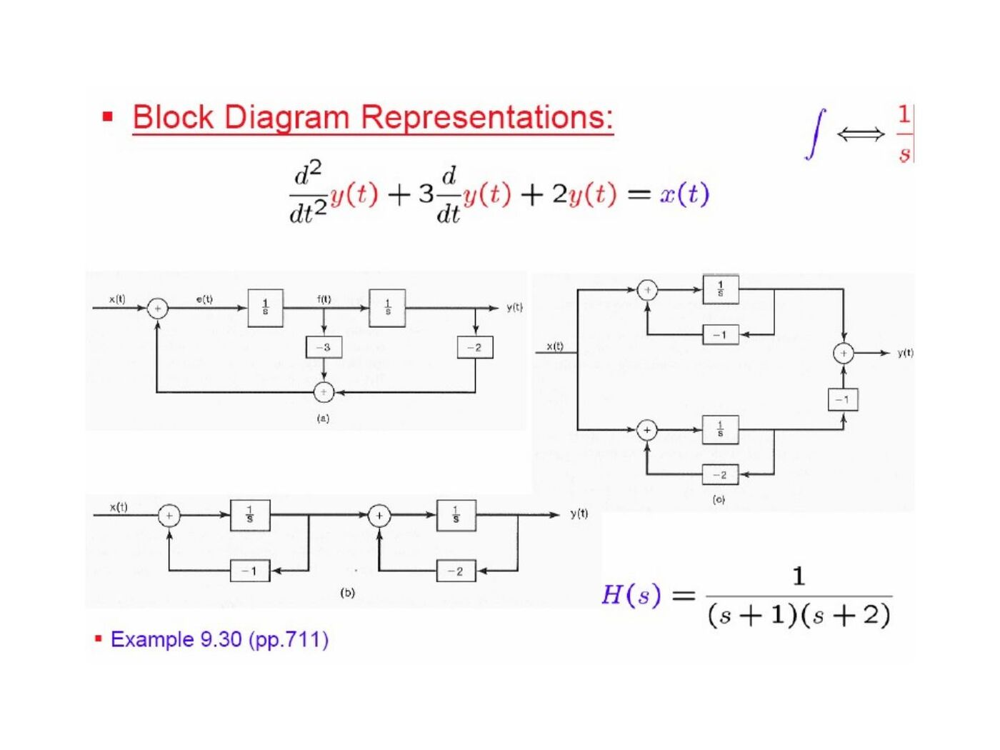
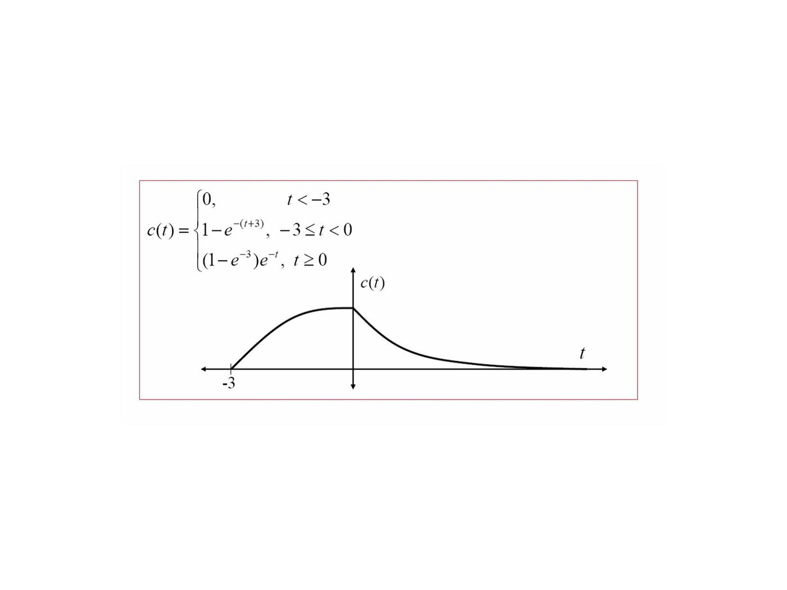

Başkent Üniversitesi EEM301 dersi için İsmail Avcıbaş’ın hazırladığı **Chapter II: Linear Time Invariant Systems** sunumu (117 sayfa). Kaynak PowerPoint’in oluşturulma tarihi 16 Ağustos 2006, son kaydı 9 Ekim 2009. Metni görsel olarak saklanan slaytların konu anlatımı, temel formülleri ve örnekleri aşağıya aktarıldı. Sunumun PDF kopyası yazının sonunda indirilebilir.

## Impulse representation and convolution

The sampling property gives x[n]=Σₖ x[k]δ[n−k]. A linear system responds with y[n]=Σₖ x[k]hₖ[n], where hₖ is its response to δ[n−k]. Time invariance makes hₖ[n]=h[n−k], yielding the convolution sum:

y[n] = Σₖ₌₋∞^∞ x[k]h[n−k] = x[n]∗h[n].

In continuous time, x(t)=∫₋∞^∞ x(τ)δ(t−τ)dτ and the corresponding LTI output is

y(t) = ∫₋∞^∞ x(τ)h(t−τ)dτ = x(t)∗h(t).

Graphical convolution consists of reversing one signal, shifting it by the output time, multiplying the overlapping values and summing or integrating.

## Discrete-time examples

For x[n]=aⁿu[n], 0<a<1, and h[n]=u[n], the overlapping indices are 0≤k≤n. Thus y[n]=[(1−a^(n+1))/(1−a)]u[n]. With a=7/8, y[0]=1, y[1]=15/8 and the limiting value is 8.

For x[n]=2ⁿu[−n] and h[n]=u[n], the sum extends to min(n,0). The result is 2^(n+1) for n<0 and 2 for n≥0.

Another example uses x[n]=1 for 0≤n≤4 and h[n]=aⁿ for 0≤n≤6, both zero elsewhere. The support of their convolution is 0≤n≤10; the overlap changes at n=4 and n=6.

## Continuous-time examples

For x(t)=e^(−at)u(t), a>0, and h(t)=u(t):

y(t) = [(1−e^(−at))/a]u(t).

For x(t)=e^(2t)u(−t) and h(t)=u(t−3), the output is (1/2)e^(2(t−3)) for t≤3, and 1/2 for t≥3. The integration boundary follows the intersection τ≤0 and τ≤t−3.

## Properties of LTI systems

Convolution is commutative, distributive and associative. Consequently, cascade LTI systems have combined response h₁∗h₂; parallel systems have h₁+h₂.

| System property | Impulse-response condition |
|---|---|
| Memoryless | h[n]=Kδ[n] or h(t)=Kδ(t) |
| Invertible | An inverse response hᵢ exists with h∗hᵢ=δ |
| Causal | h[n]=0 for n<0, or h(t)=0 for t<0 |
| BIBO stable | Σ|h[n]|<∞, or ∫|h(t)|dt<∞ |

A pure delay is stable and has an inverse advance. An accumulator has h[n]=u[n] and is not BIBO stable. Its inverse is the first-difference system with response δ[n]−δ[n−1].

The step response is s=h∗u. Therefore h[n]=s[n]−s[n−1] and h(t)=ds(t)/dt.

## Differential and difference equations

A constant-coefficient CT model has Σₖ₌₀ᴺ aₖ dᵏy/dtᵏ = Σₖ₌₀ᴹ bₖ dᵏx/dtᵏ. A DT model has Σₖ₌₀ᴺ aₖ y[n−k] = Σₖ₌₀ᴹ bₖ x[n−k]. Initial conditions are needed to determine a unique response.

The recursive equation y[n]−(1/2)y[n−1]=x[n], with initial rest, has h[n]=(1/2)ⁿu[n], an infinite impulse response. A nonrecursive finite sum y[n]=Σₖ₌₀ᴹ(bₖ/a₀)x[n−k] has a finite impulse response.

Block diagrams use adders, gains, unit delays, integrators and differentiators. The presentation gives alternative realizations for y″+3y′+2y=x and y[n]+(1/4)y[n−1]−(1/8)y[n−2]=x[n].

## Singularity functions

The identity x∗δ=x defines the impulse through convolution. Differentiation corresponds to convolution with δ′, while integration corresponds to convolution with u. Repeated integration gives t^(k−1)u(t)/(k−1)! for k≥1. Repeated differentiation gives successive derivatives of the impulse.

## Additional graphical convolution examples

The latter part of the presentation develops four CT examples and several DT examples in detail.

1. f(t)=eᵗu(−t), h(t)=−δ(t)+2e^(−t)u(t): splitting the delta term from the ordinary convolution gives y(t)=e^(−t)u(t).
1. f(t)=sin(t)[u(t)−u(t−2π)] and g(t)=u(t)−u(t−2π): the result is 0 for t≤0, 1−cos t for 0<t≤2π, cos t−1 for 2π<t≤4π and 0 afterward.
1. f(t)=A[u(t−4)−u(t−6)] and g(t)=B[u(t+5)−u(t+4)]: the result is zero outside −1≤t≤2, AB(t+1) for −1≤t<0, AB for 0≤t<1 and AB(2−t) for 1≤t≤2.
1. f₁(t)=e^(−t)u(t), f₂(t)=u(t+3)−u(t): the result is zero for t<−3, 1−e^(−(t+3)) for −3≤t<0 and (1−e^(−3))e^(−t) for t≥0.

For the DT graphical example with five consecutive samples of height 3 and h[0]=2, h[1]=2, h[2]=1, the output values at n=0,…,6 are 6, 12, 15, 15, 15, 9, 3; all other samples are zero.

For x[n]=(1/2)ⁿu[n] and h[n]=u[n]−u[n−4], the result is zero for n<0; 2[1−(1/2)^(n+1)] for 0≤n≤3; and 2[(1/2)^(n−3)−(1/2)^(n+1)] for n≥4. Replacing the input by cos(πn/2)u[n] gives y[0]=1, y[1]=1 and y[n]=0 for n≥2.
