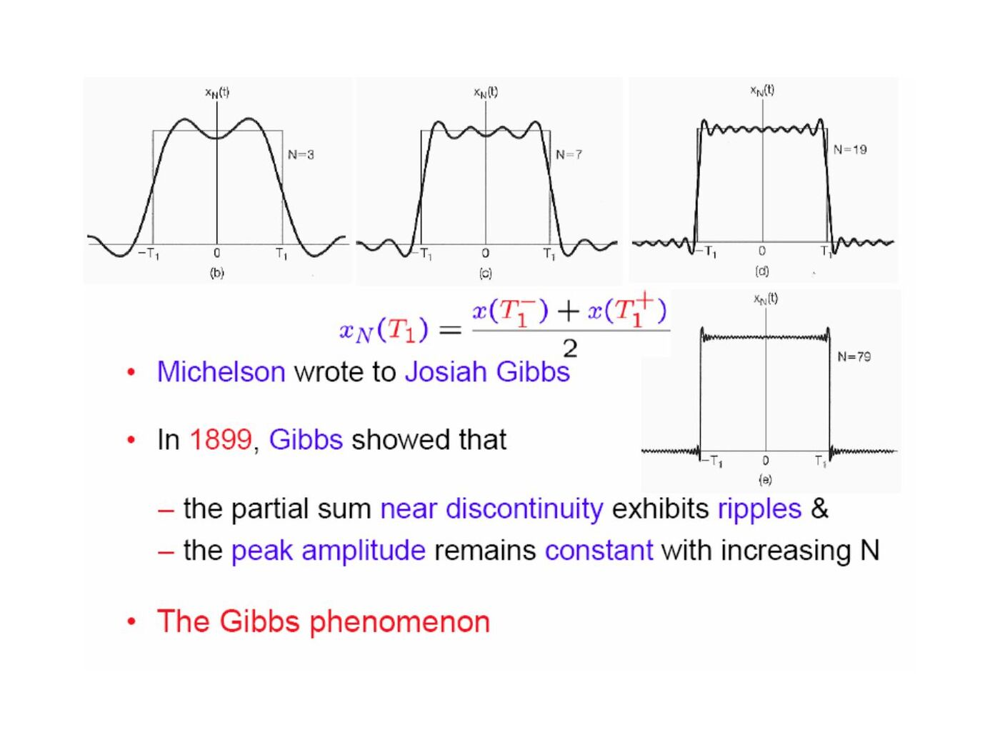
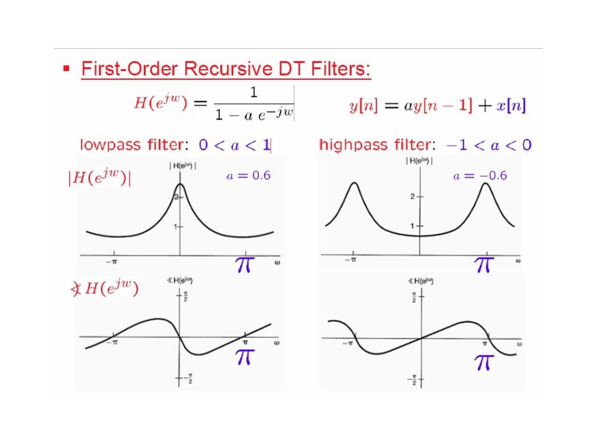

Başkent Üniversitesi EEM301 dersi için İsmail Avcıbaş’ın hazırladığı **Chapter III: Fourier Series Representation of Periodic Signals** sunumu (98 sayfa). Kaynak PowerPoint’in oluşturulma tarihi 16 Ağustos 2006, son kaydı 6 Ekim 2009. Metni görsel olarak saklanan slaytların konu anlatımı, temel formülleri ve örnekleri aşağıya aktarıldı. Sunumun PDF kopyası yazının sonunda indirilebilir.

## Historical perspective and eigenfunctions

The presentation traces harmonic representations from vibrating strings to Fourier’s work on heat conduction, then introduces complex exponentials as a convenient basis for LTI systems.

For a CT input e^(st), convolution gives the output H(s)e^(st), with H(s)=∫h(τ)e^(−sτ)dτ. For a DT input zⁿ, the output is H(z)zⁿ, with H(z)=Σh[k]z^(−k). The exponential is an eigenfunction and the multiplier is its eigenvalue.

By superposition, Σaₖe^(sₖt) produces ΣaₖH(sₖ)e^(sₖt). This is the basis for computing periodic steady-state responses harmonic by harmonic.

## Continuous-time Fourier series

For period T and ω₀=2π/T:

- Synthesis: x(t)=Σₖ₌₋∞^∞ aₖe^(jkω₀t).
- Analysis: aₖ=(1/T)∫ over one period x(t)e^(−jkω₀t)dt.
- a₀ is the average or DC value.

Orthogonality gives ∫₀ᵀ e^(j(k−m)ω₀t)dt=T when k=m, and zero otherwise. For a real signal, a₋ₖ=aₖ*. Writing aₖ=Aₖe^(jθₖ) gives x(t)=a₀+2Σₖ₌₁^∞ Aₖcos(kω₀t+θₖ).

Example 3.4 takes x(t)=1+sinω₀t+2cosω₀t+cos(2ω₀t+π/4). Its nonzero coefficients are a₀=1, a₁=1−j/2, a₋₁=1+j/2, a₂=e^(jπ/4)/2 and a₋₂=e^(−jπ/4)/2.

For a periodic unit rectangle occupying |t|<T₁ within a period T, a₀=2T₁/T and aₖ=sin(kω₀T₁)/(kπ) for k≠0.

## Convergence and Gibbs phenomenon

Finite energy over one period ensures convergence in mean square. The stated Dirichlet conditions require absolute integrability over a period, finitely many extrema and finitely many finite discontinuities.

At a jump, the series converges to the average of the left and right limits. Near the jump, the truncated series exhibits ripples whose peak overshoot persists as more harmonics are included: the Gibbs phenomenon.

## Properties of CT Fourier series

| Signal operation | Fourier-series coefficients |
|---|---|
| Ax(t)+By(t) | Aaₖ+Bbₖ |
| x(t−t₀) | aₖe^(−jkω₀t₀) |
| x(−t) | a₋ₖ |
| x*(t) | a*₋ₖ |
| dx/dt | jkω₀aₖ |
| x(t)y(t) | Σₗ aₗbₖ₋ₗ |

For a real even signal the coefficients are real and even; for a real odd signal they are imaginary and odd. Parseval’s relation is (1/T)∫ over one period |x(t)|²dt=Σ|aₖ|². Integrating a zero-mean periodic signal divides its nonzero harmonic coefficients by jkω₀.

The examples use a shifted rectangle, a triangular wave whose derivative is a square wave, and an impulse pair obtained by differentiating a rectangle. These show how shifting and differentiation avoid repeating the analysis integral.

## Discrete-time Fourier series

For a sequence of period N:

- x[n]=Σ over N consecutive k of aₖe^(jk2πn/N).
- aₖ=(1/N)Σ over N consecutive n of x[n]e^(−jk2πn/N).
- aₖ₊ᴺ=aₖ: there are only N distinct coefficients.

For x[n]=1+sin(2πn/N)+3cos(2πn/N)+cos(4πn/N+π/2), the example gives a₀=1, a₁=3/2−j/2, a₋₁=3/2+j/2, a₂=j/2 and a₋₂=−j/2, interpreted modulo N.

For a periodic rectangular sequence equal to 1 on −N₁≤n≤N₁, the coefficients are

aₖ = (1/N)sin[(2πk/N)(N₁+1/2)]/sin(πk/N),

with limiting value (2N₁+1)/N at k=0 modulo N. The slides compare this DT expression with the CT rectangular-pulse series.

DT multiplication gives periodic convolution of the coefficients. The first difference x[n]−x[n−1] gives (1−e^(−jk2π/N))aₖ. Parseval becomes (1/N)Σ over one period |x[n]|²=Σ over one coefficient period |aₖ|².

## Fourier series and LTI systems

A periodic input with coefficients aₖ produces output coefficients aₖH(jkω₀) in CT or aₖH(e^(jk2π/N)) in DT. Filtering changes the relative amplitudes and phases of harmonics; frequency-selective filters suppress selected bands.

## Filter examples

For an RC lowpass filter:

- H(jω)=1/(1+jωRC).
- h(t)=e^(−t/RC)u(t)/(RC).
- s(t)=[1−e^(−t/RC)]u(t).

For the RC highpass filter, G(jω)=jωRC/(1+jωRC), and its step response is e^(−t/RC)u(t).

The recursive DT filter y[n]−ay[n−1]=x[n] has H(e^(jω))=1/(1−ae^(−jω)). For |a|<1 it is lowpass when a>0 and highpass when a<0.

The two-point average y[n]=(x[n]+x[n−1])/2 has H(e^(jω))=e^(−jω/2)cos(ω/2). The centered three-point average has H(e^(jω))=(1+2cosω)/3. A general moving average smooths the weekly stock-index example; increasing its window narrows the central passband.

The final highpass example is y[n]=(x[n]−x[n−1])/2, with H(e^(jω))=(1−e^(−jω))/2.
