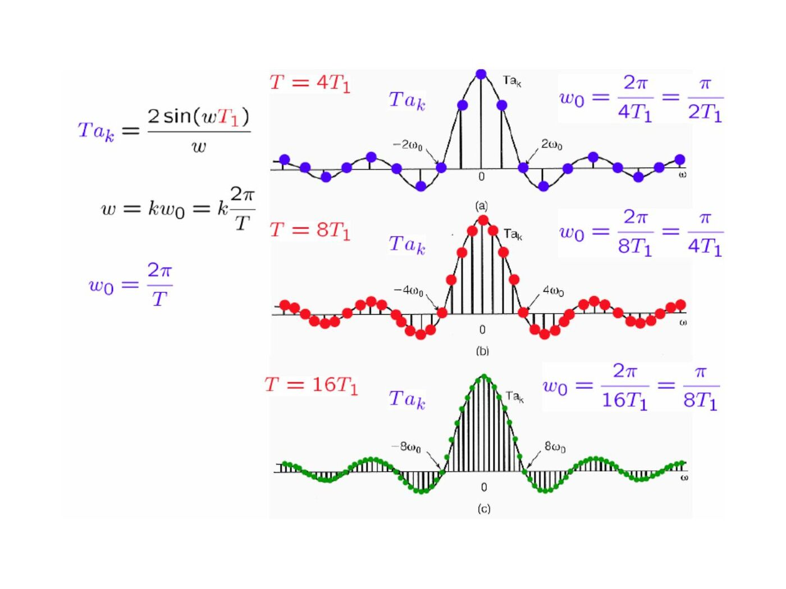
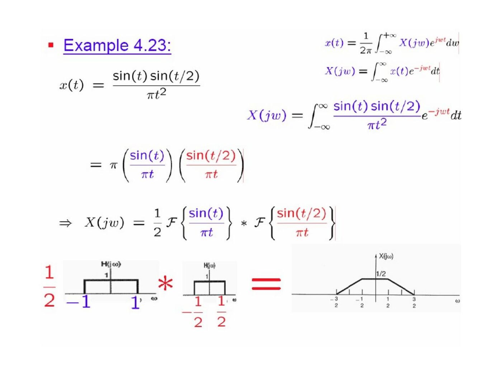

Başkent Üniversitesi EEM301 dersi için İsmail Avcıbaş’ın hazırladığı **Chapter IV: Continuous Time Fourier Transform** sunumu (71 sayfa). Kaynak PowerPoint’in oluşturulma tarihi 16 Ağustos 2006, son kaydı 6 Ekim 2009. Metni görsel olarak saklanan slaytların konu anlatımı, temel formülleri ve örnekleri aşağıya aktarıldı. Sunumun PDF kopyası yazının sonunda indirilebilir.

## From Fourier series to Fourier transform

A finite-duration signal can be repeated with period T. Its series coefficients sample an envelope: aₖ=X(jkω₀)/T, where ω₀=2π/T. Letting T increase makes the samples denser, and the synthesis sum becomes an integral:

- X(jω)=∫₋∞^∞ x(t)e^(−jωt)dt.
- x(t)=(1/2π)∫₋∞^∞ X(jω)e^(jωt)dω.

The slides discuss finite-energy convergence and sufficient Dirichlet conditions: absolute integrability, finitely many extrema and finitely many finite discontinuities on finite intervals.

## Basic transform pairs

| Time signal | Fourier transform |
|---|---|
| e^(−at)u(t), a>0 | 1/(a+jω) |
| e^(−a|t|), a>0 | 2a/(a²+ω²) |
| δ(t) | 1 |
| Unit rectangle on −T₁<t<T₁ | 2sin(ωT₁)/ω |
| sin(Wt)/(πt) | Unit rectangle on −W<ω<W |
| e^(jω₀t) | 2πδ(ω−ω₀) |
| cosω₀t | π[δ(ω−ω₀)+δ(ω+ω₀)] |
| sinω₀t | (π/j)[δ(ω−ω₀)−δ(ω+ω₀)] |

The normalized sinc is sinc(θ)=sin(πθ)/(πθ). Narrower pulses have broader spectra. For e^(−at)u(t), the magnitude is 1/√(a²+ω²) and the phase is −tan⁻¹(ω/a).

## Periodic signals

If x(t)=Σaₖe^(jkω₀t), its transform is X(jω)=2πΣaₖδ(ω−kω₀). The periodic impulse train Σδ(t−kT) transforms to (2π/T)Σδ(ω−2πk/T).

## Transform properties

| Operation | Transform |
|---|---|
| ax(t)+by(t) | aX(jω)+bY(jω) |
| x(t−t₀) | e^(−jωt₀)X(jω) |
| e^(jω₀t)x(t) | X(j(ω−ω₀)) |
| x*(t) | X*(−jω) |
| x(at), a≠0 | X(jω/a)/|a| |
| dx/dt | jωX(jω) |
| t x(t) | j dX(jω)/dω |

For real x(t), X(−jω)=X*(jω); its magnitude is even and its phase is odd where defined. The even part transforms to Re X and the odd part to j Im X.

Integration from −∞ to t transforms to X(jω)/(jω)+πX(0)δ(ω). In particular u(t) transforms to 1/(jω)+πδ(ω), interpreted in the generalized sense.

Duality exchanges time and frequency with a reversal and a 2π factor. Parseval’s relation is ∫|x(t)|²dt=(1/2π)∫|X(jω)|²dω.

The examples form a stepped pulse as the sum of two shifted rectangles, and obtain the transform of a finite ramp by differentiating it into a rectangle plus endpoint impulses.

## Convolution and frequency response

y=x∗h corresponds to Y=XH. A cascade has frequency response H₁H₂ and a parallel combination has H₁+H₂. A pure delay has H(jω)=e^(−jωt₀); differentiation has H(jω)=jω.

An ideal lowpass filter with unit gain on |ω|<ω꜀ has h(t)=sin(ω꜀t)/(πt). The slides compare this with the causal exponential response e^(−t)u(t), whose response is 1/(1+jω).

For h(t)=e^(−at)u(t) and x(t)=e^(−bt)u(t), a,b>0:

- If a≠b, y(t)=[e^(−at)−e^(−bt)]u(t)/(b−a).
- If a=b, y(t)=t e^(−at)u(t).

Cascading two ideal lowpass responses retains the smaller cutoff.

## Multiplication and modulation

Multiplication in time corresponds to convolution in frequency with the factor 1/(2π). For r(t)=s(t)cosω₀t:

R(jω) = [S(j(ω−ω₀))+S(j(ω+ω₀))]/2.

Multiplying again by cosω₀t produces a baseband term s(t)/2 and shifted copies around ±2ω₀. A lowpass filter can isolate the baseband component. Another example multiplies two sinc functions, obtaining a trapezoidal spectrum from convolution of their rectangular spectra.

## Constant-coefficient differential equations

For Σaₖ dᵏy/dtᵏ=Σbₖ dᵏx/dtᵏ, the LTI frequency response is

H(jω) = [Σbₖ(jω)ᵏ]/[Σaₖ(jω)ᵏ].

Example: y″+4y′+3y=x′+2x gives

H(jω)=(jω+2)/[(jω+1)(jω+3)] = (1/2)/(jω+1)+(1/2)/(jω+3),

so h(t)=[e^(−t)+e^(−3t)]u(t)/2. With x(t)=e^(−t)u(t), the output becomes

y(t)=[(1/4)e^(−t)+(1/2)t e^(−t)−(1/4)e^(−3t)]u(t).
