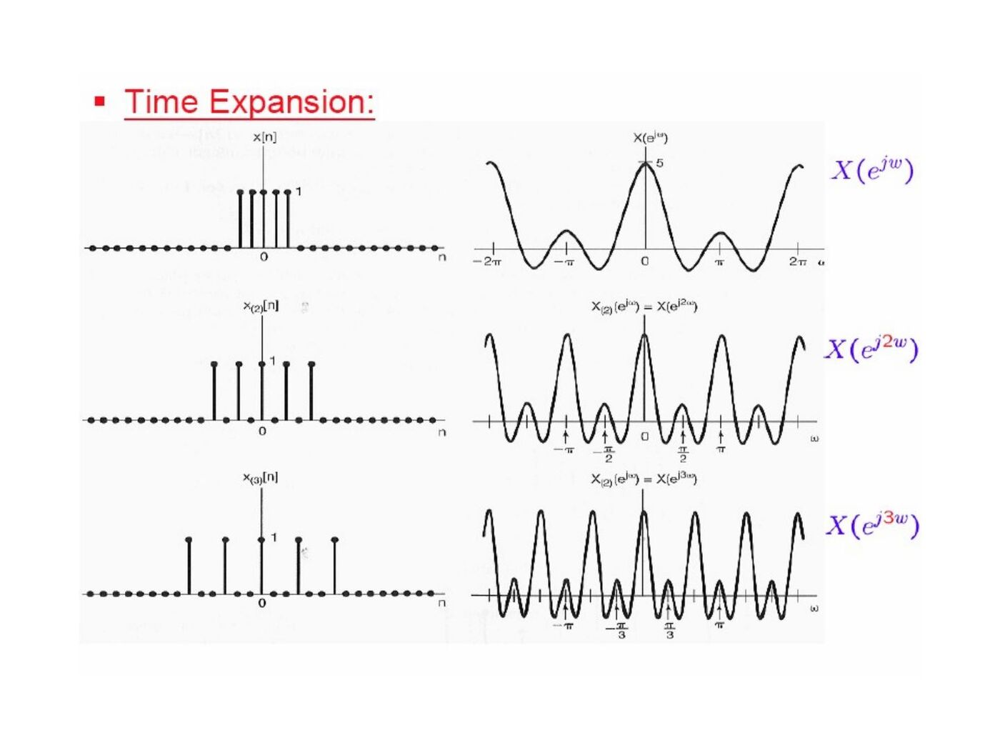

Başkent Üniversitesi EEM301 dersi için İsmail Avcıbaş’ın hazırladığı **Chapter V: Discrete Time Fourier Transform** sunumu (61 sayfa). Kaynak PowerPoint’in oluşturulma tarihi 16 Ağustos 2006, son kaydı 6 Ekim 2009. Metni görsel olarak saklanan slaytların konu anlatımı, temel formülleri ve örnekleri aşağıya aktarıldı. Sunumun PDF kopyası yazının sonunda indirilebilir.

## DT Fourier transform

Starting from a finite-duration sequence and its periodic extension, the DT Fourier series approaches a transform as N→∞:

- X(e^(jω))=Σₙ₌₋∞^∞ x[n]e^(−jωn).
- x[n]=(1/2π)∫ over any 2π interval X(e^(jω))e^(jωn)dω.

Since e^(−j2πn)=1, the transform is always 2π-periodic. Frequencies near 0 modulo 2π are low frequencies; frequencies near π modulo 2π are high frequencies. The slides distinguish absolute summability from finite-energy convergence.

## Transform examples

For x[n]=aⁿu[n], |a|<1, X(e^(jω))=1/(1−ae^(−jω)). Positive real a emphasizes low frequencies, while negative a emphasizes high frequencies.

For x[n]=a^|n|, real |a|<1:

X(e^(jω))=(1−a²)/(1−2a cosω+a²).

For a finite rectangle x[n]=1 on |n|≤N₁, the transform is sin[ω(N₁+1/2)]/sin(ω/2), with limiting value 2N₁+1 at zero. The unit impulse δ[n] transforms to 1.

An ideal lowpass response equal to 1 on |ω|<W within −π≤ω≤π has inverse transform sin(Wn)/(πn), with the n=0 limit W/π. The slides show how widening W toward π approaches δ[n].

## Periodic sequences

The transform of e^(jω₀n) is 2πΣₗδ(ω−ω₀−2πl). A periodic sequence of period N has spectral impulses at k2π/N, weighted by 2πaₖ, where aₖ are its periodic Fourier-series coefficients.

For Σₖδ[n−kN], all N distinct coefficients equal 1/N, and its transform is (2π/N)Σₖδ(ω−2πk/N).

## Properties

| Operation | DTFT |
|---|---|
| Ax[n]+By[n] | AX+BY |
| x[n−n₀] | e^(−jωn₀)X(e^(jω)) |
| e^(jω₀n)x[n] | X(e^(j(ω−ω₀))) |
| x*[n] | X*(e^(−jω)) |
| x[−n] | X(e^(−jω)) |
| x[n]−x[n−1] | (1−e^(−jω))X(e^(jω)) |
| n x[n] | j dX(e^(jω))/dω |

For real x[n], the transform is conjugate symmetric. Its real part corresponds to the even part of the sequence; j times its imaginary part corresponds to the odd part.

Multiplying a lowpass impulse response by (−1)ⁿ shifts its response by π, producing the highpass example.

## Expansion by inserting zeros

Define x₍ₖ₎[n]=x[n/k] when n is a multiple of k and zero otherwise. Its transform is X(e^(jkω)). The additional zeros create compressed repetitions in frequency.

The illustrated example writes a sequence as x[n]=y₂[n]+2y₂[n−1], where y₂ is obtained by inserting one zero between successive samples of a five-sample rectangle. This combines expansion with time shifting.

Parseval’s relation is Σ|x[n]|²=(1/2π)∫ over 2π |X(e^(jω))|²dω.

## Convolution, multiplication and filters

Convolution in time gives Y(e^(jω))=X(e^(jω))H(e^(jω)). Multiplication gives a periodic convolution in frequency:

R(e^(jω))=(1/2π)∫ over 2π S(e^(jθ))P(e^(j(ω−θ)))dθ.

For h[n]=aⁿu[n] and x[n]=bⁿu[n], |a|,|b|<1, a≠b:

y[n]=[a^(n+1)−b^(n+1)]u[n]/(a−b).

When a=b, y[n]=(n+1)aⁿu[n]. An ideal lowpass impulse response extends in both directions and is therefore noncausal.

One block-diagram example modulates an input by (−1)ⁿ before and after a lowpass filter, then adds a direct lowpass branch. The combined highpass and lowpass bands form a bandstop response.

)=Hlp(e^(j(ω−π)))+Hlp(e^(jω))")

## Duality

DT Fourier-series coefficients are themselves periodic sequences. If x[n] has coefficients aₖ with period N, treating aₙ as a sequence gives coefficients x[−k]/N. The slides also compare DTFT with the Fourier series of a continuous periodic function: a discrete sequence in one domain corresponds to a periodic function in the other.

## Difference equations

For Σₖ₌₀ᴺ aₖy[n−k]=Σₖ₌₀ᴹ bₖx[n−k],

H(e^(jω))=[Σbₖe^(−jkω)]/[Σaₖe^(−jkω)].

The example y[n]−(3/4)y[n−1]+(1/8)y[n−2]=2x[n] has

H(e^(jω))=2/[(1−(1/2)e^(−jω))(1−(1/4)e^(−jω))].

Partial fractions give h[n]=[4(1/2)ⁿ−2(1/4)ⁿ]u[n]. With x[n]=(1/4)ⁿu[n], the resulting output is

y[n]=[8(1/2)ⁿ−4(1/4)ⁿ−2(n+1)(1/4)ⁿ]u[n].
