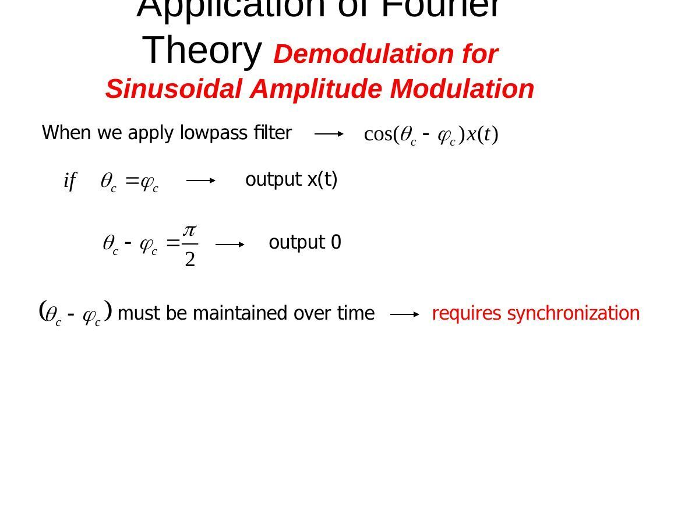
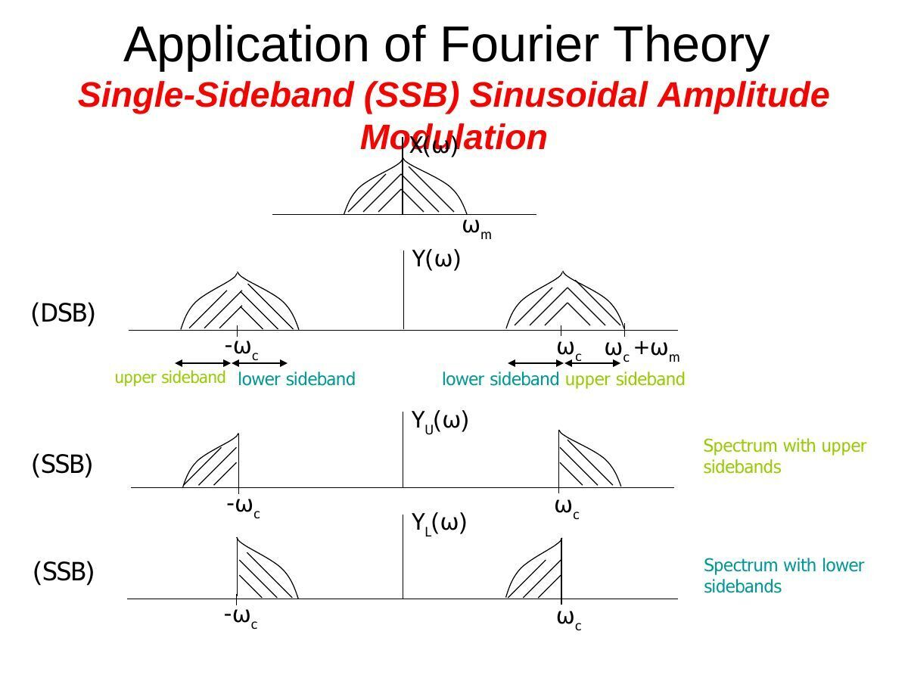
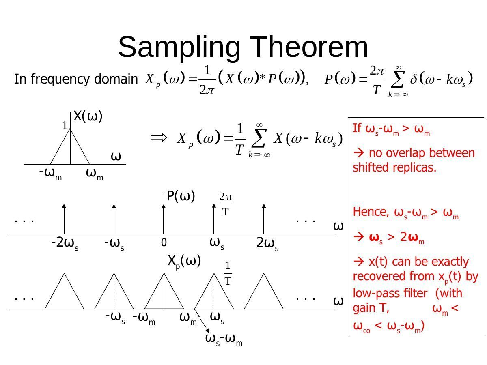
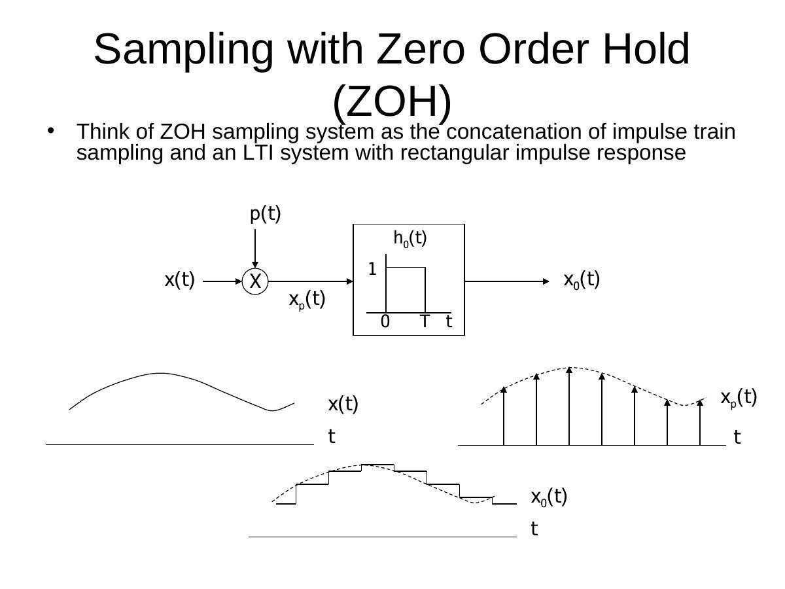

İsmail Avcıbaş’ın EEM301 arşivindeki **Continuous-Time Frequency Domain Methods** ve **Discrete-Time Frequency Domain Methods** sunumları, kaynak dosyalarının oluşturulma tarihlerine göre 14 ve 28 Temmuz 2008’e ait. 50 ve 66 sayfalık bu sürümler, modülasyon ve örnekleme bölümleriyle Chapter 1–5 dizisini tamamlıyor. İki sunumun PDF’leri yazının sonunda ZIP olarak indirilebilir.

## Continuous-time frequency methods

The CT Fourier-series analysis and synthesis equations are aₖ=(1/T₀)∫ over T₀ x(t)e^(−jkω₀t)dt and x(t)=Σaₖe^(jkω₀t), with ω₀=2π/T₀. An LTI system multiplies each harmonic coefficient by H(jkω₀).

Increasing the period of a repeated finite pulse makes its spectral lines denser. In the limit, the Fourier transform pair is X(jω)=∫x(t)e^(−jωt)dt and x(t)=(1/2π)∫X(jω)e^(jωt)dω. The presentation derives the transform of rectangular and exponential signals and introduces impulse spectra for periodic signals.

The main properties are linearity, time shifting, conjugate symmetry, differentiation, integration, time scaling, duality and Parseval’s relation. Time convolution becomes multiplication of transforms; time multiplication becomes frequency convolution divided by 2π. These properties connect signal descriptions to LTI frequency responses.

## Amplitude modulation

Multiplication by a complex exponential shifts a spectrum: x(t)e^(jω꜀t) ↔ X(j(ω−ω꜀)). Multiplication by a real cosine creates two shifted copies:

y(t)=x(t)cosω꜀t,

Y(jω)=[X(j(ω−ω꜀))+X(j(ω+ω꜀))]/2.

A baseband spectrum supported on |ω|≤ωₘ occupies bands around ±ω꜀ after modulation. The diagrams track this change through the transmitter and receiver.

## Synchronous demodulation

Multiplying the modulated signal again by cosω꜀t gives x(t)/2 plus a component centered around twice the carrier frequency. An ideal lowpass filter with gain 2 recovers x(t), provided the bands are separated.

If the local oscillator has phase error θ, the recovered baseband is scaled by cosθ. Frequency mismatch prevents a constant recovery gain and introduces a time-varying factor. The receiver therefore needs carrier synchronization.

## Envelope detection and single-sideband modulation

For envelope detection, a DC offset is added before multiplication: [A+x(t)]cosω꜀t. Choosing A so that A+x(t) remains positive makes the envelope proportional to the message plus its offset. The source compares this method with coherent reception.

Single-sideband modulation removes one of the redundant sidebands. The presentation uses phase shifts and parallel branches to illustrate how the unwanted sideband cancels.

## Discrete-time Fourier series and transform

For a period-N sequence, x[n]=Σ over N values of k aₖe^(jk2πn/N), and aₖ=(1/N)Σ over N values of n x[n]e^(−jk2πn/N). The coefficients repeat with period N. Finite-dimensional orthogonality makes the synthesis exact.

The DTFT is X(Ω)=Σx[n]e^(−jΩn), with inverse x[n]=(1/2π)∫₋π^π X(Ω)e^(jΩn)dΩ. X(Ω) repeats every 2π. A finite rectangle on |n|≤N₁ has transform sin[Ω(N₁+1/2)]/sin(Ω/2).

Time shifting multiplies the transform by e^(−jΩn₀); modulation shifts its argument. First differencing multiplies it by 1−e^(−jΩ). Inserting k−1 zeros between adjacent samples gives X(kΩ). Multiplication of sequences corresponds to periodic convolution of their transforms.

The worked examples include an impulse train, a sequence formed by zero insertion and shifting, multiplication of sinc sequences, and partial-fraction evaluation of an LTI impulse response.

## Selected worked problems

- Problem 3.26 uses a₀=2 and aₖ=j(1/2)^|k| for k≠0. The coefficients are even but not conjugate symmetric, so the signal is even and not real. Its derivative has coefficients jkω₀aₖ and is not even.
- Problem 3.35 considers a highpass response equal to 1 for |ω|≥250. With T₀=π/7, ω₀=14. For the output to equal the input, aₖ must vanish for |k|<18.
- Problem 4.5 uses a spectrum of magnitude 2 on |ω|<3 and phase −3ω/2+π. Its inverse is −2sin[3(t−3/2)]/[π(t−3/2)], with the continuous limit at t=3/2.
- Problem 4.30 asks for x(t) when g(t)=x(t)cos t has a unit rectangular spectrum on |ω|≤2. The slide presents the question without a worked answer.
- Problem 4.33 has y″+6y′+8y=2x. Its impulse response is [e^(−2t)−e^(−4t)]u(t). The input t e^(−2t)u(t) is handled by repeated-pole partial fractions.
- Problem 5.21 considers the period-6 extension of five unit samples and one zero, giving discrete spectral lines weighted by its six Fourier-series coefficients.
- Problem 5.19 has y[n]−y[n−1]/6−y[n−2]/6=x[n]. Factoring the denominator gives h[n]=[(3/5)(1/2)ⁿ+(2/5)(−1/3)ⁿ]u[n].

*Not: 4.33 çözüm slaytında H(ω) paydasının orta terimi “2jω” basılmış. Verilen diferansiyel denklemden bu terim 6jω olur; slayttaki (jω+2)(jω+4) çarpanları da 6jω ile tutarlıdır. Son satırda (jω+2)⁻³ teriminin ters dönüşümü t²e^(−2t)u(t) yazılmış; doğru çarpan t²/2’dir. Böylece y(t)=[(1/4)e^(−2t)−(1/2)t e^(−2t)+(1/2)t²e^(−2t)−(1/4)e^(−4t)]u(t) olur.*

## Sampling theorem

Sampling with an impulse train p(t)=Σδ(t−nT) gives

xₚ(t)=Σx(nT)δ(t−nT),

Xₚ(jω)=(1/T)ΣX(j(ω−kωₛ)), where ωₛ=2π/T.

Sampling repeats the original spectrum at multiples of ωₛ. If X is zero for |ω|>ωₘ and ωₛ>2ωₘ, these copies do not overlap. A lowpass filter with gain T then selects the baseband copy.

In time, ideal reconstruction interpolates the samples with shifted sinc functions. With cutoff ω꜀ between the original band edge and the nearest replica:

xᵣ(t)=Σx(nT) T sin[ω꜀(t−nT)]/[π(t−nT)].

## Zero-order hold

A zero-order hold keeps each sample value until the next sampling instant. It equals impulse-train sampling followed by a system with h₀(t)=u(t)−u(t−T).

H₀(jω)=e^(−jωT/2)·2sin(ωT/2)/ω.

Its sinc-shaped magnitude attenuates high frequencies, and its phase introduces a half-sample delay. The reconstruction response is Hᵣ=H/H₀, where H is the desired ideal lowpass response; this compensates for both effects inside the passband.

## Aliasing

If ωₛ is too small, shifted spectra overlap. Different continuous-time sinusoids then produce the same sample sequence, so ideal lowpass reconstruction alone cannot recover the original. The final slides compare sinusoidal examples sampled above and below the required rate.
