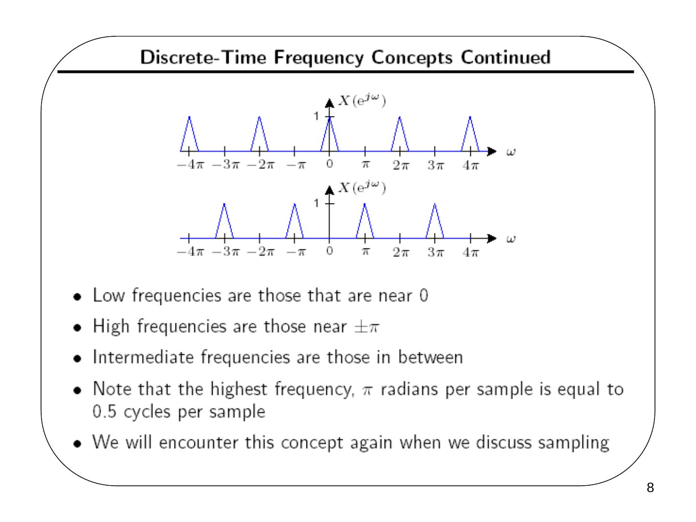
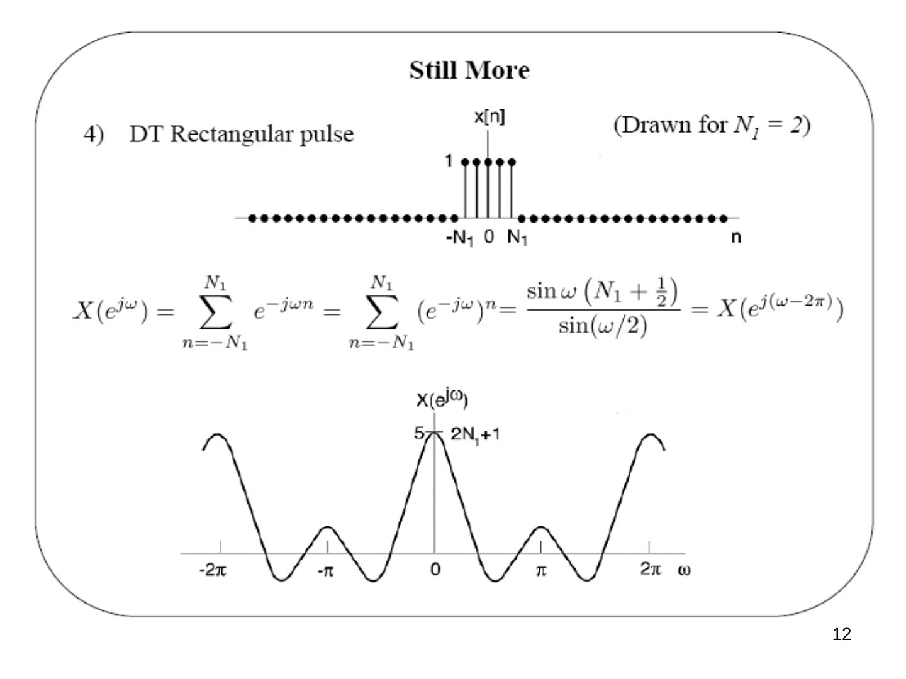
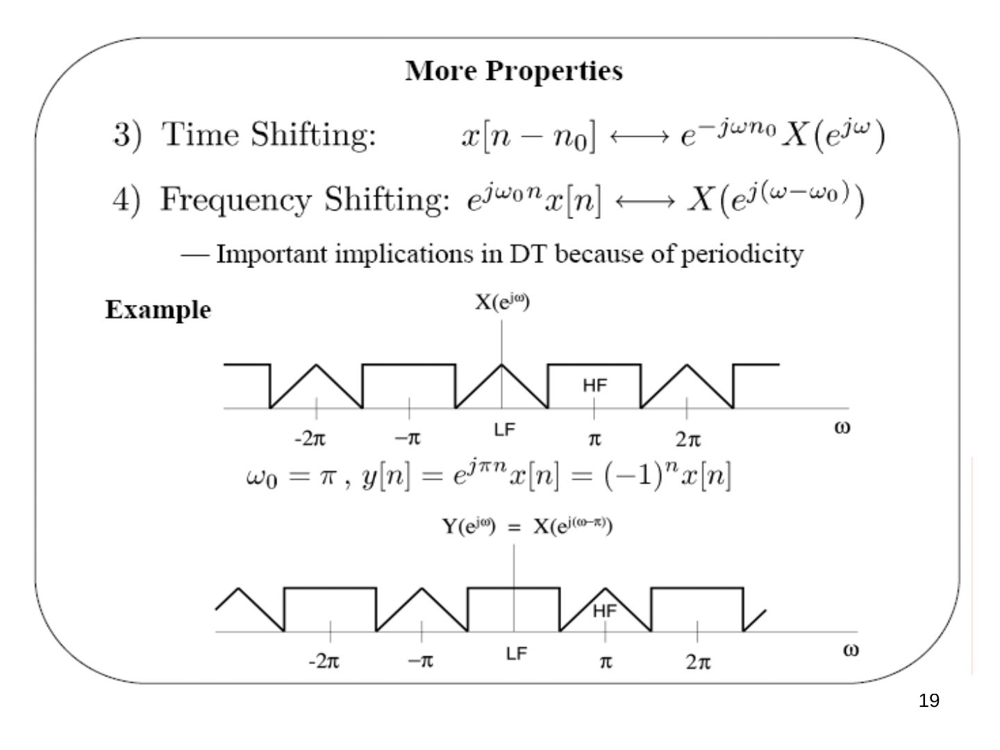
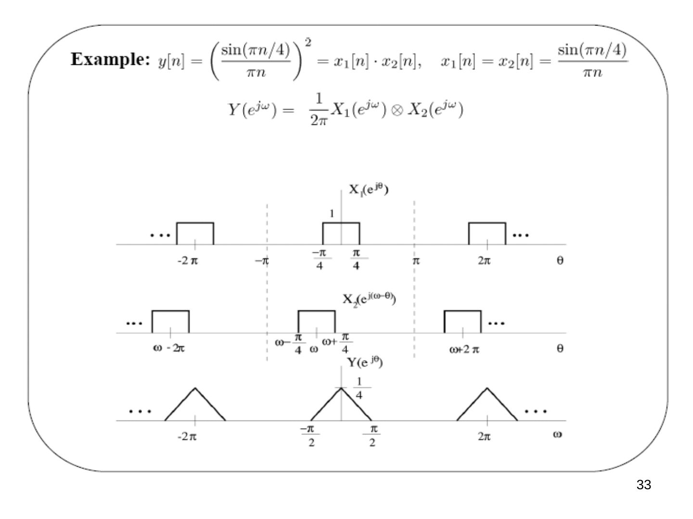
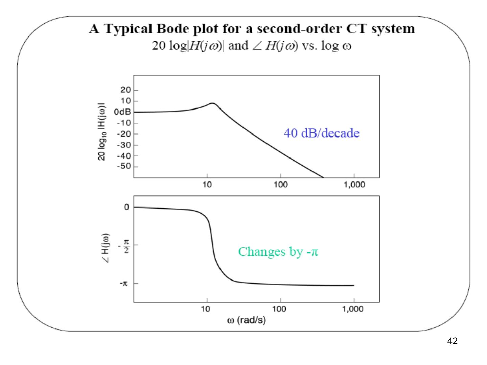
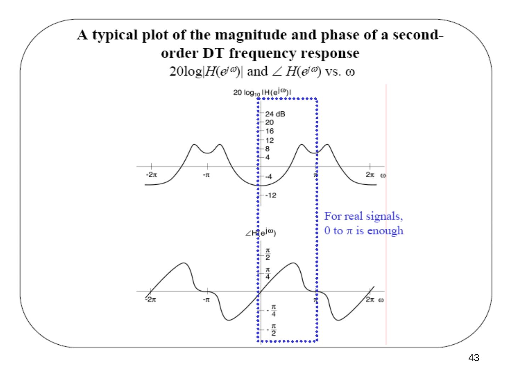

Bu yazı, Başkent Üniversitesi Elektrik-Elektronik Mühendisliği **EEM301 Sinyaller ve Sistemler I** dersinin son bölümü olan **"DT Fourier Transform"** (Ayrık Zamanlı Fourier Dönüşümü) sunumudur. Sunumu dersin öğretim üyesi **Prof. Dr. Alper Uraz** hazırlamış (Ekim 2005). Slaytların neredeyse tamamı görsel olduğu için içerik metne döküldü; formüller düz metne çevrildi, grafikler için slayt görselleri eklendi. Sunum İngilizce olduğundan içerik İngilizce aktarıldı. Orijinal PowerPoint dosyası yazının sonunda indirilebilir.

Sunumun konuları:

- Derivation of DT Fourier Transform pair
- DTFT of Periodic Signals
- Properties of DTFT
- Convolution Property
- DT LTI Systems
- Duality in Fourier Analysis
- Magnitude/Phase of FT and Frequency Response

## The discrete-time Fourier transform

Derivation (analogous to the CTFT, except that e^(jωn) = e^(j(ω+2π)n)):

- x[n] is aperiodic and (for simplicity) of finite duration.
- N is large enough so that x[n] = 0 if |n| ≥ N/2.
- x̃[n] = x[n] for |n| ≤ N/2 and periodic with period N.
- x̃[n] = x[n] for *any* n as N → ∞.

![Sonlu süreli x[n] ve onun N periyotla tekrarlanmış hâli x̃[n]](s-02.jpg "DTFT derivation: x[n] and its periodic extension")

From the DTFS:

x̃[n] = Σ (k = ⟨N⟩) ak e^(jkω0n), ω0 = 2π/N (DTFS synthesis eq.)

ak = (1/N) Σ (n = ⟨N⟩) x̃[n] e^(−jkω0n) = (1/N) Σ (n = −N1…N2) x̃[n] e^(−jkω0n) = (1/N) Σ (n = −∞…∞) x[n] e^(−jkω0n) (DTFS analysis eq.)

Define **X(e^(jω)) = Σ (n = −∞…∞) x[n] e^(−jωn)** — periodic in ω with period 2π. Then ak = (1/N) X(e^(jkω0)), and

x̃[n] = Σ (k = ⟨N⟩) (1/N) X(e^(jkω0)) e^(jkω0n) = (1/2π) Σ (k = ⟨N⟩) X(e^(jkω0)) e^(jkω0n) ω0 (∗)

As N → ∞: x̃[n] → x[n] for every n, ω0 → 0 and Σ ω0 → ∫ dω, so the sum in (∗) becomes an integral. **The DTFT pair:**

- **x[n] = (1/2π) ∫2π X(e^(jω)) e^(jωn) dω** — synthesis equation (inverse FT; over any 2π interval in ω)
- **X(e^(jω)) = Σ (n = −∞…∞) x[n] e^(−jωn)** — analysis equation (FT)

### Observations

- These are called the **analysis** and **synthesis** equations, respectively.
- Recall that e^(jωn) = e^(j(ω+ℓ2π)n) for any pair of integers ℓ and n.
- Thus X(e^(jω)) is a periodic function of ω with a fundamental period of 2π.
- Unlike the DT Fourier series, the frequency ω is continuous.
- Recall that the CT Fourier transform X(jω) was not periodic.
- Thus the DT *synthesis* integral can be taken over any continuous interval of length 2π.
- This is similar to the CT Fourier series analysis equation.

### Discrete-time frequency concepts

- Recall that e^(j(ω+ℓ2π)n) = e^(jωn).
- If seemingly very high-frequency DT signals, cos((ω + ℓ2π)n), are equal to low-frequency DT signals, cos(ωn), what do low and high frequency mean in discrete time?
- Note that the units of ω are *radians per sample*.
- A sinusoid with a frequency of 0.1 radians per sample is the same as one with a frequency of (0.1 + 2π) radians per sample.
- Recall that cos(πn) = (−1)ⁿ.
- No DT signal can oscillate "faster" between two samples.
- No DT signal can oscillate "slower" than 0 radians per sample.
- Thus ω = π = ℓ(π + 2π) is the highest perceivable DT frequency, and ω = 0 = ℓ(2π) is the lowest perceivable frequency.

*Not: Bu iki ifade ω = π + ℓ2π ve ω = ℓ2π biçiminde olmalı.*

- Low frequencies are those near 0.
- High frequencies are those near ±π.
- Intermediate frequencies are those in between.
- The highest frequency, π radians per sample, equals 0.5 cycles per sample.
- We will encounter this concept again when we discuss sampling.

### Convergence issues

- Synthesis equation: none, since we integrate over a finite interval.
- Analysis equation: needs conditions analogous to the CTFT, e.g. Σ |x[n]|² < ∞ (finite energy) or Σ |x[n]| < ∞ (absolutely summable).

## Examples (parallel with the CT examples)

1. **x[n] = δ[n]:** X(e^(jω)) = Σ δ[n] e^(−jωn) = 1.
1. **x[n] = δ[n − n0]** (shifted unit sample): X(e^(jω)) = e^(−jωn0) — the same amplitude (= 1) as above, but with a *linear* phase −ωn0.
1. **x[n] = aⁿ u[n], |a| < 1** — exponentially decaying function. Using the infinite sum formula (|a e^(−jω)| < 1):

X(e^(jω)) = Σ (n = 0…∞) (a e^(−jω))ⁿ = 1/(1 − a e^(−jω)) = 1/((1 − a cos ω) + j a sin ω)

|X(e^(jω))| = 1/√(1 − 2a cos ω + a²); at ω = 0: 1/(1 − a); at ω = π: 1/(1 + a). For a > 0 this is lowpass, for a < 0 highpass.

![aⁿu[n] dizisinin DTFT genliği: a > 0 ve a < 0 durumları](s-11.jpg "Exponentially decaying sequence: |X(e^(jω))| for a > 0 and a < 0")

4) **DT rectangular pulse** x[n] = 1 for |n| ≤ N1 (drawn for N1 = 2):

X(e^(jω)) = Σ (n = −N1…N1) e^(−jωn) = **sin ω(N1 + 1/2) / sin(ω/2)** = X(e^(j(ω−2π))), with X(e^(j0)) = 2N1 + 1 = 5.

5) **Ideal lowpass spectrum:** X(e^(jω)) = 1 for |ω| < W (repeated every 2π):

x[n] = (1/2π) ∫ (−W…W) e^(jωn) dω = **sin Wn / πn**, x[0] = (1/2π) ∫ (−W…W) X(e^(jω)) dω = W/π.

## DTFT of periodic signals

**DTFTs of sums of complex exponentials.** Recall the CT result x(t) = e^(jω0t) ↔ X(jω) = 2πδ(ω − ω0). What about DT, x[n] = e^(jω0n) ↔ X(e^(jω)) = ?

1. We expect an impulse (of area 2π) at ω = ω0.
1. But X(e^(jω)) must be periodic with period 2π.

In fact **X(e^(jω)) = 2π Σ (m = −∞…∞) δ(ω − ω0 − 2πm)**.

Note: the integration in the synthesis equation is over a 2π period, so we only need X(e^(jω)) in *one* 2π period. Thus x[n] = (1/2π) ∫ (−π…π) 2π Σ δ(ω − ω0 − 2πm) e^(jωn) dω = e^(jω0n).

**Periodic signals,** x[n] = x[n + N]: x[n] = Σ (k = ⟨N⟩) ak e^(jkω0n), ω0 = 2π/N (DTFS synthesis eq.). From the last result, e^(jkω0n) ↔ 2π Σm δ(ω − kω0 − 2πm), so by linearity of the DTFT:

X(e^(jω)) = Σ (k = ⟨N⟩) ak [2π Σm δ(ω − kω0 − 2πm)] = **2π Σ (k = −∞…∞) ak δ(ω − kω0) = 2π Σ ak δ(ω − 2πk/N)**

**Example — DT sine function:** x[n] = sin ω0n = (1/2j) e^(jω0n) − (1/2j) e^(−jω0n)

X(e^(jω)) = (π/j) Σm δ(ω − ω0 − 2πm) − (π/j) Σm δ(ω + ω0 − 2πm)

**Example — DT periodic impulse train:** x[n] = Σ (k = −∞…∞) δ[n − kN], ω0 = 2π/N.

ak = (1/N) Σ (n = ⟨N⟩) x[n] e^(−jkω0n) = (1/N) Σ (n = 0…N−1) δ[n] e^(−jkω0n) = 1/N

⇒ X(e^(jω)) = (2π/N) Σ (k = −∞…∞) δ(ω − 2πk/N) — also a periodic impulse train, in the frequency domain!

## Properties of the DT Fourier transform

1. **Periodicity:** X(e^(j(ω+2π))) = X(e^(jω)) — different from the CTFT.
1. **Linearity:** a x1[n] + b x2[n] ↔ a X1(e^(jω)) + b X2(e^(jω))
1. **Time shifting:** x[n − n0] ↔ e^(−jωn0) X(e^(jω))
1. **Frequency shifting:** e^(jω0n) x[n] ↔ X(e^(j(ω−ω0))) — important implications in DT because of periodicity. Example: with ω0 = π, y[n] = e^(jπn) x[n] = (−1)ⁿ x[n], and Y(e^(jω)) = X(e^(j(ω−π))): the low-frequency (LF) and high-frequency (HF) parts of the spectrum swap places.
1. **Time reversal:** x[−n] ↔ X(e^(−jω))
1. **Conjugate symmetry:** x[n] real ⇒ X(e^(jω)) = X*(e^(−jω)). Hence |X(e^(jω))| and Re{X(e^(jω))} are even functions, ∠X(e^(jω)) and Im{X(e^(jω))} are odd functions; x[n] real and even ⇔ X(e^(jω)) real and even; x[n] real and odd ⇔ X(e^(jω)) purely imaginary and odd.

**7) Time expansion.** Recall the CT property x(at) ↔ (1/|a|) X(j(ω/a)) — time scale in CT is infinitely fine. But in DT, x[n/2] makes no sense and x[2n] misses the odd values of x[n]. We can "slow" a DT signal down by inserting zeros: for an integer k ≥ 1, x(k)[n] inserts (k − 1) zeros between successive values (two zeros for k = 3):

x(k)[n] = x[n/k] if n is an integer multiple of k, 0 otherwise — stretched by a factor of k in the time domain.

X(k)(e^(jω)) = Σn x(k)[n] e^(−jωn) = (n = mk) Σm x(k)[mk] e^(−jωmk) = Σm x[m] e^(−j(kω)m) = **X(e^(jkω))** — compressed by a factor of k in the frequency domain.

![x[n] ile araya ikişer sıfır eklenmiş x(3)[n] ve spektrumun 3 kat sıkışması X(e^(j3ω))](s-22.jpg "Time expansion: X(3)(e^(jω)) = X(e^(j3ω))")

**8) Differentiation in frequency.** X(e^(jω)) = Σ x[n] e^(−jωn) ⇒ dX(e^(jω))/dω = −j Σ n x[n] e^(−jωn). Multiplying both sides by j:

n x[n] ↔ j dX(e^(jω))/dω (multiplication by n ⇔ differentiation in frequency)

**9) Parseval's relation:**

Σ (n = −∞…∞) |x[n]|² = (1/2π) ∫2π |X(e^(jω))|² dω (total energy in the time domain = total energy in the frequency domain)

**Differencing:** x[n] − x[n − 1] ↔ (1 − e^(−jω)) X(e^(jω)) — similar to a continuous-time derivative.

**Accumulation:** Σ (m = −∞…n) x[m] ↔ (1/(1 − e^(−jω))) X(e^(jω)) + π X(e^(j0)) Σ (ℓ = −∞…∞) δ(ω − 2πℓ) — similar to continuous-time integration.

## The convolution property

x[n] → h[n] → y[n] = h[n] ∗ x[n] ⇔ **Y(e^(jω)) = H(e^(jω)) X(e^(jω))**

⇒ the frequency response H(e^(jω)) is the DTFT of the unit sample response.

**Example:** x[n] = e^(jω0n) ↔ X(e^(jω)) = 2π Σk δ(ω − ω0 − 2πk)

Y(e^(jω)) = H(e^(jω)) 2π Σk δ(ω − ω0 − 2πk) = 2π Σk H(e^(j(ω0+2πk))) δ(ω − ω0 − 2πk) = (H periodic) H(e^(jω0)) 2π Σk δ(ω − ω0 − 2πk) ⇒ **y[n] = H(e^(jω0)) e^(jω0n)**

**Example — ideal lowpass filter:** H(e^(jω)) = 1 for |ω| < ωc (repeated every 2π) ⇒ h[n] = (1/2π) ∫ (−ωc…ωc) e^(jωn) dω = sin ωcn / πn.

**Example:** (sin(πn/4)/πn) ∗ (sin(πn/2)/πn) = sin(πn/4)/πn, since in frequency a lowpass of width ±π/4 times a lowpass of width ±π/2 gives the lowpass of width ±π/4.

**Convolution property example:** h[n] = αⁿ u[n], x[n] = βⁿ u[n], |α|, |β| < 1.

H(e^(jω)) = 1/(1 − α e^(−jω)), X(e^(jω)) = 1/(1 − β e^(−jω)) ⇒ Y(e^(jω)) = (1/(1 − α e^(−jω)))(1/(1 − β e^(−jω))) — a ratio of polynomials in e^(−jω).

- β ≠ α: by partial fraction expansion (PFE), Y(e^(jω)) = A/(1 − α e^(−jω)) + B/(1 − β e^(−jω)), with A, B determined by the PFE ⇒ y[n] = A αⁿ u[n] + B βⁿ u[n].
- β = α: Y(e^(jω)) = (1/(1 − α e^(−jω)))²; using n x[n] ↔ j dX(e^(jω))/dω ⇒ **y[n] = (n + 1) αⁿ u[n]**.

## DT LTI systems described by LCCDEs

Σ (k = 0…N) ak y[n − k] = Σ (k = 0…M) bk x[n − k]

From the time-shifting property x[n − k] ↔ e^(−jωk) X(e^(jω)):

Σ ak e^(−jkω) Y(e^(jω)) = Σ bk e^(−jkω) X(e^(jω)) ⇒ Y(e^(jω)) = [Σ (k = 0…M) bk e^(−jkω) / Σ (k = 0…N) ak e^(−jkω)] X(e^(jω))

The bracket is H(e^(jω)), the **DT transfer function** — a rational function of e^(−jω); use PFE to get h[n].

**Example — first-order recursive system:** y[n] − α y[n − 1] = x[n], |α| < 1, with the condition of initial rest (⇔ causal):

(1 − α e^(−jω)) Y(e^(jω)) = X(e^(jω)) ⇒ H(e^(jω)) = Y(e^(jω))/X(e^(jω)) = 1/(1 − α e^(−jω)) ⇒ **h[n] = αⁿ u[n]**

## DTFT multiplication property

y[n] = x1[n]·x2[n] ↔ Y(e^(jω)) = (1/2π) ∫2π X1(e^(jθ)) X2(e^(j(ω−θ))) dθ = (1/2π) X1(e^(jω)) ⊗ X2(e^(jω)) — a **periodic convolution**.

Derivation:

Y(e^(jω)) = Σn x1[n] x2[n] e^(−jωn) = Σn ((1/2π) ∫2π X1(e^(jθ)) e^(jθn) dθ) x2[n] e^(−jωn) = (1/2π) ∫2π X1(e^(jθ)) (Σn x2[n] e^(−j(ω−θ)n)) dθ = (1/2π) ∫2π X1(e^(jθ)) X2(e^(j(ω−θ))) dθ

**Calculating periodic convolutions.** Integrating from −π to π:

Y(e^(jω)) = (1/2π) ∫ (−π…π) X1(e^(jθ)) X2(e^(j(ω−θ))) dθ = (1/2π) ∫ (−∞…∞) X̂1(e^(jθ)) X2(e^(j(ω−θ))) dθ, where X̂1(e^(jθ)) = X1(e^(jθ)) for |θ| ≤ π and 0 otherwise.

**Example:** y[n] = (sin(πn/4)/πn)² = x1[n]·x2[n], x1[n] = x2[n] = sin(πn/4)/πn. Y(e^(jω)) = (1/2π) X1(e^(jω)) ⊗ X2(e^(jω)) is a triangle between −π/2 and π/2 with peak value 1/4 (repeated every 2π).

## Duality in Fourier analysis

The Fourier transform is highly symmetric.

**CTFT:** *both* time and frequency are continuous and in general *aperiodic*. x(t) = (1/2π) ∫ X(jω) e^(jωt) dω and X(jω) = ∫ x(t) e^(−jωt) dt are the same except for the factor 1/2π and the sign of the exponent. Suppose f(·) and g(·) are related by f(r) = ∫ g(τ) e^(−jrτ) dτ. Then:

- with τ = t and r = ω: x1(t) = g(t) ↔ X1(jω) = f(ω)
- with τ = −ω and r = t: x2(t) = f(t) ↔ X2(jω) = 2π g(−ω)

Example of CTFT duality: a square pulse in either the time or the frequency domain (pulse ↔ sinc, sinc ↔ pulse).

**DTFS:** *discrete & periodic* in time ↔ *periodic & discrete* in frequency: x[n] = Σ (k = ⟨N⟩) ak e^(jkω0n) = x[n + N], ω0 = 2π/N; ak = (1/N) Σ (n = ⟨N⟩) x[n] e^(−jkω0n) = a(k+N).

**Duality in DTFS.** Suppose f[·] and g[·] are related by f[m] = (1/N) Σ (r = ⟨N⟩) g[r] e^(−jrω0m) ⇒ g[r] = Σ (m = ⟨N⟩) f[m] e^(jrω0m). Then:

- with m = n and r = −k: x1[n] = f[n] ↔ ak = (1/N) g[−k]
- with r = n and m = k: x2[n] = g[n] ↔ ak = f[k]

**Duality between CTFS and DTFT:**

- CTFS: x(t) = Σ ak e^(jkω0t) = x(t + T), ω0 = 2π/T; ak = (1/T) ∫T x(t) e^(−jkω0t) dt — *periodic* in time ↔ *discrete* in frequency.
- DTFT: x[n] = (1/2π) ∫2π X(e^(jω)) e^(jωn) dω; X(e^(jω)) = Σ x[n] e^(−jωn) = X(e^(j(ω+2π))) — *discrete* in time ↔ *periodic* in frequency.

**CTFS–DTFT duality.** Suppose f(·) is a CT signal and g[·] a DT sequence related by f(τ) = Σ (m = −∞…∞) g[m] e^(jmτ) = f(τ + 2π). Then x(t) = f(t) ↔ ak = g[k] (periodic with period 2π), and x[n] = g[n] ↔ X(e^(jω)) = f(−ω).

## Magnitude and phase of FT, and frequency response

- CT: x(t) = (1/2π) ∫ X(jω) e^(jωt) dω, X(jω) = |X(jω)| e^(j∠X(jω)). Parseval relation: ∫ |x(t)|² dt = ∫ (1/2π) |X(jω)|² dω, where (1/2π)|X(jω)|² is the energy density in ω.
- DT: x[n] = (1/2π) ∫2π X(e^(jω)) e^(jωn) dω, X(e^(jω)) = |X(e^(jω))| e^(j∠X(e^(jω))). Parseval relation: Σ |x[n]|² = ∫2π (1/2π) |X(e^(jω))|² dω.

**Log-magnitude and phase.** For x(t) → H(jω) → y(t): |Y(jω)| = |H(jω)|·|X(jω)|, or log|Y(jω)| = log|H(jω)| + log|X(jω)|, and ∠Y(jω) = ∠H(jω) + ∠X(jω). For cascaded H1(jω) and H2(jω): log|H(jω)| = log|H1(jω)| + log|H2(jω)| and ∠H(jω) = ∠H1(jω) + ∠H2(jω) — easy to add.

### Plotting log-magnitude and phase

1. For real-valued signals and systems, |H(−jω)| = |H(jω)| and ∠H(−jω) = −∠H(jω) ⇒ plot for ω ≥ 0, often with a *logarithmic* frequency scale in CT.
1. In DT, we need only plot for 0 ≤ ω ≤ π (with a *linear* scale).
1. For historical reasons, log-magnitude is usually plotted in **decibels (dB)** (1 bel = 10 decibels: output power/input power = 10): 10 log10 |H(jω)|² = 20 log10 |H(jω)| (power vs. magnitude).

| Magnitude of H(jω) | dB |
|---|---|
| 1 | 0 dB |
| √2 | ~3 dB |
| 2 | ~6 dB |
| 10 | 20 dB |
| 100 | 40 dB |

So 20 dB, or 2 bels, means 10 times amplitude gain = 100 times power gain.

