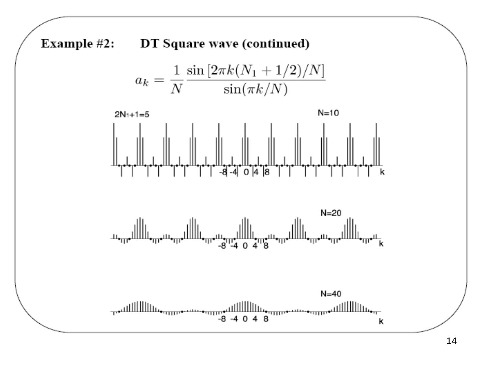
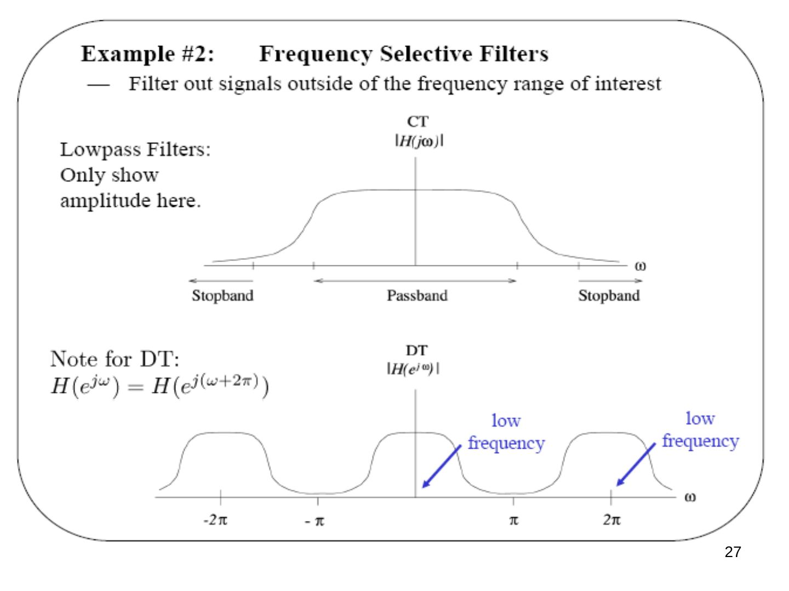
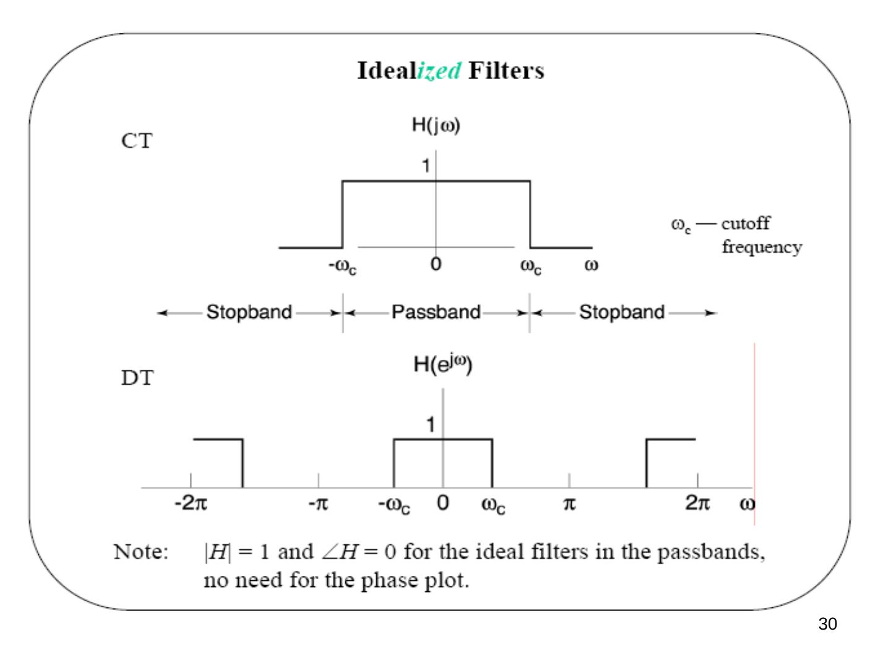
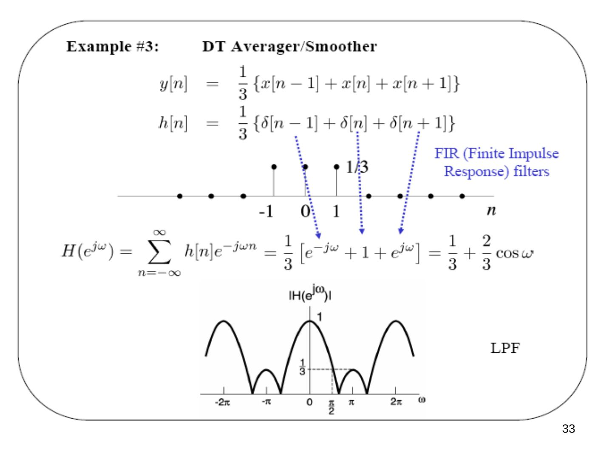
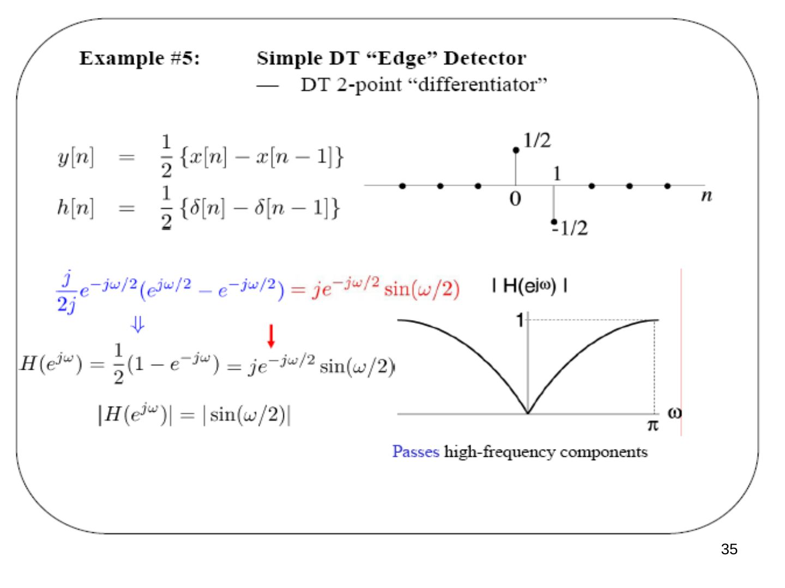

Bu yazı, Başkent Üniversitesi Elektrik-Elektronik Mühendisliği **EEM301 Sinyaller ve Sistemler I** dersinin **"DT Fourier Series"** (Ayrık Zamanlı Fourier Serileri) sunumudur. Sunumu dersin öğretim üyesi **Prof. Dr. Alper Uraz** hazırlamış (Ekim 2005). Slaytlar büyük ölçüde görsel olduğu için içerik metne döküldü; formüller düz metne çevrildi, grafikler için slayt görselleri eklendi. Sunum İngilizce olduğundan içerik İngilizce aktarıldı. Orijinal PowerPoint dosyası yazının sonunda indirilebilir.

Sunumun konuları:

- Fourier Series Representation
- Comparison of DTFS and CTFS
- Fourier Series and LTI Systems
- Frequency Response
- Frequency Selective Filters

## Fourier series representation of DT periodic signals

- x[n] is periodic with fundamental period N and fundamental frequency ω0 = 2π/N: x[n + N] = x[n].
- Only e^(jωn) which are periodic with period N appear in the FS: ωN = k2π ⇔ ω = kω0, k = 0, ±1, ±2, …
- There are only N distinct signals of this form: e^(j(k+N)ω0n) = e^(jkω0n) e^(jNω0n) = e^(jkω0n), since Nω0n = 2πn.
- So we *could* just use e^(j0ω0n), e^(j1ω0n), e^(j2ω0n), …, e^(j(N−1)ω0n).
- However, it is often useful to allow the choice of N consecutive values of k to be *arbitrary*.

### Discrete-time exponential harmonics

The set of all DT complex exponential signals that are periodic with period N can be expressed as

φk[n] = e^(jkωn) = e^(jk(2π/N)n), k = 0, ±1, ±2, …

e^(jωn) is called the **fundamental component**, e^(j2ωn) the **2nd harmonic component** and e^(jkωn) the **k-th harmonic component**.

")

### DT Fourier series representation

x[n] = Σ (k = ⟨N⟩) ak e^(jk(2π/N)n)

where Σ over k = ⟨N⟩ means the sum over *any* N consecutive values of k — this is a *finite* series — and {ak} are the Fourier (series) coefficients.

Questions: (1) What DT periodic signals have such a representation? (2) How do we find ak?

**Answer to Question #1:** *any* DT periodic signal has a Fourier series representation:

x[0] = Σ ak, x[1] = Σ ak e^(jkω0), x[2] = Σ ak e^(j2kω0), …, x[N−1] = Σ ak e^(j(N−1)kω0)

— N equations for N unknowns a0, a1, …, a(N−1).

**Equivalent expressions for exponential sums.** Since only N of the harmonics are distinct, we may truncate the sum so that it contains only N terms:

x[n] = Σ (k = 0…N−1) ak e^(jkωn) = Σ (k = ℓ…N−1+ℓ) ak e^(jkωn) = Σ (k = ⟨N⟩) ak e^(jkωn)

New notation: Σ (k = ⟨N⟩) ak e^(jkωn) ≜ Σ (k = 1+ℓ…N+ℓ) ak e^(jkωn) for any ℓ.

**Example:** x[n] = 1.0 for n = 3k and 0.5 otherwise = Σ (k = ⟨N⟩) ak φk[n].

- *Harmonically* related exponentials can be combined linearly to form a **Fourier series**.
- *Any* finite-valued discrete-time periodic signal can be written in this form.
- The trick (again) is how to find the coefficients ak.

### A more direct way to solve for ak

Finite geometric series:

Σ (n = 0…N−1) αⁿ = N if α = 1; (1 − α^N)/(1 − α) if α ≠ 1

With α = e^(jkω0):

Σ (n = ⟨N⟩) e^(jkω0n) = Σ (n = 0…N−1) (e^(jk2π/N))ⁿ = N for k = 0, ±N, ±2N, …; (1 − e^(jk(2π/N)N))/(1 − e^(jkω0)) = 0 otherwise.

So from x[n] = Σ (k = ⟨N⟩) ak e^(jkω0n), multiply both sides by e^(−jmω0n) and sum over n = ⟨N⟩:

Σn x[n] e^(−jmω0n) = Σn (Σk ak e^(jkω0n)) e^(−jmω0n) = Σk ak (Σn e^(j(k−m)ω0n)) = Σk ak N δ[k − m] = N am (orthogonality)

**DT Fourier series pair (ω0 = 2π/N):**

- **x[n] = Σ (k = ⟨N⟩) ak e^(jkω0n)** (synthesis equation)
- **ak = (1/N) Σ (n = ⟨N⟩) x[n] e^(−jkω0n)** (analysis equation)

Note: it is convenient to think of ak as being defined for *all* integers k. So:

1. a(k+N) = ak — a special property of DT Fourier coefficients.
1. We only use N consecutive values of ak in the synthesis equation (since x[n] is periodic, it is specified by N numbers, either in the time or the frequency domain).
1. ak are called the **spectral** or **FS coefficients**.

## Examples

### Example #1: sum of a pair of sinusoids

x[n] = cos(πn/8) + cos(πn/4 + π/4) — periodic with period N = 16 ⇒ ω0 = π/8

x[n] = (1/2)[e^(jω0n) + e^(−jω0n)] + (1/2)[e^(jπ/4) e^(j2ω0n) + e^(−jπ/4) e^(−j2ω0n)]

- a0 = 0
- a1 = 1/2, a−1 = 1/2
- a2 = e^(jπ/4)/2, a−2 = e^(−jπ/4)/2
- a3 = 0, a−3 = 0, …
- a15 = a(−1+16) = a−1 = 1/2
- a66 = a(2+4×16) = a2 = e^(jπ/4)/2

### Example #2: DT square wave

x[n] = 1 for |n| ≤ N1 within each period N.

a0 = (1/N) Σ (n = −N1…N1) x[n] = (2N1 + 1)/N = aN = a−N = a6N = …

For k ≠ multiple of N, using n = m − N1:

ak = (1/N) Σ (n = −N1…N1) e^(−jkω0n) = (1/N) Σ (m = 0…2N1) e^(−jkω0(m−N1)) = (1/N) e^(jkω0N1) Σ (m = 0…2N1) (e^(−jkω0))^m = (1/N) e^(jkω0N1) (1 − e^(−jkω0(2N1+1)))/(1 − e^(jkω0))

= **(1/N) sin[k(N1 + 1/2)ω0] / sin(kω0/2) = (1/N) sin[2πk(N1 + 1/2)/N] / sin(πk/N)**

*Not: Geometrik toplamın paydasında 1 − e^(−jkω0) olmalı; sonuç ifadesi doğru.*

**Partial Fourier series.** With N = 11 and N1 = 2, the partial sums for k = 0, k = −1…1, k = −3…3 and k = −5…5 were plotted (a0 = (2N1 + 1)/N). When the number of terms equals N, the series gives the exact periodic signal.

")

")

## Compare and contrast DTFS with CTFS

- CTFS: x(t) = Σ (k = −∞…∞) ak e^(jkωt), ak = (1/T) ∫T x(t) e^(−jkωt) dt
- DTFS: x[n] = Σ (k = ⟨N⟩) ak e^(jkωn), ak = (1/N) Σ (n = ⟨N⟩) x[n] e^(−jkωn)

**Unlike the CTFS:**

- There are only N distinct DT exponential harmonics.
- The *finite* DTFS sum is over *any* N consecutive terms.
- Thus the DTFS coefficients ak form a discrete-time periodic signal (complex valued).
- The DTFS always converges for all periodic signals such that |x[n]| < ∞.
- No Gibbs phenomenon.

**Convergence issues for DT Fourier series:** *not* an issue, since all series are finite sums.

**Properties of DT Fourier series:** lots, just as with CT Fourier series. Example — *frequency shift*: if x[n] ↔ ak, what is bk for e^(jMω0n) x[n]?

x[n] e^(jMω0n) = Σ (r = ⟨N⟩) ar e^(jrω0n) e^(jMω0n) = (with k = r + M) Σ (k = ⟨N⟩) a(k−M) e^(jkω0n) ⇒ **bk = a(k−M)** (jkω0 → j(k − M)ω0)

### Fourier series key concepts

x[n] = Σ (k = ⟨N⟩) ak e^(jkωn), x(t) = Σ (k = −∞…∞) ak e^(jkωt)

- Class of signals that can be represented as a Fourier series: any practical periodic CT signal; any periodic DT signal.
- There is a one-to-one mapping between a signal and its FS coefficients: if you know the signal, you can calculate the coefficients; if you know the coefficients, you can generate the signal.
- The coefficients ak contain all of the information in the signal.
- The squared magnitudes |ak|² represent the average power of the signal at the k-th harmonic.

**Parseval's relation** for periodic DT signals:

(1/N) Σ (n = ⟨N⟩) |x(n)|² = Σ (k = ⟨N⟩) |ak|²

where ak ↔ x(n): the average power in one period of x(n) equals the sum of the average powers in all of its harmonic components. The properties of the DTFS are given in Table 3.2 (of the textbook).

## Fourier series and LTI systems

**The eigenfunction property of complex exponentials:**

- CT: e^(st) → h(t) → H(s) e^(st), with the CT "system function" H(s) = ∫ (−∞…∞) h(t) e^(−st) dt
- DT: zⁿ → h[n] → H(z) zⁿ, with the DT "system function" H(z) = Σ (n = −∞…∞) h[n] z^(−n)

where h(t) and h(n) are impulse responses.

**Periodic signals and LTI systems:**

x(t) = Σ ak e^(jkω0t) → h(t) → y(t) = Σ H(jkω0) ak e^(jkω0t), i.e. ak → H(jkω0) ak, where H(jkω0) = |H(jkω0)| e^(j∠H(jkω0)) is a "gain" that includes both amplitude and phase. So |ak| → |H(jkω0)| |ak|: the powers of signals get modified through the filter/system.

x[n] = Σ (k = ⟨N⟩) ak e^(jkω0n) → h[n] → y[n] = Σ H(e^(jkω0)) ak e^(jkω0n), with H(e^(jkω0)) = |H(e^(jkω0))| e^(j∠H(e^(jkω0))).

### The frequency response of an LTI system

- e^(jωt) → H(jω) → H(jω) e^(jωt) (s = jω). **CT frequency response:** H(jω) = ∫ (−∞…∞) h(t) e^(−jωt) dt
- e^(jωn) → H(e^(jω)) → H(e^(jω)) e^(jωn) (z = e^(jω)). **DT frequency response:** H(e^(jω)) = Σ (n = −∞…∞) h[n] e^(−jωn)

## Frequency shaping and filtering

By the choice of H(jω) (or H(e^(jω))) as a function of ω, we can *shape* the frequency composition of the output: preferential amplification, selective filtering of some frequencies.

**Example #1: audio system** — adjustable filter (bass, mid-range, treble controls) → equalizer → speaker. For audio signals, the amplitude is much more important than the phase.

**Example #2: frequency selective filters** — filter out signals outside the frequency range of interest. Lowpass filters have a passband around ω = 0 and stopbands elsewhere (only the amplitude is shown). Note for DT: H(e^(jω)) = H(e^(j(ω+2π))), so the DT response repeats every 2π, and the low frequencies are around ω = 0, ±2π, ….

**Highpass filters:** remember (−1)ⁿ = e^(jπn): π is the highest frequency in DT, so a DT highpass filter passes frequencies around ±π, ±3π, ….

### Idealized filters

- **Lowpass:** H(jω) = 1 for |ω| < ωc (passband) and 0 otherwise (stopband); ωc is the cutoff frequency. The DT version repeats with period 2π.
- **Highpass:** H(jω) = 0 for |ω| < ωc and 1 otherwise; in DT the passbands are ωc < |ω| < 2π − ωc (around π), repeating every 2π.
- **Bandpass:** passband ωc1 < |ω| < ωc2 (lower and upper cut-off frequencies); in DT repeated every 2π.

Note: |H| = 1 and ∠H = 0 for the ideal filters in the passbands, so there is no need for a phase plot.

## Filter examples

### Example #3: DT averager/smoother

y[n] = (1/3){x[n−1] + x[n] + x[n+1]}, h[n] = (1/3){δ[n−1] + δ[n] + δ[n+1]} — an **FIR (finite impulse response)** filter.

H(e^(jω)) = Σ h[n] e^(−jωn) = (1/3)[e^(−jω) + 1 + e^(jω)] = **1/3 + (2/3) cos ω** — a lowpass filter (LPF).

### Example #4: nonrecursive DT (FIR) filters

y[n] = (1/(N + M + 1)) Σ (k = −N…M) x[n−k] → h[n] = (1/(N + M + 1)) Σ (k = −N…M) δ[n−k]

H(e^(jω)) = (1/(N + M + 1)) Σ (k = −N…M) e^(−jkω) = (1/(N + M + 1)) e^(jω[(N−M)/2]) sin[ω(M + N + 1)/2] / sin(ω/2)

The response rolls off at lower ω as M + N + 1 increases (plotted for M + N + 1 = 33 and 65).

### Example #5: simple DT "edge" detector — DT 2-point "differentiator"

y[n] = (1/2){x[n] − x[n−1]}, h[n] = (1/2){δ[n] − δ[n−1]}

H(e^(jω)) = (1/2)(1 − e^(−jω)) = (j/2j) e^(−jω/2)(e^(jω/2) − e^(−jω/2)) = **j e^(−jω/2) sin(ω/2)**, |H(e^(jω))| = |sin(ω/2)|

It passes high-frequency components.

