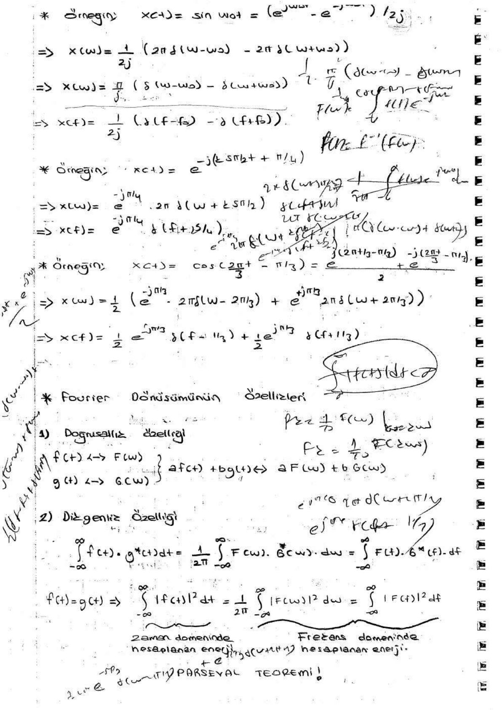
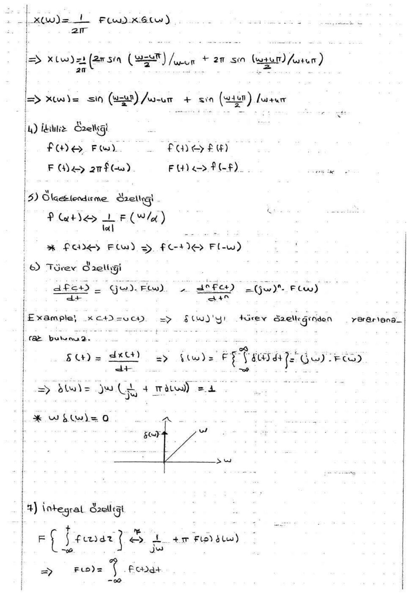
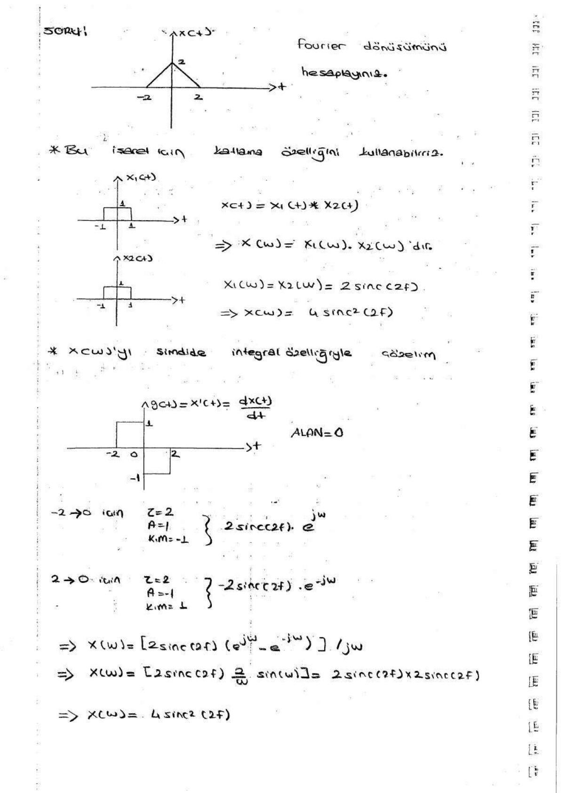
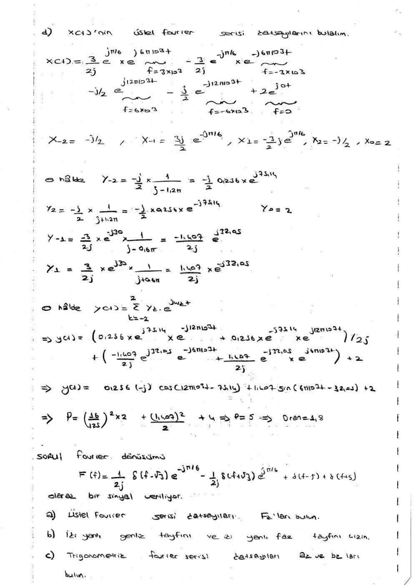

This post contains the **46-page handwritten Fourier transform lecture notes** kept in the EEM301 Signals and Systems I folder under the name "sinyaller-sistemler-fourier.pdf". It is not known who wrote the notes; the scan is dated 2008 and the pages carry no information about the author (a personal note on the first page has been covered). Below, the headings, main formulas, and results of the examples in the notes are summarized; a few pages are included as images. The scanned PDF can be downloaded at the end of the post.

*This content belongs to a third-party source; it is shared for archival and nostalgic purposes with the source credited. It will be removed upon the request of the rights holder.*

## Definition of the Fourier transform

- F(ω) = ∫₋∞^∞ f(t) e^(−jωt) dt, F(f) = ∫₋∞^∞ f(t) e^(−j2πft) dt
- f(t) = F⁻¹{F(ω)} = (1/2π) ∫₋∞^∞ F(ω) e^(jωt) dω, f(t) = ∫₋∞^∞ F(f) e^(j2πft) df
- For the Fourier transform of a signal to exist, the condition ∫|f(t)|dt < ∞ must be satisfied.
- Relation to the Fourier series coefficients: F_k = (1/T₀) F(ω)|_(ω=kω₀).
- The amplitude and phase spectra of aperiodic signals are continuous. The Fourier transform of periodic signals cannot be computed directly but can be computed indirectly through impulses; their spectra consist of lines.

Basic pairs:

- e^(±jω₀t) ⟷ 2πδ(ω ∓ ω₀), i.e., δ(f ∓ f₀)
- e^(j(kω₀t + φ)) ⟷ e^(jφ)·2πδ(ω − kω₀)
- cos ω₀t ⟷ π[δ(ω − ω₀) + δ(ω + ω₀)] = ½[δ(f − f₀) + δ(f + f₀)]
- sin ω₀t ⟷ (π/j)[δ(ω − ω₀) − δ(ω + ω₀)]

")

## Properties of the Fourier transform

1. **Linearity:** a·f(t) + b·g(t) ⟷ a·F(ω) + b·G(ω)
1. **Invariance and Parseval's theorem:** ∫f(t)g*(t)dt = (1/2π)∫F(ω)G*(ω)dω; for f = g, ∫|f(t)|²dt = (1/2π)∫|F(ω)|²dω = ∫|F(f)|²df (the energy computed in the time and frequency domains is equal).
1. **Shifting properties:** time shifting f(t − t₀) ⟷ e^(−jωt₀)F(ω) (|e^(−jωt₀)| = 1, only the phase changes by −ωt₀); modulation e^(jω₀t)f(t) ⟷ F(ω − ω₀).
1. **Multiplication and convolution in time:** x(t) = f(t)·g(t) ⟷ (1/2π)F(ω) ∗ G(ω); x(t) = f(t) ∗ g(t) ⟷ F(ω)·G(ω). For example, if h(t) = δ(t − t₀), then y(t) = x(t − t₀).
1. **Duality:** if f(t) ⟷ F(ω), then F(t) ⟷ 2πf(−ω).
1. **Scaling:** f(at) ⟷ (1/|a|)F(ω/a); in particular f(−t) ⟷ F(−ω).
1. **Derivative:** dⁿf/dtⁿ ⟷ (jω)ⁿF(ω).
1. **Integral:** ∫₋∞^t f(τ)dτ ⟷ F(ω)/(jω) + πF(0)δ(ω), F(0) = ∫f(t)dt.

## Solved examples

- **Rectangular pulse:** a rectangle of amplitude A and width τ ⟷ Aτ·sinc(fτ); if its center is shifted to t = k, then Aτ·sinc(fτ)·e^(−jωk). For example, for a pulse of amplitude 2 between 3 ≤ t ≤ 4, F(ω) = 2 sinc(f)·e^(−j3.5ω); the amplitude spectrum is |2 sinc(f)|, and the phase spectrum is a line of slope −3.5 with ±π jumps added to it due to the sign changes of the sinc.
- **Stepped signals:** x(t) is written as a sum of several shifted rectangles and transformed using the shifting property; the result is verified by direct computation of the integral.
- **Unit step:** δ(t) = du/dt and, with the integral property, u(t) ⟷ 1/(jω) + πδ(ω); u(t − 2) ⟷ e^(−j2ω)/(jω) + πδ(ω).
- **Windowed cosine:** x(t) = cos(4πt)·[u(t + 1/2) − u(t − 1/2)] using the multiplication-in-time property: X(ω) = sin((ω − 4π)/2)/(ω − 4π) + sin((ω + 4π)/2)/(ω + 4π).
- **Triangular signal:** a triangle with peak 2 between −2 and 2 is written as the convolution of two rectangles of width 2: X₁(ω) = X₂(ω) = 2 sinc(2f) ⇒ X(ω) = 4 sinc²(2f). The same result is also obtained via the transform of the derivative (two rectangles) and the integral property.
- **Modulation with a sinc:** x(t) = 3 sinc(2t)·cos(2π·10³t); the transform of the sinc is found to be a rectangle via the inverse Fourier transform, and multiplication by the cosine shifts the spectrum to ±10³ Hz.

## Exam-style problems

The end of the notes contains solved exam questions. Examples:

- The Fourier transform of the signal f(t) = u(t + 2) − u(t) (A = 1, τ = 2, shift −1: F(ω) = 2 sinc(2f)·e^(jω)), and its two-sided amplitude and phase spectra.
- The Fourier transform of the signal x(t) = 3 sin(6π·10³t + π/6) − j cos(12π·10³t) + 2, and its two-sided amplitude and phase spectra; the output signal when this signal is passed through a system with frequency response H(f) = 1/(1 + j2π·10⁻³f), and the ratio of the average power at the output to that at the input.
- For F(f) = (1/2j)δ(f − √3)e^(−jπ/6) − (1/2j)δ(f + √3)e^(jπ/6) + δ(f − 5) + δ(f + 5): the exponential and trigonometric Fourier series coefficients, the spectra, the inverse transform f(t) = sin(2√3πt − π/6) + 2 cos(10πt), and the power via Parseval's theorem (2.5).

