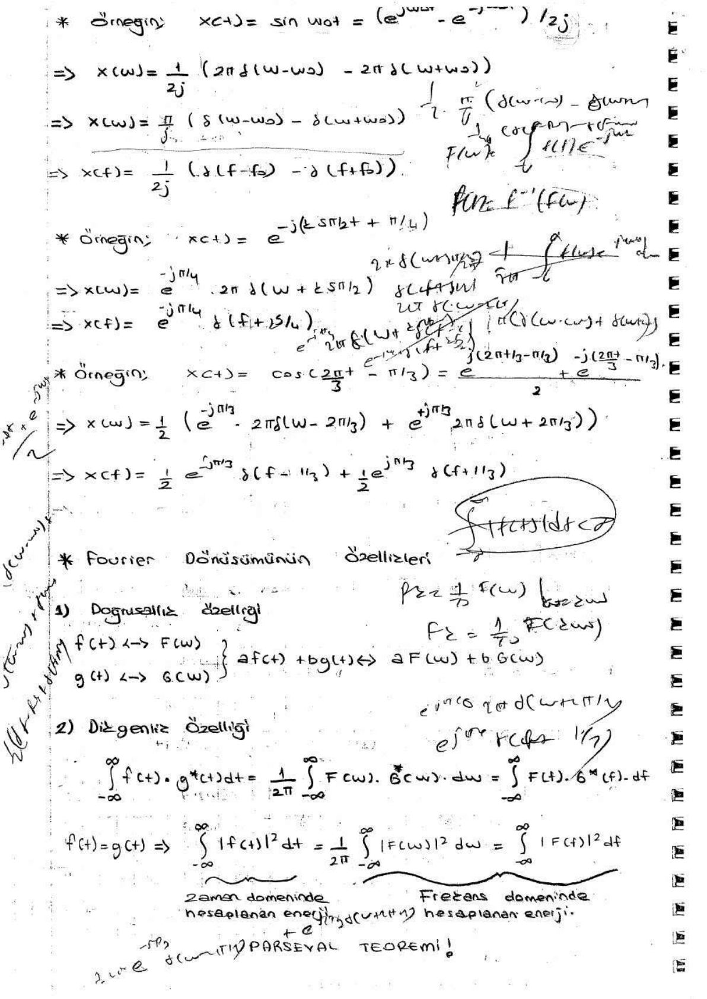
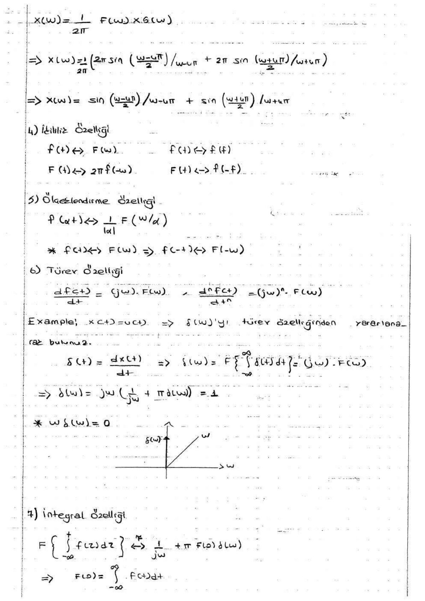
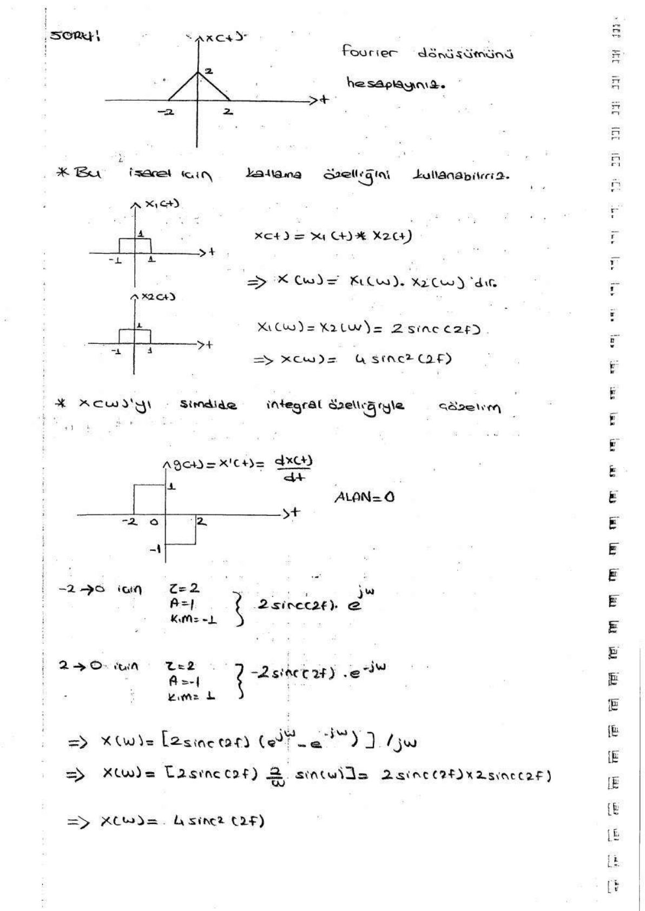
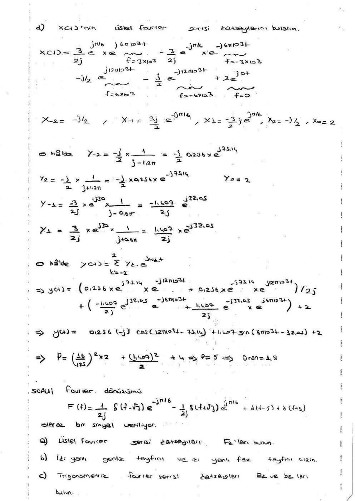

Bu yazı, EEM301 Sinyaller ve Sistemler I klasöründe "sinyaller-sistemler-fourier.pdf" adıyla duran, **46 sayfalık el yazısı Fourier dönüşümü ders notunu** içeriyor. Notların kim tarafından yazıldığı belli değil; tarama 2008 tarihli ve sayfalarda yazara ilişkin bir bilgi yok (ilk sayfadaki kişisel bir not kapatıldı). Aşağıda notun başlıkları, ana formülleri ve örneklerin sonuçları aktarıldı; birkaç sayfa görsel olarak eklendi. Tarama PDF yazının sonunda indirilebilir.

*Bu içerik üçüncü taraf bir kaynağa aittir; arşiv ve nostalji amacıyla kaynak belirtilerek paylaşılmıştır. Hak sahibinin talebi hâlinde kaldırılır.*

## Fourier dönüşümünün tanımı

- F(ω) = ∫₋∞^∞ f(t) e^(−jωt) dt, F(f) = ∫₋∞^∞ f(t) e^(−j2πft) dt
- f(t) = F⁻¹{F(ω)} = (1/2π) ∫₋∞^∞ F(ω) e^(jωt) dω, f(t) = ∫₋∞^∞ F(f) e^(j2πft) df
- Bir işaretin Fourier dönüşümünün alınabilmesi için ∫|f(t)|dt < ∞ şartı sağlanmalıdır.
- Fourier serisi katsayılarıyla ilişki: F_k = (1/T₀) F(ω)|_(ω=kω₀).
- Periyodik olmayan işaretlerin genlik ve faz tayfı süreklidir. Periyodik işaretlerin Fourier dönüşümü doğrudan hesaplanamaz ama dürtüler yoluyla dolaylı olarak hesaplanabilir; tayfları çizgilerden oluşur.

Temel çiftler:

- e^(±jω₀t) ⟷ 2πδ(ω ∓ ω₀), yani δ(f ∓ f₀)
- e^(j(kω₀t + φ)) ⟷ e^(jφ)·2πδ(ω − kω₀)
- cos ω₀t ⟷ π[δ(ω − ω₀) + δ(ω + ω₀)] = ½[δ(f − f₀) + δ(f + f₀)]
- sin ω₀t ⟷ (π/j)[δ(ω − ω₀) − δ(ω + ω₀)]

")

## Fourier dönüşümünün özellikleri

1. **Doğrusallık:** a·f(t) + b·g(t) ⟷ a·F(ω) + b·G(ω)
1. **Değişmezlik ve Parseval teoremi:** ∫f(t)g*(t)dt = (1/2π)∫F(ω)G*(ω)dω; f = g için ∫|f(t)|²dt = (1/2π)∫|F(ω)|²dω = ∫|F(f)|²df (zaman ve frekans domeninde hesaplanan enerji eşittir).
1. **Kayma özellikleri:** zamanda kayma f(t − t₀) ⟷ e^(−jωt₀)F(ω) (|e^(−jωt₀)| = 1, yalnız faz −ωt₀ değişir); modülasyon e^(jω₀t)f(t) ⟷ F(ω − ω₀).
1. **Zamanda çarpma ve katlama:** x(t) = f(t)·g(t) ⟷ (1/2π)F(ω) ∗ G(ω); x(t) = f(t) ∗ g(t) ⟷ F(ω)·G(ω). Örneğin h(t) = δ(t − t₀) ise y(t) = x(t − t₀).
1. **İkilik (dualite):** f(t) ⟷ F(ω) ise F(t) ⟷ 2πf(−ω).
1. **Ölçekleme:** f(at) ⟷ (1/|a|)F(ω/a); özel olarak f(−t) ⟷ F(−ω).
1. **Türev:** dⁿf/dtⁿ ⟷ (jω)ⁿF(ω).
1. **İntegral:** ∫₋∞^t f(τ)dτ ⟷ F(ω)/(jω) + πF(0)δ(ω), F(0) = ∫f(t)dt.

## Çözümlü örnekler

- **Dikdörtgen darbe:** genliği A, genişliği τ olan dikdörtgen ⟷ Aτ·sinc(fτ); merkezi t = k'ya kaymışsa Aτ·sinc(fτ)·e^(−jωk). Örneğin 3 ≤ t ≤ 4 arasında genliği 2 olan darbe için F(ω) = 2 sinc(f)·e^(−j3.5ω); genlik tayfı |2 sinc(f)|, faz tayfı eğimi −3.5 olan doğru üzerine sinc'in işaret değişimlerinden gelen ±π sıçramaları biner.
- **Basamaklı sinyaller:** x(t) birden çok kaydırılmış dikdörtgenin toplamı olarak yazılıp kayma özelliğiyle dönüşüm alınır; sonuç integralle doğrudan hesaplanarak doğrulanır.
- **Birim basamak:** δ(t) = du/dt ve integral özelliğiyle u(t) ⟷ 1/(jω) + πδ(ω); u(t − 2) ⟷ e^(−j2ω)/(jω) + πδ(ω).
- **Pencerelenmiş kosinüs:** x(t) = cos(4πt)·[u(t + 1/2) − u(t − 1/2)] zamanda çarpma özelliğiyle: X(ω) = sin((ω − 4π)/2)/(ω − 4π) + sin((ω + 4π)/2)/(ω + 4π).
- **Üçgen sinyal:** −2 ile 2 arasında tepesi 2 olan üçgen, genişliği 2 olan iki dikdörtgenin katlaması olarak yazılır: X₁(ω) = X₂(ω) = 2 sinc(2f) ⇒ X(ω) = 4 sinc²(2f). Aynı sonuç türevin (iki dikdörtgen) dönüşümü ve integral özelliğiyle de bulunuyor.
- **sinc ile modülasyon:** x(t) = 3 sinc(2t)·cos(2π·10³t); sinc'in dönüşümü ters Fourier dönüşümüyle dikdörtgen bulunur, kosinüsle çarpım tayfı ±10³ Hz'e kaydırır.

## Sınav tipi sorular

Notun sonunda çözümlü sınav soruları var. Örnekler:

- f(t) = u(t + 2) − u(t) işaretinin Fourier dönüşümü (A = 1, τ = 2, kayma −1: F(ω) = 2 sinc(2f)·e^(jω)), iki yanlı genlik ve faz tayfları.
- x(t) = 3 sin(6π·10³t + π/6) − j cos(12π·10³t) + 2 sinyalinin Fourier dönüşümü, iki yanlı genlik ve faz tayfları; bu sinyal H(f) = 1/(1 + j2π·10⁻³f) frekans yanıtlı sistemden geçtiğinde çıkış sinyali ve çıkıştaki ortalama gücün girişe oranı.
- F(f) = (1/2j)δ(f − √3)e^(−jπ/6) − (1/2j)δ(f + √3)e^(jπ/6) + δ(f − 5) + δ(f + 5) için üstel ve trigonometrik Fourier serisi katsayıları, tayflar, ters dönüşüm f(t) = sin(2√3πt − π/6) + 2 cos(10πt) ve Parseval teoremiyle güç (2.5).

