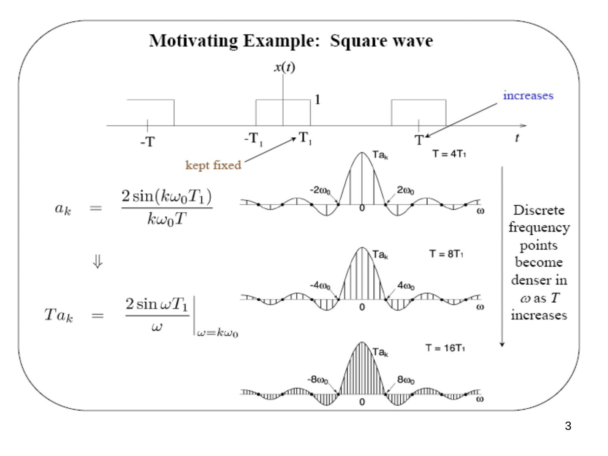
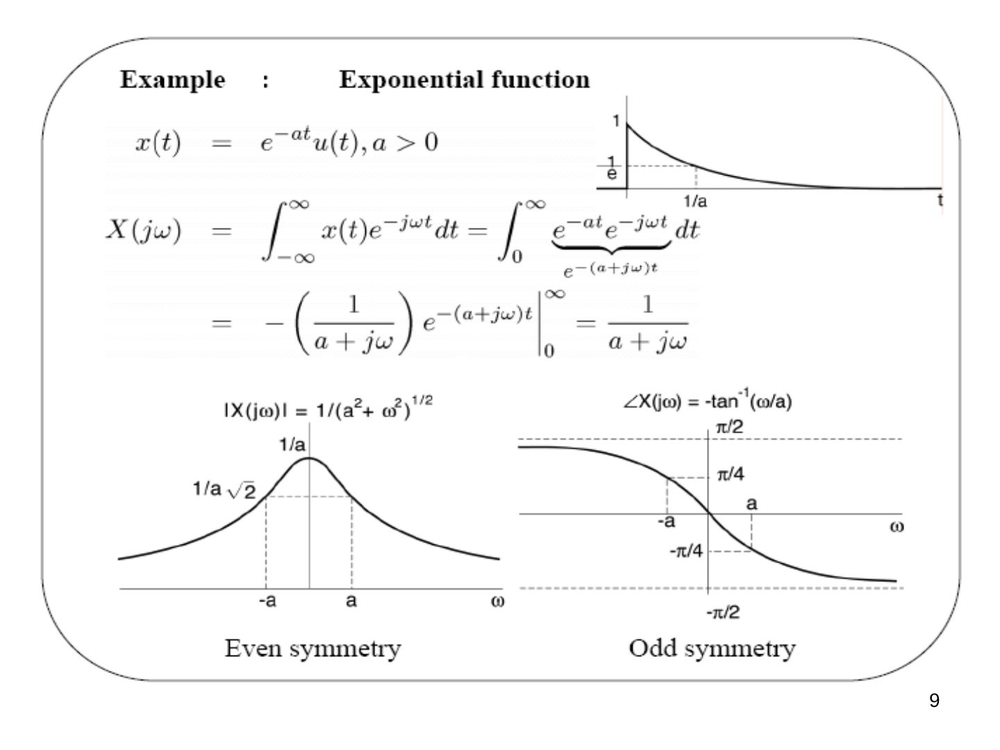
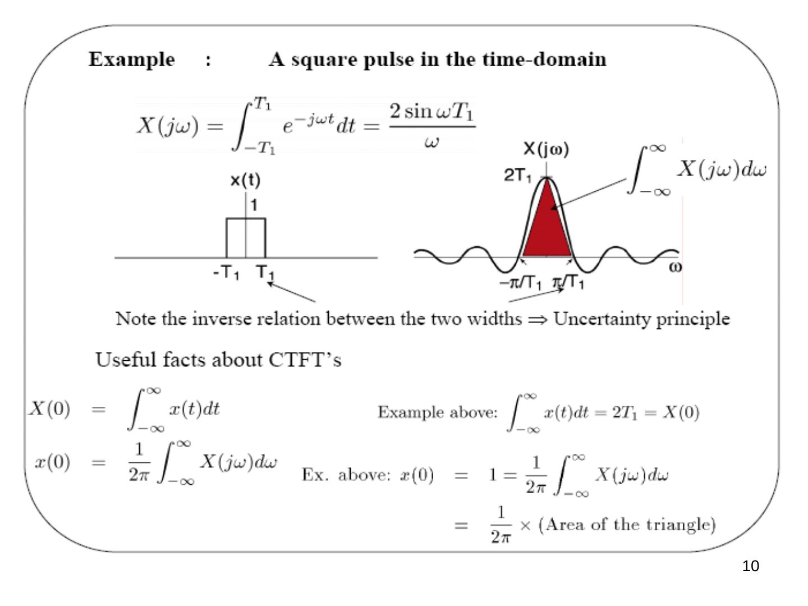
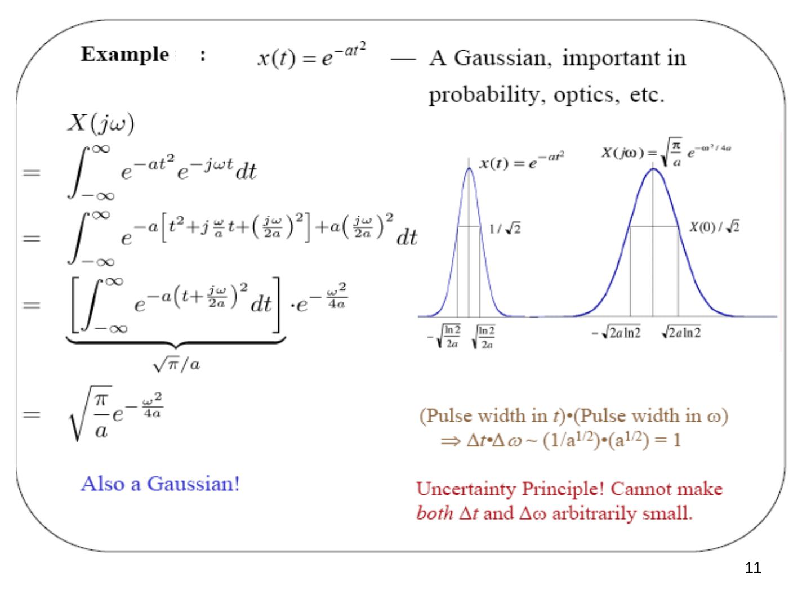
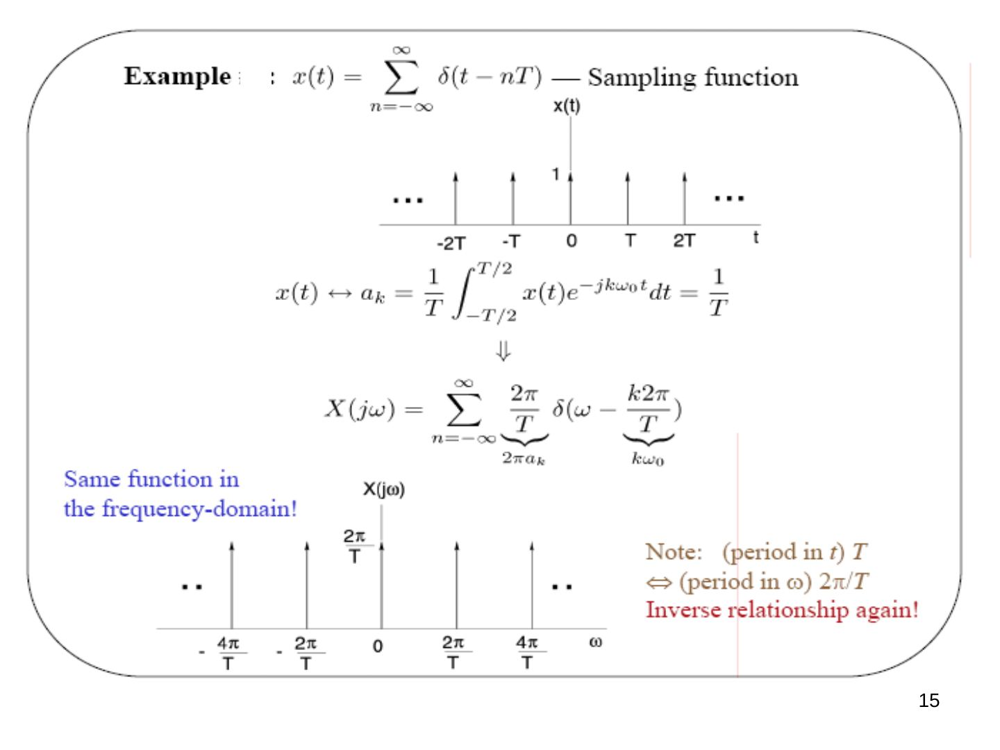
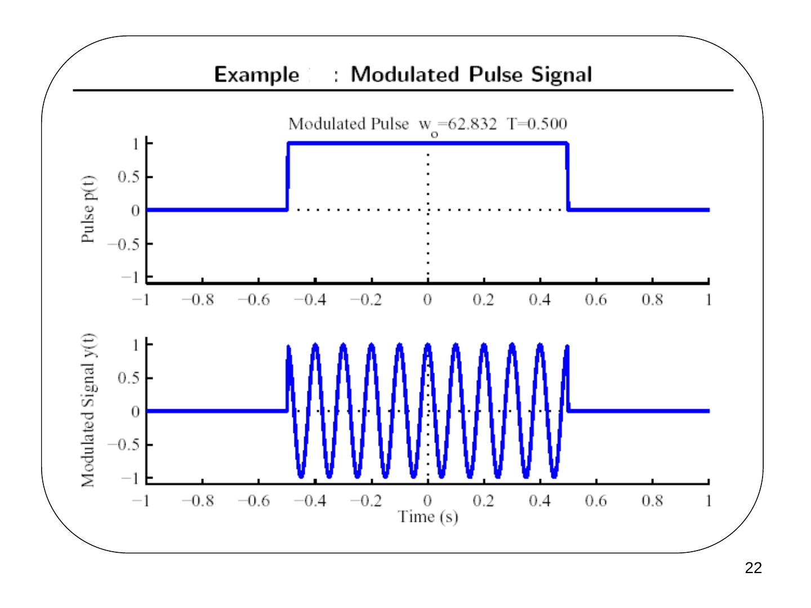
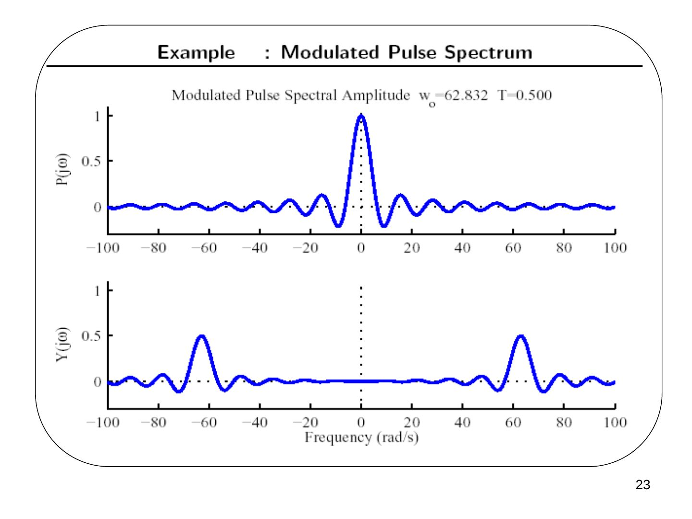
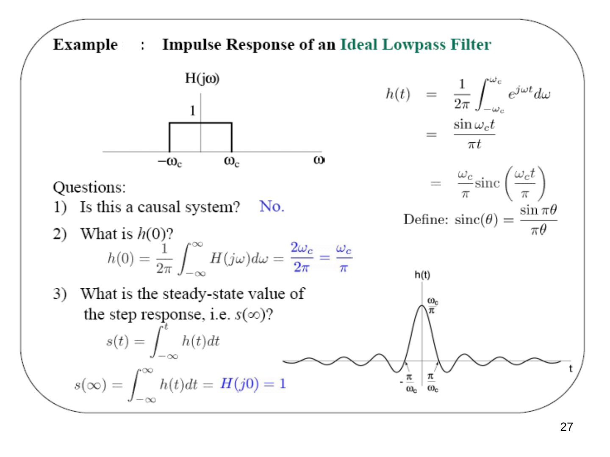
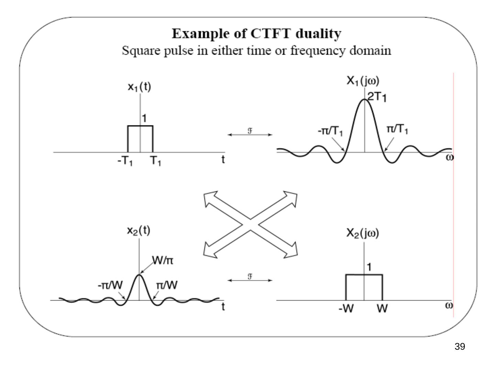

Bu yazı, Başkent Üniversitesi Elektrik-Elektronik Mühendisliği **EEM301 Sinyaller ve Sistemler I** dersinin **"Fourier Transform"** (Fourier Dönüşümü) sunumudur. Sunum dersin öğretim üyesi **Prof. Dr. Alper Uraz** tarafından hazırlanmış; dosyanın son düzenlemesi Aralık 2005 tarihli. Slaytların neredeyse tamamı görsel olduğu için içerik metne döküldü; formüller düz metne çevrildi, grafikler için slayt görselleri eklendi. Sunum İngilizce olduğundan içerik İngilizce aktarıldı. Orijinal PowerPoint dosyası yazının sonunda indirilebilir.

Sunumun konuları:

- Derivation of CT Fourier Transform pair
- Fourier Transforms of Periodic Signals
- Properties of CT Fourier Transform
- Convolution Property
- Frequency Response and LTI Systems
- Multiplication Property and Parseval's Relation
- Duality

## Fourier's derivation of the CT Fourier transform

- x(t) is an aperiodic signal — view it as the limit of a periodic signal as T → ∞.
- For a periodic signal, the harmonic components are spaced ω0 = 2π/T apart.
- As T → ∞, ω0 → 0, and the harmonic components are spaced closer and closer in frequency.

⇒ Fourier series → Fourier integral.

### Motivating example: square wave

For the periodic square wave (pulse half-width T1 kept fixed, period T increasing):

ak = 2 sin(kω0T1)/(kω0T) ⇒ T·ak = (2 sin ωT1/ω) at ω = kω0

The discrete frequency points become denser in ω as T increases (T = 4T1, 8T1, 16T1), while the envelope T·ak stays the same.

### Derivation

For simplicity, assume x(t) has a finite duration (zero outside −T1 < t < T1). Define x̃(t) = x(t) for −T/2 < t < T/2, extended periodically for |t| > T/2. As T → ∞, x̃(t) = x(t) for all t.

x̃(t) = Σ (k = −∞…∞) ak e^(jkω0t), ω0 = 2π/T

ak = (1/T) ∫ (−T/2…T/2) x̃(t) e^(−jkω0t) dt = (1/T) ∫ (−T/2…T/2) x(t) e^(−jkω0t) dt (x̃(t) = x(t) in this interval) = (1/T) ∫ (−∞…∞) x(t) e^(−jkω0t) dt (1)

If we define X(jω) = ∫ (−∞…∞) x(t) e^(−jωt) dt, then Eq. (1) gives ak = X(jkω0)/T. Thus, for −T/2 < t < T/2:

x(t) = x̃(t) = Σ (1/T) X(jkω0) e^(jkω0t) = (1/2π) Σ ω0 X(jkω0) e^(jkω0t)

As T → ∞, Σ ω0 → ∫ dω, and we get the **CT Fourier transform pair**:

- **x(t) = (1/2π) ∫ (−∞…∞) X(jω) e^(jωt) dω** — synthesis equation (inverse FT)
- **X(jω) = ∫ (−∞…∞) x(t) e^(−jωt) dt** — analysis equation (FT)

### For what kinds of signals can we do this?

It works even if x(t) has infinite duration, provided that:

1. **Finite energy:** ∫ |x(t)|² dt < ∞. In this case there is *zero* energy in the error e(t) = x(t) − (1/2π) ∫ X(jω) e^(jωt) dω: ∫ |e(t)|² dt = 0.
1. **Dirichlet conditions:** (i) (1/2π) ∫ X(jω) e^(jωt) dω = x(t) at points of continuity; (ii) it equals the midpoint at a discontinuity; (iii) Gibbs phenomenon.
1. By allowing impulses in x(t) or in X(jω), we can represent even *more* signals — e.g. it allows us to consider the FT of *periodic* signals.

## Examples

**(a) x(t) = δ(t):** X(jω) = ∫ δ(t) e^(−jωt) dt = 1 ⇒ δ(t) = (1/2π) ∫ e^(jωt) dω — the synthesis equation for δ(t).

**(b) x(t) = δ(t − t0):** X(jω) = ∫ δ(t − t0) e^(−jωt) dt = e^(−jωt0).

**Exponential function:** x(t) = e^(−at) u(t), a > 0

X(jω) = ∫ (0…∞) e^(−at) e^(−jωt) dt = −(1/(a + jω)) e^(−(a+jω)t) from 0 to ∞ = **1/(a + jω)**

|X(jω)| = 1/(a² + ω²)^(1/2) (even symmetry, equal to 1/(a√2) at ω = ±a); ∠X(jω) = −tan⁻¹(ω/a) (odd symmetry, ∓π/4 at ω = ±a).

**A square pulse in the time domain:** x(t) = 1 for |t| < T1:

X(jω) = ∫ (−T1…T1) e^(−jωt) dt = **2 sin ωT1 / ω**

Note the inverse relation between the two widths (pulse width 2T1 in time, main lobe between −π/T1 and π/T1 in frequency) ⇒ *uncertainty principle*.

Useful facts about CTFTs:

- X(0) = ∫ x(t) dt. Example above: ∫ x(t) dt = 2T1 = X(0).
- x(0) = (1/2π) ∫ X(jω) dω. Example above: x(0) = 1 = (1/2π) ∫ X(jω) dω = (1/2π) × (area of the triangle).

**A Gaussian:** x(t) = e^(−at²) — important in probability, optics, etc.

X(jω) = ∫ e^(−at²) e^(−jωt) dt = ∫ e^(−a[t² + j(ω/a)t + (jω/2a)²] + a(jω/2a)²) dt = [∫ e^(−a(t + jω/2a)²) dt] · e^(−ω²/4a) = **√(π/a) e^(−ω²/4a)**

Also a Gaussian! (Pulse width in t)·(pulse width in ω): Δt·Δω ~ (1/a^(1/2))·(a^(1/2)) = 1. **Uncertainty principle!** We cannot make *both* Δt and Δω arbitrarily small.

### Symmetry

- xe(t) = (1/2)(x(t) + x(−t)) ↔ Re{X(jω)}
- xo(t) = (1/2)(x(t) − x(−t)) ↔ Im{X(jω)}

The Fourier transform exhibits the same symmetry as the Fourier series. If x(t) is real, then Re{X(jω)} is even and Im{X(jω)} is odd. Because of this symmetry, X(jω) is often plotted only for positive frequencies; X(jω) for ω < 0 can be inferred from these plots.

## CT Fourier transforms of periodic signals

Suppose X(jω) = δ(ω − ω0). Then x(t) = (1/2π) ∫ δ(ω − ω0) e^(jωt) dω = (1/2π) e^(jω0t) — periodic in t with frequency ω0. That is,

**e^(jω0t) ↔ 2π δ(ω − ω0)** — all the energy is concentrated in one frequency, ω0.

More generally:

**x(t) = Σ ak e^(jkω0t) ↔ X(jω) = Σ 2π ak δ(ω − kω0)**

**Example:** x(t) = cos ω0t = (1/2)e^(jω0t) + (1/2)e^(−jω0t) ↔ X(jω) = π δ(ω − ω0) + π δ(ω + ω0) — a "line spectrum".

**Example — sampling function:** x(t) = Σ (n = −∞…∞) δ(t − nT). Its FS coefficients are ak = (1/T) ∫ (−T/2…T/2) x(t) e^(−jkω0t) dt = 1/T, so

X(jω) = Σ (2π/T) δ(ω − k2π/T)

The same function in the frequency domain! Note: (period in t) T ⇔ (period in ω) 2π/T — inverse relationship again.

## Properties of the CT Fourier transform

1. **Linearity:** a x(t) + b y(t) ↔ a X(jω) + b Y(jω)
1. **Time shifting:** x(t − t0) ↔ e^(−jωt0) X(jω). Proof: ∫ x(t − t0) e^(−jωt) dt = e^(−jωt0) ∫ x(t′) e^(−jωt′) dt′ (t′ = t − t0). The FT magnitude is unchanged, |e^(−jωt0) X(jω)| = |X(jω)|; the FT phase changes linearly, ∠(e^(−jωt0) X(jω)) = ∠X(jω) − ωt0.
1. **Conjugate symmetry:** x(t) real ⇔ X(−jω) = X*(jω) ⇒ |X(−jω)| = |X(jω)| (even), ∠X(−jω) = −∠X(jω) (odd), Re{X(−jω)} = Re{X(jω)} (even), Im{X(−jω)} = −Im{X(jω)} (odd).
1. **Time scaling:** x(at) ↔ (1/|a|) X(jω/a). E.g. a > 1 → at > t: compressed in time ⇔ stretched in frequency. With a = −1: x(−t) ↔ X(−jω).

Hence:

- x(t) real and even, x(t) = x(−t) ⇒ X(jω) = X(−jω) = X*(jω) — real & even
- x(t) real and odd, x(t) = −x(−t) ⇒ X(jω) = −X(−jω) = −X*(jω) — purely imaginary & odd
- for real x(t): X(jω) = Re{X(jω)} + j Im{X(jω)}, where Re{X(jω)} ↔ Ev{x(t)} and j Im{X(jω)} ↔ Od{x(t)}

### Frequency translation (modulation)

e^(jω0t) x(t) ↔ X(j(ω − ω0))

- Multiplication by a complex exponential shifts the Fourier transform origin to the specified frequency.
- This is the basis of amplitude modulation (think AM radio band).
- It is a convenient method for merging multiple bandlimited signals into a single signal.
- The signal can then be recovered by bandpass filtering and AM demodulation.

**Example — transform of a modulated pulse.** We found the transform of a pulse earlier:

p(t) = u(t + T) − u(t − T) (1 for |t| < T, 0 for |t| > T), P(jω) = 2T sin(ωT)/(ωT) = 2T sinc(ωT/π)

Plot y(t) = cos(ω0t) p(t) versus time and its Fourier transform for f0 = 10 Hz and T = 0.5 s. Both signals are even, so Im{X(jω)} = Im{P(jω)} = 0.

## Convolution property

**y(t) = h(t) ∗ x(t) ↔ Y(jω) = H(jω) X(jω)**, where h(t) ↔ H(jω).

A consequence of the eigenfunction property: x(t) = ∫ ((1/2π) X(jω) dω) e^(jωt) is a sum of exponentials with coefficients a = (1/2π) X(jω) dω. Each a e^(jωt) passes through h(t) as H(jω) a e^(jωt), so

y(t) = ∫ (H(jω) (1/2π) X(jω) dω) e^(jωt) = (1/2π) ∫ H(jω) X(jω) e^(jωt) dω — the synthesis equation for y(t), with Y(jω) = H(jω) X(jω).

### The frequency response revisited

x(t) → h(t) (impulse response) → y(t) = h(t) ∗ x(t); Y(jω) = H(jω) X(jω), where H(jω) is the **frequency response**. The frequency response of a CT LTI system is simply the Fourier transform of its impulse response.

**Example:** x(t) = e^(jω0t). Recall e^(jω0t) ↔ 2πδ(ω − ω0), so Y(jω) = H(jω) 2πδ(ω − ω0) = 2πH(jω0) δ(ω − ω0), and by the inverse FT, y(t) = H(jω0) e^(jω0t).

**Example — a differentiator:** y(t) = dx(t)/dt is an LTI system. Differentiation property: Y(jω) = jω X(jω) ⇒ H(jω) = jω.

1. Amplifies high frequencies (enhances sharp edges) — larger at high ω0.
1. +π/2 phase shift (j = e^(jπ/2)): (d/dt) sin ω0t = ω0 cos ω0t = ω0 sin(ω0t + π/2); (d/dt) cos ω0t = −ω0 sin ω0t = ω0 cos(ω0t + π/2).

**Example — impulse response of an ideal lowpass filter:** H(jω) = 1 for |ω| < ωc, 0 otherwise.

h(t) = (1/2π) ∫ (−ωc…ωc) e^(jωt) dω = sin ωct / πt = (ωc/π) sinc(ωct/π), where sinc(θ) = sin πθ / πθ.

Questions:

1. Is this a causal system? **No.**
1. What is h(0)? h(0) = (1/2π) ∫ H(jω) dω = 2ωc/2π = ωc/π.
1. What is the steady-state value of the step response, s(∞)? s(t) = ∫ (−∞…t) h(τ) dτ ⇒ s(∞) = ∫ (−∞…∞) h(t) dt = H(j0) = 1.

**Example — cascading filtering operations:** H1(jω) followed by H2(jω) gives H(jω) = H1(jω) H2(jω). E.g. with H1(jω) = H2(jω), H(jω) = H1²(jω) has a sharper frequency selectivity.

**Example:** (sin 4πt / πt) ∗ (sin 8πt / πt) = ? Here x(t) = sin 4πt/πt has X(jω) = 1 for |ω| < 4π, and h(t) = sin 8πt/πt has H(jω) = 1 for |ω| < 8π. Hence Y(jω) = X(jω) H(jω) = X(jω) ⇒ **y(t) = x(t)**.

**Example:** e^(−at²) ∗ e^(−bt²) = ? In frequency: √(π/a) e^(−ω²/4a) × √(π/b) e^(−ω²/4b) = (π/√(ab)) e^(−(ω²/4)(1/a + 1/b)) ⇒ e^(−at²) ∗ e^(−bt²) = √(π/(a+b)) · e^(−(ab/(a+b))t²). Gaussian × Gaussian = Gaussian ⇒ Gaussian ∗ Gaussian = Gaussian.

**Example:** h(t) = e^(−t) u(t), x(t) = e^(−2t) u(t), y(t) = h(t) ∗ x(t).

Y(jω) = H(jω) X(jω) = 1/((1 + jω)(2 + jω)) — a rational function of jω (ratio of polynomials in jω). By partial fraction expansion,

Y(jω) = 1/(1 + jω) − 1/(2 + jω) ⇒ (inverse FT) **y(t) = [e^(−t) − e^(−2t)] u(t)**

### LTI systems described by LCCDEs

(Linear constant-coefficient differential equations)

Σ (k = 0…N) ak d^k y(t)/dt^k = Σ (k = 0…M) bk d^k x(t)/dt^k

Using the differentiation property d^k x(t)/dt^k ↔ (jω)^k X(jω) and transforming both sides:

Σ ak (jω)^k Y(jω) = Σ bk (jω)^k X(jω) ⇒ Y(jω) = [Σ (k = 0…M) bk (jω)^k / Σ (k = 0…N) ak (jω)^k] X(jω) = H(jω) X(jω)

1. H(jω) is rational, so we can use partial fraction expansion to get h(t).
1. If X(jω) is rational, e.g. x(t) = Σ cl e^(−at) u(t), then Y(jω) is also rational.

## Parseval's relation and the multiplication property

**Parseval's relation:**

∫ (−∞…∞) |x(t)|² dt = (1/2π) ∫ (−∞…∞) |X(jω)|² dω

(total energy in the time domain = total energy in the frequency domain); (1/2π)|X(jω)|² is the *spectral density*.

**Multiplication property.** The FT is highly symmetric: x(t) = (1/2π) ∫ X(jω) e^(jωt) dω and X(jω) = ∫ x(t) e^(−jωt) dt. We already know that x(t) ∗ y(t) ↔ X(jω)·Y(jω). Then it isn't a surprise that

**x(t)·y(t) ↔ (1/2π) X(jω) ∗ Y(jω) = (1/2π) ∫ X(jθ) Y(j(ω − θ)) dθ** (convolution in ω) — a consequence of *duality*.

**Examples of the multiplication property:** r(t) = s(t)·p(t) ↔ R(jω) = (1/2π)[S(jω) ∗ P(jω)]. For p(t) = cos ω0t ↔ P(jω) = πδ(ω − ω0) + πδ(ω + ω0), for any s(t):

R(jω) = (1/2) S(j(ω − ω0)) + (1/2) S(j(ω + ω0))

This is **amplitude modulation (AM)**. All of the information in s(t) is preserved when it is multiplied by a sinusoid (drawn assuming ω0 − ω1 > 0, i.e. ω0 > ω1, where ω1 is the bandwidth of s(t)).

")

### Integration

First note that x(t) ∗ u(t) = ∫ x(τ) u(t − τ) dτ = ∫ (−∞…t) x(τ) dτ. Thus, by the convolution property,

F{∫ (−∞…t) x(τ) dτ} = X(jω)·U(jω) = X(jω)(πδ(ω) + 1/jω) = **(1/jω) X(jω) + π X(0) δ(ω)**

The lower limit of the integral is different from the integral defined for the Laplace transform.

## Duality

F{x(t)} = X(jω) ≜ ∫ x(t) e^(−jωt) dt, F⁻¹{X(jω)} = x(t) ≜ (1/2π) ∫ X(jω) e^(jωt) dω

- We have already seen several examples where a Fourier transform pair had almost the exact inverse relationship. For example: p_T(t) ↔ 2T sinc(ωT/π) and 2W sinc(tW/π) ↔ 2π p_W(ω).
- This symmetry applies to Fourier transforms in general.
- It is due to the similarity of the synthesis and analysis equations.

**Duality derived.** Suppose x(t) ↔ X(jω). Solve for the Fourier transform of X(jt) as a function of x(ω):

F{X(jt)} = Ψ(jω) = ∫ X(jt) e^(−jωt) dt ⇒ Ψ(ju) = ∫ X(jt) e^(−jut) dt = ∫ X(jω) e^(−juω) dω = 2π((1/2π) ∫ X(jω) e^(jω(−u)) dω) = 2π x(−u)

⇒ Ψ(jω) = 2π x(−ω), i.e. **F{X(jt)} = 2π x(−ω)**. Thus

x(t) ↔ X(jω), X(jt) ↔ 2π x(−ω), X(−jt) ↔ 2π x(ω)

This is a handy property: if we know x(t) ↔ X(jω), we can easily find the Fourier transform of X(jt).

**Signal multiplication & frequency convolution derived.** Use duality to determine the Fourier transform of a product (hint: use duality and the convolution property applied to x(t) ∗ h(t)):

- y(t) = x(t) ∗ h(t) ↔ Y(jω) = X(jω)·H(jω)
- Y(jt) ↔ 2π y(−ω)
- X(jt)·H(jt) ↔ 2π (x(−ω) ∗ h(−ω)) = (1/2π)(2π x(−ω)) ∗ (2π h(−ω))
- ⇒ x(t)·w(t) ↔ (1/2π) X(jω) ∗ W(jω)

This property is important for modulation & sampling, to be discussed later.
