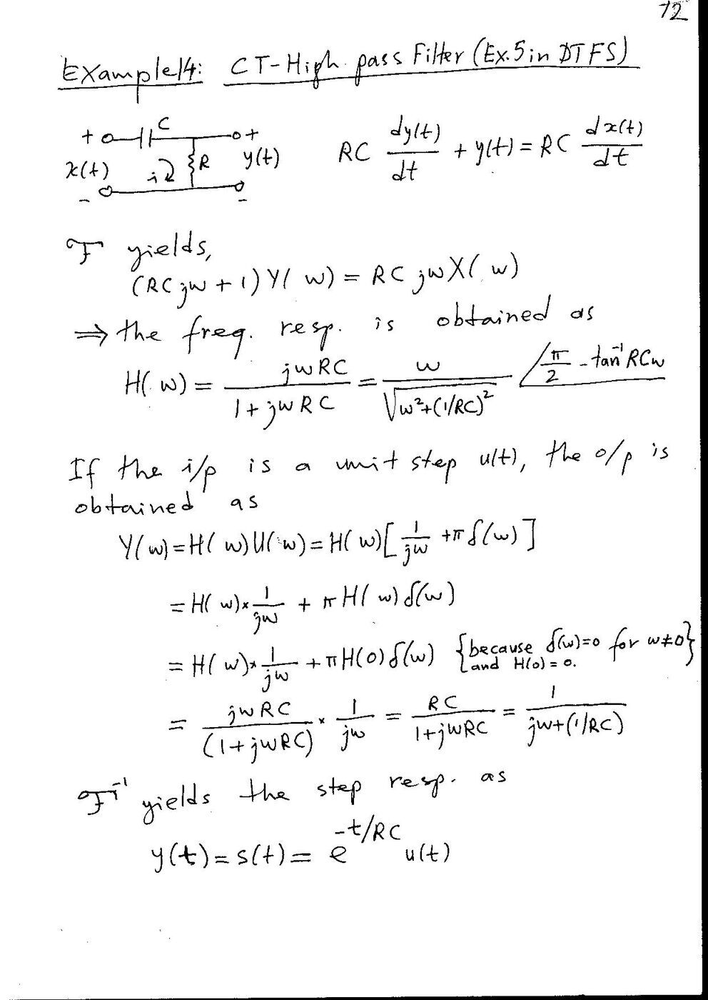
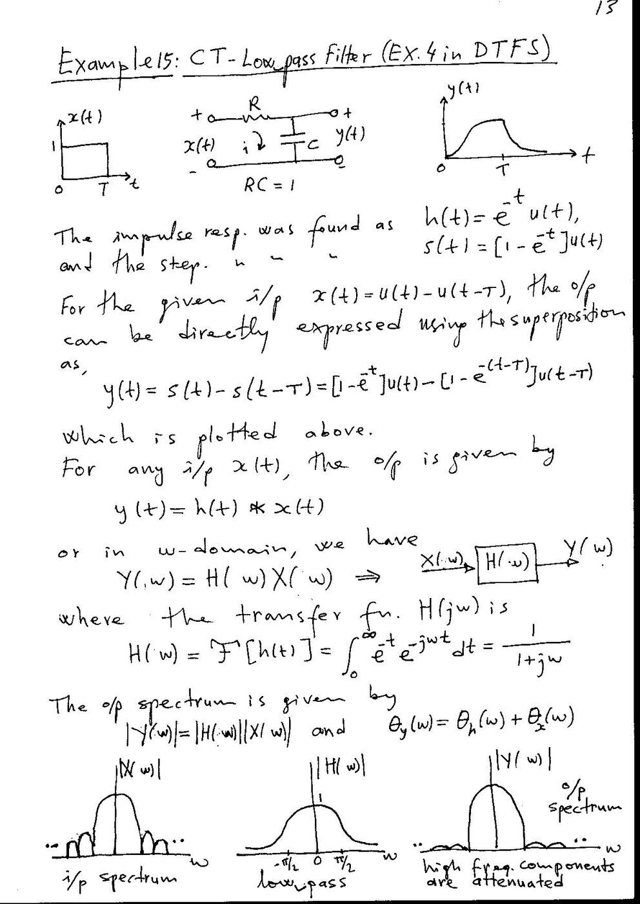
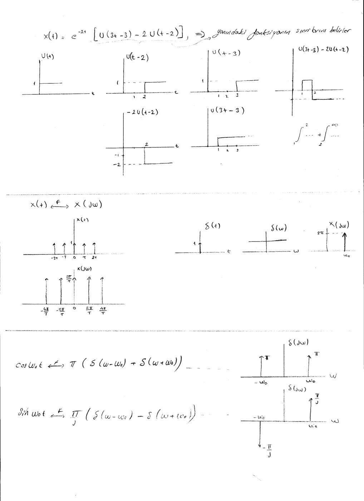
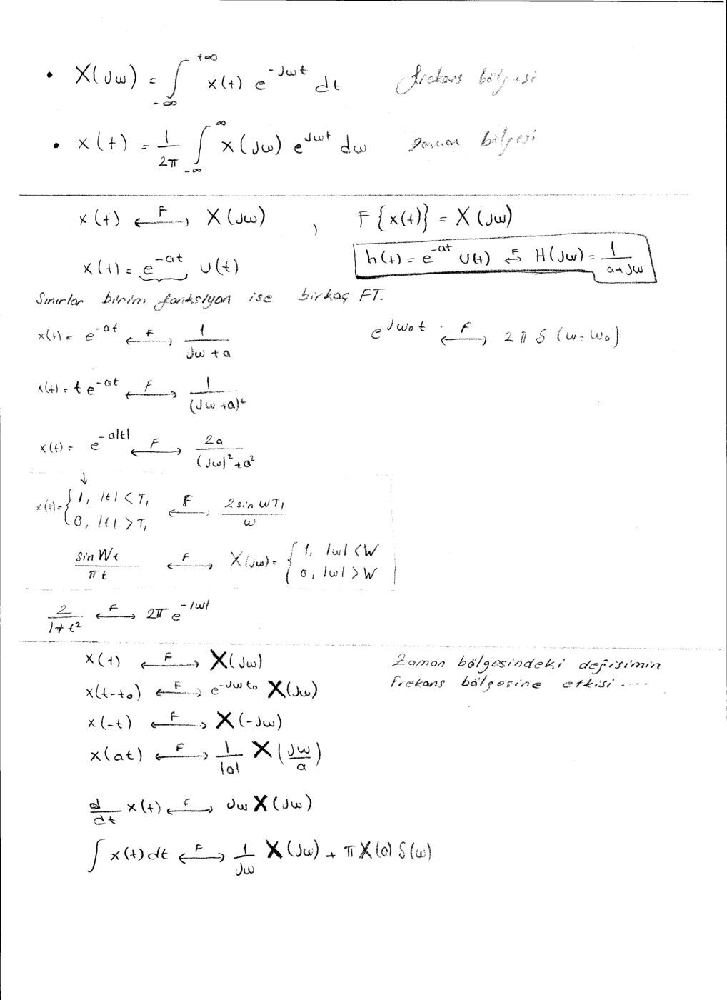
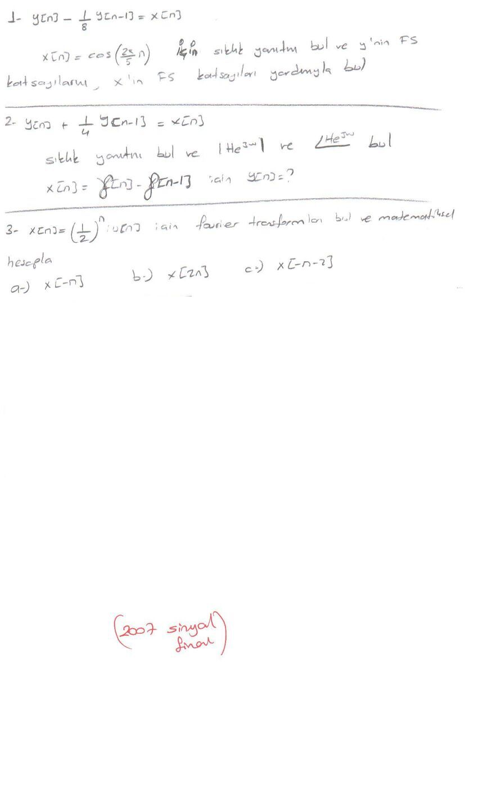

The EEM301 archive now brings together the **additional solutions signed by Alper Uraz**, two scanned Fourier worksheets, and a question dump titled "2007 signals final." The final exam page gives the year, 2007, but not the exact exam date. For the record date, the archive modification time of this file, 9 January 2011, was used. The original scans and the short trigonometric identity file can be downloaded as a ZIP at the end of the post.

## Discrete-time system: example 8

Difference equation:

y[n]−(3/4)y[n−1]+(1/8)y[n−2]=2x[n].

With the delay operator, L(q)=2/(1−(3/4)q⁻¹+(1/8)q⁻²). The characteristic roots are 1/2 and 1/4. The causal impulse response has the form A(1/2)ⁿ+B(1/4)ⁿ. Since the initial samples are h[0]=2 and h[1]=3/2, we find A=4, B=−2:

h[n]=[4(1/2)ⁿ−2(1/4)ⁿ]u[n].

, Uraz")

For x[n]=(1/8)ⁿu[n], the particular solution is (2/3)(1/8)ⁿ. With the conditions y[0]=2 and y[1]=7/4:

y[n]=[(2/3)(1/8)ⁿ−4(1/4)ⁿ+(16/3)(1/2)ⁿ]u[n].

The next page obtains the same result using the convolution sum. The two terms inside Σₖ₌₀ⁿh[k](1/8)^(n−k) are reduced to finite geometric series.

")

")

## Continuous-time system: example 11

For (p²+6p+8)y(t)=(2p+3)x(t), substitute p=jω:

H(jω)=(2jω+3)/[(jω)²+6jω+8].

The impulse response is h(t)=[2.5e^(−4t)−0.5e^(−2t)]u(t). Direct convolution with x(t)=3e^(−t)u(t) gives:

y(t)=∫₀ᵗ[2.5e^(−4τ)−0.5e^(−2τ)]·3e^(−(t−τ))dτ

=[e^(−t)−2.5e^(−4t)+1.5e^(−2t)]u(t).

")

## RC high-pass circuit: example 14

For the RC circuit with the output taken across the resistor, the voltage divider gives:

H(jω)=R/[R+1/(jωC)]=jωRC/(1+jωRC).

The response to a unit step input is e^(−t/RC)u(t). The impulse response, as the derivative of the step response, takes the form δ(t)−e^(−t/RC)u(t)/(RC).

## RC low-pass circuit: example 15

For the low-pass system with RC=1, H(jω)=1/(1+jω) and h(t)=e^(−t)u(t). The unit step response is s(t)=[1−e^(−t)]u(t).

For the finite rectangular input x(t)=u(t)−u(t−T), linearity and time invariance give y(t)=s(t)−s(t−T). The first edge charges the capacitor; after the second edge, the output decays exponentially.

## Trigonometric reminder

A separate short text file recalls the double-angle identities: sin2x=2sinx cosx and cos2x=cos²x−sin²x=1−2sin²x=2cos²x−1.

Geometric sums and complex-number identities are found in the archive post **Fourier Summary and Useful Identities (Alper Uraz)**.

## Building a piecewise signal from steps

The scanned worksheet gives x(t)=e^(−2t)[u(3t−3)−2u(t−2)]. The step u(3t−3) begins at t=1, and the second step begins at t=2. The multiplier is zero for t<1, 1 for 1≤t<2, and −1 for t≥2. The integral is therefore split into the intervals 1–2 and 2–∞.

The same page plots the spectrum of a periodic impulse train and the sine and cosine transforms:

- Σδ(t−nT) ↔ (2π/T)Σδ(ω−2πn/T).
- cosω₀t ↔ π[δ(ω−ω₀)+δ(ω+ω₀)].
- sinω₀t ↔ (π/j)[δ(ω−ω₀)−δ(ω+ω₀)].

## Fourier transform summary

X(jω)=∫x(t)e^(−jωt)dt and x(t)=(1/2π)∫X(jω)e^(jωt)dω. The page lists the exponential, two-sided exponential, rectangular, and sinc pairs, together with the shifting, time-reversal, scaling, differentiation, and integration properties.

- e^(−at)u(t) ↔ 1/(a+jω), a>0.
- t e^(−at)u(t) ↔ 1/(a+jω)².
- Unit rectangle for |t|<T₁ ↔ 2sin(ωT₁)/ω.
- sin(Wt)/(πt) ↔ unit rectangle for |ω|<W.
- 2/(1+t²) ↔ 2πe^(−|ω|).
- x(t+t₀) ↔ e^(jωt₀)X(jω).
- x(−t) ↔ X(−jω); x(at) ↔ X(jω/a)/|a|.
- dx/dt ↔ jωX(jω).
- ∫₋∞ᵗx(τ)dτ ↔ X(jω)/(jω)+πX(0)δ(ω).

*Note: In the handwritten summary, the denominator for e^(−a|t|) is written as (jω)²+a². The correct pair is 2a/(a²+ω²) for a>0. In some lines of the one-sided exponential pairs, u(t) is also omitted; those pairs hold for causal exponentials.*

## 2007 final exam question dump

The page contains not solutions but the following three questions:

1. y[n]−(1/8)y[n−1]=x[n] and x[n]=cos(2πn/5). Find the frequency response; using the Fourier-series coefficients of x, compute the Fourier-series coefficients of y.
2. y[n]+(1/4)y[n−1]=x[n]. Find the frequency response, its magnitude, and its phase. Determine y[n] for x[n]=δ[n]−δ[n−1].
3. For x[n]=(1/2)ⁿu[n], compute the Fourier transform mathematically. Then find the transforms of x[−n], x[2n], and x[−n−2].

