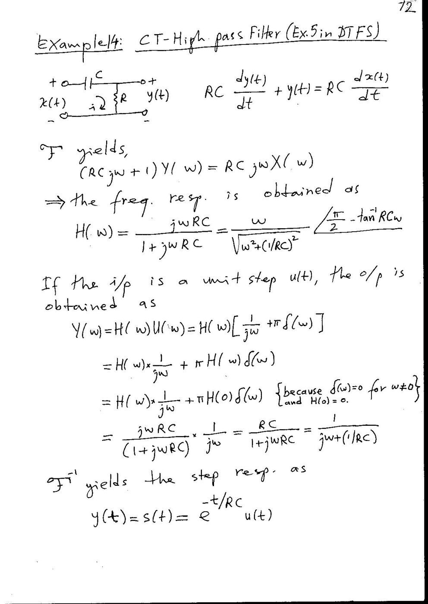
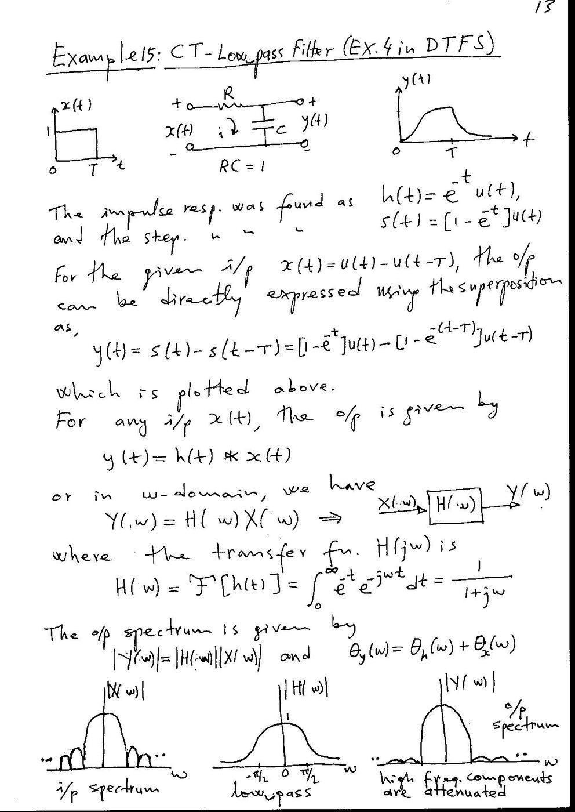
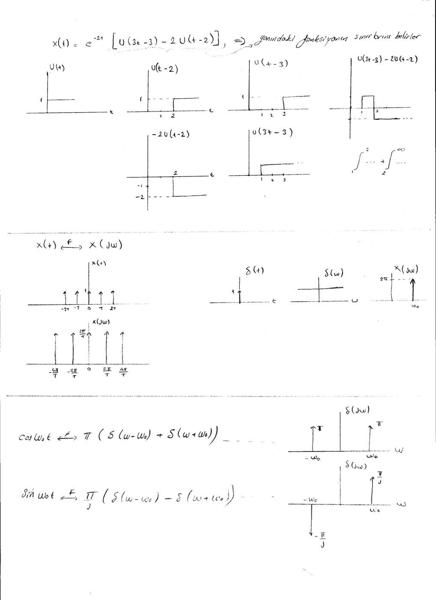
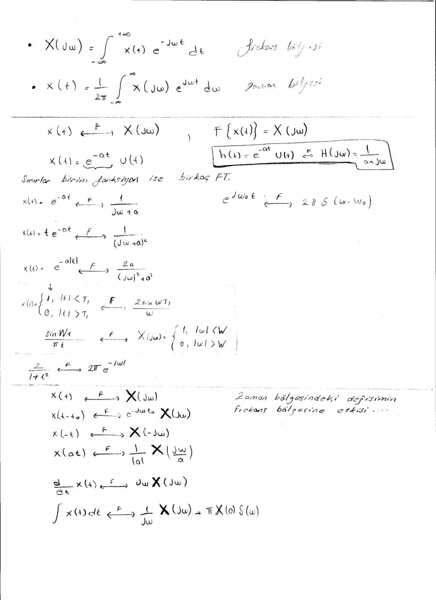
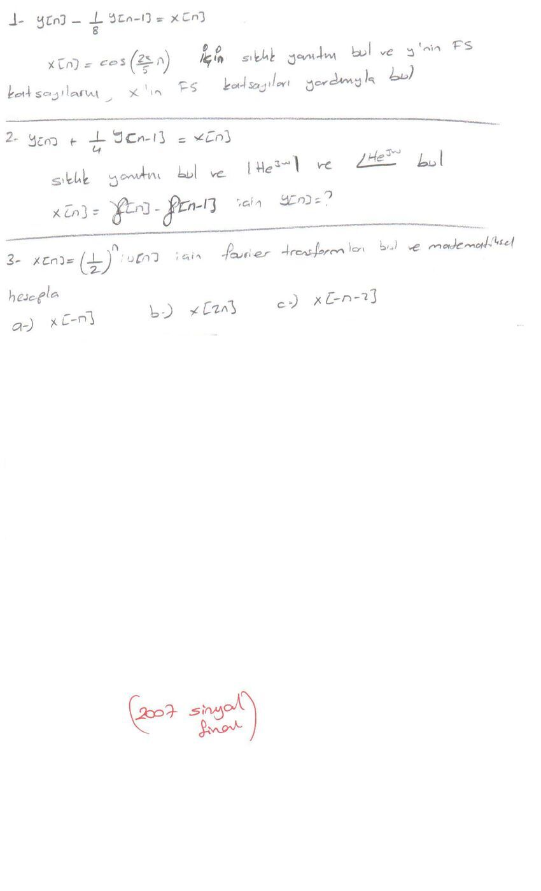

EEM301 arşivindeki **Alper Uraz imzalı ek çözümler**, iki taranmış Fourier çalışma sayfası ve “2007 sinyal final” başlıklı soru dökümü bir araya getirildi. Final sayfasının yılı 2007; kesin sınav günü yazmıyor. Kayıt tarihi için bu dosyanın 9 Ocak 2011 tarihli arşiv değişiklik zamanı kullanıldı. Tarama asılları ve kısa trigonometrik bağıntı dosyası yazının sonunda ZIP olarak indirilebilir.

## Ayrık zamanlı sistem: örnek 8

Fark denklemi:

y[n]−(3/4)y[n−1]+(1/8)y[n−2]=2x[n].

Gecikme operatörüyle L(q)=2/(1−(3/4)q⁻¹+(1/8)q⁻²). Karakteristik kökler 1/2 ve 1/4’tür. Nedensel dürtü yanıtı A(1/2)ⁿ+B(1/4)ⁿ biçimindedir. Başlangıç örnekleri h[0]=2 ve h[1]=3/2 olduğundan A=4, B=−2 bulunur:

h[n]=[4(1/2)ⁿ−2(1/4)ⁿ]u[n].

, Uraz")

x[n]=(1/8)ⁿu[n] için özel çözüm (2/3)(1/8)ⁿ’dir. y[0]=2 ve y[1]=7/4 koşullarıyla:

y[n]=[(2/3)(1/8)ⁿ−4(1/4)ⁿ+(16/3)(1/2)ⁿ]u[n].

Sonraki sayfa aynı sonucu konvolüsyon toplamıyla elde eder. Σₖ₌₀ⁿh[k](1/8)^(n−k) içindeki iki terim sonlu geometrik seriye çevrilir.

")

")

## Sürekli zamanlı sistem: örnek 11

(p²+6p+8)y(t)=(2p+3)x(t) için p=jω yerleştirilir:

H(jω)=(2jω+3)/[(jω)²+6jω+8].

Dürtü yanıtı h(t)=[2,5e^(−4t)−0,5e^(−2t)]u(t)’dir. x(t)=3e^(−t)u(t) ile doğrudan konvolüsyon:

y(t)=∫₀ᵗ[2,5e^(−4τ)−0,5e^(−2τ)]·3e^(−(t−τ))dτ

=[e^(−t)−2,5e^(−4t)+1,5e^(−2t)]u(t).

")

## RC yüksek geçiren devre: örnek 14

Çıkışın direnç üzerinden alındığı RC devresinde gerilim bölücüsü:

H(jω)=R/[R+1/(jωC)]=jωRC/(1+jωRC).

Birim basamak girişine yanıt e^(−t/RC)u(t)’dir. Dürtü yanıtı, basamak yanıtının türevi olarak δ(t)−e^(−t/RC)u(t)/(RC) biçimindedir.

## RC alçak geçiren devre: örnek 15

RC=1 alınan alçak geçiren sistemde H(jω)=1/(1+jω), h(t)=e^(−t)u(t). Birim basamak yanıtı s(t)=[1−e^(−t)]u(t)’dir.

Sonlu dikdörtgen giriş x(t)=u(t)−u(t−T) olduğunda doğrusallık ve zamanla değişmezlikten y(t)=s(t)−s(t−T) elde edilir. İlk kenar kondansatörü doldurur; ikinci kenardan sonra çıkış üstel olarak söner.

## Trigonometrik hatırlatma

Ayrı kısa metin dosyası çift açı bağıntılarını hatırlatır: sin2x=2sinx cosx ve cos2x=cos²x−sin²x=1−2sin²x=2cos²x−1.

Geometrik toplamlar ve karmaşık sayı bağıntıları, arşivdeki **Fourier Özeti ve Faydalı Bağıntılar (Alper Uraz)** yazısında bulunuyor.

## Basamaklarla parçalı sinyal kurma

Taranmış çalışma sayfasında x(t)=e^(−2t)[u(3t−3)−2u(t−2)] veriliyor. u(3t−3) t=1’de, ikinci basamak t=2’de başlar. Çarpan t<1’de sıfır, 1≤t<2’de 1, t≥2’de −1’dir. Bu nedenle integral 1–2 ve 2–∞ aralıklarına ayrılır.

Aynı sayfa periyodik dürtü dizisinin spektrumunu, sinüs ve kosinüs dönüşümlerini çiziyor:

- Σδ(t−nT) ↔ (2π/T)Σδ(ω−2πn/T).
- cosω₀t ↔ π[δ(ω−ω₀)+δ(ω+ω₀)].
- sinω₀t ↔ (π/j)[δ(ω−ω₀)−δ(ω+ω₀)].

## Fourier dönüşümü özeti

X(jω)=∫x(t)e^(−jωt)dt ve x(t)=(1/2π)∫X(jω)e^(jωt)dω. Sayfada üstel, çift taraflı üstel, dikdörtgen ve sinc çiftleriyle kaydırma, tersleme, ölçekleme, türev ve integral özellikleri sıralanıyor.

- e^(−at)u(t) ↔ 1/(a+jω), a>0.
- t e^(−at)u(t) ↔ 1/(a+jω)².
- |t|<T₁’de birim dikdörtgen ↔ 2sin(ωT₁)/ω.
- sin(Wt)/(πt) ↔ |ω|<W’de birim dikdörtgen.
- 2/(1+t²) ↔ 2πe^(−|ω|).
- x(t+t₀) ↔ e^(jωt₀)X(jω).
- x(−t) ↔ X(−jω); x(at) ↔ X(jω/a)/|a|.
- dx/dt ↔ jωX(jω).
- ∫₋∞ᵗx(τ)dτ ↔ X(jω)/(jω)+πX(0)δ(ω).

*Not: El yazısı özetinde e^(−a|t|) için payda (jω)²+a² biçiminde yazılmış. Doğru çift, a>0 için 2a/(a²+ω²)’dir. Tek taraflı üstel çiftlerin bazı satırlarında u(t) de yazılmamış; bu çiftler nedensel üsteller için geçerlidir.*

## 2007 final soru dökümü

Sayfada çözüm değil, aşağıdaki üç soru bulunuyor:

1. y[n]−(1/8)y[n−1]=x[n] ve x[n]=cos(2πn/5). Sıklık yanıtını bulun; x’in Fourier-serisi katsayılarından yararlanarak y’nin Fourier-serisi katsayılarını hesaplayın.
2. y[n]+(1/4)y[n−1]=x[n]. Sıklık yanıtını, büyüklüğünü ve fazını bulun. x[n]=δ[n]−δ[n−1] için y[n]’yi belirleyin.
3. x[n]=(1/2)ⁿu[n] için Fourier dönüşümünü matematiksel olarak hesaplayın. Ardından x[−n], x[2n] ve x[−n−2] dönüşümlerini bulun.

