Bu yazı, Başkent Üniversitesi Elektrik-Elektronik Mühendisliği **EEM301 Sinyaller ve Sistemler I** dersinin **"Fourier Series"** (Fourier Serileri) sunumudur. Sunumu dersin öğretim üyesi **Prof. Dr. Alper Uraz** hazırlamış (Ekim 2005). Slaytların neredeyse tamamı görsel olduğu için içerik metne döküldü; formüller düz metne çevrildi, kısmi Fourier serisi grafikleri için slayt görselleri eklendi. Sunum İngilizce olduğundan içerik İngilizce aktarıldı. Orijinal PowerPoint dosyası yazının sonunda indirilebilir.

Sunumun konuları:

- Complex Exponentials as Eigenfunctions of LTI Systems
- Fourier Series of CT Periodic Signals
- CT Fourier Series Properties
- Periodic Convolution
- Symmetry Advantage
- Gibbs Phenomenon

## The eigenfunctions φk(t) and their properties

(Focus on CT systems now, but the results apply to DT systems as well.)

φk(t) → System → λk φk(t), where λk is the **eigenvalue** and φk(t) the **eigenfunction**: eigenfunction in → same function out with a "gain".

From the superposition property of LTI systems:

x(t) = Σk ak φk(t) → LTI → y(t) = Σk λk ak φk(t)

Now the task of finding the response of LTI systems is to determine λk.

### Complex exponentials as the eigenfunctions of any LTI system

CT: x(t) = e^(st) → h(t) →

y(t) = ∫ h(τ) e^(s(t−τ)) dτ = [∫ h(τ) e^(−sτ) dτ] e^(st) = **H(s) e^(st)** (eigenvalue H(s), eigenfunction e^(st))

DT: x[n] = zⁿ → h[n] →

y[n] = Σm h[m] z^(n−m) = [Σm h[m] z^(−m)] zⁿ = **H(z) zⁿ**

So, with H(s) = ∫ (−∞…∞) h(t) e^(−st) dt:

x(t) = Σk ak e^(sk t) → y(t) = Σk H(sk) ak e^(sk t)

and with H(z) = Σ (n = −∞…∞) h[n] z^(−n):

x[n] = Σk ak zkⁿ → y[n] = Σk H(zk) ak zkⁿ

### What kinds of signals can we represent as "sums" of complex exponentials?

For now, focus on restricted sets of complex exponentials of magnitude 1:

- CT: s = jω — purely imaginary, i.e. signals of the form e^(jωt)
- DT: z = e^(jω), i.e. signals of the form e^(jωn)

⇒ CT & DT Fourier series (for periodic signals) and transforms.

CT complex exponential (sinusoid): x(t) = e^(st) at s = jω = e^(jωt) = cos(ωt) + j sin(ωt); s = jω ⇒ Re{s} = 0, Im{s} = ω.

DT complex exponential (sinusoid): zⁿ = (|z| e^(j∠z))ⁿ = |z|ⁿ e^(jωn), ω = ∠z, |z| = 1 ⇒ x[n] = e^(jωn) = cos(ωn) + j sin(ωn).

## Fourier series representation of CT periodic signals

x(t) = x(t + T) for all t:

- the smallest such T is the **fundamental period**
- ω0 = 2π/T is the **fundamental frequency**

e^(jωt) is periodic with period T ⇔ ω = kω0. Hence

**x(t) = Σ (k = −∞…∞) ak e^(jkω0t) = Σ ak e^(jk2πt/T)**

- periodic with period T
- {ak} are the **Fourier (series) coefficients**, or spectral coefficients
- k = 0: DC; k = ±1: first harmonic; k = ±2: second harmonic

 = e^(jt): real part of complex exponential harmonics")

### Question #1: how do we find the Fourier coefficients?

First, for simple periodic signals consisting of a few sinusoidal terms, use Euler's relation (memorize!):

x(t) = cos 4πt + 2 sin 8πt = (1/2)[e^(j4πt) + e^(−j4πt)] + (2/2j)[e^(j8πt) − e^(−j8πt)]

ω0 = 4π, T = 2π/ω0 = 2π/4π = 1/2

- a0 = 0 — no dc component
- a1 = 1/2, a−1 = 1/2
- a2 = 1/j, a−2 = −1/j
- a3 = 0, a−3 = 0, …

For *real* periodic signals there are two other commonly used forms:

x(t) = a0 + Σ (k = 1…∞) [αk cos kω0t + βk sin kω0t] or x(t) = a0 + Σ (k = 1…∞) γk cos(kω0t + θk)

Because of the eigenfunction property of e^(jωt), we will usually use the complex exponential form. A consequence is that we need to include terms for *both* positive and negative frequencies, e^(jkω0t) and e^(−jkω0t). Remember:

cos(kω0t) = (1/2)(e^(jkω0t) + e^(−jkω0t)), sin(kω0t) = (1/2j)(e^(jkω0t) − e^(−jkω0t))

### The complete answer to Question #1 (given x(t), how to find ak?)

Suppose x(t) = Σ ak e^(jkω0t). (1) Multiply both sides by e^(−jnω0t), (2) integrate over one period:

∫T x(t) e^(−jnω0t) dt = ∫T (Σk ak e^(jkω0t)) e^(−jnω0t) dt = Σk ak (∫T e^(j(k−n)ω0t) dt)

(Here ∫T denotes the integral over *any* interval of length T, one period.) Next note the **orthogonality**:

∫T e^(j(k−n)ω0t) dt = T if k = n, 0 if k ≠ n; i.e. = T δ[k − n]

so ∫T x(t) e^(−jnω0t) dt = Σk ak T δ[k − n] = an T.

**CT Fourier series pair (ω0 = 2π/T):**

- **x(t) = Σ (k = −∞…∞) ak e^(jkω0t)** (synthesis equation)
- **ak = (1/T) ∫T x(t) e^(−jkω0t) dt** (analysis equation)

Shorthand: x(t) ↔FS↔ ak.

## Alternative forms

**Amplitude-phase.** Since a−k = ak* for real x(t):

x(t) = Σ ak e^(jkωt) = a0 + Σ (k = 1…∞) ak e^(jkωt) + Σ (k = 1…∞) a−k e^(−jkωt) = a0 + Σ [(ak e^(jkωt)) + (ak e^(jkωt))*] = a0 + 2 Σ Re{ak e^(jkωt)} = a0 + 2 Σ |ak| Re{e^(j(kωt + θk))} = **a0 + 2 Σ (k = 1…∞) Ak cos(kωt + θk)**

where Ak ≜ |ak| and θk ≜ ∠ak is the complex phase angle of ak.

**Trigonometric.**

x(t) = a0 + 2 Σ Re{ak e^(jkωt)} = a0 + 2 Σ [Re{ak} cos(kωt) − Im{ak} sin(kωt)] = **a0 + 2 Σ (k = 1…∞) [Bk cos(kωt) − Ck sin(kωt)]**

where Bk ≜ Re{ak} and Ck ≜ Im{ak}.

**Summary:**

| Form | x(t) |
|---|---|
| Exponential | Σ (k = −∞…∞) ak e^(jkωt) |
| Amplitude-phase | a0 + 2 Σ (k = 1…∞) Ak cos(kωt + θk) |
| Trigonometric | a0 + 2 Σ (k = 1…∞) Bk cos(kωt) − Ck sin(kωt) |

ak = Ak e^(jθk) = Bk + jCk; Ak = √(Bk² + Ck²) = |ak|; θk = ∠(Bk + jCk) = ∠ak; Bk = Ak cos θk = Re{ak}; Ck = Ak sin θk = Im{ak}.

## Examples

### Periodic square wave

x(t) = 1 for |t| < T1, 0 for T1 < |t| < T/2, periodic with period T.

- For k = 0: a0 = (1/T) ∫ (−T/2…T/2) x(t) dt = 2T1/T — the DC component is just the average.
- For k ≠ 0: ak = (1/T) ∫ (−T1…T1) e^(−jkω0t) dt = −(1/(jkω0T)) e^(−jkω0t) from −T1 to T1 = **sin(kω0T1)/(kπ)**, ω0 = 2π/T

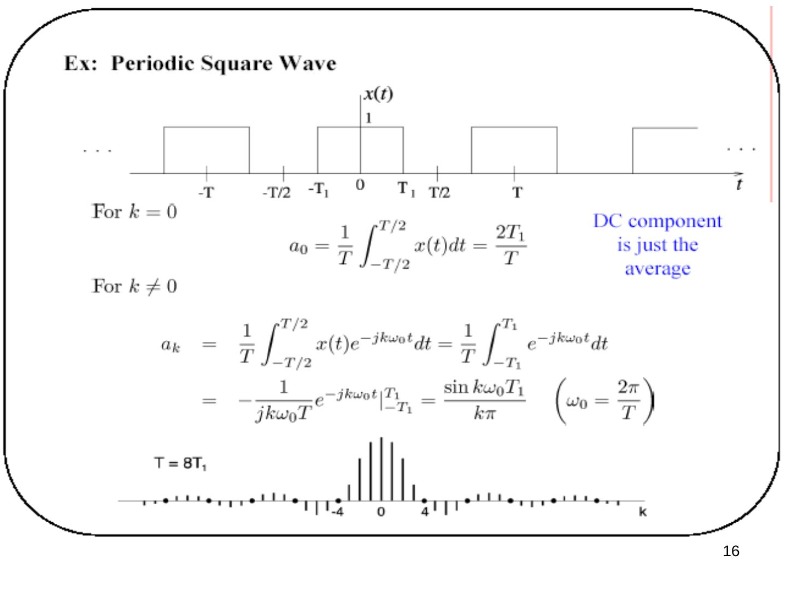

### Periodic impulse train (important!)

x(t) = Σ (n = −∞…∞) δ(t − nT) — the *sampling function*, important for sampling.

ak = (1/T) ∫ (−T/2…T/2) δ(t) e^(−jkω0t) dt = **1/T for all k!**

⇒ x(t) = (1/T) Σ e^(jkω0t): all components have (1) the same amplitude and (2) the same phase.

## Dirichlet conditions for convergence

The Fourier series of a periodic signal x(t) converges if *all* of the following conditions are met:

1. ∫T0 |x(t)| dt < ∞
1. Finite number of discontinuities in a period T0
1. Finite number of distinct maxima and minima in T0
1. x(t) is single valued

These are sufficient, but not necessary, conditions, and they are usually satisfied in practice. When they are satisfied, the truncated Fourier series with a finite number (N) of terms is the best approximation to the original function, using the total squared-error magnitude over one period for comparison:

J = ∫T [x(t) − xN(t)]² dt, xN(t) = Σ (k = −N…N) ak e^(jkωt)

## Properties of CT Fourier series

- **Linearity:** x(t) ↔ ak, y(t) ↔ bk ⇒ αx(t) + βy(t) ↔ αak + βbk
- **Conjugate symmetry:** x(t) real ⇒ a−k = ak*. With ak = Re{ak} + j Im{ak} = |ak| e^(j∠ak): Re{ak} is even and Im{ak} is odd, or |ak| is even and ∠ak is odd.
- **Time shift:** x(t − t0) ↔ ak e^(−jkω0t0) = ak e^(−jk2πt0/T) — introduces a linear phase shift ∝ t0.

**Example — shift by half period:** y(t) = x(t − T/2) ↔ ak e^(−jkπ) = (−1)ᵏ ak, using e^(−jkω0T/2) = e^(−jkπ). For the impulse train shifted by T/2, ak = 1/T, so y(t) ↔ (−1)ᵏ/T.

- **Time reversal:** y(t) = x(−t), the period T is unchanged: y(t) = Σ ak e^(−jkωt) = Σ a−m e^(jmωt) (substituting k = −m). So x(t) ↔ ak ⇒ x(−t) ↔ a−k. If x(t) is even, a−k = ak; if x(t) is odd, a−k = −ak.
- **Time scaling:** for a positive real α, x(αt) is periodic with period T/α and fundamental frequency αω: x(αt) = Σ ak e^(jk(αω)t). The Fourier coefficients have not changed but the Fourier series representation *has* changed.
- **Parseval's relation** (applies to power signals): P = (1/T) ∫T |x(t)|² dt = Σ (k = −∞…∞) |ak|² — average signal power equals the sum of the powers in the harmonics. Energy is the same whether measured in the time domain or in the frequency domain.
- **Multiplication property:** if x(t) ↔ ak and y(t) ↔ bk (both periodic with the same period T), then x(t)·y(t) ↔ ck = Σ (l = −∞…∞) al b(k−l) = ak ∗ bk. Proof: Σl al e^(jlω0t) · Σm bm e^(jmω0t) = Σ(l,m) al bm e^(j(l+m)ω0t) = (with l + m = k) Σk [Σl al b(k−l)] e^(jkω0t).

## Periodic convolution

For x(t), y(t) periodic with period T, the ordinary convolution x(t) ∗ y(t) = ∫ (−∞…∞) x(τ) y(t − τ) dτ is not useful: e.g. if both x(t) and y(t) are positive, x(t) ∗ y(t) = ∞.

**Periodic convolution:** integrate over *any* one period (e.g. −T/2 to T/2):

z(t) = ∫ (−T/2…T/2) x(τ) y(t − τ) dτ = ∫ (−∞…∞) xT(τ) y(t − τ) dτ, where xT(t) = x(t) for −T/2 < t < T/2 and 0 otherwise.

Facts:

1. z(t) is periodic with period T (for LTI systems x(t) = x(t + T) → y(t) = y(t + T); in the convolution treat y(t) as the input and xT(t) as h(t)).
1. It doesn't matter over which period we integrate: z(t) = ∫T x(τ) y(t − τ) dτ = x(t) ⊗ y(t).
1. Periodic convolution in time ⇔ multiplication in frequency: with x(t) ↔ ak, y(t) ↔ bk, z(t) ↔ ck,

ck = (1/T) ∫T z(t) e^(−jkω0t) dt = ∫T [(1/T) ∫T y(t − τ) e^(−jkω0(t−τ)) dt] x(τ) e^(−jkω0τ) dτ = ∫T bk x(τ) e^(−jkω0τ) dτ = **T ak bk**

## Symmetry advantage

### Products of even and odd signals

The product of even and odd signals is either even or odd:

- x(t) even, y(t) even ⇒ even: p(t) ≜ x(t)y(t) = x(−t)y(−t) = p(−t)
- x(t) even, y(t) odd ⇒ odd: p(t) = x(−t)[−y(−t)] = −p(−t)
- x(t) odd, y(t) even ⇒ odd: p(t) = [−x(−t)] y(−t) = −p(−t)
- x(t) odd, y(t) odd ⇒ even: p(t) = [−x(−t)][−y(−t)] = p(−t)

The same relations hold for discrete-time signals.

- Conceptually, the FS coefficients are integrals of products.
- The integral is nothing more than the area under the curve of this product.
- If the product is odd, the total area is zero.
- If the product is even, the total area is twice that of the left/right half.

### Symmetry & FS coefficients

x(t) = a0 + 2 Σ [Bk cos(kωt) − Ck sin(kωt)]

Bk = (1/T0) ∫T0 x(t) cos(kωt) dt = (1/T0) ∫ (−T0/2…T0/2) xe(t) cos(kωt) dt = (2/T0) ∫ (0…T0/2) xe(t) cos(kωt) dt

Ck = −(1/T0) ∫T0 x(t) sin(kωt) dt = −(1/T0) ∫ (−T0/2…T0/2) xo(t) sin(kωt) dt = −(2/T0) ∫ (0…T0/2) xo(t) sin(kωt) dt

- Symmetry can simplify the calculation of the FS coefficients.
- If x(t) is even, Ck = 0.
- If x(t) is odd, Bk = 0.
- Each product within the non-zero integrals is even.

## Worked examples (MATLAB plots)

### Example: triangle waveform

*What is the fundamental period of x(t)? What type of symmetry does the signal have? Find the trigonometric Fourier series coefficients. Plot the partial Fourier series sum for N = 1, 5, 10 & 50.* Hint: ∫ t cos(ωt) dt = (1/ω²) cos(ωt) + (t/ω) sin(ωt) + C.

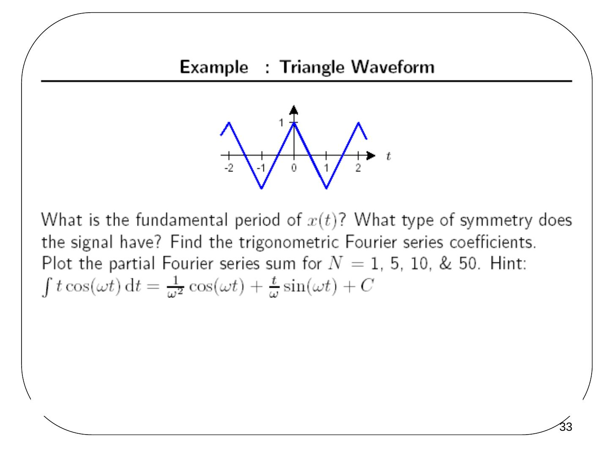

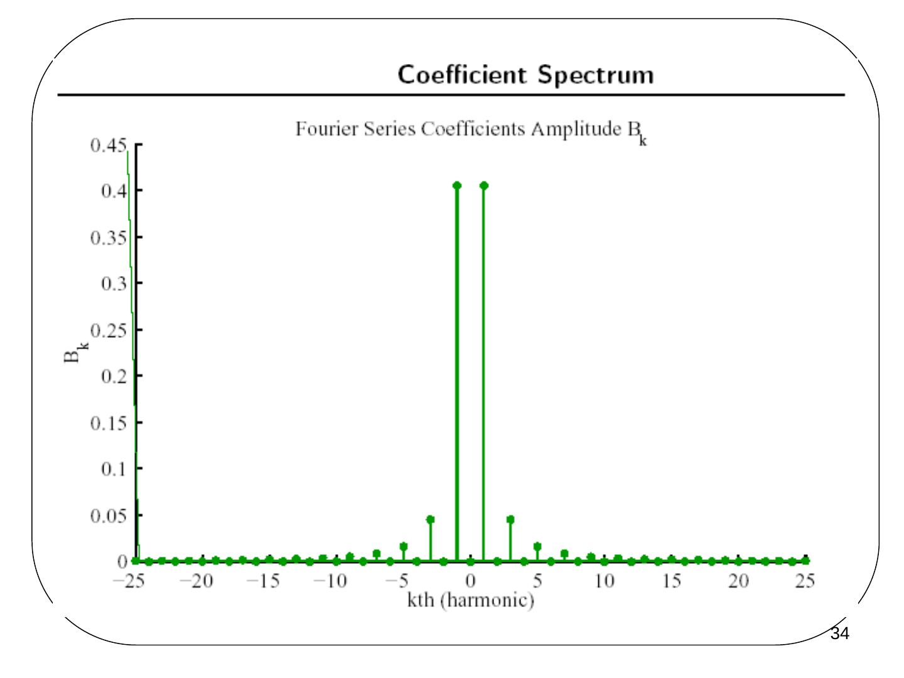

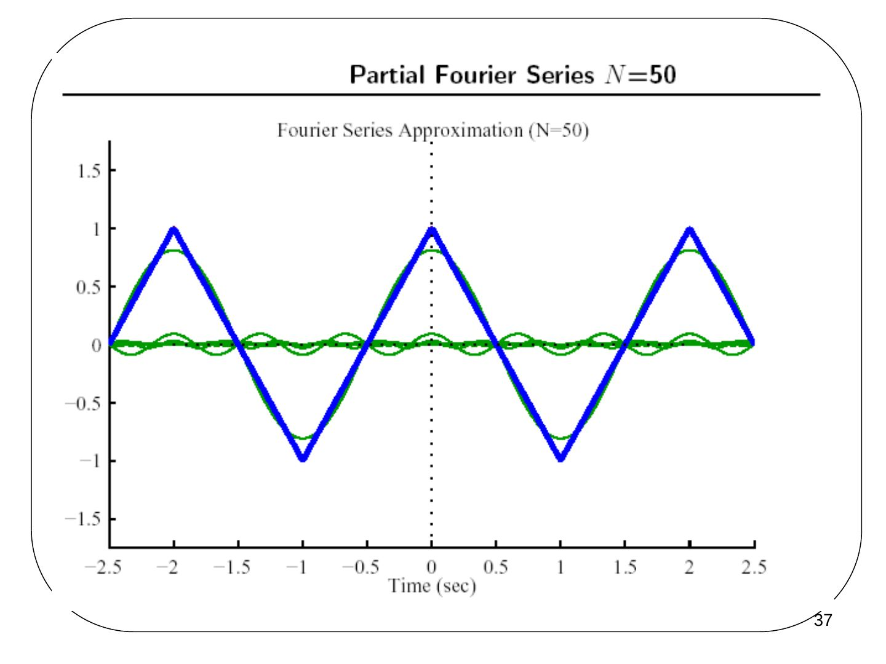

### Example: pulse waveform

*What is the fundamental period of x(t)? What type of symmetry does the signal have? Find the trigonometric Fourier series coefficients. Plot the partial Fourier series sum for N = 1, 5, 10, 25, 50 & 100.*

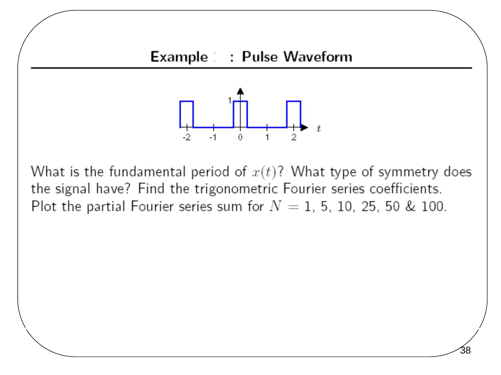

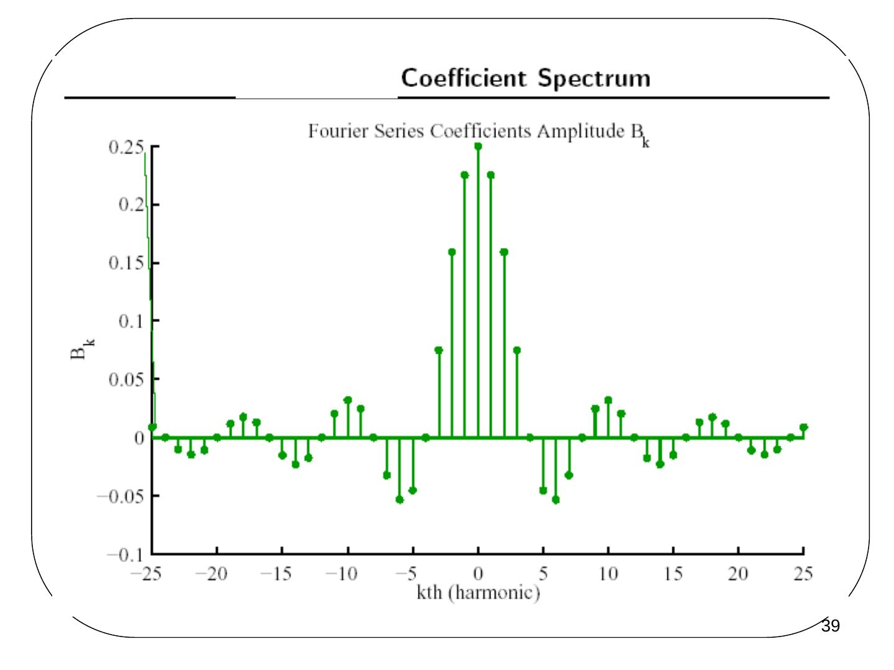

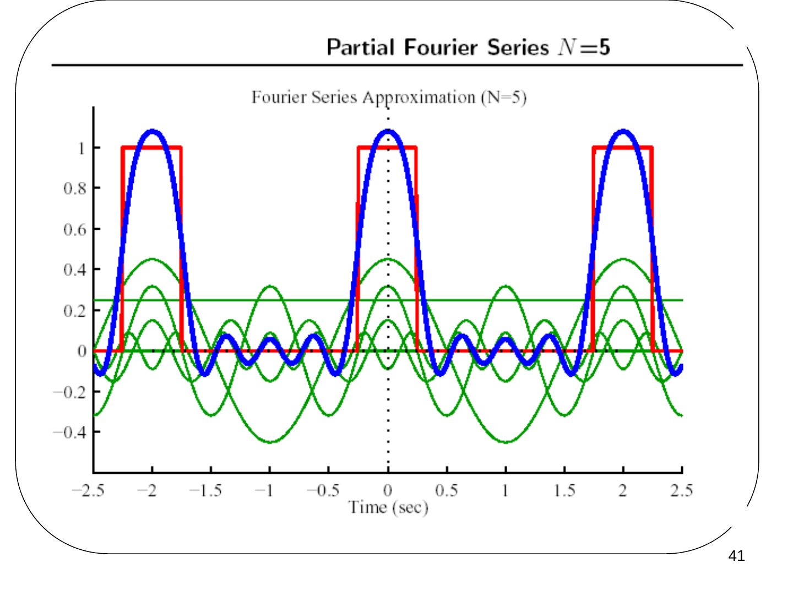

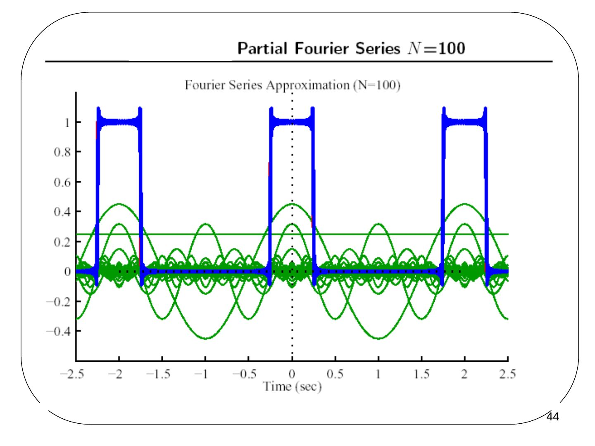

## Gibbs phenomenon

- For finite Fourier series estimates there is apparent overshoot.
- As N increases, the edges become sharper and more accurate.
- The maximum overshoot (error) does not decrease as N → ∞.
- This is called **Gibbs phenomenon**.

### Example: sawtooth waveform

*What is the fundamental period of x(t)? What type of symmetry does the signal have? Find the trigonometric Fourier series coefficients. Plot the partial Fourier series sum for N = 1, 5, 10 & 50.* Hints: ∫ t cos(ωt) dt = (1/ω²) cos(ωt) + (t/ω) sin(ωt) + C and ∫ t sin(ωt) dt = (1/ω²) sin(ωt) − (t/ω) cos(ωt) + C.

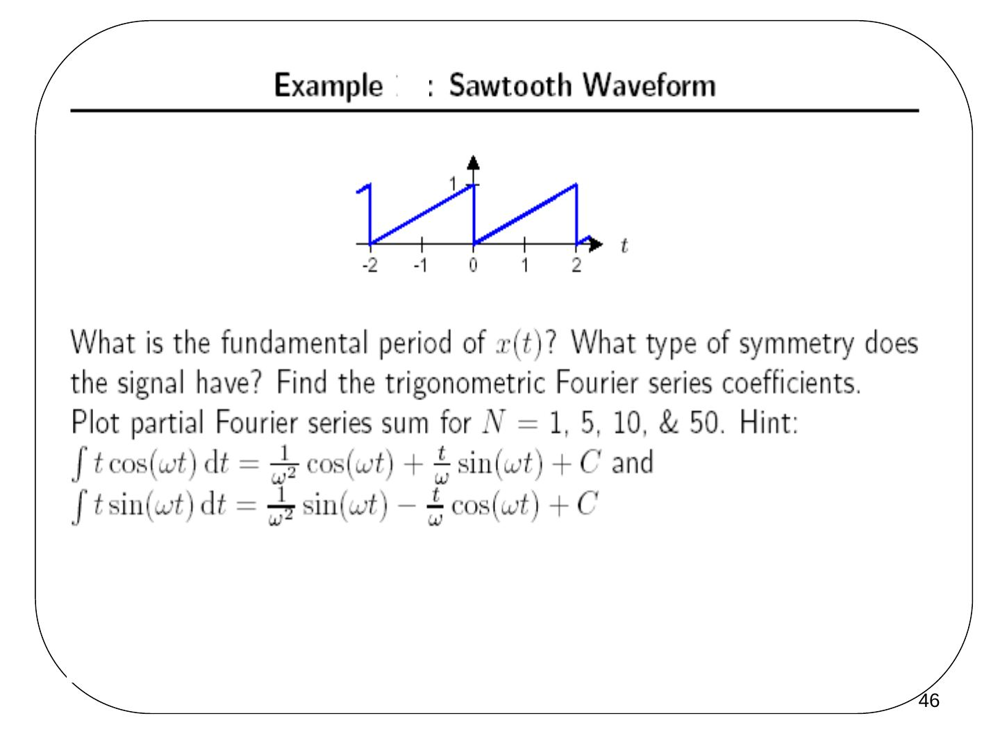

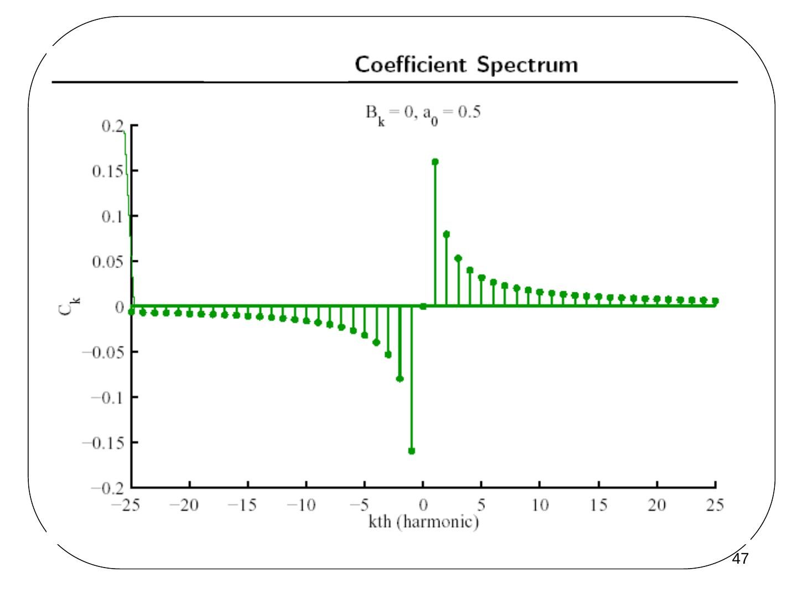

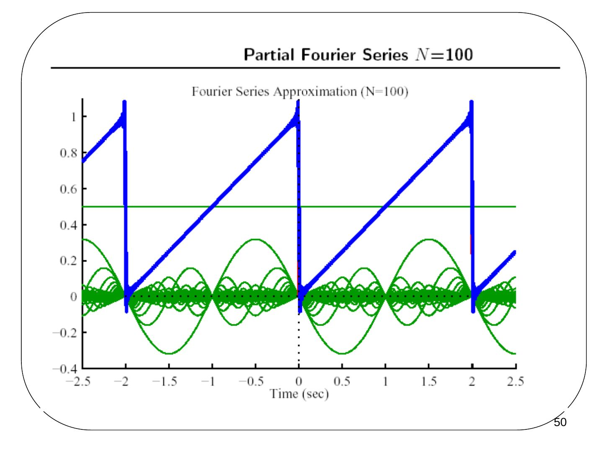
