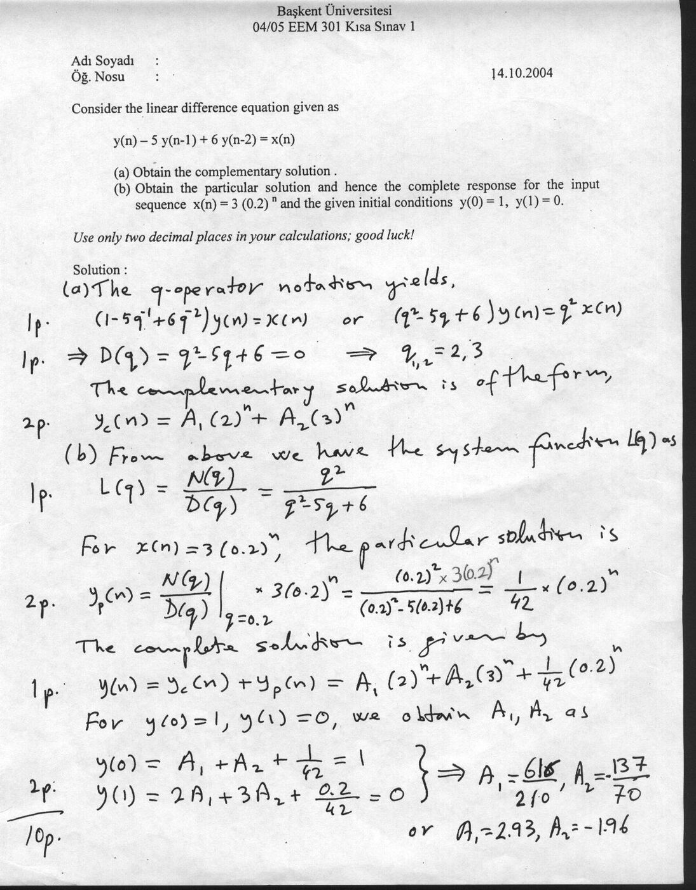
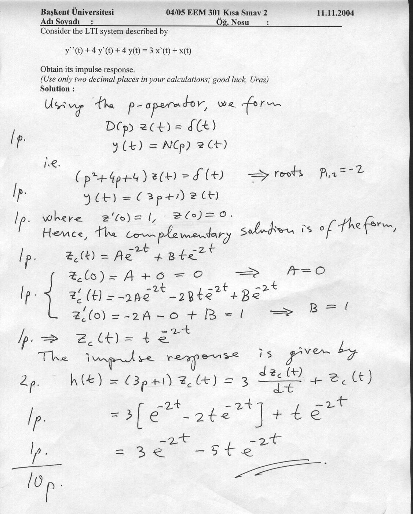
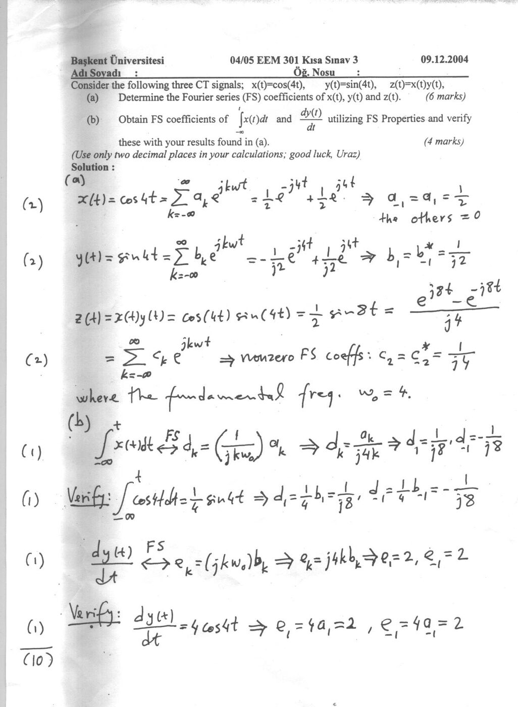
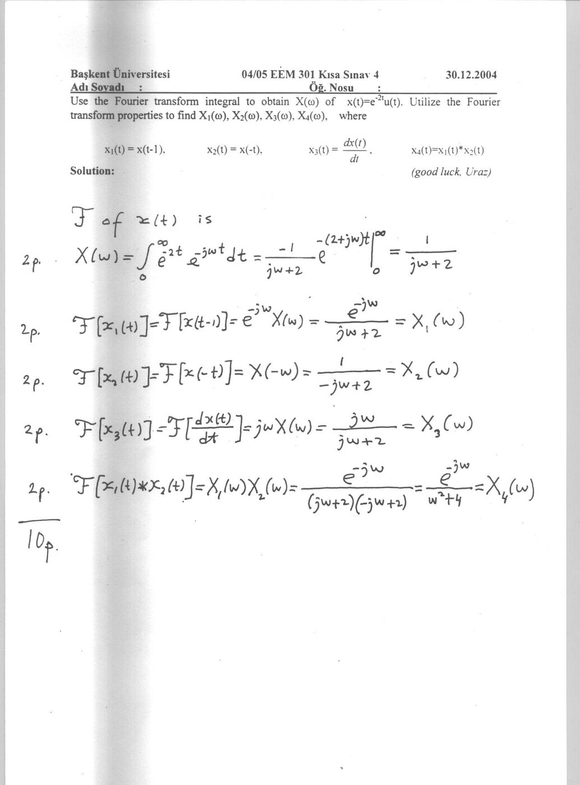

This post contains the **fall 2004–2005 quizzes** (Quiz 1–4) of Başkent University's **EEM301 Signals and Systems I** course, together with the handwritten answer keys; the questions are by Prof. Dr. Alper Uraz. In addition, there is an undated "Quiz 3" solution (the Fourier series of a sawtooth signal). The documents are scanned pages; the questions and results are transcribed below as text. The scans can be downloaded as a ZIP at the end of the post.

## Quiz 1 (14.10.2004): Difference equation

For the difference equation y(n) − 5y(n − 1) + 6y(n − 2) = x(n):

1. Find the complementary solution.
1. For the input x(n) = 3(0.2)ⁿ and the initial conditions y(0) = 1, y(1) = 0, find the particular solution and the complete response.

**Solution:** Using the q-operator, (1 − 5q⁻¹ + 6q⁻²)y(n) = x(n), or (q² − 5q + 6)y(n) = q²x(n). D(q) = q² − 5q + 6 = 0 ⇒ q₁,₂ = 2, 3.

- Complementary solution: y_c(n) = A₁(2)ⁿ + A₂(3)ⁿ
- System function L(q) = q²/(q² − 5q + 6); particular solution y_p(n) = (0.2)²·3(0.2)ⁿ / ((0.2)² − 5(0.2) + 6) = (1/42)(0.2)ⁿ
- Complete solution: y(n) = A₁(2)ⁿ + A₂(3)ⁿ + (1/42)(0.2)ⁿ
- From the conditions y(0) = 1 and y(1) = 0: **A₁ = 616/210 ≈ 2.93, A₂ = −137/70 ≈ −1.96**

## Quiz 2 (11.11.2004): Impulse response

Find the impulse response of the LTI system described by y″(t) + 4y′(t) + 4y(t) = 3x′(t) + x(t).

**Solution:** Using the p-operator, D(p)z(t) = δ(t), y(t) = N(p)z(t); that is, (p² + 4p + 4)z(t) = δ(t), the roots are p₁,₂ = −2 (double root) and y(t) = (3p + 1)z(t), z′(0) = 1, z(0) = 0.

- z_c(t) = Ae^(−2t) + Bte^(−2t); z(0) = 0 ⇒ A = 0, z′(0) = 1 ⇒ B = 1, so z(t) = te^(−2t)
- h(t) = (3p + 1)z(t) = 3[e^(−2t) − 2te^(−2t)] + te^(−2t) = **3e^(−2t) − 5te^(−2t)** (t ≥ 0)

## Quiz 3 (09.12.2004): Fourier series coefficients

For the signals x(t) = cos(4t), y(t) = sin(4t), z(t) = x(t)y(t):

1. Find the Fourier series (FS) coefficients of x(t), y(t), and z(t). (6 points)
1. Find the FS coefficients of ∫x(t)dt and dy(t)/dt using the FS properties, and verify them against the results in (a). (4 points)

**Solution:** (ω₀ = 4)

- x(t) = ½e^(−j4t) + ½e^(j4t) ⇒ a₁ = a₋₁ = 1/2, all others 0
- y(t) = −(1/2j)e^(−j4t) + (1/2j)e^(j4t) ⇒ b₁ = b₋₁* = 1/(2j)
- z(t) = cos 4t sin 4t = ½ sin 8t = (e^(j8t) − e^(−j8t))/(4j) ⇒ the nonzero coefficients are c₂ = c₋₂* = 1/(4j)
- ∫x(t)dt ⟷ d_k = a_k/(jkω₀) = a_k/(j4k) ⇒ d₁ = 1/(j8), d₋₁ = −1/(j8). Verification: ∫cos 4t dt = ¼ sin 4t ⇒ d₁ = ¼b₁ = 1/(j8)
- dy/dt ⟷ e_k = jkω₀b_k = j4k·b_k ⇒ e₁ = 2, e₋₁ = 2. Verification: dy/dt = 4 cos 4t ⇒ e₁ = 4a₁ = 2

## Quiz 4 (30.12.2004): Fourier transform

Find the Fourier transform of x(t) = e^(−2t)u(t) using the integral; using the Fourier transform properties, find the transforms of x₁(t) = x(t − 1), x₂(t) = x(−t), x₃(t) = dx(t)/dt, and x₄(t) = x₁(t) ∗ x₂(t).

**Solution:**

- X(ω) = ∫₀^∞ e^(−2t)e^(−jωt) dt = 1/(jω + 2)
- X₁(ω) = e^(−jω)X(ω) = e^(−jω)/(jω + 2)
- X₂(ω) = X(−ω) = 1/(−jω + 2)
- X₃(ω) = jωX(ω) = jω/(jω + 2)
- X₄(ω) = X₁(ω)X₂(ω) = e^(−jω)/((jω + 2)(−jω + 2)) = **e^(−jω)/(ω² + 4)**

## Quiz 3 (undated): Fourier series of a sawtooth signal

The solution on a separate sheet, labeled "KS3", finds the exponential Fourier series of the sawtooth signal defined by x(t) = t (0 ≤ t ≤ 1), with period T = 1 (ω₀ = 2π):

- a₀ = ∫₀¹ t dt = 1/2
- a_k = ∫₀¹ t e^(−jk2πt) dt (by integration by parts) = 1/(−jk2π) = **j/(2πk)**, k ≠ 0
- x(t) = Σ a_k e^(jk2πt)

 = t, T = 1")
