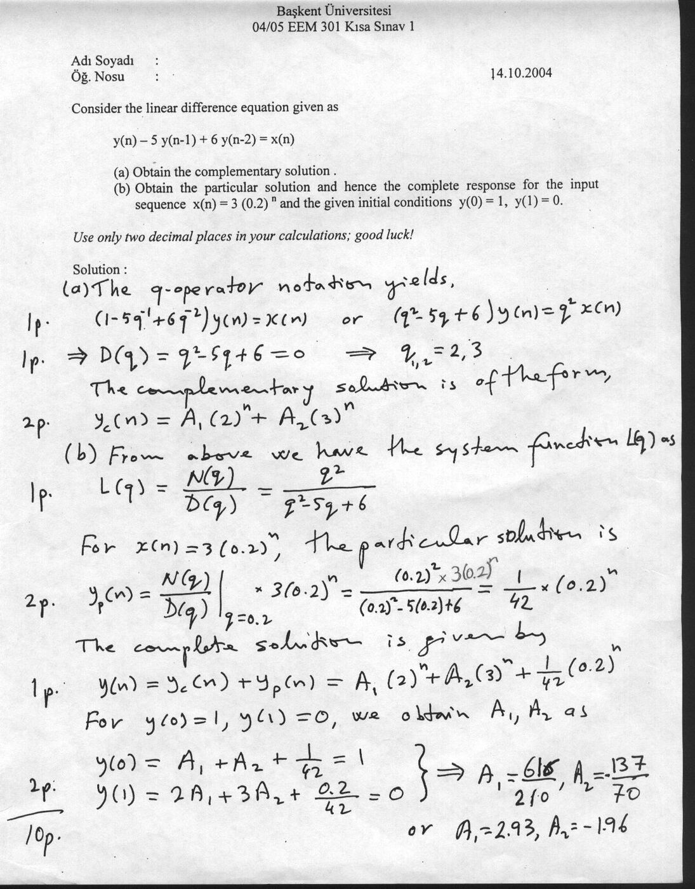
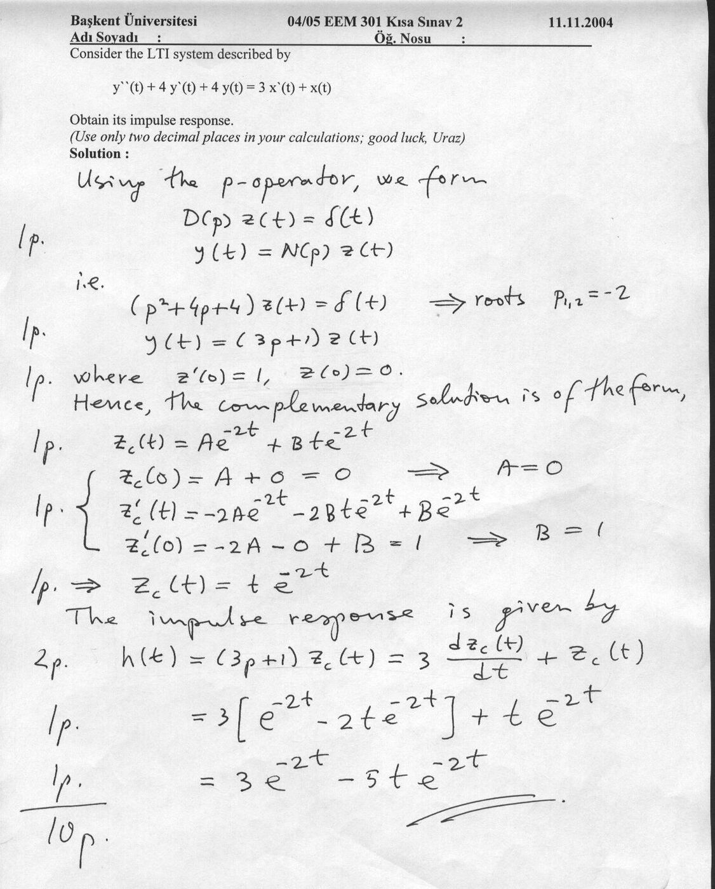
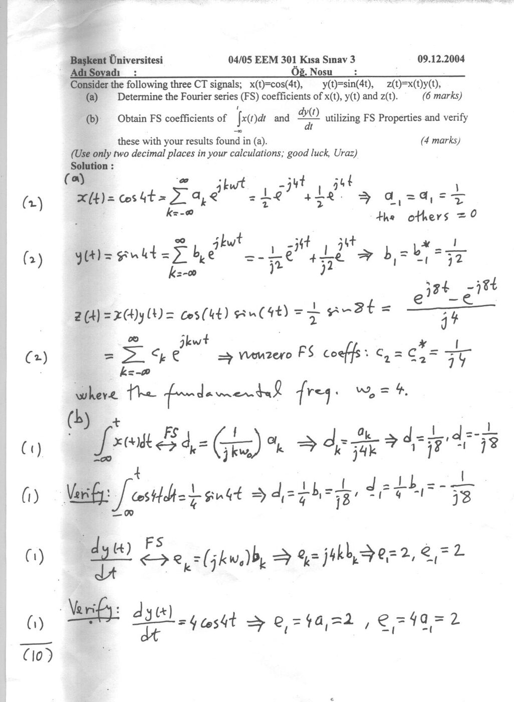
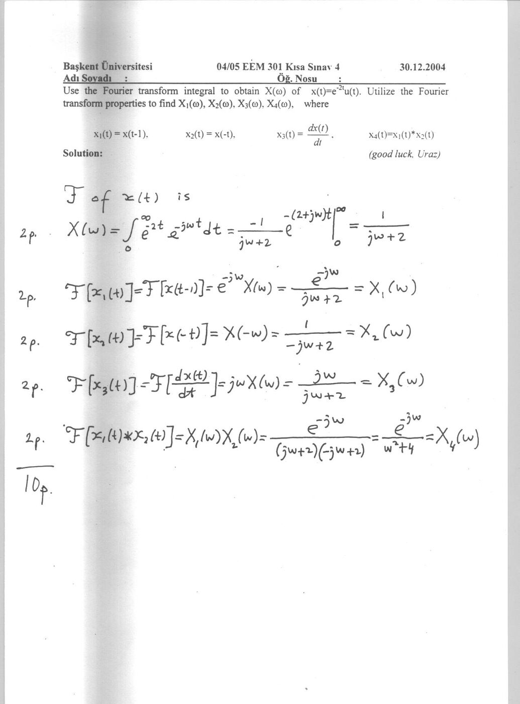

Bu yazı, Başkent Üniversitesi **EEM301 Sinyaller ve Sistemler I** dersinin **2004–2005 güz dönemi kısa sınavlarını** (Kısa Sınav 1–4) ve el yazısı cevap anahtarlarını içeriyor; sorular Prof. Dr. Alper Uraz'a ait. Ek olarak, tarihi belli olmayan bir "KS3" çözümü (testere dişi sinyalin Fourier serisi) de var. Belgeler taranmış sayfalar; sorular ve sonuçlar aşağıya metin olarak aktarıldı. Taramalar yazının sonunda ZIP olarak indirilebilir.

## Kısa Sınav 1 (14.10.2004): Fark denklemi

y(n) − 5y(n − 1) + 6y(n − 2) = x(n) fark denklemi için:

1. Tümleyen (complementary) çözümü bulun.
1. x(n) = 3(0.2)ⁿ girişi ve y(0) = 1, y(1) = 0 başlangıç koşulları için özel çözümü ve tam yanıtı bulun.

**Çözüm:** q-operatörüyle (1 − 5q⁻¹ + 6q⁻²)y(n) = x(n), ya da (q² − 5q + 6)y(n) = q²x(n). D(q) = q² − 5q + 6 = 0 ⇒ q₁,₂ = 2, 3.

- Tümleyen çözüm: y_c(n) = A₁(2)ⁿ + A₂(3)ⁿ
- Sistem fonksiyonu L(q) = q²/(q² − 5q + 6); özel çözüm y_p(n) = (0.2)²·3(0.2)ⁿ / ((0.2)² − 5(0.2) + 6) = (1/42)(0.2)ⁿ
- Tam çözüm: y(n) = A₁(2)ⁿ + A₂(3)ⁿ + (1/42)(0.2)ⁿ
- y(0) = 1 ve y(1) = 0 koşullarından **A₁ = 616/210 ≈ 2.93, A₂ = −137/70 ≈ −1.96**

## Kısa Sınav 2 (11.11.2004): Dürtü yanıtı

y″(t) + 4y′(t) + 4y(t) = 3x′(t) + x(t) ile tanımlanan LTI sistemin dürtü yanıtını bulun.

**Çözüm:** p-operatörüyle D(p)z(t) = δ(t), y(t) = N(p)z(t); yani (p² + 4p + 4)z(t) = δ(t), kökler p₁,₂ = −2 (çift kök) ve y(t) = (3p + 1)z(t), z′(0) = 1, z(0) = 0.

- z_c(t) = Ae^(−2t) + Bte^(−2t); z(0) = 0 ⇒ A = 0, z′(0) = 1 ⇒ B = 1, yani z(t) = te^(−2t)
- h(t) = (3p + 1)z(t) = 3[e^(−2t) − 2te^(−2t)] + te^(−2t) = **3e^(−2t) − 5te^(−2t)** (t ≥ 0)

## Kısa Sınav 3 (09.12.2004): Fourier serisi katsayıları

x(t) = cos(4t), y(t) = sin(4t), z(t) = x(t)y(t) sinyalleri için:

1. x(t), y(t) ve z(t)'nin Fourier serisi (FS) katsayılarını bulun. (6 puan)
1. ∫x(t)dt ve dy(t)/dt'nin FS katsayılarını FS özellikleriyle bulun ve (a)'daki sonuçlarla doğrulayın. (4 puan)

**Çözüm:** (ω₀ = 4)

- x(t) = ½e^(−j4t) + ½e^(j4t) ⇒ a₁ = a₋₁ = 1/2, diğerleri 0
- y(t) = −(1/2j)e^(−j4t) + (1/2j)e^(j4t) ⇒ b₁ = b₋₁* = 1/(2j)
- z(t) = cos 4t sin 4t = ½ sin 8t = (e^(j8t) − e^(−j8t))/(4j) ⇒ sıfır olmayan katsayılar c₂ = c₋₂* = 1/(4j)
- ∫x(t)dt ⟷ d_k = a_k/(jkω₀) = a_k/(j4k) ⇒ d₁ = 1/(j8), d₋₁ = −1/(j8). Doğrulama: ∫cos 4t dt = ¼ sin 4t ⇒ d₁ = ¼b₁ = 1/(j8)
- dy/dt ⟷ e_k = jkω₀b_k = j4k·b_k ⇒ e₁ = 2, e₋₁ = 2. Doğrulama: dy/dt = 4 cos 4t ⇒ e₁ = 4a₁ = 2

## Kısa Sınav 4 (30.12.2004): Fourier dönüşümü

x(t) = e^(−2t)u(t)'nin Fourier dönüşümünü integralle bulun; Fourier dönüşümü özelliklerini kullanarak x₁(t) = x(t − 1), x₂(t) = x(−t), x₃(t) = dx(t)/dt ve x₄(t) = x₁(t) ∗ x₂(t)'nin dönüşümlerini bulun.

**Çözüm:**

- X(ω) = ∫₀^∞ e^(−2t)e^(−jωt) dt = 1/(jω + 2)
- X₁(ω) = e^(−jω)X(ω) = e^(−jω)/(jω + 2)
- X₂(ω) = X(−ω) = 1/(−jω + 2)
- X₃(ω) = jωX(ω) = jω/(jω + 2)
- X₄(ω) = X₁(ω)X₂(ω) = e^(−jω)/((jω + 2)(−jω + 2)) = **e^(−jω)/(ω² + 4)**

## KS3: Testere dişi sinyalin Fourier serisi

Ayrı bir kâğıttaki "KS3" çözümünde x(t) = t (0 ≤ t ≤ 1) ile tanımlanan, T = 1 periyotlu (ω₀ = 2π) testere dişi sinyalin üstel Fourier serisi bulunuyor:

- a₀ = ∫₀¹ t dt = 1/2
- a_k = ∫₀¹ t e^(−jk2πt) dt (kısmi integrasyonla) = 1/(−jk2π) = **j/(2πk)**, k ≠ 0
- x(t) = Σ a_k e^(jk2πt)

 = t, T = 1 için Fourier serisi katsayıları")
