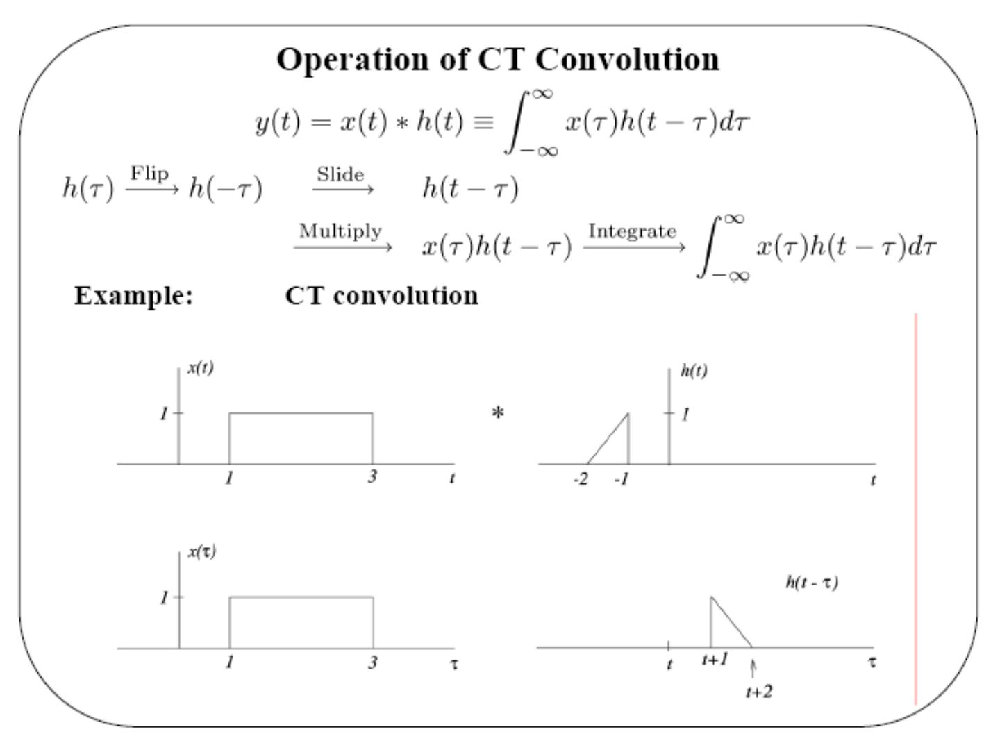

Bu yazı, Başkent Üniversitesi Elektrik-Elektronik Mühendisliği **EEM301 Sinyaller ve Sistemler I** dersinin **"Convolution"** (Konvolüsyon) sunumudur. Sunum dersin öğretim üyesi **Prof. Dr. Alper Uraz** tarafından hazırlanmış; dosyanın son düzenlemesi Kasım 2006 tarihli. Sunum İngilizce olduğu için içerik İngilizce aktarıldı, formüller düz metne çevrildi, grafikler için slayt görselleri eklendi ve örneklerin sonuçları kontrol edildi. Orijinal PowerPoint dosyası yazının sonunda indirilebilir.

Sunumun konuları:

- Impulse Response Sequence of DT LTI Systems
- Convolution Sum for DT LTI Systems
- Properties of Convolution Sum
- Impulse Response of LTI Systems
- Convolution Integral for CT LTI Systems
- Properties of Convolution Integral
- Operational Definition of the Unit Impulse

## Exploiting superposition and time-invariance

For a linear system: x[n] = Σ_k a_k x_k[n] → y[n] = Σ_k a_k y_k[n].

**Question:** are there sets of "basic" signals so that

1. we can represent rich classes of signals as linear combinations of these building block signals, and
1. the response of LTI systems to these basic signals is both *simple* and *insightful*?

**Fact:** for LTI systems (CT or DT) there are two natural choices for these building blocks. Focus for now: **DT — shifted unit samples; CT — shifted unit impulses.**

### Representation of DT signals using unit samples

![x[n] dizisinin ölçeklenmiş ve kaydırılmış birim örneklerin toplamı olarak gösterimi](s-03.jpg "Representation of DT signals using unit samples")

That is,

x[n] = … + x[−2]δ[n+2] + x[−1]δ[n+1] + x[0]δ[n] + x[1]δ[n−1] + … ⇒ **x[n] = Σ (k = −∞…∞) x[k] δ[n−k]**

where x[k] are the *coefficients* and δ[n−k] the *basic signals*: **the sifting property of the unit sample**.

Suppose the system is **linear**, and define h_k[n] as the response to δ[n−k]: δ[n−k] → h_k[n]. From superposition:

x[n] = Σ x[k] δ[n−k] → y[n] = Σ x[k] h_k[n]

Now suppose the system is **LTI**, and define the *unit sample response* h[n]: δ[n] → h[n]. From TI: δ[n−k] → h[n−k]. From LTI:

x[n] = Σ x[k] δ[n−k] → **y[n] = Σ (k = −∞…∞) x[k] h[n−k]** — the **convolution sum**.

## Impulse response of DT LTI systems

Consider

y(n) + a1 y(n−1) + … + an y(n−k) = x(n) (1)

where x(n) is the impulse function δ(n), with δ(n) = 0 for n ≠ 0 and δ(n) = 0 for n < 0. Let h(n) be the impulse response sequence. Since h(n) must satisfy the equation for all n:

h(n) + a1 h(n−1) + … + an h(n−k) = δ(n)

*Not: Burada kastedilen δ(0) = 1 ve n < 0 için h(n) = 0 (sistem başlangıçta durgun) olmalı.*

All the terms on the left except the first are zero for n = 0, so h(0) = 1. Similarly for n = 1 all terms except the first two are zero: h(1) + a1 h(0) = 0. Continuing yields k linear equations from which the initial conditions h(0), h(1), …, h(k−1) are obtained. As in the continuous case, we take the complementary solution of the difference equation (δ(n) = 0 for n ≠ 0) and calculate the arbitrary constants to satisfy these initial conditions.

**Example:** y(n) − 2y(n−1) + 1.31y(n−2) − 0.28y(n−3) = x(n)

The characteristic equation is Δ(q) = q³ − 2q² + 1.31q − 0.28 = 0 ⇒ q1 = 0.5, q2 = 0.7, q3 = 0.8, so

yc(n) = A(0.5)ⁿ + B(0.7)ⁿ + C(0.8)ⁿ

Initial conditions, starting with h(0) = 1:

- h(0) = 1
- h(1) − 2h(0) = 0 ⇒ h(1) = 2
- h(2) − 2h(1) + 1.31h(0) = 0 ⇒ h(2) = 2.69

Substituting into the complementary solution:

- A + B + C = 1
- 0.5A + 0.7B + 0.8C = 2
- 0.25A + 0.49B + 0.64C = 2.69

⇒ A = 25/6, B = −49/2, C = 64/3, hence

**h(n) = (25/6)(0.5)ⁿ − (49/2)(0.7)ⁿ + (64/3)(0.8)ⁿ = 4.167(0.5)ⁿ − 24.5(0.7)ⁿ + 21.33(0.8)ⁿ, n ≥ 0**

## Convolution sum

**Convolution sum representation of the response of LTI systems:**

y[n] = x[n] ∗ h[n] = Σ (k = −∞…∞) x[k] h[n−k]

Interpretation: δ[n] → h[n] ⇒ x[k]δ[n−k] → x[k]h[n−k]; sum up the responses over all k.

### Visualizing the calculation of y[n] = x[n] ∗ h[n]

Choose a value of n and consider it fixed; view x[k] and h[n−k] as functions of k with n fixed. y[n] is the sum of the products where they overlap.

![x[n], h[n] ve sabit n için x[k] ile h[n−k] dizilerinin üst üste gelişi](s-12.jpg "Visualizing the calculation of y[n] = x[n] ∗ h[n]")

*Not: Slayttaki toplam formülünde alt sınır "k = ∞" yazılmış; −∞ olmalı (aynı yazım hatası akümülatör örneğinde de var).*

**Calculating successive values: shift, multiply, sum.** With x[0] = 1, x[1] = 0, x[2] = −1 and h[−1] = 1, h[0] = 2, h[1] = −1, h[2] = −1:

| n | y[n] |
|---|---|
| n < −1 | 0 |
| −1 | 1 × 1 = 1 |
| 0 | 0 × 1 + 1 × 2 = 2 |
| 1 | (−1) × 1 + 0 × 2 + 1 × (−1) = −2 |
| 2 | (−1) × 2 + 0 × (−1) + 1 × (−1) = −3 |
| 3 | (−1) × (−1) + 0 × (−1) = 1 |
| 4 | (−1) × (−1) = 1 |
| n > 4 | 0 |

## Properties of convolution and DT LTI systems

**1) A DT LTI system is completely characterized by its unit sample response.**

Ex. #1: h[n] = δ[n − n0]. There are *many* systems with this response to δ[n], but only *one* LTI system: y[n] = x[n − n0] ⇒ **x[n] ∗ δ[n − n0] = x[n − n0]**.

Ex. #2: y[n] = Σ (k = −∞…n) x[k] — an **accumulator**. Unit sample response: h[n] = Σ (k = −∞…n) δ[k] = u[n] ⇒ x[n] ∗ u[n] = Σ (k = −∞…n) x[k].

**The commutative property:** y[n] = x[n] ∗ h[n] = h[n] ∗ x[n].

Ex: the step response s[n] of an LTI system is s[n] = u[n] ∗ h[n] = h[n] ∗ u[n] (u[n] is the step input; viewed the other way, h[n] is the "input" to an accumulator whose unit sample response is u[n]) ⇒ s[n] = Σ (k = −∞…n) h[k] (running sum), or h[n] = s[n] − s[n−1].

**The distributive property:** x[n] ∗ (h1[n] + h2[n]) = x[n] ∗ h1[n] + x[n] ∗ h2[n]. Interpretation: a system with h1[n] + h2[n] is equivalent to h1[n] and h2[n] in parallel with their outputs added.

**The associative property:** x[n] ∗ (h1[n] ∗ h2[n]) = (x[n] ∗ h1[n]) ∗ h2[n], and by commutativity x[n] ∗ (h2[n] ∗ h1[n]) = (x[n] ∗ h2[n]) ∗ h1[n]. Implication (very special to LTI systems): h1 followed by h2 is equivalent to a single system h1[n] ∗ h2[n], and also to h2 followed by h1 — the order of cascaded LTI systems does not matter.

**Properties of LTI systems:**

1. Causality ⇔ h[n] = 0 for all n < 0
1. Stability ⇔ Σ (k = −∞…∞) |h[k]| < ∞

## Representation of CT signals

Approximate any input x(t) as a sum of shifted, scaled pulses: x̂(t) = x(kΔ), kΔ < t < (k+1)Δ.

Let δΔ(t) be a pulse of width Δ and height 1/Δ: δΔ(t) has unit area, and Δ·δΔ(t) has unit amplitude. A pulse of height x(kΔ) on [kΔ, (k+1)Δ] is x(kΔ) δΔ(t − kΔ) Δ, so

x̂(t) = Σ (k = −∞…∞) x(kΔ) δΔ(t − kΔ) Δ

and in the limit Δ → 0:

**x(t) = ∫ (−∞…∞) x(τ) δ(t − τ) dτ — the sifting property of the unit impulse.**

For the unit step signal this integral gives u(t) = ∫ (−∞…∞) u(τ) δ(t − τ) dτ = ∫ (0…∞) δ(t − τ) dτ, since u(τ) = 0 for τ < 0 and u(τ) = 1 for τ > 0.

## Impulse response of CT LTI systems

Consider a system described by the first order differential equation

y′(t) + a y(t) = x(t) (1)

where x(t) = δ(t), and assume y = 0 for t < 0. δ(t) is applied at t = 0, so outside the interval 0⁻ < t < 0⁺ we have y(0⁻) = 0 and y′(t) + a y(t) = 0 for t > 0⁺. This homogeneous solution is easily obtained if y(0⁺) is known. Integrating (1) between t = 0⁻ and t = 0⁺:

[y(0⁺) − y(0⁻)] + 0 = 1

where the second term is zero since y(t) is finite (no discontinuities) and (0⁻, 0⁺) is infinitesimal; y(0⁻) = 0 ⇒ y(0⁺) = 1. Therefore the impulse response is

**h(t) = e^(−at) u(t)**

The response of a first order linear system to a unit impulse is identical to the response of the unforced system with the initial condition set to 1. Similarly, the unit impulse response of an n-th order system is identical to the response of the unforced system with y⁽ⁿ⁻¹⁾(0⁺) = 1 and all other initial conditions zero.

**Example:** y″(t) + 4y′(t) + 3y(t) = x(t), with y(0) = 0 and y′(0) = 1. The roots of the characteristic polynomial are −1 and −3, so yc(t) = A e^(−t) + B e^(−3t). With the ic: A + B = 0 and −A − 3B = 1 ⇒ A = 0.5, B = −0.5. Consequently

**h(t) = (0.5 e^(−t) − 0.5 e^(−3t)) u(t)**

Now consider the more general case with derivatives of x(t) included, D(p) y(t) = N(p) x(t), where deg D(p) = n and deg N(p) ≤ n − 1, so that the system function L(p) is strictly proper. The system equation is considered in two parts,

D(p) z(t) = x(t), y(t) = N(p) z(t)

so that the impulse response of the first equation is obtained and afterwards used in the second equation.

## Convolution integral

**Response of a CT LTI system:** if δΔ(t) → hΔ(t), then x̂(t) = Σ x(kΔ) δΔ(t − kΔ) Δ → ŷ(t) = Σ x(kΔ) hΔ(t − kΔ) Δ. With the impulse response δ(t) → h(t) and taking limits Δ → 0:

x(t) = ∫ x(τ) δ(t − τ) dτ → **y(t) = ∫ (−∞…∞) x(τ) h(t − τ) dτ — the convolution integral**

**Operation of CT convolution:** y(t) = x(t) ∗ h(t) = ∫ x(τ) h(t − τ) dτ: **flip** h(τ) → h(−τ), **slide** → h(t − τ), **multiply** → x(τ) h(t − τ), **integrate** over τ.

### Example: CT convolution

x(t) is a unit-height rectangular pulse on 1 < t < 3; h(t) is a triangle rising from 0 at t = −2 to 1 at t = −1. Then h(t − τ) is a triangle with height 1 at τ = t + 1 falling to 0 at τ = t + 2.

| Time interval | Output |
|---|---|
| t < −1 | y(t) = 0 |
| −1 < t < 0 | y(t) = ½(t + 2)(t + 2 − 1) = ½(t + 1)² |
| 0 < t < 1 | y(t) = ½ · 1 · 1 = ½ |
| 1 < t < 2 | y(t) = ½ − ½(t + 2 − 3)(t − 1) = ½ − ½(t − 1)² |
| t > 2 | y(t) = 0 |

*Not: −1 < t < 0 aralığındaki ara ifade ½(t + 1)(t + 2 − 1) olmalı; sonuç ½(t + 1)² doğru.*

## Properties and examples (CT)

1. **Commutativity:** x(t) ∗ h(t) = h(t) ∗ x(t)
1. x(t) ∗ δ(t − t0) = x(t − t0). Sifting property: x(t) ∗ δ(t) = x(t)
1. **An integrator:** y(t) = ∫ (−∞…t) x(τ) dτ. If the input is x(t) = δ(t), the output is y(t) = h(t) ⇒ h(t) = ∫ (−∞…t) δ(τ) dτ = u(t). That is, y(t) = x(t) ∗ h(t) = x(t) ∗ u(t) = ∫ (−∞…t) x(τ) dτ (running integral).
1. **Step response:** s(t) = u(t) ∗ h(t) = h(t) ∗ u(t) = ∫ (−∞…t) h(τ) dτ, or h(t) = ds/dt.

**Distributivity:** a system h1(t) + h2(t) gives y(t) = x(t) ∗ [h1(t) + h2(t)] = x(t) ∗ h1(t) + x(t) ∗ h2(t) (parallel connection).

**Associativity:** h1(t) followed by h2(t) gives y(t) = [x(t) ∗ h1(t)] ∗ h2(t) = x(t) ∗ [h1(t) ∗ h2(t)]; by commutativity this equals x(t) ∗ [h2(t) ∗ h1(t)] = [x(t) ∗ h2(t)] ∗ h1(t).

- **Causality:** a CT LTI system is causal ⇔ h(t) = 0, t < 0.
- **Stability:** a CT LTI system is stable ⇔ ∫ (−∞…∞) |h(τ)| dτ < ∞.

### Memoryless systems

A DT LTI system is *memoryless* if h(n) = 0 for n ≠ 0 and *with memory* if h(n) ≠ 0 for some n ≠ 0. Likewise a CT LTI system is memoryless if h(t) = 0 for t ≠ 0. Examples of memoryless systems:

- h(n) = K δ(n), y(n) = K x(n), where K = h(0)
- h(t) = K δ(n), y(t) = K x(t)

*Not: İkinci örnekte h(t) = K δ(t) olmalı.*

## The operational definition of the unit impulse δ(t)

δ(t) is the idealization of a unit-area pulse that is so short that, for any physical system of interest to us, the system responds only to the area of the pulse and is insensitive to its duration.

Operationally, the unit impulse is the signal which, when applied to any LTI system, results in an output equal to the impulse response of the system: **δ(t) ∗ h(t) = h(t) for all h(t)** — δ(t) is defined by what it does under convolution.

### The unit doublet — differentiator

A differentiator y(t) = dx(t)/dt has as its impulse response the **unit doublet** u1(t) = dδ(t)/dt. Operational definition: x(t) ∗ u1(t) = dx(t)/dt.

**Triplets and beyond:** for n > 0, uₙ(t) = u1(t) ∗ … ∗ u1(t) (n times), where n is the number of differentiations. Operational definition: x(t) ∗ uₙ(t) = dⁿx(t)/dtⁿ (n > 0).

### Integrators

An integrator y(t) = ∫ (−∞…t) x(τ) dτ has impulse response u₋₁(t) ≡ u(t) ("−1 derivatives" = integral ⇒ impulse response = unit step). Operational definition: x(t) ∗ u₋₁(t) = ∫ (−∞…t) x(τ) dτ.

Cascade of n integrators: u₋ₙ(t) = u₋₁(t) ∗ … ∗ u₋₁(t) (n times, n > 0). Two integrators: u₋₂(t) = ∫ (−∞…t) u₋₁(τ) dτ = ∫ (−∞…t) u(τ) dτ = t·u(t), the unit ramp. More generally, for n > 0:

u₋ₙ(t) = tⁿ⁻¹/(n − 1)! · u(t)

**Notation:** define u0(t) = δ(t). Then uₙ(t) ∗ uₘ(t) = uₙ₊ₘ(t), where n and m can be positive or negative. E.g. u1(t) ∗ u₋₁(t) = u0(t) ⇒ (d/dt) u(t) = δ(t).

**Sometimes useful tricks:**

x(t) ∗ h(t) = x(t) ∗ δ(t) ∗ h(t) = x(t) ∗ u1(t) ∗ u₋₁(t) ∗ h(t) = {[x(t) ∗ u1(t)] ∗ h(t)} ∗ u₋₁(t)

*Differentiate first, then convolve, then integrate.*

### Example

x(t) = 1 for −1 < t < 1 and −1 for 1 < t < 2; h(t) = 1 for 1 < t < 2. Then

dx(t)/dt = δ(t + 1) − 2δ(t − 1) + δ(t − 2)

dx(t)/dt ∗ h(t) = h(t + 1) − 2h(t − 1) + h(t − 2)

x(t) ∗ h(t) = ∫ (−∞…t) [dx(τ)/dτ ∗ h(τ)] dτ

: differentiate, convolve, integrate")

The result rises from 0 to 1 on 0 < t < 1, stays at 1 on 1 < t < 2, falls to −1 at t = 3 and returns to 0 at t = 4.

## Inverse systems

A system is **invertible** if distinct inputs lead to distinct outputs. If a system is invertible, an **inverse system** exists such that, when cascaded with the original system, it yields an output equal to the input of the first system.

- y(t) = 2x(t) (system) → w(t) = (1/2) y(t) (inverse system) ⇒ w(t) = x(t)
- y(n) = Σ (k = −∞…n) x(k) (accumulator) → w(n) = y(n) − y(n−1) (first order difference equation) ⇒ w(n) = x(n)

In terms of impulse responses: for x(t) → h(t) → y(t) → h1(t) → w(t) = x(t), the overall impulse response is h(t) ∗ h1(t), and the condition that h1(t) must satisfy to be the impulse response of the inverse system is

**h(t) ∗ h1(t) = δ(t)**

i.e. the cascade is the identity system δ(t). Similar results hold for the DT case: h(n) ∗ h1(n) = δ(n).
