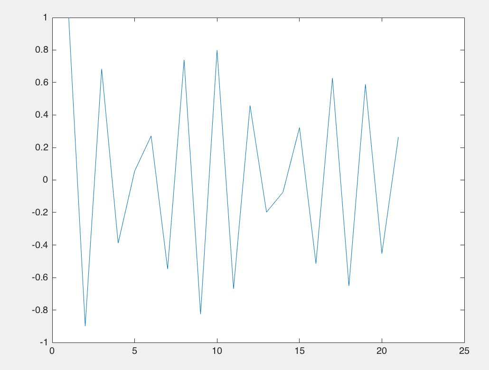
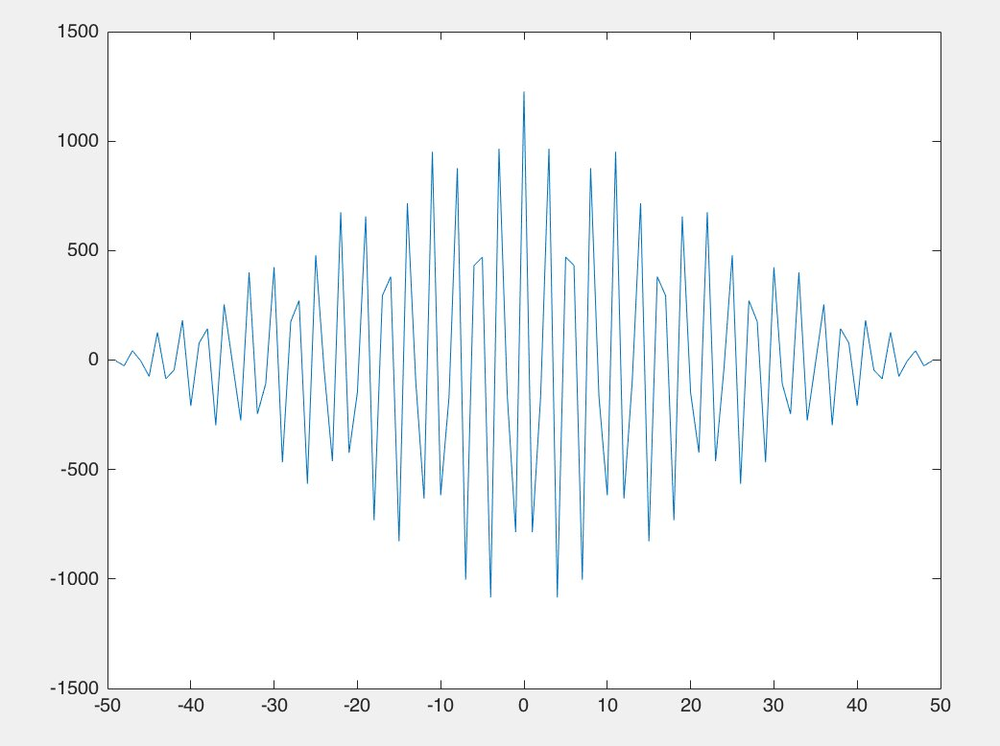
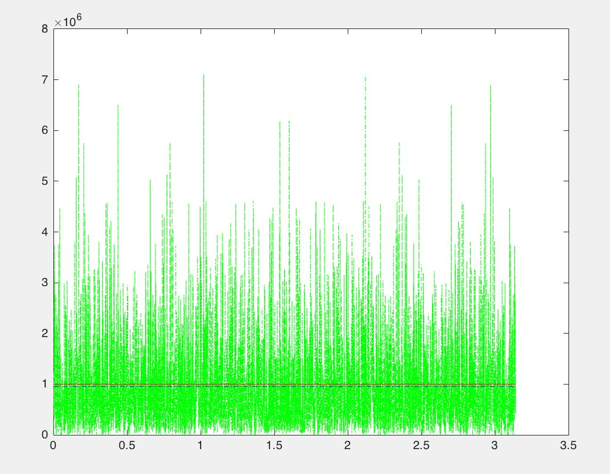

This post contains the files for **Assignment 3** of the **EEM301 Signals and Systems I** course folder at Başkent University, dated May 2016: Hasan Can Öztürk's MATLAB code and screenshots, along with code and plots a friend wrote for the same assignment (personal information removed). The topics are autocorrelation, cross-correlation, power spectrum via the periodogram, and the power spectral density (PSD) of white noise. The code and plots are available for download as a ZIP at the end of the post.

## Autocorrelation and power spectrum

The cosine signal is sampled at 50 points over the range 0–100; its autocorrelation is computed with `autocorr`, and its power spectrum (in dB) is plotted with `periodogram`:

```matlab
t=linspace(0,100,50);
x=10*cos(300*t+72);
figure(1);
N = length(x);
xlim([0,N])
Y=autocorr(x);
plot(Y)
figure(2)
[Pxx,F] = periodogram(x,[],length(x));
plot(F,10*log10(Pxx));
```

In the author's own `korelasyon.m` file, the same code is set up with x = 10cos(0·t + 0), i.e., a constant signal; the screenshots, however, belong to the cosine version.

")



*Note: Since the sampling interval is 100/49 ≈ 2.04 s, high-frequency signals such as cos(300t) suffer severe aliasing; the peak in the periodogram shows the location of the aliased frequency, not the true frequency. To see the true frequency, the sampling interval must be smaller than π/300.*

## Cross-correlation

```matlab
t=linspace(0,100,50);
x=10*cos(900*t+0);
y=5*cos(900*t+0);
figure(1);
N = length(x);
xlim([0,N])
[acor,lag]=xcorr(x,y);
plot(lag,acor)
```

The cross-correlation of two cosines with the same frequency yields an oscillating sequence that takes its largest value at zero lag and decreases triangularly toward the edges (lags −49…49). In the friend's version the frequencies and phases differ: x = 10cos(900t + 52), y = 5cos(400t + 37).



## Power spectral density of white noise

The friend's `beyazgurultu.m` file computes the PSD of 4372 samples of Gaussian noise with standard deviation σ = 1000 using the FFT, and compares it with the theoretical value σ² and the mean PSD:

```matlab
sigma = 1000;
L = 4372;
noise= randn(1,L) * sigma;
PSD = abs(fft(noise)).^2/length(noise);
vect_freq = linspace(0,pi,length(PSD));
plot(vect_freq,PSD,'-.g');
hold on, plot([vect_freq(1) vect_freq(end)],[sigma^2 sigma^2],'r');
hold on, plot([vect_freq(1) vect_freq(end)],[mean(PSD) mean(PSD)],'-.b');
```

The PSD values fluctuate randomly at all frequencies, but their mean sits on the line σ² = 10⁶; the spectrum of white noise is flat.



*Note: `linspace(0,pi,length(PSD))` squeezes the entire 0–2π range of the FFT into 0–π; the correct axis should be `linspace(0,2*pi,L)` (or only the first half should be plotted). For a flat spectrum, this does not change the appearance of the plot.*
