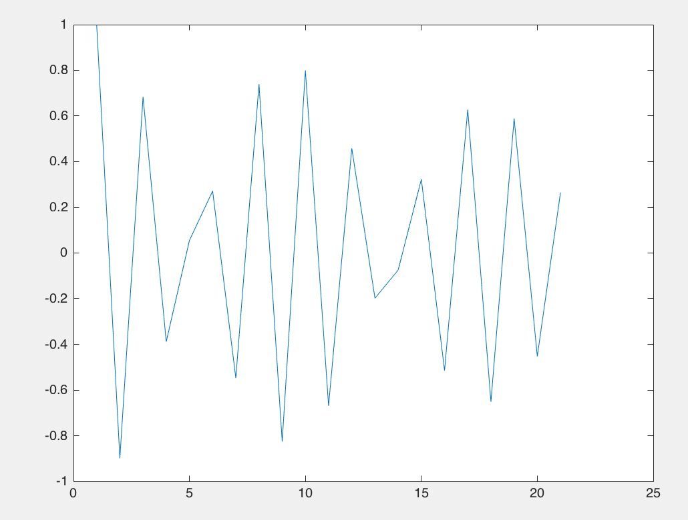
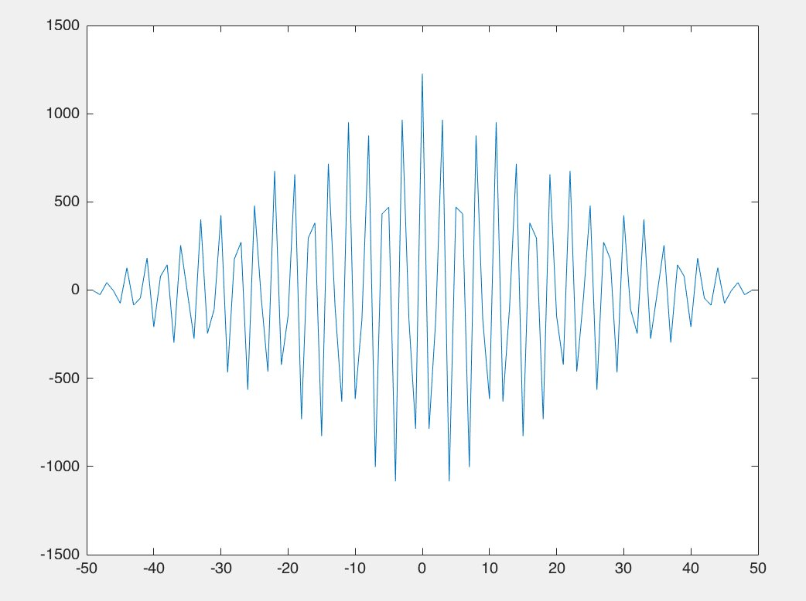
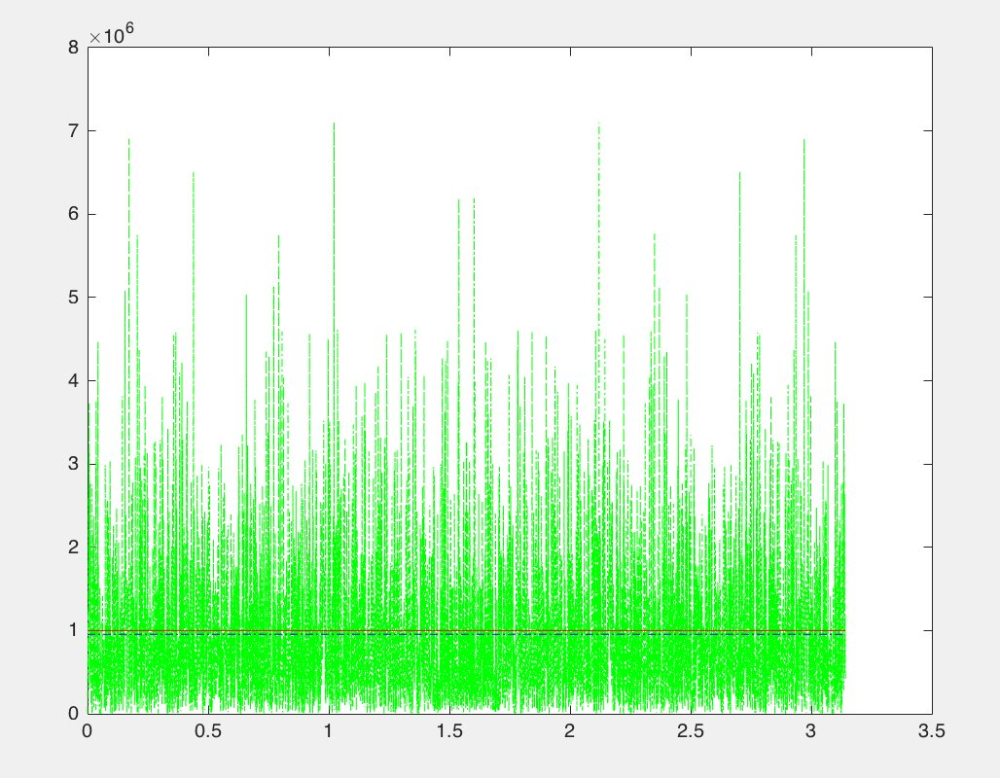

Bu yazı, Başkent Üniversitesi **EEM301 Sinyaller ve Sistemler I** klasöründeki Mayıs 2016 tarihli **Ödev 3** dosyalarını içeriyor: Hasan Can Öztürk'ün MATLAB kodları ve ekran görüntüleri ile bir arkadaşın aynı ödev için yazdığı kodlar ve grafikler (kişisel bilgiler çıkarıldı). Konular özilinti (autocorrelation), çapraz ilinti (cross-correlation), periodogram ile güç spektrumu ve beyaz gürültünün güç spektral yoğunluğu (PSD). Kodlar ve grafikler yazının sonunda ZIP olarak indirilebilir.

## Özilinti ve güç spektrumu

Kosinüs sinyali 0–100 aralığında 50 noktada örnekleniyor; `autocorr` ile özilintisi, `periodogram` ile güç spektrumu (dB) çiziliyor:

```matlab
t=linspace(0,100,50);
x=10*cos(300*t+72);
figure(1);
N = length(x);
xlim([0,N])
Y=autocorr(x);
plot(Y)
figure(2)
[Pxx,F] = periodogram(x,[],length(x));
plot(F,10*log10(Pxx));
```

Klasördeki kendi `korelasyon.m` dosyasında aynı kod x = 10cos(0·t + 0), yani sabit bir sinyal için duruyor; ekran görüntüleri ise kosinüslü sürüme ait.

")



*Not: Örnekleme aralığı 100/49 ≈ 2.04 s olduğundan cos(300t) gibi yüksek frekanslı sinyaller ciddi biçimde örtüşmeye (aliasing) uğrar; periodogramdaki tepe asıl frekansın değil, örtüşmüş frekansın yerini gösterir. Gerçek frekansı görmek için örnekleme aralığı π/300'den küçük olmalıdır.*

## Çapraz ilinti

```matlab
t=linspace(0,100,50);
x=10*cos(900*t+0);
y=5*cos(900*t+0);
figure(1);
N = length(x);
xlim([0,N])
[acor,lag]=xcorr(x,y);
plot(lag,acor)
```

Aynı frekanslı iki kosinüsün çapraz ilintisi, sıfır gecikmede en büyük değeri alan ve kenarlara doğru üçgensel olarak azalan salınımlı bir dizi verir (−49…49 gecikme). Arkadaşın sürümünde frekanslar ve fazlar farklı: x = 10cos(900t + 52), y = 5cos(400t + 37).



## Beyaz gürültünün güç spektral yoğunluğu

Arkadaşın `beyazgurultu.m` dosyası, standart sapması σ = 1000 olan 4372 örneklik Gauss gürültüsünün PSD'sini FFT ile hesaplayıp kuramsal değer σ² ve ortalama PSD ile karşılaştırıyor:

```matlab
sigma = 1000;
L = 4372;
noise= randn(1,L) * sigma;
PSD = abs(fft(noise)).^2/length(noise);
vect_freq = linspace(0,pi,length(PSD));
plot(vect_freq,PSD,'-.g');
hold on, plot([vect_freq(1) vect_freq(end)],[sigma^2 sigma^2],'r');
hold on, plot([vect_freq(1) vect_freq(end)],[mean(PSD) mean(PSD)],'-.b');
```

PSD değerleri bütün frekanslarda rastgele dalgalanır ama ortalaması σ² = 10⁶ çizgisine oturur; beyaz gürültünün spektrumu düzdür.



*Not: `linspace(0,pi,length(PSD))` FFT'nin bütün 0–2π aralığını 0–π'ye sıkıştırır; doğru eksen `linspace(0,2*pi,L)` (ya da yalnız ilk yarının çizilmesi) olmalıdır. Düz spektrumda bu, grafiğin görünüşünü değiştirmez.*
