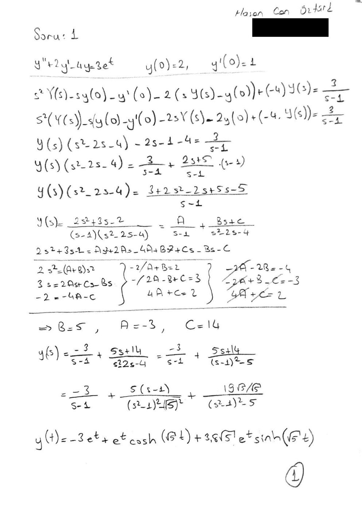
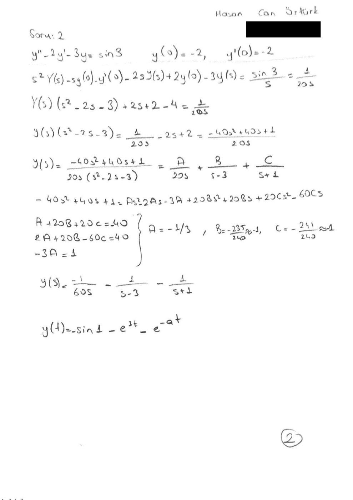
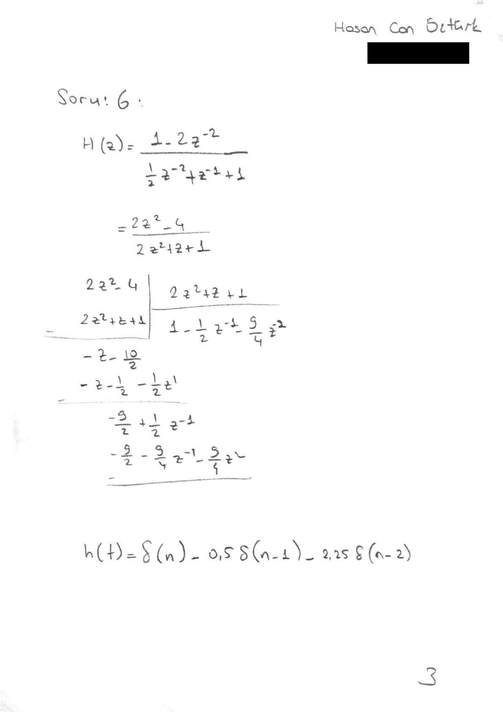

This post contains the Laplace and z-transform homework that Hasan Can Öztürk prepared in May 2017 for the Başkent University **EEM301 Signals and Systems I** course. The homework has six questions: the first two are solving initial value differential equations with the Laplace transform, questions 3 and 4 are inverse Laplace transforms, question 5 is solving a difference equation with initial conditions using the z-transform, and question 6 is an inverse z-transform. Each question was solved with MATLAB's symbolic tools (`laplace`, `ilaplace`, `ztrans`, `iztrans`); handwritten solutions of questions 1, 2 and 6 were also scanned. The student number has been covered on the scanned pages. The scanned PDF and the `soru1.m`–`soru6.m` files can be downloaded as a ZIP at the end of the post.

## Question coefficients

At the top of each MATLAB file, the coefficients of the six questions are given as comments in the same table:

```matlab
%1)  2 -4  3  2  1
%2) -2 -3  3 -2 -2
%3)  2  1  1 -3 -2
%4)  1 -3  1 -3 18
%5)  3 -3  1  3  6
%6)  1 -2  4 -2
```

For example, the first row corresponds to the equation y″ + 2y′ − 4y = 3eᵗ, y(0) = 2, y′(0) = 1.

## Question 1: y″ + 2y′ − 4y = 3eᵗ

Initial conditions: y(0) = 2, y′(0) = 1. Take the Laplace transform of both sides:

- s²Y(s) − s·y(0) − y′(0) + 2(sY(s) − y(0)) − 4Y(s) = 3/(s − 1)
- Y(s)(s² + 2s − 4) = 3/(s − 1) + 2s + 5
- Y(s) = (2s² + 3s − 2) / ((s − 1)(s² + 2s − 4)) = A/(s − 1) + (Bs + C)/(s² + 2s − 4)

Partial fractions give **A = −3, B = 5, C = 14**:

- Y(s) = −3/(s − 1) + (5s + 14)/((s + 1)² − 5)



Result on the paper: y(t) = −3eᵗ + eᵗ cosh(√5 t) + 3.8√5 eᵗ sinh(√5 t).

*Note: In the hand solution, the transform of the 2y′ term is written as −2(sY − y(0)) and the denominator as s² − 2s − 4; the correct forms are +2(sY − y(0)) and s² + 2s − 4. The values of A, B, C still come out right, but the last step is wrong: since s² + 2s − 4 = (s + 1)² − 5, the correct result is **y(t) = −3eᵗ + e⁻ᵗ[5 cosh(√5 t) + (9/√5) sinh(√5 t)]** (5s + 14 = 5(s + 1) + 9). Check: y(0) = −3 + 5 = 2, y′(0) = −3 − 5 + 9 = 1.*

MATLAB solution:

```matlab
syms s t Y  % to define the s and t domains as symbolic

denklem='D(D(y))(t)+2*D(y)(t)-4*y(t)=3*exp(t)'; %the equation without initial values

laplace_ilk=laplace(denklem,t,s); %Laplace transform of the equation without initial values

laplace_son=subs(laplace_ilk,{'laplace(y(t),t,s)','y(0)','D(y)(0)'},{Y,2,1}); %adding the initial value information
Y=solve(laplace_son,Y); % isolating the function Y

y=ilaplace(Y,s,t) % inverse Laplace transform of Y
```

## Question 2: y″ − 2y′ − 3y = sin 3

Initial conditions: y(0) = −2, y′(0) = −2. The right-hand side is a constant (sin 3), whose transform is sin 3 / s. On the paper, sin 3 ≈ 1/20 was used:

- Y(s)(s² − 2s − 3) = 1/(20s) − 2s + 2 = (−40s² + 40s + 1)/(20s)
- Y(s) = (−40s² + 40s + 1) / (20s(s − 3)(s + 1)) = A/(20s) + B/(s − 3) + C/(s + 1)
- A = −1/3, B ≈ −1, C ≈ −1



*Note: The approximation sin 3 ≈ 1/20 comes from taking 3 in degrees (sin 3° ≈ 0.052); `sin(3)` in MATLAB, however, is in radians (≈ 0.141). The last line on the paper (y(t) = −sin 1 − e³ᵗ − e⁻ᵃᵗ) is also incomplete/incorrect. Letting c = sin 3, the exact solution is **y(t) = (c/12 − 1)e³ᵗ + (c/4 − 1)e⁻ᵗ − c/3** (particular solution −c/3; roots 3 and −1).*

The MATLAB code is the same as in Question 1, only the equation and initial values differ:

```matlab
denklem='D(D(y))(t)-2*D(y)(t)-3*y(t)=sin(3)';
laplace_ilk=laplace(denklem,t,s);
laplace_son=subs(laplace_ilk,{'laplace(y(t),t,s)','y(0)','D(y)(0)'},{Y,-2,-2});
Y=solve(laplace_son,Y);
y=ilaplace(Y,s,t)
```

## Questions 3 and 4: Inverse Laplace transform

```matlab
syms s t Y

F= (2*s+1)/(s^2-3*s-2);   % Question 3
f= ilaplace(F);
disp(f);

F= (s-3)/s*(s^2-3*s+18);  % Question 4
f= ilaplace(F);
disp(f);
```

*Note: The expression in Question 4 is read by MATLAB as ((s − 3)/s)·(s² − 3s + 18). If F(s) = (s − 3)/(s(s² − 3s + 18)) was intended, the correct form is `F=(s-3)/(s*(s^2-3*s+18));`.*

## Question 5: Solving a difference equation with the z-transform

The equation solved in the code: y(n) + (3/2)y(n − 1) − (3/2)y(n − 2) = x(n), y(−1) = 3, y(−2) = 6, x(n) = (1/4)ⁿ u(n). The z-transforms of the delayed terms with initial conditions are:

- Z{y(n − 1)} = z⁻¹Y(z) + y(−1)
- Z{y(n − 2)} = z⁻²Y(z) + z⁻¹y(−1) + y(−2)

```matlab
syms z n Y

% y(n)-2y(n-1)+3y(n-2)=x(n)  , y(-1)=5  , y(-2)=2  , x(n)=(1/2)^(n)u(n)

a=1;     % coefficient of y(n)
b=3/2;    % coefficient of y(n-1)
c=-3/2;     % coefficient of y(n-2)
d=1;     % coefficient of x(n)
e= 1/4;  % constant in the base of the exponential term that forms x(n)

y_1= 3 ;   % defining y(-1)
y_2= 6 ;   % defining y(-2)

X=ztrans(e^n*heaviside(n));     % transforming x(n) to the z domain

Y1=(z^(-1)*Y)+y_1;              % transforming y(n-1) to the z domain

Y2=(z^(-2)*Y+(z^(-1)*y_1)+y_2); % transforming y(n-2) to the z domain

f= a*Y+b*Y1+c*Y2-d*X;           % forming the equation

sol=solve(f,Y);                 % isolating Y(z) in the equation

pretty(sol);                    % writing the isolated Y(z) in a simpler form

yn=iztrans(sol);                % finding y[n] with the inverse z-transform

disp(yn);
```

*Note: The comment line at the top of the code (y(n) − 2y(n − 1) + 3y(n − 2), y(−1) = 5, y(−2) = 2, x(n) = (1/2)ⁿu(n)) is left over from a template; the equation actually solved is the one defined by a–e and the variables y_1, y_2.*

## Question 6: Inverse z-transform

H(z) = (1 − 2z⁻²) / (1 + z⁻¹ − ½z⁻²). On the paper, the numerator and denominator were multiplied by 2z² and long division was performed, and the first terms were found as h(n) = δ(n) − 0.5δ(n − 1) − 2.25δ(n − 2).



```matlab
syms z n    %(the symbolic variables z and n are defined)

X=(-2*z^(-2)+1)/(1+z^(-1)+(-1/2)*z^(-2)); %(our function is defined)

x=iztrans(X);  %(the inverse z-transform is taken)

disp(x);
```

*Note: On the paper the denominator is written as ½z⁻² + z⁻¹ + 1 (with a + sign), and after multiplication as 2z² + z + 1; with the H(z) in the code, multiplying by 2z² gives a denominator of 2z² + 2z − 1. For the H(z) in the code, the first terms from long division (the recursion h(n) = −h(n − 1) + ½h(n − 2) + x(n)) are h(n) = δ(n) − δ(n − 1) − 0.5δ(n − 2) + 0·δ(n − 3) − 0.25δ(n − 4) + …. The last line of the paper has h(t) written; in discrete time it should be h(n).*
