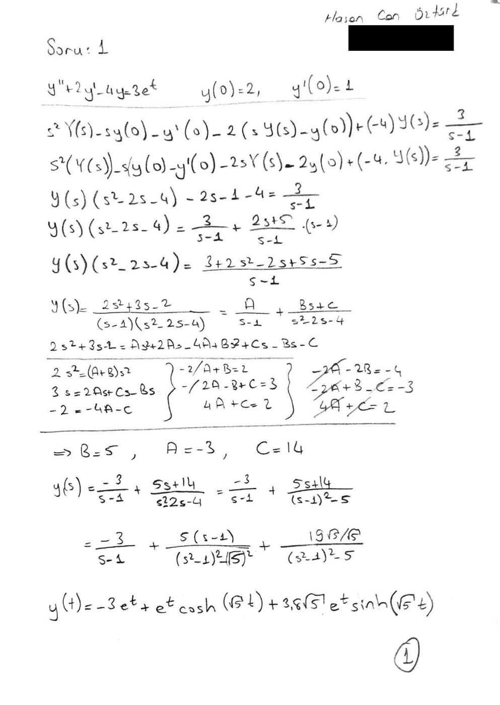
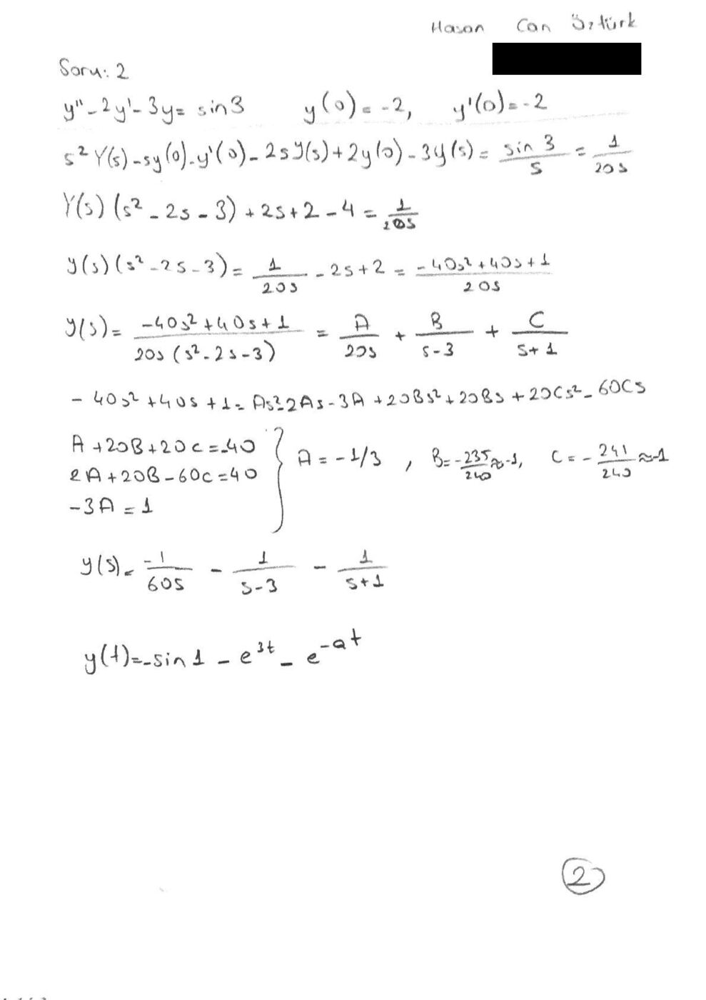
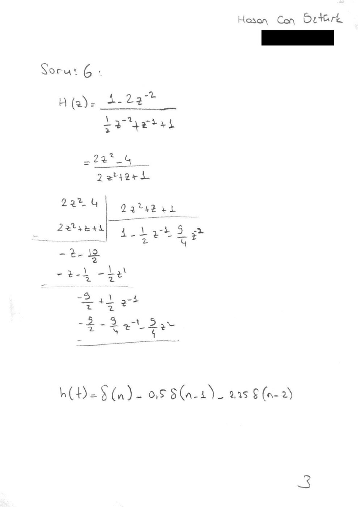

Bu yazı, Hasan Can Öztürk'ün Mayıs 2017'de Başkent Üniversitesi **EEM301 Sinyaller ve Sistemler I** dersi için hazırladığı Laplace ve z dönüşümü ödevini içeriyor. Ödevde altı soru var: ilk ikisi ilk değerli diferansiyel denklemlerin Laplace dönüşümüyle çözümü, 3. ve 4. sorular ters Laplace dönüşümü, 5. soru ilk koşullu bir fark denkleminin z dönüşümüyle çözümü, 6. soru ise ters z dönüşümü. Her soru MATLAB'ın sembolik araçlarıyla (`laplace`, `ilaplace`, `ztrans`, `iztrans`) çözülmüş; 1, 2 ve 6. soruların el yazısı çözümleri de taranmış. Taranmış sayfalarda öğrenci numarası kapatıldı. Taranmış PDF ve `soru1.m`–`soru6.m` dosyaları yazının sonunda ZIP olarak indirilebilir.

## Soru katsayıları

Her MATLAB dosyasının başında altı sorunun katsayıları aynı tablo hâlinde yorum olarak duruyor:

```matlab
%1)  2 -4  3  2  1
%2) -2 -3  3 -2 -2
%3)  2  1  1 -3 -2
%4)  1 -3  1 -3 18
%5)  3 -3  1  3  6
%6)  1 -2  4 -2
```

Örneğin 1. satır, y″ + 2y′ − 4y = 3eᵗ, y(0) = 2, y′(0) = 1 denklemine karşılık geliyor.

## Soru 1: y″ + 2y′ − 4y = 3eᵗ

İlk koşullar: y(0) = 2, y′(0) = 1. Her iki tarafın Laplace dönüşümü alınır:

- s²Y(s) − s·y(0) − y′(0) + 2(sY(s) − y(0)) − 4Y(s) = 3/(s − 1)
- Y(s)(s² + 2s − 4) = 3/(s − 1) + 2s + 5
- Y(s) = (2s² + 3s − 2) / ((s − 1)(s² + 2s − 4)) = A/(s − 1) + (Bs + C)/(s² + 2s − 4)

Kısmi kesirlerden **A = −3, B = 5, C = 14** bulunur:

- Y(s) = −3/(s − 1) + (5s + 14)/((s + 1)² − 5)



Kâğıttaki sonuç: y(t) = −3eᵗ + eᵗ cosh(√5 t) + 3,8√5 eᵗ sinh(√5 t).

*Not: El çözümünde 2y′ teriminin dönüşümü −2(sY − y(0)) olarak, payda da s² − 2s − 4 olarak yazılmış; doğrusu +2(sY − y(0)) ve s² + 2s − 4'tür. A, B, C değerleri yine doğru çıkıyor ama son adım hatalı: s² + 2s − 4 = (s + 1)² − 5 olduğundan doğru sonuç **y(t) = −3eᵗ + e⁻ᵗ[5 cosh(√5 t) + (9/√5) sinh(√5 t)]**'dir (5s + 14 = 5(s + 1) + 9). Kontrol: y(0) = −3 + 5 = 2, y′(0) = −3 − 5 + 9 = 1.*

MATLAB çözümü:

```matlab
syms s t Y  % s ve t domainlerini tanımlı hale getirmek için

denklem='D(D(y))(t)+2*D(y)(t)-4*y(t)=3*exp(t)'; %denklemimizin ilk değersiz hali

laplace_ilk=laplace(denklem,t,s); %denklemin ilk değersiz halinin laplace'si

laplace_son=subs(laplace_ilk,{'laplace(y(t),t,s)','y(0)','D(y)(0)'},{Y,2,1}); %ilk değer bilgilerinin eklenmesi
Y=solve(laplace_son,Y); % Y fonksiyonunun yalnız bırakılması

y=ilaplace(Y,s,t) % Y'nin ters laplace'si
```

## Soru 2: y″ − 2y′ − 3y = sin 3

İlk koşullar: y(0) = −2, y′(0) = −2. Sağ taraf sabit (sin 3), dönüşümü sin 3 / s. Kâğıtta sin 3 ≈ 1/20 alınmış:

- Y(s)(s² − 2s − 3) = 1/(20s) − 2s + 2 = (−40s² + 40s + 1)/(20s)
- Y(s) = (−40s² + 40s + 1) / (20s(s − 3)(s + 1)) = A/(20s) + B/(s − 3) + C/(s + 1)
- A = −1/3, B ≈ −1, C ≈ −1



*Not: sin 3 ≈ 1/20 yaklaşımı 3'ün derece alınmasından geliyor (sin 3° ≈ 0,052); MATLAB'daki `sin(3)` ise radyandır (≈ 0,141). Kâğıttaki son satır (y(t) = −sin 1 − e³ᵗ − e⁻ᵃᵗ) de eksik/hatalı. c = sin 3 denirse kesin çözüm **y(t) = (c/12 − 1)e³ᵗ + (c/4 − 1)e⁻ᵗ − c/3**'tür (özel çözüm −c/3; kökler 3 ve −1).*

MATLAB kodu Soru 1 ile aynı, yalnız denklem ve ilk değerler farklı:

```matlab
denklem='D(D(y))(t)-2*D(y)(t)-3*y(t)=sin(3)';
laplace_ilk=laplace(denklem,t,s);
laplace_son=subs(laplace_ilk,{'laplace(y(t),t,s)','y(0)','D(y)(0)'},{Y,-2,-2});
Y=solve(laplace_son,Y);
y=ilaplace(Y,s,t)
```

## Soru 3 ve 4: Ters Laplace dönüşümü

```matlab
syms s t Y

F= (2*s+1)/(s^2-3*s-2);   % Soru 3
f= ilaplace(F);
disp(f);

F= (s-3)/s*(s^2-3*s+18);  % Soru 4
f= ilaplace(F);
disp(f);
```

*Not: Soru 4'teki ifade MATLAB'da ((s − 3)/s)·(s² − 3s + 18) olarak okunur. Kastedilen F(s) = (s − 3)/(s(s² − 3s + 18)) ise doğru yazım `F=(s-3)/(s*(s^2-3*s+18));` olmalıdır.*

## Soru 5: Fark denkleminin z dönüşümüyle çözümü

Kodda çözülen denklem: y(n) + (3/2)y(n − 1) − (3/2)y(n − 2) = x(n), y(−1) = 3, y(−2) = 6, x(n) = (1/4)ⁿ u(n). Gecikmeli terimlerin ilk koşullu z dönüşümleri:

- Z{y(n − 1)} = z⁻¹Y(z) + y(−1)
- Z{y(n − 2)} = z⁻²Y(z) + z⁻¹y(−1) + y(−2)

```matlab
syms z n Y

% y(n)-2y(n-1)+3y(n-2)=x(n)  , y(-1)=5  , y(-2)=2  , x(n)=(1/2)^(n)u(n)

a=1;     % y(n)'in katsayısı
b=3/2;    % y(n-1)'in katsayısı
c=-3/2;     % y(n-2)'nin katsayısı
d=1;     % x(n)'in katsayısı
e= 1/4;  % x(n)'i oluşturan üstel terimin tabanındaki sabit

y_1= 3 ;   % y(-1)'in tanımlanması
y_2= 6 ;   % y(-2)'nin tanımlanması

X=ztrans(e^n*heaviside(n));     % x(n) in z domaine dönüştürülmesi

Y1=(z^(-1)*Y)+y_1;              % y(n-1)'in z domaine dönüştürülmesi

Y2=(z^(-2)*Y+(z^(-1)*y_1)+y_2); % y(n-2)'in z domaine dönüştürülmesi

f= a*Y+b*Y1+c*Y2-d*X;           % denklemin oluşturulması

sol=solve(f,Y);                 % denklemde Y(z)'nin yalnız bırakılması

pretty(sol);                    % yalnız bırakılan Y(z)nin daha sade yazılması

yn=iztrans(sol);                % ters z dönüşümü ile y[n]'in bulunması

disp(yn);
```

*Not: Kodun başındaki yorum satırı (y(n) − 2y(n − 1) + 3y(n − 2), y(−1) = 5, y(−2) = 2, x(n) = (1/2)ⁿu(n)) şablondan kalmış; asıl çözülen denklem a–e ve y_1, y_2 değişkenleriyle tanımlanan denklemdir.*

## Soru 6: Ters z dönüşümü

H(z) = (1 − 2z⁻²) / (1 + z⁻¹ − ½z⁻²). Kâğıtta pay ve payda 2z² ile çarpılıp uzun bölme yapılmış ve ilk terimler h(n) = δ(n) − 0,5δ(n − 1) − 2,25δ(n − 2) olarak bulunmuş.



```matlab
syms z n    %(z ve n sembolik değişkenleri tanımlanır)

X=(-2*z^(-2)+1)/(1+z^(-1)+(-1/2)*z^(-2)); %(fonksiyonumuz tanımlanır)

x=iztrans(X);  %(ters z dönüşümü yapılır)

disp(x);
```

*Not: Kâğıtta payda ½z⁻² + z⁻¹ + 1 (işareti +), çarpımdan sonra da 2z² + z + 1 yazılmış; koddaki H(z) ile 2z² ile çarpınca payda 2z² + 2z − 1 olur. Koddaki H(z) için uzun bölmenin (h(n) = −h(n − 1) + ½h(n − 2) + x(n) yinelemesi) ilk terimleri h(n) = δ(n) − δ(n − 1) − 0,5δ(n − 2) + 0·δ(n − 3) − 0,25δ(n − 4) + …'dir. Kâğıdın son satırında h(t) yazılmış; ayrık zamanda h(n) olmalıdır.*
