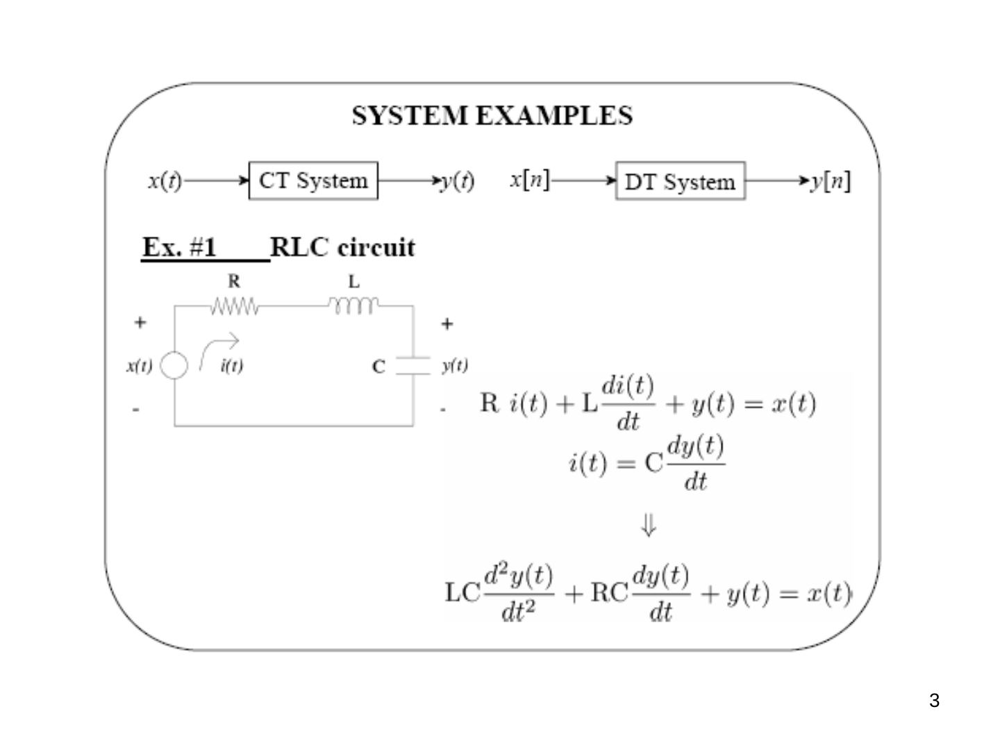

Bu yazı, Başkent Üniversitesi Elektrik-Elektronik Mühendisliği **EEM301 Sinyaller ve Sistemler I** dersinin ilk bölümü olan **"Systems"** (Sistemler) sunumudur. Sunumu dersin öğretim üyesi **Prof. Dr. Alper Uraz** hazırlamış; dosyanın son düzenlemesi Kasım 2005 tarihli. Sunum İngilizce olduğu için içerik İngilizce aktarıldı, formüller düz metne çevrildi ve hesaplanabilir sonuçlar kontrol edildi (iki yerde not düşüldü). Orijinal PowerPoint dosyası yazının sonunda indirilebilir.

## Course outline

EEM 301 Signals & Systems — chapters:

1. Systems
1. Signals
1. Convolution
1. Fourier Series
1. Discrete-time Fourier Series
1. Fourier Transform
1. Discrete-time Fourier Transform

This chapter (**Systems**) covers: classification of systems; differential equation models and the p-operator; difference equation models and the q-operator; solution of linear differential equations; solution of linear difference equations; stability.

## System examples

A CT system maps x(t) → y(t); a DT system maps x[n] → y[n].

**Ex. #1 — RLC circuit.** For a series RLC circuit driven by x(t), with the capacitor voltage y(t) as the output:

R i(t) + L di(t)/dt + y(t) = x(t), i(t) = C dy(t)/dt ⇒ LC d²y(t)/dt² + RC dy(t)/dt + y(t) = x(t)

**Ex. #2 — Mechanical system.** A mass M connected to a wall by a spring (K) and a damper (D), driven by force x(t), with displacement y(t). Force balance:

M d²y(t)/dt² = x(t) − K y(t) − D dy(t)/dt ⇒ M d²y(t)/dt² + D dy(t)/dt + K y(t) = x(t)

")

**Observation:** very different physical systems may be modeled mathematically in very similar ways.

1. A very rich class of systems (but by no means all systems of interest to us) are described by differential and difference equations.
1. Such an equation, by itself, does not completely describe the input-output behavior of a system: we need auxiliary conditions (initial conditions, boundary conditions).
1. In some cases the system of interest has time as the natural independent variable and is causal. However, that is not always the case.
1. Very different physical systems may have very similar mathematical descriptions.

## Classification of systems

### Static and dynamic systems

A system is **static** if its outputs at any instant depend only on the present value of the inputs. A circuit that has only resistors is a static system. A system is **dynamic** if its outputs depend on the present as well as the past values of the inputs; such a system may be regarded as one with memory. A circuit that has one or more energy storing elements such as C or L is a dynamic system. All dynamic systems can be represented mathematically by differential/difference equations.

### Causal (nonanticipatory) and noncausal (anticipatory) systems

- A system is **causal** if the output does not anticipate future values of the input, i.e. if the output at any time depends only on values of the input up to that time.
- *All* real-time physical systems are causal, because time only moves forward. Effect occurs after cause. (Imagine if you owned a noncausal system whose output depends on tomorrow's stock price.)
- Causality does *not* apply to spatially varying signals (we can move both left and right, up and down).
- Causality does *not* apply to systems processing *recorded* signals, e.g. taped sports games vs. live broadcast.

Mathematically (in CT): a system x(t) → y(t) is causal if, when x1(t) → y1(t), x2(t) → y2(t) and x1(t) = x2(t) for all t ≤ t0, then y1(t) = y2(t) for all t ≤ t0.

**Causal or noncausal?**

- y(t) = x²(t − 1): e.g. y(5) depends on x(4) … causal
- y(t) = x(t + 1): e.g. y(5) = x(6), y depends on the future ⇒ noncausal
- y[n] = x[−n]: e.g. y[5] = x[−5] is ok, but y[−5] = x[5], y depends on the future ⇒ noncausal
- y[n] = (1/2)^(n+1) x³[n − 1]: e.g. y[5] depends on x[4] … causal

### Time-invariant and time-varying systems

Informally, a system is **time-invariant (TI)** if its behavior does not depend on what time it is.

- Mathematically (in DT): a system x[n] → y[n] is TI if for *any* input x[n] and *any* time shift n0: if x[n] → y[n], then x[n − n0] → y[n − n0].
- Similarly for a CT time-invariant system: if x(t) → y(t), then x(t − t0) → y(t − t0).

**Time-invariant or time-varying?**

- y(t) = x²(t + 1): x(t − t0) → y(t − t0) = x²((t − t0) + 1) ⇒ **TI**
- y[n] = (1/2)^(n+1) x³[n − 1]: x[n − n0] → y1[n] = (1/2)^(n+1) x³[n − n0 − 1] ≠ y[n − n0] ⇒ **time-varying** (not time-invariant)

**Now we can deduce something!** Fact: if the input to a TI system is periodic, then the output is periodic with the same period. "Proof": suppose x(t + T) = x(t) and x(t) → y(t). Then by TI, x(t + T) → y(t + T). These are the same input, so they must be the same output, i.e. y(t) = y(t + T).

### Linear and nonlinear systems

A (CT) system is **linear** if it has the superposition property: if x1(t) → y1(t) and x2(t) → y2(t), then a·x1(t) + b·x2(t) → a·y1(t) + b·y2(t).

- y[n] = x²[n]: nonlinear, TI, causal
- y(t) = x(2t): linear, *not* TI, noncausal

Can you find systems with other combinations? E.g. linear, TI, noncausal; linear, not TI, causal.

**Superposition** in general: if x_k[n] → y_k[n], then Σ_k a_k x_k[n] → Σ_k a_k y_k[n].

![DT LTI sistem örneği: x2[n] = 2x1[n−1] − x1[n−2] olduğundan y2[n] = 2y1[n−1] − y1[n−2]](s-15.jpg "Example: DT LTI system — superposition and time shift")

## Differential equation models and the p-operator

In general, a linear CT system is described by an n-th order ordinary differential equation

a_n dⁿy/dtⁿ + a_(n−1) dⁿ⁻¹y/dtⁿ⁻¹ + … + a1 dy/dt + a0 y = b_m dᵐx/dtᵐ + … + b0 x

where x is the input, y is the output, a_i, b_j are real constants and m, n are integers. The order n of the differential equation gives the order of the system, and usually n ≥ m.

We introduce the **operator p** to replace d/dt:

(a_n pⁿ + a_(n−1) pⁿ⁻¹ + … + a1 p + a0) y(t) = (b_m pᵐ + b_(m−1) pᵐ⁻¹ + … + b1 p + b0) x(t), or **D(p) y(t) = N(p) x(t)**

where D(p) and N(p) are polynomials in p. Note that p·y(t) is simply a short-hand notation for the first order derivative with respect to time; y(t)·p has no meaning, i.e. py(t) ≠ y(t)p — it does not satisfy commutativity.

⇒ y(t) = L(p) x(t), where **L(p) = N(p)/D(p)** is called the *system operator*, the *operational transfer function* or the *system function*. L(p) is a rational function, and for most physical systems a proper rational function (n ≥ m).

**Example:** for a series RC circuit, Kirchhoff's voltage law gives RC dv/dt + v = E. In operator notation (RCp + 1) v = E, and the system operator is L(p) = 1/(RCp + 1).

### Deterministic and stochastic systems

A system is **deterministic** if the system operator L(p) as well as the input(s) are known exactly. For such a system the output for any given input can be determined for all future time if all the initial conditions are known.

If the parameters of the system operator or the input are not known precisely but can be described only in a statistical sense, such systems are called **stochastic**. Most real systems are subject to random disturbances and are therefore stochastic in nature. However, we will consider only linear time-invariant (LTI) deterministic systems.

### Continuous-time and discrete-time systems

If time takes any value in the continuous set of real numbers, such systems are called **continuous-time (CT)** systems — for example RLC circuits or mechanical systems. With digital components and devices, the input and output signals are of interest only at specific instants t = nT, where n is an integer and T is the sampling interval. Such systems are called **discrete-time (DT)** systems.

## Difference equation models and the q-operator

DT LTI systems are described not by differential but by **difference equations**. A general form of order N is

y(n) + a1 y(n−1) + … + a_(N−1) y(n−N+1) + a_N y(n−N) = b0 x(n) + b1 x(n−1) + … + b_N x(n−N)

or y(n) = Σ (k = 0…N) b_k x(n−k) − Σ (k = 1…N) a_k y(n−k).

The input and output are defined only at discrete values of time nT; x(n), n = 0, 1, … are the **input sequences** and y(n) the **output sequences**.

Let **q** denote the *shift operator* that advances a sequence by one time interval: q x(n) = x(n+1). Its inverse is the *unit delay operator*: q⁻¹ x(n) = x(n−1). The general difference equation becomes

(1 + a1 q⁻¹ + … + a_N q⁻ᴺ) y(n) = (b0 + b1 q⁻¹ + … + b_N q⁻ᴺ) x(n)

Multiplying both sides by qᴺ:

(qᴺ + a1 qᴺ⁻¹ + … + a_N) y(n) = (b0 qᴺ + b1 qᴺ⁻¹ + … + b_N) x(n)

Hence the linear **DT system function** is

L(q) = N(q)/D(q) = (b0 qᴺ + b1 qᴺ⁻¹ + … + b_N) / (qᴺ + a1 qᴺ⁻¹ + … + a_N)

**Example — savings account.** A savings account pays compound interest daily. Let the original amount be p0 and the rate of interest r percent per annum. At the end of the first day the interest is r/(365 × 100) × p(0), where p(0) = p0. So:

p(1) = p(0) + r/(365×100) × p(0), p(2) = p(1) + r/(365×100) × p(1), … ⇒ **p(n+1) = (1 + r/36500) p(n)**

This is a first order LTI discrete-time model where the period T is one day.

**Example.** 3y(n) + 4y(n−1) + 7y(n−2) = 2x(n) + 5x(n−1). With the q-operator: (3 + 4q⁻¹ + 7q⁻²) y(n) = (2 + 5q⁻¹) x(n). Multiplying by q²: (3q² + 4q + 7) y(n) = (2q² + 5q) x(n), i.e. D(q) y(n) = N(q) x(n), and the system function is

L(q) = (2q² + 5q)/(3q² + 4q + 7)

**Exercise:** classify each system as static/dynamic (S/D), linear/nonlinear (L/NL), time-invariant/time-varying (TI/TV), CT/DT and give its order:

- y(t) = x²(t) + 4
- y(t) = t x(t)
- dy(t)/dt + t y(t) = x(t)
- dy(t)/dt + y²(t) = x(t)
- d²y/dt² + dy/dt + 3y = x
- d²y/dt² + dy/dt + 3y = x + 2x²
- d²y/dt² + y dy/dt + 3y = x
- y(k) + 2y(k−1) − 3y(k−2) = 2x(k) + x(k−1)
- y(k) + 2y(k−1) − 3y(k−2) = 2x(k) + x(k+1)
- y(k) = k x(k) + k² x(k−1)
- y(k) = 2x(k) + 3[x(k−1)]²

## Solution of linear differential equations

With operator notation D(p) y(t) = N(p) x(t), where D(p) is a polynomial of degree n with the coefficient of pⁿ equal to 1 (a *monic* polynomial). For a unique solution we need n initial conditions (ic): the values of y and its first n−1 derivatives at t = 0.

The complete solution consists of two parts, **y(t) = yc(t) + yp(t)**:

1. **Complementary function** yc(t): the solution of the homogeneous equation (no input, x(t) = 0). Also known as the natural (free) or zero-input response.
1. **Particular integral** yp(t): the component due to the forcing function x(t), independent of the initial conditions. Also called the forced or zero-state response.

### Determining the complementary function

Homogeneous equation: D(p) y(t) = 0. Characteristic equation: D(p) = a_n pⁿ + … + a1 p + a0 = 0, whose n roots r_i are called **natural modes**. The complementary function has the form

yc(t) = A1 y1(t) + A2 y2(t) + … + An yn(t)

where the A_i depend on the ic as well as the particular integral, and:

1. For each distinct real root r_i, y_i(t) = e^(r_i t).
1. For each pair of complex conjugate roots a ± jb: e^(at) cos bt and e^(at) sin bt.
1. For each real root with multiplicity m: e^(rt), t e^(rt), …, t^(m−1) e^(rt).
1. For a ± jb with multiplicity m: e^(at) cos bt, e^(at) sin bt, t e^(at) cos bt, t e^(at) sin bt, …, t^(m−1) e^(at) cos bt, t^(m−1) e^(at) sin bt.

**Examples**

(a) d³y/dt³ + 8 d²y/dt² + 37 dy/dt + 50y = x ⇒ D(p) = p³ + 8p² + 37p + 50 = 0 ⇒ roots −2, −3 ± j4

yc(t) = A1 e^(−2t) + A2 e^(−3t) cos 4t + A3 e^(−3t) sin 4t

(b) D(p) = p² + 10p + 25 = 0 ⇒ roots −5, −5 ⇒ yc(t) = A1 e^(−5t) + A2 t e^(−5t)

### Determining the particular integral

Non-homogeneous equation: D(p) yp(t) = N(p) x(t). For the special input x(t) = A e^(st), where s is real or complex:

yp(t) = [N(p)/D(p)] at p = s × A e^(st) = (N(s)/D(s)) A e^(st)

This method does not apply to all inputs. For a sinusoid, x(t) = A cos ωt = Re[A e^(jωt)] or A sin ωt = Im[A e^(jωt)] with s = jω. More generally x(t) = A e^(at) cos bt = Re[A e^(st)] with s = a + jb.

**Examples**

(a) d³y/dt³ + 8 d²y/dt² + 37 dy/dt + 50y = 4e^(−3t) ⇒ (p³ + 8p² + 37p + 50) y(t) = 4e^(−3t)

yp(t) = [1/(p³ + 8p² + 37p + 50)] at p = −3 × 4e^(−3t) = −0.25 e^(−3t)

(b) With x(t) = 4 cos 3t = Re[4e^(st)], s = j3:

yp(t) = Re[4e^(j3t)/(−22 + j84)] = −(22/1885) cos 3t + (84/1885) sin 3t

### The complete solution

For example (a) above:

y(t) = A1 e^(−2t) + A2 e^(−3t) cos 4t + A3 e^(−3t) sin 4t − 0.25 e^(−3t)

where A1, A2, A3 must satisfy the ic. Let y(0) = 1, y′(0) = 2, y″(0) = 1. At t = 0:

- y(0) = A1 + A2 − 0.25 = 1
- y′(0) = −2A1 − 3A2 + 4A3 + 0.75 = 2
- y″(0) = −4A1 − 7A2 − 24A3 − 2.25 = 1

⇒ **A1 = 42/17, A2 = −83/68, A3 = 43/68**

*Not: y″(0) denkleminde A1 teriminin işareti + olmalı (e^(−2t)'nin ikinci türevi +4e^(−2t)); verilen sonuçlar (42/17, −83/68, 43/68) bu düzeltilmiş denklemi sağlıyor.*

Useful derivatives: if y(t) = A e^(at) cos bt, then y′(t) = A a e^(at) cos bt − A b e^(at) sin bt; if y(t) = A e^(at) sin bt, then y′(t) = A a e^(at) sin bt + A b e^(at) cos bt. A more direct approach for the complete solution is provided by the Laplace transform.

## Solution of linear difference equations

A linear difference equation of order N:

y(n) + a1 y(n−1) + … + a_N y(n−N) = b0 x(n) + b1 x(n−1) + … + b_N x(n−N)

⇒ y(n) = Σ b_k x(n−k) − Σ a_k y(n−k): the n-th output sample is a linear combination of the present and N past inputs and the N past outputs. This gives a simple "brute force" solution. A closed-form solution follows the same steps as the continuous case, using (1 + a1 q⁻¹ + … + a_N q⁻ᴺ) y(n) = (b0 + b1 q⁻¹ + … + b_N q⁻ᴺ) x(n). The complete solution is y(n) = yc(n) + yp(n).

### The complementary solution

Consider the homogeneous equation with characteristic polynomial D(q) = qᴺ + a1 qᴺ⁻¹ + … + a_(N−1) q + a_N = 0. If r is any root of D(q), the sequence y(n) = A rⁿ is a solution. For distinct roots:

yc(n) = Σ (k = 1…N) A_k y_k(n) = Σ A_k r_kⁿ

Steps:

1. Calculate the N roots r_k of D(q).
1. For each distinct real root, the sequence is r_kⁿ.
1. For each pair of complex conjugate roots a ± jb, the sequences are (a ± jb)ⁿ. In polar form, a + jb = √(a² + b²) ∠ tan⁻¹(b/a) = r∠φ = r e^(jφ), so the two sequences may be written as rⁿ cos nφ and rⁿ sin nφ, from rⁿ e^(jnφ) = rⁿ cos nφ + j rⁿ sin nφ.
1. For a multiple real root r of multiplicity m: rⁿ, n rⁿ, n² rⁿ, …, n^(m−1) rⁿ.
1. For complex conjugate roots r e^(±jφ) of multiplicity m: rⁿ cos nφ, rⁿ sin nφ; n rⁿ cos nφ, n rⁿ sin nφ; …; n^(m−1) rⁿ cos nφ, n^(m−1) rⁿ sin nφ.

**Examples**

(a) y(n) − 8y(n−1) + 37y(n−2) − 50y(n−3) = 0 ⇒ D(q) = q³ − 8q² + 37q − 50 = 0 ⇒ r1 = 2, r2,3 = 3 ± j4 = 5 e^(±j0.93)

yc(n) = A1 2ⁿ + A2 5ⁿ cos 0.93n + A3 5ⁿ sin 0.93n

(b) y(n+3) − 7y(n+2) + 16y(n+1) − 12y(n) = 0 ⇒ D(q) = q³ − 7q² + 16q − 12 = 0 ⇒ r1 = r2 = 2 (m = 2), r3 = 3

yc(n) = A1 2ⁿ + A2 n 2ⁿ + A3 3ⁿ

### The particular solution

The particular solution yp(n) of the non-homogeneous equation depends on the forcing function and is also called the **forced response**. As with differential equations, it is readily found for complex exponential sequences.

**Example:** y(n+3) − 8y(n+2) + 37y(n+1) − 50y(n) = 8(0.5)ⁿ ⇒ (q³ − 8q² + 37q − 50) y(n) = 8(0.5)ⁿ

yp(n) = 8(0.5)ⁿ / D(0.5) = 8(0.5)ⁿ / (−33.375) = −(64/267)(0.5)ⁿ

### The complete solution

y(n) = yc(n) + yp(n). The unknown constants are chosen so that all boundary conditions are satisfied; for an N-th order difference equation, N initial conditions must be given.

**Example:** the previous example with y(0) = 2, y(1) = 3, y(2) = 5:

y(n) = A1 2ⁿ + A2 5ⁿ cos 0.93n + A3 5ⁿ sin 0.93n − (64/267)(0.5)ⁿ

- y(0) = A1 + A2 − 64/267 = 2
- y(1) = 2A1 + 5A2 cos 0.93 + 5A3 sin 0.93 − 32/267 = 3
- y(2) = 4A1 + 25A2 cos 1.85 + 25A3 sin 1.85 − 16/267 = 5

Slaytta verilen sonuç: A1 = 2.1886, A2 = 0.05108, A3 = −0.35666.

*Not: Bu üç denklem çözüldüğünde A1 ≈ 2.49, A2 ≈ −0.25, A3 ≈ −0.28 bulunuyor; slayttaki değerler ilk iki denklemi yaklaşık sağlıyor ama y(2) = 5 koşulunu sağlamıyor (yerine konunca y(2) ≈ −0.23 çıkıyor).*

There is also a direct approach for difference equations using the z-transform.

## Stability

Stability is directly related to the usefulness of the system response. A system is **stable** if the output remains bounded for all bounded inputs.

**CT:** the natural response of an LTI CT system remains bounded ⇔ all roots of D(p) satisfy: (i) the real parts of all simple roots are ≤ 0, (ii) the real parts of all multiple roots are < 0.

**DT:** the natural response of an LTI DT system remains bounded ⇔ all roots of D(q) satisfy: (i) the magnitude of all simple roots is ≤ 1, (ii) the magnitude of all multiple roots is < 1.

For stability of the complete response in the **bounded-input bounded-output (BIBO)** sense:

- An LTI CT system is BIBO stable if all roots of D(p) have negative real parts; unstable if the real part of any root is ≥ 0.
- An LTI DT system is BIBO stable if all roots of D(q) have magnitudes less than one; unstable if the magnitude of any root is ≥ 1.

Simple roots of D(p) with zero real part (or of D(q) with unit magnitude) are excluded because a bounded natural response does not necessarily imply stability: such roots give a bounded sinusoid in the natural response, but the particular solution grows without bound if the input is a sinusoid of the same frequency.

**Example:** y″(t) + 4y(t) = x(t) ⇒ D(p) = p² + 4 = 0 ⇒ p1,2 = ±j2. The complementary function yc(t) = A cos 2t + B sin 2t is bounded. For the input x(t) = 2 cos 2t, the particular integral is yp(t) = 0.5 t sin 2t, which is unbounded although the input itself is bounded.
