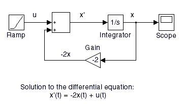
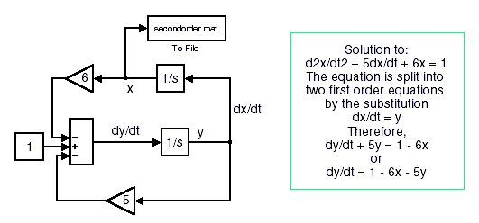
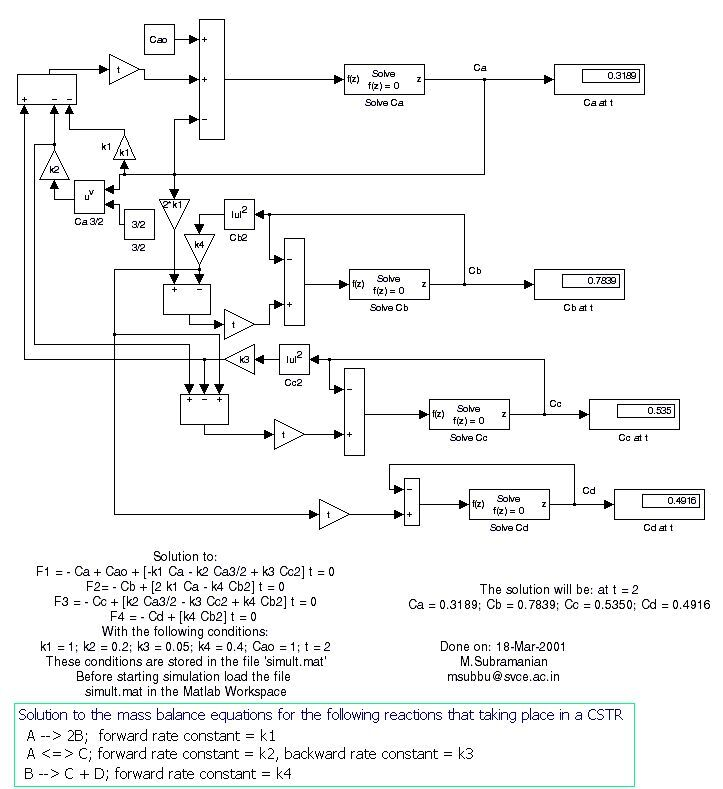

The **PISim** folder in the EEM301 archive contains M. Subramanian's Simulink examples from 2001; the model descriptions include the institutional address **svce.ac.in**. The 19 MDL model files and 14 GIF block diagrams can be downloaded as a ZIP at the end of the post. The files are in the Simulink 3-era format; the review below is based on the model texts and diagrams, and the models were not run.

*This content belongs to a third-party source; it is shared for archival and nostalgic purposes with attribution. It will be removed at the request of the rights holder.*

## First-order differential equation

**FirstOrderODE.mdl** builds the equation x′(t)=−2x(t)+u(t) using an integrator, a gain of −2, a summing junction and a ramp input. The initial condition is x(0)=0. The integrator output is x, and the summing junction output is x′.

Source excerpt from the gain block in the model:

```matlab
Block {
  BlockType Gain
  Name "Gain"
  Gain "-2"
}
```

*Note: This block is the text representation of the MDL file, not a MATLAB script. The ZIP contains the full model with its connections and other blocks.*



## Second-order equation and transfer function

**SolutionToSecondOrderODE_1.mdl** and **SolutionToSecondOrderODE_2.mdl** represent the equation x″+5x′+6x=1 with two different drawings. The first model explicitly shows the decomposition x′=y and y′=1−6x−5y. Both integrators have an initial value of zero. The names secondorder.mat and 2ndOrder.mat are used for the output logs.



**SecondOdrTransferFunction.mdl** excites the transfer function 10/(s²+1.6s+4) with a step of magnitude 4. Source coefficients:

```matlab
BlockType TransferFcn
Numerator "[10]"
Denominator "[1 1.6 4]"
```

## Coupled first-order equations

**TwoFirstOrderODE_1.mdl**:

- dCₐ/dt=−4Cₐ+Cᵦ.
- dCᵦ/dt=4(Cₐ−Cᵦ).
- Cₐ(0)=100, Cᵦ(0)=0.

The two integrators use each other's outputs. The results are configured to be saved under the file names CA.mat and CB.mat.

**TwoFirstOrderODE_2.mdl**:

- 2dCₐ₁/dt+Cₐ₁=Cₐ₀.
- 4dCₐ₂/dt+Cₐ₂=Cₐ₁.
- Cₐ₀=1; both initial conditions are zero.

Here the output of the first system feeds the second system; the gains 1/2 and 1/4 determine the time constants.

## Liquid level dynamics

**LiquidLevelDynamics.mdl** uses the equation dh/dt=(Fᵢ−kₒ√h)/A for a cylindrical tank. Fᵢ=1, 1/A=0.01, kₒ=0.01 and h(0)=0. The square-root block represents the nonlinear dependence of the outlet flow on the level.

**TimeDomain_ControlofTankLevel.mdl**:

A dh′/dt+K꜀h′+(K꜀/Tᵢ)∫h′dt=F′ᵢ.

The model uses A=2, K꜀=1 and 1/Tᵢ=0.2. The description cites Example 11.4 in George Stephanopoulos's Chemical Process Control; the file is the Simulink implementation prepared for this example.

**TwoTanksInSeriesImpulseInput.mdl** connects two non-interacting tanks:

- A₁dh₁/dt+h₁/R₁=F₀.
- A₂dh₂/dt+h₂/R₂=h₁/R₁.
- A₁=A₂=10, R₁=0.1, R₂=0.35, F₀=20.

The steady-state level of the first tank is given as 2, and that of the second as 7. The impulse in the first tank is represented by adding 1 to the initial level, giving h₁(0)=3; h₂(0)=7.

## Feedback and PID

**FeedbackControl.mdl** connects a gain of 1.6 with the blocks 5/(s+1) and 1/(2s+1) in series and uses unity negative feedback. The reference step is 0.1.

**PID_Controller.mdl** combines proportional, integral and derivative paths. The controller has the form G꜀(s)=K[1+1/(Tᵢs)+T𝒹s]. The parameters K, Tᵢ and T𝒹 appear in the model as symbolic values.

- **PID_StepChangeInSetPoint.mdl**: response to a reference change; process 2/(s²+2s+1), mask values 1, 1, 2.
- **PID_StepChangeInLoad_1.mdl** and **PID_StepChangeInLoad_2.mdl**: two models showing the response to a load change with different load connections; mask values 1, 1, 1.

## Nonlinear algebraic equations

**NonLinearEquations.mdl** sets up the following equations using four Algebraic Constraint blocks:

F₁=−Cₐ+Cₐ₀+[−k₁Cₐ−k₂Cₐ^(3/2)+k₃C꜀²]t=0,

F₂=−Cᵦ+[2k₁Cₐ−k₄Cᵦ²]t=0,

F₃=−C꜀+[k₂Cₐ^(3/2)−k₃C꜀²+k₄Cᵦ²]t=0,

F₄=−C𝒹+[k₄Cᵦ²]t=0.

The source parameters are k₁=1, k₂=0.2, k₃=0.05, k₄=0.4, Cₐ₀=1 and t=2. The description gives the solution Cₐ=0.3189, Cᵦ=0.7839, C꜀=0.5350 and C𝒹=0.4916.



*Note: The model refers to the file simult.mat to load parameters; this file is not in the source folder. The required parameter values are present in the model's description. This missing input file should not be confused with the MAT files produced by the other models.*

## Vapor pressure and saturation temperature

**VapPress.mdl** uses the Antoine relation: P=exp[A−B/(C+T)]. The given constants are A=14.5463, B=2940.46 and C=237.22; the input temperature is 80. The expression in the model:

```matlab
Expr "exp(u[1] - u[2]/(u[3] + u[4]))"
```

**Sat_Temp.mdl** is the block layout that computes the saturation temperature for P=150 using the inverse relation T=B/(A−lnP)−C:

```matlab
Expr "(u[2]/(u[1] - log(u[4])))-u[3]"
```

## Bubble and dew pressure

**BUBL_PY.MDL** produces the bubble pressure P and the vapor composition Y from the liquid composition X and the pure-component vapor pressures. **DEW_PX.MDL** works in the reverse direction, producing the dew pressure P and the liquid composition X from the vapor composition Y.

The ideal mixture relations are P=ΣxᵢPᵢˢᵃᵗ, yᵢ=xᵢPᵢˢᵃᵗ/P; for the dew calculation they are 1/P=Σyᵢ/Pᵢˢᵃᵗ and xᵢ=yᵢP/Pᵢˢᵃᵗ. Both models use T=110 and the composition vector [0.3; 0.45; 0.25].

The Antoine constants of the three components are [14.5463;2940.46;237.22], [14.2724;2945.47;224] and [14.2043;2972.64;209], respectively. Since the source model does not explain the physical units of the numbers, no units are assumed here.
