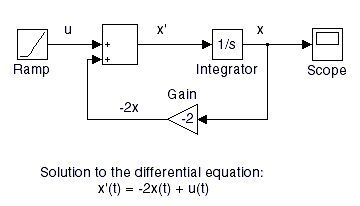
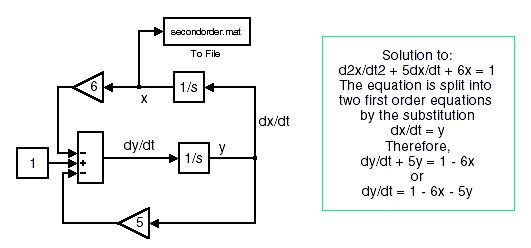
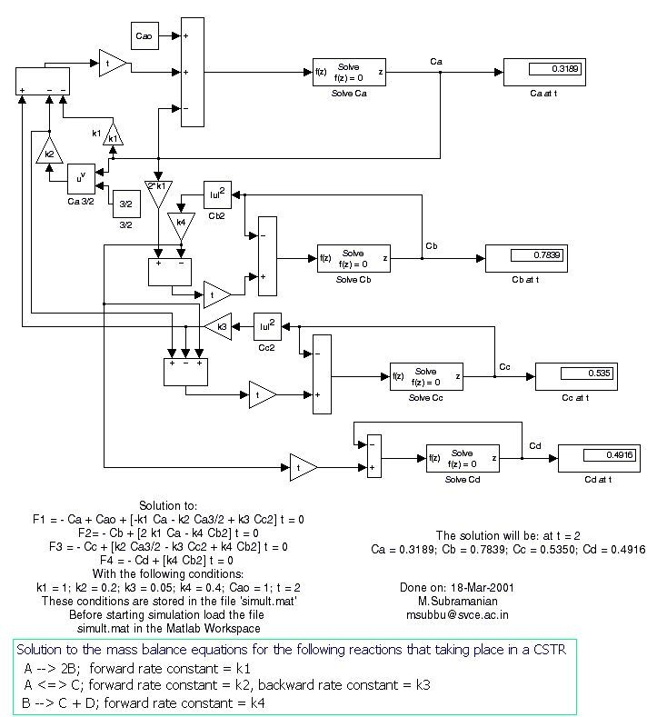

EEM301 arşivindeki **PISim** klasörü, M. Subramanian’ın 2001 tarihli Simulink örneklerini içeriyor; model açıklamalarında **svce.ac.in** kurum adresi yer alıyor. 19 MDL model dosyası ve 14 GIF blok şeması yazının sonunda ZIP olarak indirilebilir. Dosyalar Simulink 3 dönemi biçiminde; aşağıdaki inceleme model metinlerine ve şemalara dayanıyor, modeller çalıştırılmadı.

*Bu içerik üçüncü taraf bir kaynağa aittir; arşiv ve nostalji amacıyla kaynak belirtilerek paylaşılmıştır. Hak sahibinin talebi hâlinde kaldırılır.*

## Birinci dereceden diferansiyel denklem

**FirstOrderODE.mdl**, x′(t)=−2x(t)+u(t) denklemini bir integratör, −2 kazancı, toplama düğümü ve rampa girişiyle kurar. Başlangıç koşulu x(0)=0’dır. İntegratör çıkışı x, toplama düğümünün çıkışı x′ olur.

Modeldeki kazanç bloğundan kaynak parçası:

```matlab
Block {
  BlockType Gain
  Name "Gain"
  Gain "-2"
}
```

*Not: Bu blok MATLAB komut dosyası değil, MDL dosyasının metin gösterimidir. ZIP’te bağlantılar ve diğer bloklarla birlikte tam model bulunur.*



## İkinci dereceden denklem ve transfer fonksiyonu

**SolutionToSecondOrderODE_1.mdl** ve **SolutionToSecondOrderODE_2.mdl**, x″+5x′+6x=1 denklemini iki farklı çizimle temsil eder. İlk model x′=y ve y′=1−6x−5y ayrımını açıkça gösterir. İki integratörün başlangıç değeri sıfırdır. Çıkış kaydı için secondorder.mat ve 2ndOrder.mat adları kullanılmıştır.



**SecondOdrTransferFunction.mdl**, 10/(s²+1,6s+4) transfer fonksiyonunu 4 büyüklüğündeki basamakla uyarır. Kaynak katsayıları:

```matlab
BlockType TransferFcn
Numerator "[10]"
Denominator "[1 1.6 4]"
```

## Bağlı birinci dereceden denklemler

**TwoFirstOrderODE_1.mdl**:

- dCₐ/dt=−4Cₐ+Cᵦ.
- dCᵦ/dt=4(Cₐ−Cᵦ).
- Cₐ(0)=100, Cᵦ(0)=0.

İki integratör birbirinin çıkışını kullanır. Sonuçlar CA.mat ve CB.mat dosya adlarıyla kaydedilecek şekilde yapılandırılmıştır.

**TwoFirstOrderODE_2.mdl**:

- 2dCₐ₁/dt+Cₐ₁=Cₐ₀.
- 4dCₐ₂/dt+Cₐ₂=Cₐ₁.
- Cₐ₀=1; iki başlangıç koşulu sıfır.

Burada birinci sistemin çıkışı ikinci sistemi besler; 1/2 ve 1/4 kazançları zaman sabitlerini belirler.

## Sıvı seviyesi dinamiği

**LiquidLevelDynamics.mdl** silindirik tank için dh/dt=(Fᵢ−kₒ√h)/A denklemini kullanır. Fᵢ=1, 1/A=0,01, kₒ=0,01 ve h(0)=0’dır. Karekök bloğu çıkış debisinin seviyeye doğrusal olmayan bağımlılığını temsil eder.

**TimeDomain_ControlofTankLevel.mdl**:

A dh′/dt+K꜀h′+(K꜀/Tᵢ)∫h′dt=F′ᵢ.

Model A=2, K꜀=1 ve 1/Tᵢ=0,2 kullanır. Açıklama, George Stephanopoulos’un Chemical Process Control kitabındaki Örnek 11.4’e atıf yapar; dosya bu örnek için hazırlanmış Simulink uygulamasıdır.

**TwoTanksInSeriesImpulseInput.mdl** iki etkileşimsiz tankı bağlar:

- A₁dh₁/dt+h₁/R₁=F₀.
- A₂dh₂/dt+h₂/R₂=h₁/R₁.
- A₁=A₂=10, R₁=0,1, R₂=0,35, F₀=20.

Birinci tankın durağan seviyesi 2, ikinci tankınki 7 olarak verilmiştir. Birinci tanktaki dürtü, başlangıç seviyesine 1 eklenerek h₁(0)=3 şeklinde temsil edilir; h₂(0)=7’dir.

## Geri besleme ve PID

**FeedbackControl.mdl**, 1,6 kazancı ile 5/(s+1) ve 1/(2s+1) bloklarını seri bağlayıp birim negatif geri besleme kullanır. Referans basamağı 0,1’dir.

**PID_Controller.mdl**, oransal, integral ve türev yollarını birleştirir. Denetleyici G꜀(s)=K[1+1/(Tᵢs)+T𝒹s] biçimindedir. K, Tᵢ ve T𝒹 parametreleri modelde sembolik değerler olarak yer alır.

- **PID_StepChangeInSetPoint.mdl**: referans değişimine tepki; proses 2/(s²+2s+1), maske değerleri 1, 1, 2.
- **PID_StepChangeInLoad_1.mdl** ve **PID_StepChangeInLoad_2.mdl**: yük değişimine tepkiyi farklı yük bağlantılarıyla gösteren iki model; maske değerleri 1, 1, 1.

## Doğrusal olmayan cebirsel denklemler

**NonLinearEquations.mdl**, dört Algebraic Constraint bloğuyla şu denklemleri kurar:

F₁=−Cₐ+Cₐ₀+[−k₁Cₐ−k₂Cₐ^(3/2)+k₃C꜀²]t=0,

F₂=−Cᵦ+[2k₁Cₐ−k₄Cᵦ²]t=0,

F₃=−C꜀+[k₂Cₐ^(3/2)−k₃C꜀²+k₄Cᵦ²]t=0,

F₄=−C𝒹+[k₄Cᵦ²]t=0.

Kaynak parametreleri k₁=1, k₂=0,2, k₃=0,05, k₄=0,4, Cₐ₀=1 ve t=2’dir. Açıklamada Cₐ=0,3189, Cᵦ=0,7839, C꜀=0,5350 ve C𝒹=0,4916 çözümü verilmiştir.



*Not: Model parametreleri yüklemek için simult.mat dosyasına başvuruyor; bu dosya kaynak klasörde yok. Gerekli parametre değerleri modelin açıklamasında mevcut. Diğer modellerin ürettiği MAT dosyalarıyla bu eksik giriş dosyası karıştırılmamalıdır.*

## Buhar basıncı ve doyma sıcaklığı

**VapPress.mdl** Antoine bağıntısını kullanır: P=exp[A−B/(C+T)]. Verilen sabitler A=14,5463, B=2940,46 ve C=237,22; giriş sıcaklığı 80’dir. Modeldeki ifade:

```matlab
Expr "exp(u[1] - u[2]/(u[3] + u[4]))"
```

**Sat_Temp.mdl**, ters bağıntı T=B/(A−lnP)−C ile P=150 için doyma sıcaklığını hesaplayan blok düzenidir:

```matlab
Expr "(u[2]/(u[1] - log(u[4])))-u[3]"
```

## Kabarcık ve çiy basıncı

**BUBL_PY.MDL**, sıvı bileşimi X ve saf bileşen buhar basınçlarından kabarcık basıncı P ile buhar bileşimi Y üretir. **DEW_PX.MDL** ters yönde, buhar bileşimi Y’den çiy basıncı P ve sıvı bileşimi X üretir.

İdeal karışım bağıntıları P=ΣxᵢPᵢˢᵃᵗ, yᵢ=xᵢPᵢˢᵃᵗ/P; çiy hesabında 1/P=Σyᵢ/Pᵢˢᵃᵗ ve xᵢ=yᵢP/Pᵢˢᵃᵗ biçimindedir. İki modelde T=110 ve bileşim vektörü [0,3; 0,45; 0,25] kullanılır.

Üç bileşenin Antoine sabitleri sırasıyla [14,5463;2940,46;237,22], [14,2724;2945,47;224] ve [14,2043;2972,64;209]’dur. Kaynak model, sayıların fiziksel birimlerini açıklamadığından burada birim varsayılmadı.
