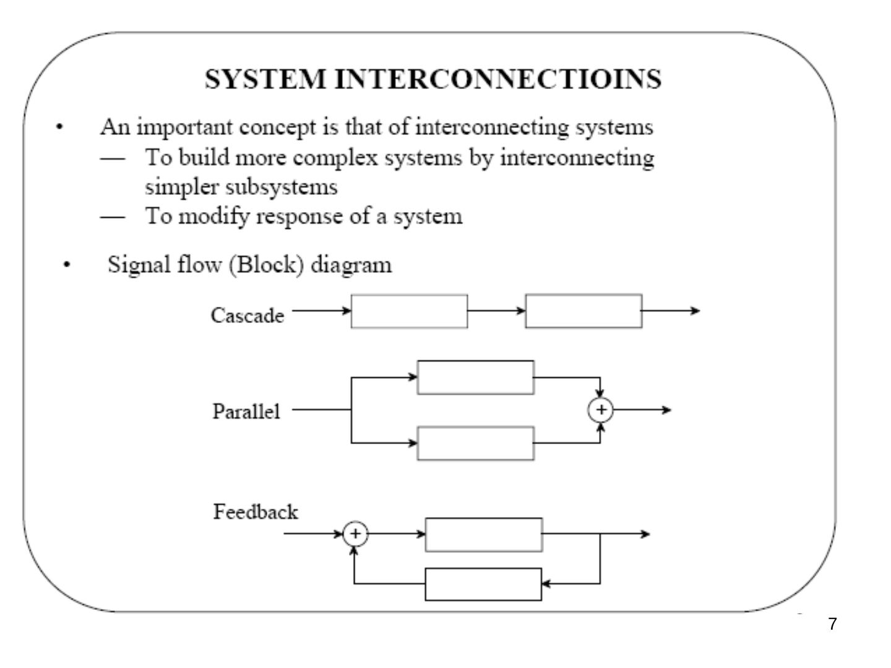
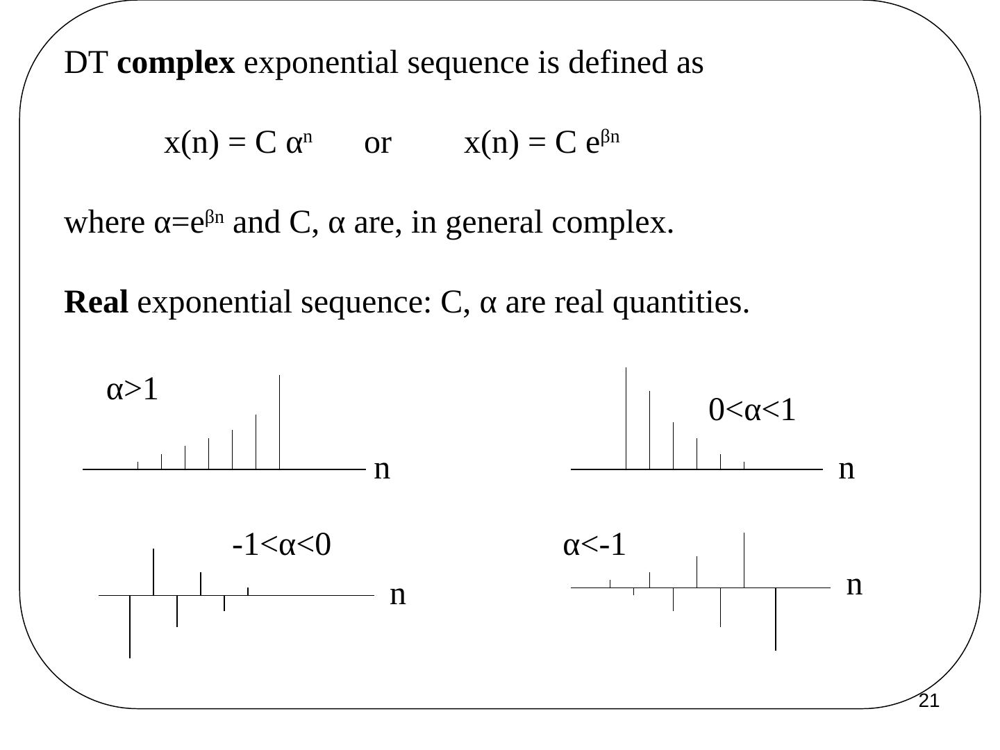
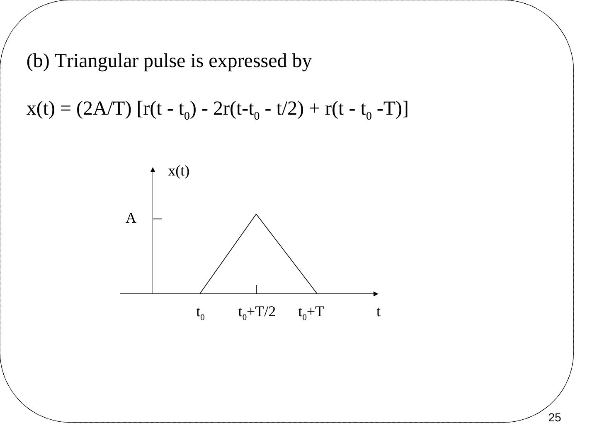

Bu yazı, Başkent Üniversitesi Elektrik-Elektronik Mühendisliği **EEM301 Sinyaller ve Sistemler I** dersinin **"Signals"** (Sinyaller) başlıklı sunumudur. Sunumu dersin öğretim üyesi **Prof. Dr. Alper Uraz** hazırlamış (Eylül 2005). Ders kitabı Oppenheim & Willsky, *Signals and Systems* (2. baskı) idi. Sunum İngilizce olduğu için içerik İngilizce aktarıldı; formüller düz metne çevrildi, grafikler için slayt görselleri eklendi. Orijinal PowerPoint dosyası yazının sonunda indirilebilir.

Sunumun konuları:

- Continuous-time (CT) and Discrete-time (DT) Signals
- Periodic Signals
- Even and Odd Signals
- Complex Exponential Signals
- Some Common Signals
- Power and Energy Signals

## Signals and systems

**Signals** are functions of independent variables that carry information. For example:

- Electrical signals — voltages and currents in a circuit
- Acoustic signals — audio or speech signals (analog or digital)
- Video signals — intensity variations in an image (e.g. a CAT scan)

### CT signals

Most of the signals in the physical world are CT signals — e.g. voltage & current, pressure, temperature, velocity, etc. A CT signal x(t) has a value for every real t.

### DT signals

x[n], n — integer, time varies discretely.

![Ayrık zamanlı bir x[n] dizisinin n = −9 … 10 için çubuk gösterimi](s-04.jpg "DT signal x[n]")

A DT signal has values for only discrete instants of time, that is, the domain of t is a discrete set of numbers. Such a signal is usually denoted as x(n) or x[n], instead of x(t), where n is an integer.

A DT signal can also be obtained by sampling a CT signal. In such cases, n may be replaced by kT, where k is an integer and T is called the sampling interval. Hence, the sampled signal is denoted by x(kT) or x(k) for simplicity. A DT signal x(n) is often called a **sequence**.

### Systems

For the most part, our view of systems will be from an input-output perspective: a system responds to applied input signals, and its response is described in terms of one or more output signals.

- x(t) → **CT System** → y(t)
- x[n] → **DT System** → y[n]

### System interconnections

An important concept is that of interconnecting systems:

- to build more complex systems by interconnecting simpler subsystems,
- to modify the response of a system.

Signal flow (block) diagrams: **cascade** (seri), **parallel** (paralel) and **feedback** (geri besleme) connections.

## Periodic signals

A CT signal x(t) is said to be **periodic** iff

x(t + T) = x(t) for all −∞ < t < ∞

The smallest positive value of T for which this holds is called the **period** of the signal. For integer k, T may be replaced by kT.

Similarly, a DT signal x[n] is said to be periodic if and only if

x[n + N] = x[n] for all −∞ < n < ∞

The smallest positive integer value of N for which this holds is called the period of the signal. Any signal that is not periodic is said to be **aperiodic**.

 = A sin(2πn/N), N = 6")

The most common example of a CT periodic signal is the sinusoid

x(t) = A cos(ωt − φ)

where A is the amplitude, ω is the angular frequency in rad/s and φ is the phase in radians. The angular frequency is ω = 2πf, where f is the frequency in hertz (cycles/s). The period T, in seconds, is

T = 1/f = 2π/ω

The sum of x1(t) = A1 cos(ω1 t) and x2(t) = A2 cos(ω2 t) is periodic iff the ratio T2/T1 is a rational number.

### Example

Consider the three sinusoidal (periodic) signals

x1(t) = 10 sin 3πt, x2(t) = 20 sin 7πt, x3(t) = 10 sin 32t

- ω1 = 2π/T1 = 3π, so the period of x1(t) is T1 = 2π/3π = 2/3
- ω2 = 2π/T2 = 7π, so T2 = 2π/7π = 2/7
- ω3 = 2π/T3 = 32, so T3 = 2π/32 = π/16

The ratio T2/T1 = 3/7 is a rational fraction, thus the sum of x1 and x2 is also periodic. The ratio T3/T1 = (π/16)/(2/3) is an irrational number, therefore the sum of x1 and x3 will not be periodic.

## Even and odd signals

A signal is **even** if x(t) = x(−t), x(n) = x(−n). An even function is symmetrical about the vertical axis.

A signal is **odd** if x(t) = −x(−t), x(n) = −x(−n). An odd function is antisymmetric about the vertical axis.

Remember that sin kωt is odd while cos kωt is even for all values of k. Any signal can be expressed as a sum of even and odd parts:

x(t) = xe(t) + xo(t), x(n) = xe(n) + xo(n)

- xe(t) = (1/2)[x(t) + x(−t)] (even), xo(t) = (1/2)[x(t) − x(−t)] (odd)
- xe(n) = (1/2)[x(n) + x(−n)] (even), xo(n) = (1/2)[x(n) − x(−n)] (odd)

## Complex exponential signals

Recall Euler's relationship

e^(jθ) = cos θ + j sin θ

A sinusoid can also be expressed as

A cos(ωt + φ) = Re[A e^(jωt) e^(jφ)] or A sin(ωt + φ) = Im[A e^(jωt) e^(jφ)]

or alternatively

A cos(ωt + φ) = (A/2)[e^(jωt) e^(jφ) + e^(−jωt) e^(−jφ)]

Note the periodic nature of the complex exponential: e^(j(ωt + φ + 2kπ)) = e^(j(ωt + φ)).

 = e^(jt), real and imaginary parts")

 = e^(jt) in 3-D")

### DT complex exponentials

Similar to the CT case, a periodic DT signal in the form of a complex exponential is

x(n) = A cos(2πn/N) = Re{A e^(j2πn/N)} = Re{A e^(jΩn)}

or x(n) = A sin(2πn/N) = Im{A e^(jΩn)}, where Ω = 2π/N is the angular frequency in radians. The period N is an integer and a dimensionless quantity. With a phase shift:

A cos(Ωn + φ) = (A/2){e^(jΩn) e^(jφ) + e^(−jΩn) e^(−jφ)}

A distinct property of the DT complex exponential is

x(n) = e^(j(Ω + 2π)n) = e^(jΩn) e^(j2πn) = e^(jΩn)

so we need to consider only a 2π interval, e.g. 0 ≤ Ω < 2π or −π ≤ Ω < π.

A second distinct property is related to periodicity. With period N > 0:

e^(jΩ(n + N)) = e^(jΩn) ⇒ e^(jΩN) = 1 ⇒ ΩN = 2πm ⇒ Ω/2π = m/N

where m is also an integer, i.e. **Ω/2π must be a rational number**. If m and N have no common factors, the fundamental frequency is 2π/N = Ω/m and the fundamental period is

N = m (2π/Ω)

Note that CT x(t) = x(t + mT) is periodic for integer m and any real T (need not be an integer), whereas DT x(n) = x(n + mN) is periodic for integers m and N.

![x[n] = e^(j0.2n) dizisinin gerçel ve sanal kısımları (n = −10…40)](s-19.jpg "Example 2: x[n] = e^(j0.2n)")

*Not: Bu örnekte Ω/2π = 0,2/2π = 1/(10π) rasyonel olmadığı için x[n] = e^(j0.2n) dizisi aslında periyodik değildir; grafikteki zarf yalnızca periyodik görünür.*

A DT complex exponential sequence is defined as

x(n) = C αⁿ or x(n) = C e^(βn)

where α = e^(βn) and C, α are in general complex. **Real exponential sequence:** C and α are real quantities.

*Not: Doğrusu α = e^β olmalı (x(n) = C e^(βn) = C (e^β)ⁿ).*

## Some common signals

### Unit step

u(t) = 0 for t < 0, u(t) = 1 for t > 0. At t = 0 the value of the function jumps from 0 to 1; it is discontinuous.

The unit step sequence: u(n) = 0 for n < 0, u(n) = 1 for n ≥ 0.

### Unit ramp

Integration of the unit step gives the unit ramp function r(t) = t for t ≥ 0. A ramp signal with slope m is m·r(t). Some other signals may be generated by these singularity functions, namely u(t) and r(t). The DT unit ramp is defined as r(n) = n for n ≥ 0.

### Example: signals generated by singularity functions

(a) A rectangular pulse with duration T and height A starting at t = t0:

x(t) = A u(t − t0) − A u(t − t0 − T)

(b) A triangular pulse:

x(t) = (2A/T)[r(t − t0) − 2r(t − t0 − t/2) + r(t − t0 − T)]

*Not: Ortadaki terim r(t − t0 − T/2) olmalı (tepe noktası t0 + T/2'de).*

### Unit impulse

An important singularity function is the **impulse** or **delta** function δ(t), integration of which gives u(t):

u(t) = ∫ from −∞ to t of δ(τ) dτ (running integral)

Alternatively, the unit impulse is the time derivative of the unit step: δ(t) = du(t)/dt. It can be seen as the limit of a rectangular pulse δε(t) of width 2ε and height 1/2ε: as ε → 0, δε(t) → δ(t).

Properties of the impulse:

1. δ(t) = 0 for t ≠ 0
1. ∫ from −∞ to ∞ of δ(τ) dτ = 1 (the area under the impulse is unity)

**DT unit impulse sequence δ(n):** the process of integration is replaced with summation,

u(n) = Σ from m = −∞ to n of δ(m) (running sum)

The DT unit impulse is the first difference of the step sequence: δ(n) = u(n) − u(n − 1). It is defined as δ(n) = 0 for n ≠ 0 and δ(n) = 1 for n = 1.

*Not: δ(n) = 1 koşulu n = 0 için olmalı.*

## Power and energy signals

The energy content of a signal x(t) is given by

E = lim (T→∞) ∫ from −T to T of x²(t) dt

and the average power by

P = lim (T→∞) (1/2T) ∫ from −T to T of x²(t) dt

If x(t) is the current (A) flowing in a 1 Ω resistor, then E is the total energy (J) dissipated and P is the average power (W) content of the signal.

If the average power is finite and positive, the energy content is infinite. Similarly, if the energy is finite, the average power must be zero:

1. x(t) is a **power signal** iff its average power P is finite and positive, implying that its energy is infinite.
1. x(t) is an **energy signal** iff its energy E is finite, implying that its power is zero.
1. If x(t) satisfies neither condition, it is neither a power nor an energy signal.

### Example: x(t) = A e^(at) u(t), a < 0

E = lim (T→∞) ∫ from −T to T of [A e^(at) u(t)]² dt = lim (T→∞) A² ∫ from 0 to T of e^(2at) dt = lim (T→∞) [A² e^(2aT)/(2a) − A²/(2a)] = −A²/(2a)

Since a < 0, E is positive and finite, so this is an **energy signal**.

If a = 0, x(t) = A u(t) and

- E = lim (T→∞) A² ∫ from 0 to T of 1 dt = lim (T→∞) A² T = ∞
- P = lim (T→∞) (1/2T) A² T = A²/2

As P is finite, A u(t), i.e. the step function, is a **power signal**.

### Periodic signals and a finite-duration example

The average power of a periodic signal x(t) with period T can be found by integrating over one complete cycle:

P = (1/T) ∫ from 0 to T of x²(t) dt

**Example:** x(t) = 30 cos 4πt [u(t) − u(t − 1)]

E = ∫ from 0 to 1 of 30² cos² 4πt dt = (900/2) ∫ from 0 to 1 of (1 + cos 8πt) dt = 450 [t + sin 8πt / 8π] from 0 to 1 = 450 (1 + sin 8π / 8π − 0) = 450

As E is finite, this x(t) is an energy signal.
