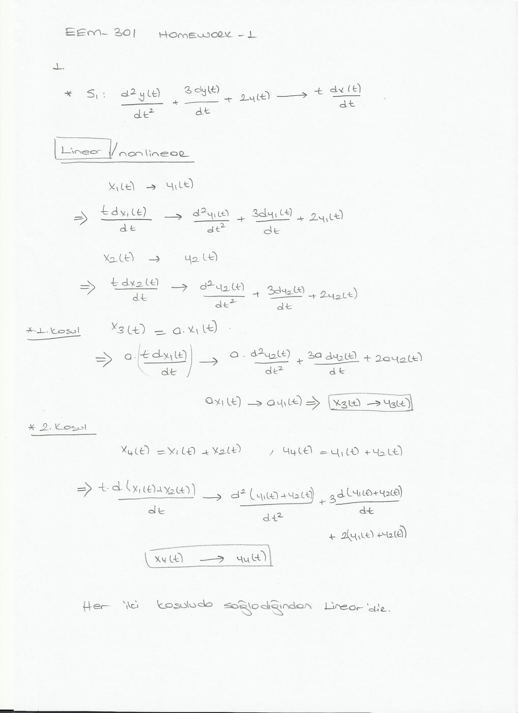
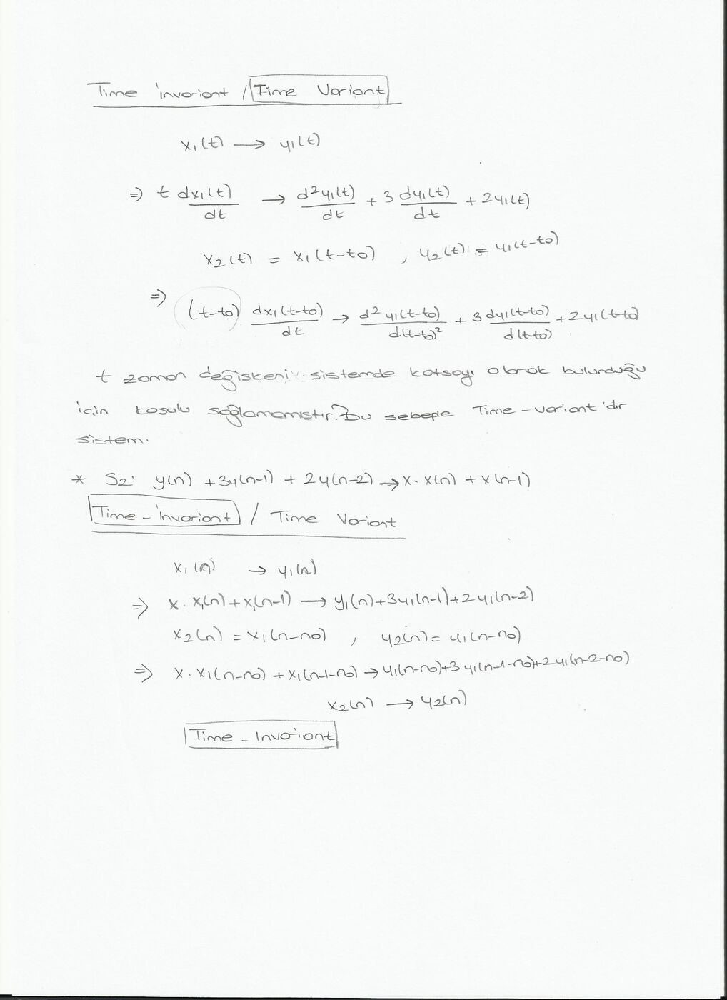
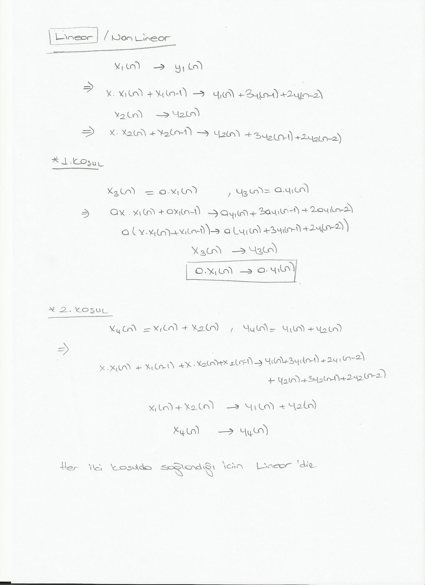

This post collects the homework files of a classmate for the 2012 fall semester of **EEM301 Signals and Systems I** at Başkent University. Personal information has been removed. There are three parts: the scanned handwritten solution of HW-1 Question 1 (linearity and time-invariance), the problem coefficients assigned to that student for HW-2, and the **MATLAB Projects – 2** solutions. The question texts of the homework (Prof. Dr. Alper Uraz's HW-1/HW-2 document) are in the post [Course Content Form, Homework, Exercise List and MATLAB Projects](/arsiv/eem301-izlence-odevler/). The scans and Word files can be downloaded as a ZIP at the end of the post.

## HW-1, Question 1: Linearity and time-invariance

In the homework, each student was assigned different coefficients according to their position in the class list. The systems in this solution are:

- **S1:** d²y(t)/dt² + 3 dy(t)/dt + 2y(t) = t · dx(t)/dt
- **S2:** y(n) + 3y(n − 1) + 2y(n − 2) = x · x(n) + x(n − 1)

### S1: Is it linear?

Let x₁(t) → y₁(t) and x₂(t) → y₂(t).

- **Condition 1 (scaling):** For x₃(t) = a·x₁(t), the left-hand side becomes a·t·dx₁/dt; multiplying both sides of the equation by a gives y₃(t) = a·y₁(t).
- **Condition 2 (additivity):** For x₄(t) = x₁(t) + x₂(t), t·d(x₁ + x₂)/dt gives d²(y₁ + y₂)/dt² + 3d(y₁ + y₂)/dt + 2(y₁ + y₂); y₄(t) = y₁(t) + y₂(t).

Since both conditions are satisfied, S1 is **linear**.



### S1: Is it time-invariant?

For x₂(t) = x₁(t − t₀), the left-hand side becomes t·dx₁(t − t₀)/dt; however, in the equation that y₁(t − t₀) must satisfy, the coefficient is (t − t₀). Because the time variable t appears as a coefficient in the system, the condition is not satisfied: S1 is a **time-variant** system.

### S2: Is it time-invariant?

For x₂(n) = x₁(n − n₀), we obtain x·x₁(n − n₀) + x₁(n − 1 − n₀) → y₁(n − n₀) + 3y₁(n − 1 − n₀) + 2y₁(n − 2 − n₀); that is, x₂(n) → y₂(n) = y₁(n − n₀). S2 is **time-invariant**.



### S2: Is it linear?

On the paper, as for S1, it is shown that both the scaling (a·x₁(n) → a·y₁(n)) and additivity (x₁ + x₂ → y₁ + y₂) conditions are satisfied, and it is concluded that S2 is **linear**.



*Note: If the coefficient "x" in the homework table denotes the input itself (g = x), the term on the right-hand side of S2 becomes x(n)·x(n) = x²(n). In that case, the input a·x(n) gives a²·x²(n) and the system is not linear; in the solution, x has been treated as a constant coefficient.*

## HW-2: Coefficients assigned to this student

The coefficients assigned to the student in the Fourier questions of HW-2 (the system equations and input signals are in the Word file as equation objects):

1. **S2 coefficients e = −1.7, f = 1.0, g = 1, h = 0:** Find the Fourier series (FS) representation of the output y(n) for the given input.
1. **For h(t), a = 10, b = 25, c = 0, d = 1:** (a) Determine the frequency response H(jω) using the Fourier transform. (b) Find the output y(t) for the given input using the FT.
1. **e = −1.7, f = 1.0, g = 1, h = 0:** Find the output y(n) for the given input using the DTFT.

## MATLAB Projects – 2

Solutions to problems 3.2 and 4.2 of Buck–Daniel–Singer's *Signals and Systems using MATLAB*.

### 3.2: Frequency response with freqz

System: y(n) − 0.8y(n − 1) = 2x(n) − x(n − 2), i.e., H(e^(jω)) = (2 − e^(−j2ω)) / (1 − 0.8e^(−jω)).

```matlab
a1=[1 -0.8]
b1=[2 0 -1]
[H,W]=freqz(b1,a1,4)
```

```
H =5.0000
   2.8200 - 1.3705i
   1.8293 - 1.4634i
   0.9258 - 0.9732i

W =0
  0.7854
  1.5708
  2.3562
```

With the `'whole'` option, the frequencies are spread over the range 0–2π:

```matlab
[H,W]=freqz(b1,a1,4,'whole')
```

```
H =5.0000
   1.8293 - 1.4634i
   0.5556
   1.8293 + 1.4634i

W =0
  1.5708
  3.1416
  4.7124
```

Check: at ω = 0, H = (2 − 1)/(1 − 0.8) = 5; at ω = π, H = (2 − 1)/(1 + 0.8) = 0.5556; at ω = π/2, H = 3/(1 + 0.8j) = 1.8293 − 1.4634j.

### 4.2: Sampled signal

```matlab
tau=0.01;
t = [0:tau:10-tau];
x= exp(-2*abs(t));
```

```
>> t=[0:0.01:(10-0.01)];
>> y=exp(-2*abs(t-5));
>> N=10/0.01;
>> length(y)

ans =1000

>> N

N =1000
```
