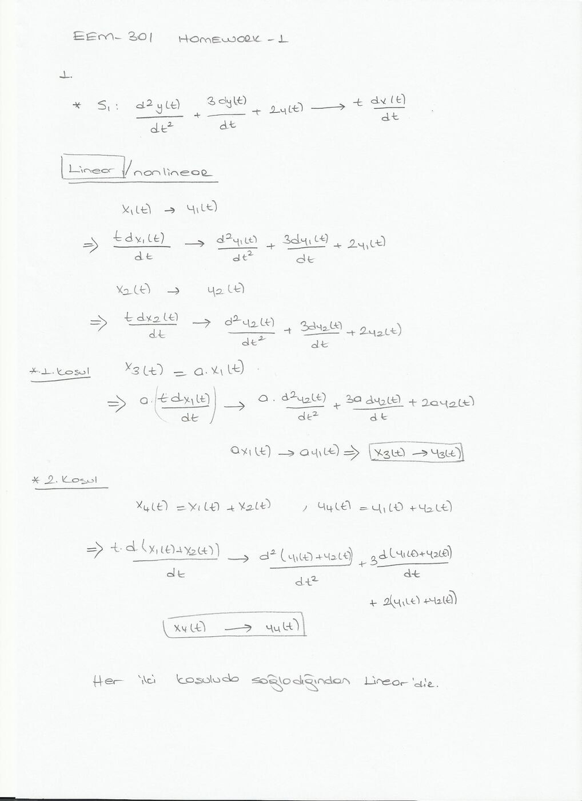
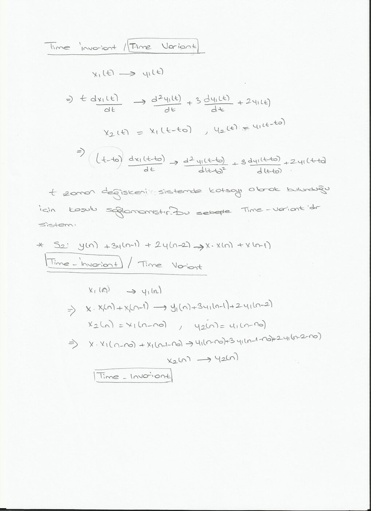
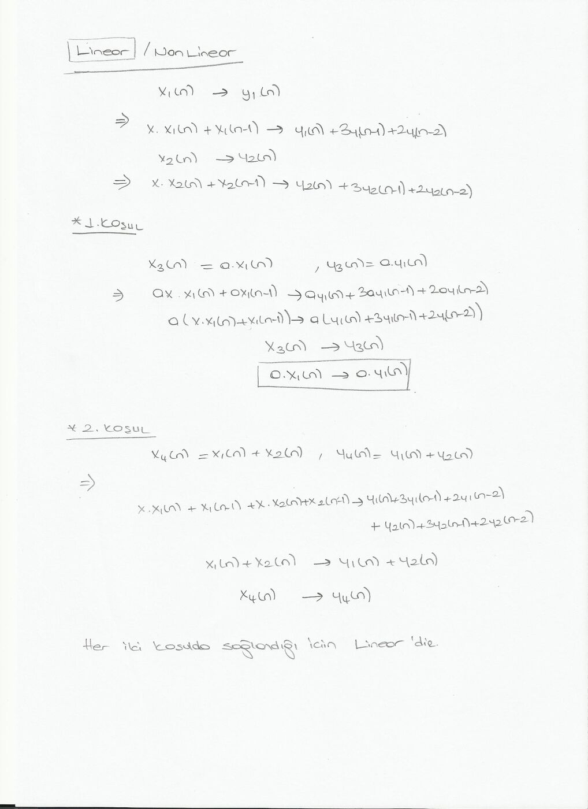

Bu yazı, Başkent Üniversitesi **EEM301 Sinyaller ve Sistemler I** dersinin 2012 güz dönemine ait, bir arkadaşın hazırladığı ödev dosyalarını bir araya getiriyor. Kişisel bilgiler çıkarıldı. Üç parça var: HW-1'in 1. sorusunun taranmış el yazısı çözümü (doğrusallık ve zamanla değişmezlik), HW-2 için o öğrenciye düşen soru katsayıları ve **MATLAB Projects – 2** çözümleri. Ödevlerin soru metinleri (Prof. Dr. Alper Uraz'ın HW-1/HW-2 belgesi) [Ders İçerik Formu, Ödevler, Alıştırma Listesi ve MATLAB Projeleri](/arsiv/eem301-izlence-odevler/) yazısında var. Taramalar ve Word dosyaları yazının sonunda ZIP olarak indirilebilir.

## HW-1, Soru 1: Doğrusallık ve zamanla değişmezlik

Ödevde her öğrenciye sınıf listesindeki sırasına göre farklı katsayılar düşüyordu. Bu çözümdeki sistemler:

- **S1:** d²y(t)/dt² + 3 dy(t)/dt + 2y(t) = t · dx(t)/dt
- **S2:** y(n) + 3y(n − 1) + 2y(n − 2) = x · x(n) + x(n − 1)

### S1: Doğrusal mı?

x₁(t) → y₁(t) ve x₂(t) → y₂(t) olsun.

- **1. koşul (ölçekleme):** x₃(t) = a·x₁(t) için sol taraf a·t·dx₁/dt olur; denklemin her iki tarafı a ile çarpılır, y₃(t) = a·y₁(t) çıkar.
- **2. koşul (toplamsallık):** x₄(t) = x₁(t) + x₂(t) için t·d(x₁ + x₂)/dt, d²(y₁ + y₂)/dt² + 3d(y₁ + y₂)/dt + 2(y₁ + y₂) verir; y₄(t) = y₁(t) + y₂(t).

Her iki koşul sağlandığından S1 **doğrusaldır**.



### S1: Zamanla değişmez mi?

x₂(t) = x₁(t − t₀) için sol taraf t·dx₁(t − t₀)/dt olur; oysa y₁(t − t₀)'ın sağlaması gereken denklemde katsayı (t − t₀)'dır. Sistemde t zaman değişkeni katsayı olarak bulunduğu için koşul sağlanmaz: S1 **zamanla değişen** (time-variant) bir sistemdir.

### S2: Zamanla değişmez mi?

x₂(n) = x₁(n − n₀) için x·x₁(n − n₀) + x₁(n − 1 − n₀) → y₁(n − n₀) + 3y₁(n − 1 − n₀) + 2y₁(n − 2 − n₀) elde edilir; yani x₂(n) → y₂(n) = y₁(n − n₀). S2 **zamanla değişmezdir**.



### S2: Doğrusal mı?

Kâğıtta S1'deki gibi ölçekleme (a·x₁(n) → a·y₁(n)) ve toplamsallık (x₁ + x₂ → y₁ + y₂) koşullarının ikisinin de sağlandığı gösterilip S2'nin **doğrusal** olduğu sonucuna varılmış.



*Not: Ödev tablosundaki "x" katsayısı girişin kendisini gösteriyorsa (g = x), S2'nin sağ tarafındaki terim x(n)·x(n) = x²(n) olur. Bu durumda a·x(n) girişi a²·x²(n) verir ve sistem doğrusal değildir; çözümde x sabit bir katsayı gibi ele alınmış.*

## HW-2: Bu öğrenciye düşen katsayılar

HW-2'nin Fourier sorularında öğrenciye düşen katsayılar (sistem denklemleri ve giriş sinyalleri Word dosyasında denklem nesnesi olarak duruyor):

1. **S2 katsayıları e = −1.7, f = 1.0, g = 1, h = 0:** Çıkış y(n)'nin verilen giriş için Fourier serisi (FS) gösterimini bulun.
1. **h(t) için a = 10, b = 25, c = 0, d = 1:** (a) H(jω) frekans yanıtını Fourier dönüşümüyle belirleyin. (b) Verilen giriş için y(t) çıkışını FT ile bulun.
1. **e = −1.7, f = 1.0, g = 1, h = 0:** Verilen giriş için y(n) çıkışını DTFT ile bulun.

## MATLAB Projects – 2

Buck–Daniel–Singer *Signals and Systems using MATLAB* kitabının 3.2 ve 4.2 problemlerinin çözümleri.

### 3.2: freqz ile frekans yanıtı

Sistem: y(n) − 0.8y(n − 1) = 2x(n) − x(n − 2), yani H(e^(jω)) = (2 − e^(−j2ω)) / (1 − 0.8e^(−jω)).

```matlab
a1=[1 -0.8]
b1=[2 0 -1]
[H,W]=freqz(b1,a1,4)
```

```
H =5.0000
   2.8200 - 1.3705i
   1.8293 - 1.4634i
   0.9258 - 0.9732i

W =0
  0.7854
  1.5708
  2.3562
```

`'whole'` seçeneğiyle frekanslar 0–2π aralığına yayılır:

```matlab
[H,W]=freqz(b1,a1,4,'whole')
```

```
H =5.0000
   1.8293 - 1.4634i
   0.5556
   1.8293 + 1.4634i

W =0
  1.5708
  3.1416
  4.7124
```

Kontrol: ω = 0'da H = (2 − 1)/(1 − 0.8) = 5; ω = π'de H = (2 − 1)/(1 + 0.8) = 0.5556; ω = π/2'de H = 3/(1 + 0.8j) = 1.8293 − 1.4634j.

### 4.2: Örneklenmiş sinyal

```matlab
tau=0.01;
t = [0:tau:10-tau];
x= exp(-2*abs(t));
```

```
>> t=[0:0.01:(10-0.01)];
>> y=exp(-2*abs(t-5));
>> N=10/0.01;
>> length(y)

ans =1000

>> N

N =1000
```
