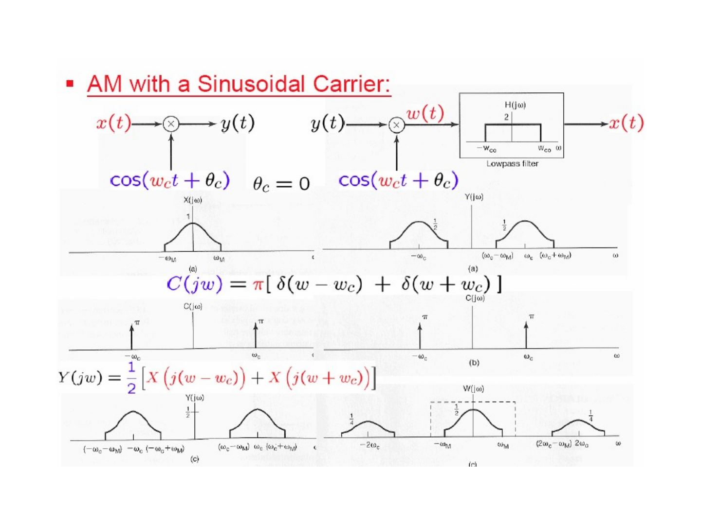
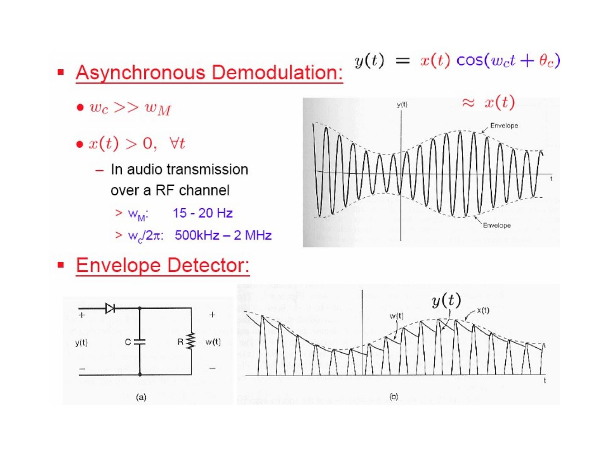
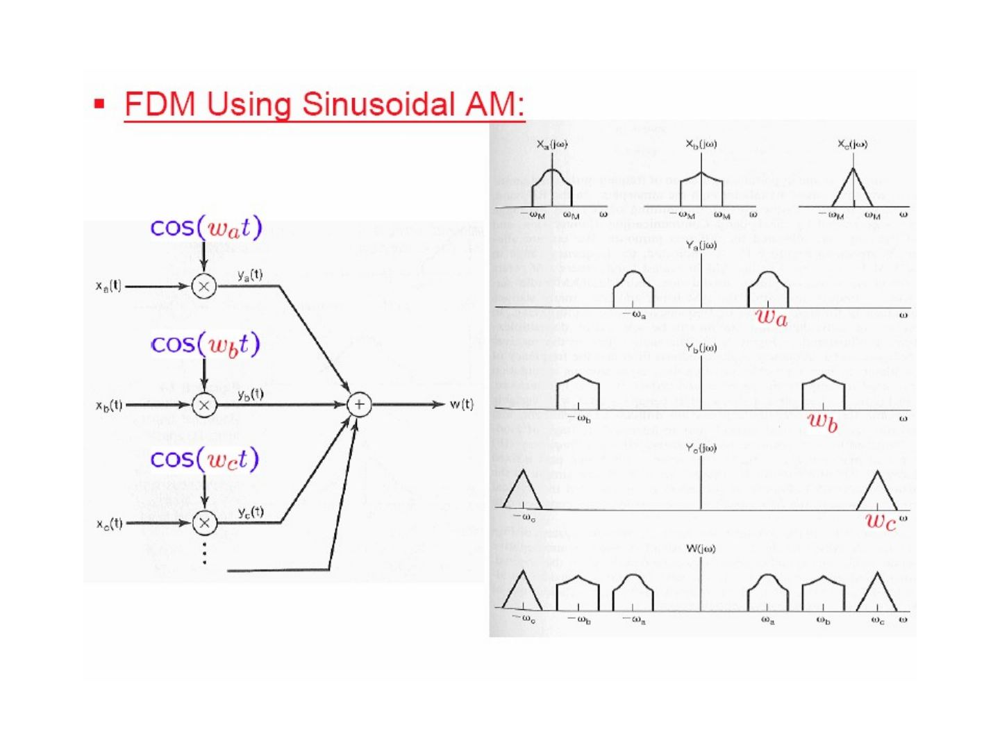
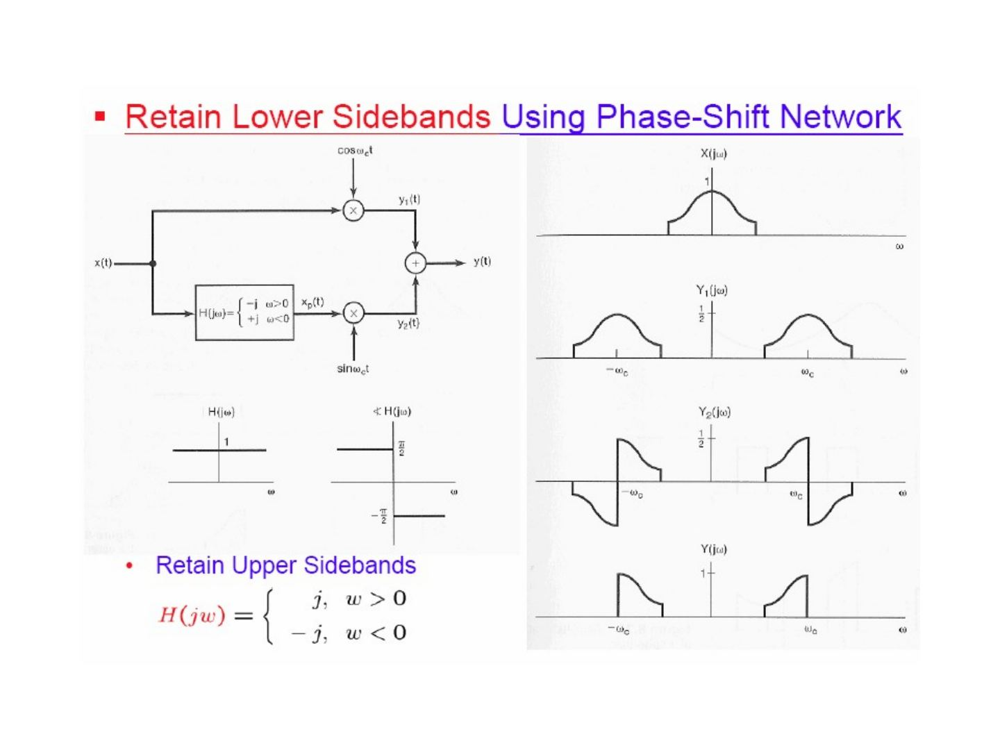
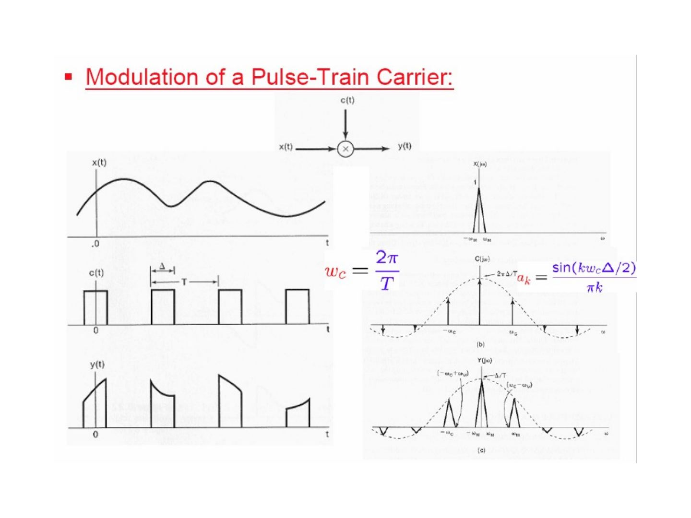
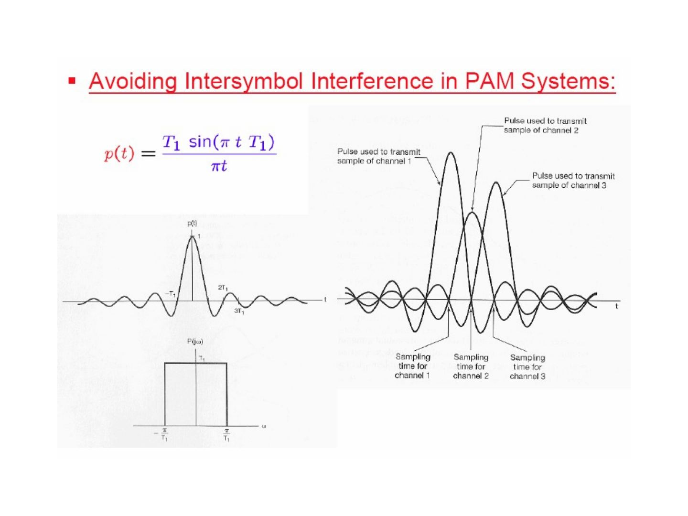
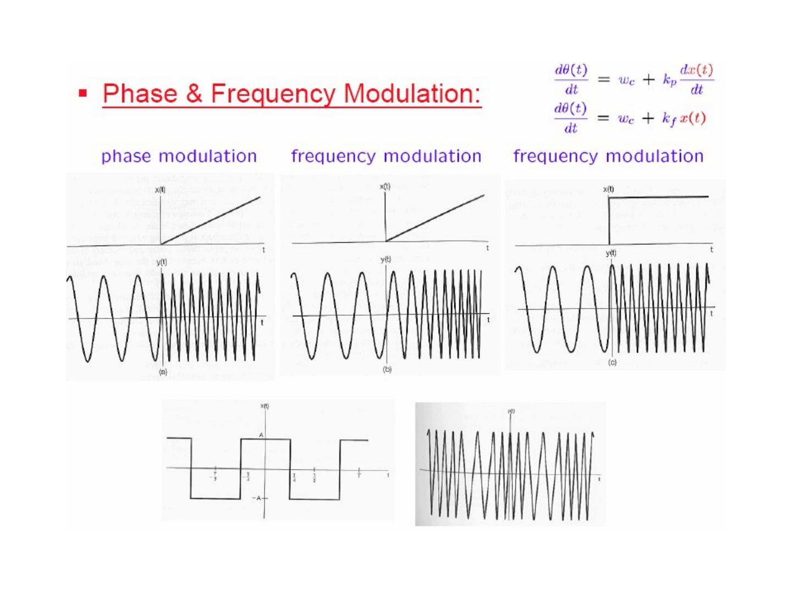
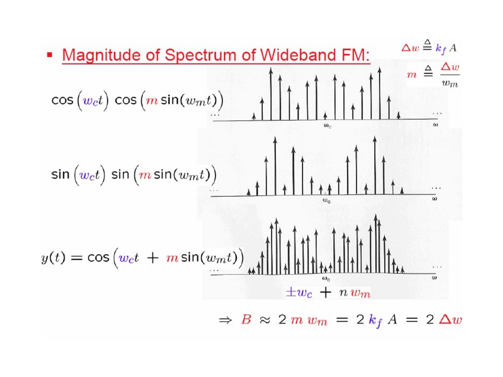
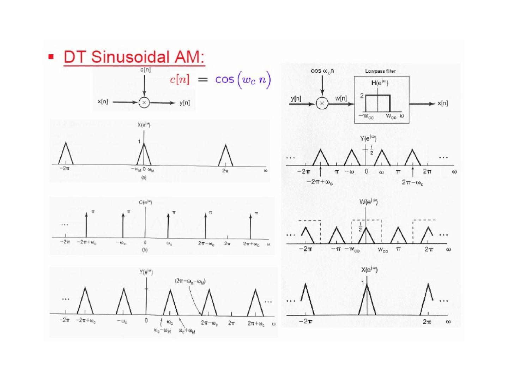

Bu yazı, Başkent Üniversitesi **EEM308 Sinyaller ve Sistemler II** dersinin arşiv klasöründe bulunan, yazarı slaytlarda belirtilmemiş İngilizce ders slaytlarından **"Communication"** başlıklı modülasyon sunumudur (49 slayt; sonuncusu boş). Dosya son olarak 21 Temmuz 2009'da kaydedilmiş; PowerPoint dosyasının özelliklerinde yazar olarak *İsmail Avcıbaş* adı görünüyor, ancak slaytların tamamı başka bir ders sunumundan alınmış ekran görüntüleridir ve asıl hazırlayanın kim olduğu (kurum, hoca) slaytlarda yazmıyor. Kırmızı başlıklı, mavi vurgulu madde düzeni bir üniversitenin "Signals and Systems" ders slaytlarına benziyor; şekiller Oppenheim & Willsky'nin *Signals & Systems* kitabının 8. bölümünden (Communication Systems) taranmış. Slayt içeriği İngilizce olarak metne döküldü; gerekli birkaç şekil için slayt görselleri eklendi. Orijinal PowerPoint dosyası yazının sonunda indirilebilir.

*Bu içerik üçüncü taraf bir kaynağa aittir; arşiv ve nostalji amacıyla kaynak belirtilerek paylaşılmıştır. Hak sahibinin talebi hâlinde kaldırılır.*

## Modulation and multiplexing

**Modulation & demodulation:**

- M: **embedding** an information-bearing signal into a second signal
- D: **extracting** the information-bearing signal
- Methods: Amplitude Modulation (AM), Frequency Modulation (FM)
- x(t) is multiplied by the carrier c(t) = A(t) cos(ω(t)·t + θ(t)) to give y(t).

**Multiplexing & demultiplexing:**

- Simultaneous transmission of **more than one signal** with overlapping spectra **over the same channel**
- Methods: Time-Division Multiplexing (TDM), Frequency-Division Multiplexing (FDM)

**Signal frequency characteristics:** the modulating signal x(t) (e.g. voice signals, about 200 Hz – 4 kHz) is moved by the carrier signal c(t) to the transmission band (communication satellite ≈ 100 MHz – 40 GHz, 802.11 & Bluetooth 2.4 GHz, microwave links up to ≈ 300 GHz). Modulated signal: y(t) = x(t) c(t).

Outline:

- Complex Exponential & Sinusoidal Amplitude Modulation & Demodulation
- Frequency-Division Multiplexing
- Single-Sideband Sinusoidal Amplitude Modulation
- Amplitude Modulation with a Pulse-Train Carrier
- Pulse-Amplitude Modulation
- Sinusoidal Frequency Modulation
- Discrete-Time Modulation

## AM with a complex exponential carrier

ω_c: carrier frequency, c(t) = e^{j(ω_c t + θ_c)}; take θ_c = 0.

y(t) = x(t) c(t) = x(t) e^{jω_c t}

C(jω) = 2π δ(ω − ω_c)

Y(jω) = (1/2π) ∫_{−∞}^{+∞} X(jθ) C(j(ω − θ)) dθ = X(j(ω − ω_c))

**Demodulation:** multiply by c_d(t) = e^{−j(ω_c t + θ_c)}:

w(t) = y(t) c_d(t) = y(t) e^{−jω_c t} = x(t) e^{jω_c t} e^{−jω_c t} ⇒ **w(t) = x(t)**

W(jω) = Y(j(ω + ω_c)) ⇒ W(jω) = X(jω)

## AM with sinusoidal carriers

c(t) = e^{jω_c t} = cos(ω_c t) + j sin(ω_c t) ⇒ y(t) = x(t) cos(ω_c t) + j x(t) sin(ω_c t)

So Re{y(t)} and Im{y(t)} are obtained by multiplying x(t) by cos(ω_c t + θ_c) and sin(ω_c t + θ_c) separately. (Question on the slide: what is the phase difference of the two carriers c₁(·), c₂(·)?)

### Sinusoidal carrier, synchronous demodulation

C(jω) = π[δ(ω − ω_c) + δ(ω + ω_c)]

Y(jω) = ½ [X(j(ω − ω_c)) + X(j(ω + ω_c))]

With y(t) = x(t) cos(ω_c t) and w(t) = y(t) cos(ω_c t):

w(t) = x(t) cos²(ω_c t) = x(t) [½ + ½ cos(2ω_c t)] = ½ x(t) + ½ x(t) cos(2ω_c t)

A lowpass filter with gain 2 and cutoff ω_M < ω_co < 2ω_c − ω_M recovers x(t).

**Overlapping:** if ω_c < ω_M, the shifted replicas of X(jω) overlap in Y(jω) and x(t) cannot be recovered.

### Not synchronized in phase

With a complex exponential carrier c_m(t) = e^{j(ω_c t + θ_c)} and demodulating carrier c_d(t) = e^{−j(ω_c t + φ_c)}, θ_c ≠ φ_c:

w(t) = y(t) c_d(t) = x(t) e^{j(ω_c t + θ_c)} e^{−j(ω_c t + φ_c)} = x(t) e^{j(θ_c − φ_c)} ⇒ only |x(t)| = |w(t)|.

With sinusoidal carriers, y(t) = x(t) cos(ω_c t + θ_c), w(t) = y(t) cos(ω_c t + φ_c):

w(t) = x(t) cos(ω_c t + θ_c) cos(ω_c t + φ_c) = x(t) [½ cos(θ_c − φ_c) + ½ cos(2ω_c t + θ_c + φ_c)]
= ½ cos(θ_c − φ_c) x(t) + ½ x(t) cos(2ω_c t + θ_c + φ_c)

After the lowpass filter the output is cos(θ_c − φ_c) x(t): the amplitude depends on the phase difference.

## Asynchronous demodulation

y(t) = x(t) cos(ω_c t + θ_c) ≈ envelope x(t), provided

- ω_c ≫ ω_M
- x(t) > 0 for all t
- Example — audio transmission over an RF channel: ω_M: 15–20 Hz, ω_c/2π: 500 kHz – 2 MHz

*Not: Slaytta ses sinyalinin bant genişliği "15 - 20 Hz" yazıyor; doğrusu 15–20 kHz'dir (Oppenheim & Willsky'deki örnek de böyledir).*

**Envelope detector:** a diode followed by a parallel RC circuit; the capacitor charges to the peaks of y(t) and discharges slowly through R, so w(t) follows the envelope x(t).

If x(t) is not positive, add a constant: x(t) → x(t) + A > 0, with A ≥ K where |x(t)| ≤ K. Then y(t) = (A + x(t)) cos(ω_c t).

- K/A: **modulation index m**, in % (the figure shows m = 0.5 and m = 1.0).

Synchronous vs. asynchronous demodulation in the frequency domain: x(t) cos(ω_c t) has only the shifted replicas of X(jω) (height ½), while [x(t) + A] cos(ω_c t) also contains carrier impulses of area πA at ±ω_c.

## Frequency-Division Multiplexing (FDM)

Each signal x_a(t), x_b(t), x_c(t), … is multiplied by its own carrier cos(ω_a t), cos(ω_b t), cos(ω_c t), …, and the products are added: w(t) = y_a(t) + y_b(t) + y_c(t) + …; in W(jω) the spectra sit side by side without overlap.

**Demultiplexing and demodulation:** a bandpass filter H₁(jω) around ±ω_a selects y_a(t) (demultiplexing); then multiplication by cos(ω_a t) and a lowpass filter H₂(jω) with gain 2 give x_a(t) (demodulation).

Frequency bands of the electromagnetic spectrum (table on the slide):

| Frequency range | Designation | Typical uses | Propagation method | Channel features |
|---|---|---|---|---|
| 30–300 Hz | ELF (extremely low frequency) | Macrowave, submarine communication | Megametric waves | Penetration of conducting earth and seawater |
| 0.3–3 kHz | VF (voice frequency) | Data terminals, telephony | Copper wire | |
| 3–30 kHz | VLF (very low frequency) | Navigation, telephone, telegraph, frequency and timing standards | Surface ducting (ground wave) | Low attenuation, little fading, extremely stable phase and frequency, large antennas |
| 30–300 kHz | LF (low frequency) | Industrial (power line) communication, aeronautical and maritime long-range navigation, radio beacons | Mostly surface ducting | Slight fading, high atmospheric pulse |
| 0.3–3 MHz | MF (medium frequency) | Mobile, AM broadcasting, amateur, public safety | Ducting and ionospheric reflection (sky wave) | Increased fading, but reliable |
| 3–30 MHz | HF (high frequency) | Military communication, aeronautical mobile, international fixed, amateur and citizen's band, industrial | Ionospheric reflecting sky wave, 50–400 km layer altitudes | Intermittent and frequency-selective fading, multipath |
| 30–300 MHz | VHF (very high frequency) | FM and TV broadcast, land transportation (taxis, buses, railroad) | Sky wave (ionospheric and tropospheric scatter) | Fading, scattering, and multipath |
| 0.3–3 GHz | UHF (ultra high frequency) | UHF TV, space telemetry, radar, military | Transhorizon tropospheric scatter and line-of-sight relaying | |
| 3–30 GHz | SHF (super high frequency) | Satellite and space communication, common carrier (CC), microwave | Line-of-sight ionosphere penetration | Ionospheric penetration, extraterrestrial noise, high directivity |
| 30–300 GHz | EHF (extremely high frequency) | Experimental, government, radio astronomy | Line of sight | Water vapor and oxygen absorption |
| 10³–10⁷ GHz | Infrared, visible light, ultraviolet | Optical communications | Line of sight | |

## Single-Sideband (SSB) sinusoidal AM

The double-sideband spectrum Y(jω) contains, around each of ±ω_c, an **upper sideband** and a **lower sideband**; each carries the full information of x(t). Keeping only the upper sidebands gives Y_u(jω), keeping only the lower sidebands gives Y_l(jω).

- **Retain upper sidebands using an ideal highpass filter:** pass y(t) through H(jω) = 1 for |ω| > ω_c, 0 otherwise.
- **Retain lower sidebands using a phase-shift network:** y₁(t) = x(t) cos(ω_c t); x(t) is also passed through the 90° phase shifter H(jω) = −j for ω > 0, +j for ω < 0 to give x_p(t), and y₂(t) = x_p(t) sin(ω_c t); then y(t) = y₁(t) + y₂(t) contains only the lower sidebands.
- **Retain upper sidebands:** use H(jω) = j for ω > 0, −j for ω < 0.

## AM with a pulse-train carrier

The carrier c(t) is a rectangular pulse train with period T and pulse width Δ, ω_c = 2π/T. Its Fourier series coefficients are

a_k = sin(kω_cΔ/2) / (πk)

so C(jω) is a train of impulses at kω_c with sinc-shaped areas 2πa_k, and Y(jω) = Σ_k a_k X(j(ω − kω_c)): replicas of X(jω) at every harmonic of ω_c, weighted by a_k.

**Time-Division Multiplexing (TDM):** each signal x₁(t), …, x₄(t) is multiplied by a pulse train that is shifted in time so the pulses of different channels do not overlap; the products are added (equivalently, a rotating switch connects the channels to the line in turn).

## Pulse-Amplitude Modulation (PAM)

In a PAM signal the pulse heights follow the samples of x(t).

**TDM-PAM** (three channels, pulse spacing T₁, frame period T = 3T₁):

y(t) = A x₁(t) for t = 0, ±3T₁, …;  A x₂(t) for t = T₁, T₁ ± 3T₁, …;  A x₃(t) for t = 2T₁, 2T₁ ± 3T₁, …

**Intersymbol interference in PAM systems:** a band-limited channel spreads each pulse in time, so at the sampling time of one channel the tails of the neighbouring channels' pulses are also present.

**Avoiding intersymbol interference:** use band-limited pulses that are zero at the sampling times of the other channels, e.g.

p(t) = T₁ sin(πt/T₁) / (πt)

whose transform is P(jω) = T₁ for |ω| < π/T₁ and 0 otherwise; p(t) is zero at t = ±T₁, ±2T₁, …

*Not: Slaytta darbe p(t) = T₁ sin(π t T₁)/(πt) yazılmış; doğrusu p(t) = T₁ sin(πt/T₁)/(πt)'dir (sıfır geçişleri kT₁ noktalarında olsun diye).*

**General form of band-limited pulses with time-domain zero-crossings at kT₁, k ∈ ℤ:**

P(jω) = 1 + P₁(jω) for |ω| ≤ π/T₁;  P₁(jω) for π/T₁ < |ω| ≤ 2π/T₁;  0 otherwise

where P₁(jω) has **odd symmetry around π/T₁**: P₁(−jω + jπ/T₁) = −P₁(jω + jπ/T₁), 0 ≤ ω ≤ π/T₁. ⇒ p(t) has zero crossings at ±T₁, ±2T₁, …

*Not: Slaytın son satırında "±T₁, ±2T₂" yazıyor; doğrusu ±T₁, ±2T₁, …'dir.*

## Sinusoidal frequency modulation

**Frequency Modulation (FM):**

- The modulating signal is used to control the **frequency** of a sinusoidal carrier.
- With sinusoidal AM, the peak amplitude of the envelope of the carrier is directly dependent on the amplitude of the modulating signal x(t), which can have a large dynamic range.
- With FM, the envelope of the carrier is **constant**.
- An FM transmitter can always operate at peak power, and amplitude variations introduced over a transmission channel due to additive disturbances or fading can be eliminated at the receiver.
- FM generally requires **greater bandwidth** than does sinusoidal AM.

### Angle modulation

c(t) = A cos(ω_c t + θ_c) = A cos θ(t)

- **Phase modulation:** use the modulating signal x(t) to vary the phase θ_c:
  y(t) = A cos(θ(t)) = A cos(ω_c t + θ_c(t)), θ_c(t) = θ₀ + k_p x(t), dθ(t)/dt = ω_c + k_p dx(t)/dt
- **Frequency modulation:** use x(t) to vary the derivative of the angle:
  y(t) = A cos(θ(t)), dθ(t)/dt = ω_c + k_f x(t)

The figure compares phase modulation and frequency modulation for a ramp x(t) (PM of a ramp gives a constant frequency shift; FM of a ramp gives a linearly increasing frequency), FM of a step, and FM of a square wave.

### Instantaneous frequency

y(t) = A cos(θ(t)) ⇒ ω_i = dθ(t)/dt

- If y(t) is truly sinusoidal: θ(t) = ω_c t + θ₀, ω_i = ω_c
- Phase modulation: ω_i = ω_c + k_p dx(t)/dt
- Frequency modulation: ω_i = ω_c + k_f x(t)

### Narrowband FM

Frequency modulation with x(t) = A cos(ω_m t):

ω_i(t) = dθ(t)/dt = ω_c + k_f A cos(ω_m t) ⇒ ω_c − k_f A ≤ ω_i(t) ≤ ω_c + k_f A

Δω ≜ k_f A (maximum frequency deviation) ⇒ ω_i(t) = ω_c + Δω cos(ω_m t)

y(t) = cos(ω_c t + k_f ∫ x(t) dt) = cos(ω_c t + (Δω/ω_m) sin(ω_m t) + θ₀); let θ₀ = 0:

y(t) = cos(ω_c t + (Δω/ω_m) sin(ω_m t))

- **Modulation index for FM:** m ≜ Δω/ω_m
- When m is small ⇒ **narrowband FM**

Using cos(A + B) = cos A cos B − sin A sin B:

y(t) = cos(ω_c t + m sin(ω_m t)) = cos(ω_c t) cos(m sin(ω_m t)) − sin(ω_c t) sin(m sin(ω_m t))

When m is sufficiently small (≪ π/2), cos θ ≈ 1 and sin θ ≈ θ for 0 < θ ≪ 1, so cos(m sin(ω_m t)) ≈ 1, sin(m sin(ω_m t)) ≈ m sin(ω_m t) and

y(t) ≈ cos(ω_c t) − m sin(ω_m t) sin(ω_c t)

The approximate spectrum of narrowband FM has impulses of area π at ±ω_c and impulses of area ±mπ/2 at ±(ω_c ± ω_m). Compare with AM double-sideband with carrier: y₂(t) = cos(ω_c t) + m cos(ω_m t) cos(ω_c t).

### Wideband FM

When m is large, in y(t) = cos(ω_c t) cos(m sin(ω_m t)) − sin(ω_c t) sin(m sin(ω_m t)) the terms cos(m sin(ω_m t)) and sin(m sin(ω_m t)) are periodic signals with fundamental frequency ω_m. Hence the spectrum of y(t) = cos(ω_c t + m sin(ω_m t)) consists of impulses at ±ω_c + nω_m, and its bandwidth is

B ≈ 2mω_m = 2k_f A = 2Δω

### Periodic square-wave modulating signal

ω_i(t) = ω_c + k_f x(t); with k_f = 1 ⇒ Δω = A.

- When x(t) > 0, ω_i(t) = ω_c + Δω
- When x(t) < 0, ω_i(t) = ω_c − Δω

With r(t) a symmetric square wave of period T taking values 0 and 1:

y(t) = r(t) cos((ω_c + Δω)t) + r(t − T/2) cos((ω_c − Δω)t)

Y(jω) = ½ [R(jω + jω_c + jΔω) + R(jω − jω_c − jΔω)] + ½ [R_T(jω + jω_c − jΔω) + R_T(jω − jω_c + jΔω)]

R(jω) = Σ_{k=−∞}^{∞} (2/(2k + 1)) (−1)^k δ(ω − 2π(2k + 1)/T) + π δ(ω),  R_T(jω) = R(jω) e^{−jωT/2}

The spectrum Y(jω) is concentrated around ω_c − Δω and ω_c + Δω (figure on the slide).

## Discrete-time modulation

**DT sinusoidal AM:** y[n] = x[n] c[n], c[n] = cos(ω_c n). The spectrum of y[n] contains replicas of X(e^{jω}) at ±ω_c (and their 2π-periodic copies). Demodulation: multiply again by cos(ω_c n) and lowpass filter with gain 2 and cutoff ω_co, to obtain x[n].

**Transmodulation or transmultiplexing — TDM to FDM:** the TDM signal is demultiplexed into N channels x₁[n], …, x_N[n]; each is upsampled 2N:1 and multiplied by its own carrier (1, cos(πn/N), cos(2πn/N), …), and the results are summed to form the FDM signal.
