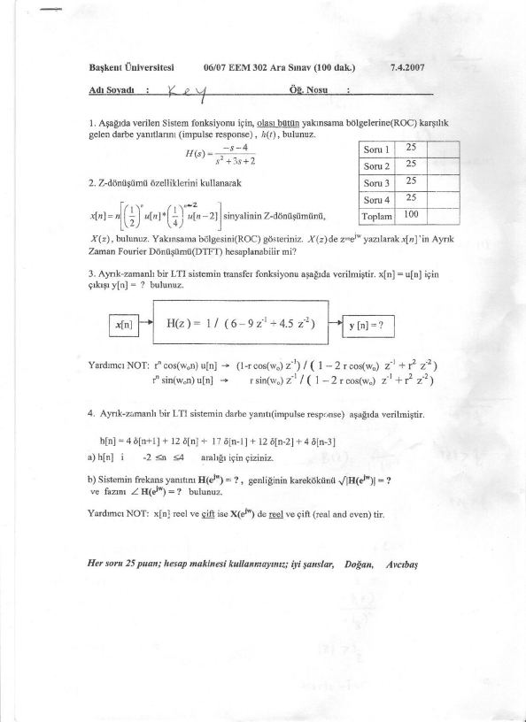
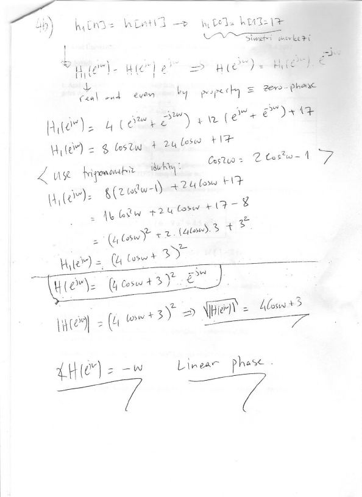

This post contains the midterm exam of the **06/07 EEM 302 Signals and Systems II** course at Başkent University, dated **April 7, 2007**, together with the exam's handwritten **answer key** ("EEM302 Arasınav Yanıtlar", i.e. "EEM302 Midterm Answers"). The course was later offered under the code EEM 308. At the bottom of the exam sheet the instructors' names appear as *Doğan* and *Avcıbaş*; this copy has "Key" written in the name field, so it is the solution copy of the exam. The exam lasts 100 minutes and has four questions worth 25 points each; calculators are not allowed. The four scanned pages are available for download as a PDF at the end of the post.

## Questions

**1.** For the system function given below, find the impulse responses h(t) corresponding to *all possible* regions of convergence (ROC).

H(s) = (−s − 4) / (s² + 3s + 2)

**2.** Using the properties of the z-transform, find the z-transform X(z) of the signal

x[n] = n · [ (1/2)ⁿ u[n] ∗ (1/4)ⁿ⁻² u[n − 2] ]

Show the region of convergence (ROC). Can the discrete-time Fourier transform (DTFT) of x[n] be computed by substituting z = e^{jω} in X(z)?

**3.** The transfer function of a discrete-time LTI system is given as H(z) = 1 / (6 − 9z⁻¹ + 4.5z⁻²). Find the output y[n] = ? for x[n] = u[n].

Hint:

- rⁿ cos(ω₀n) u[n] ↔ (1 − r cos(ω₀) z⁻¹) / (1 − 2r cos(ω₀) z⁻¹ + r² z⁻²)
- rⁿ sin(ω₀n) u[n] ↔ r sin(ω₀) z⁻¹ / (1 − 2r cos(ω₀) z⁻¹ + r² z⁻²)

**4.** The impulse response of a discrete-time LTI system is given below:

h[n] = 4δ[n+1] + 12δ[n] + 17δ[n−1] + 12δ[n−2] + 4δ[n−3]

1. Plot h[n] for the range −2 ≤ n ≤ 4.
1. Find the frequency response of the system H(e^{jω}), the square root of its magnitude √|H(e^{jω})|, and its phase ∠H(e^{jω}).

Hint: If x[n] is real and even, then X(e^{jω}) is also real and even.

## Answer key

### Question 1: Impulse responses by ROC

Partial fraction expansion:

H(s) = (−s − 4) / ((s + 1)(s + 2)) = A/(s + 1) + B/(s + 2)

A = (s + 1)H(s) |ₛ₌₋₁ = −3, B = (s + 2)H(s) |ₛ₌₋₂ = 2, so H(s) = −3/(s + 1) + 2/(s + 2).

Since the poles are at s = −1 and s = −2, three ROCs are possible:

| ROC | h(t) | Comment |
|---|---|---|
| Re{s} < −2 | (3e⁻ᵗ − 2e⁻²ᵗ) u(−t) | Not causal (anti-causal), not stable |
| Re{s} > −1 | (−3e⁻ᵗ + 2e⁻²ᵗ) u(t) | Causal and stable; ROC includes the jω axis |
| −2 < Re{s} < −1 | 3e⁻ᵗ u(−t) + 2e⁻²ᵗ u(t) | Two-sided (non-causal), not stable |

### Question 2: Z-transform properties

- a[n] = (1/2)ⁿ u[n] → A(z) = 1 / (1 − ½z⁻¹), |z| > 1/2
- b[n] = (1/4)ⁿ u[n] → B(z) = 1 / (1 − ¼z⁻¹), |z| > 1/4
- c[n] = (1/4)ⁿ⁻² u[n − 2] = b[n − 2] → C(z) = z⁻² / (1 − ¼z⁻¹), |z| > 1/4

Since x[n] = n·(a[n] ∗ c[n]), by the convolution and "multiplication by n" properties, X(z) = −z · d/dz [A(z)C(z)]:

A(z)C(z) = z⁻² / (1 − ¾z⁻¹ + ⅛z⁻²) = 1 / (z² − ¾z + ⅛)

d/dz [A(z)C(z)] = −(2z − ¾) / (z² − ¾z + ⅛)²

X(z) = (2z⁻² − ¾z⁻³) / (1 − ¾z⁻¹ + ⅛z⁻²)², |z| > 1/2

Since the ROC includes the unit circle (|z| = 1), the system is stable; **yes, the DTFT can be computed**.

### Question 3: Unit step response

Y(z) = H(z)X(z) = 1 / (6 − 9z⁻¹ + 4.5z⁻²) · 1 / (1 − z⁻¹)

Partial fractions: Y(z) = A/(1 − z⁻¹) + (B + Cz⁻¹)/(6 − 9z⁻¹ + 4.5z⁻²)

- A = (1 − z⁻¹)Y(z) |_{z⁻¹=1} = 2/3
- lim_{z→∞} Y(z) = 1/6 = A + B/6 ⇒ B = −3
- lim_{z→0} z⁻¹Y(z) = 0 = −A + (2/9)C ⇒ C = 3

Y(z) = (2/3) · 1/(1 − z⁻¹) + (3/6) · (z⁻¹ − 1)/(1 − 1.5z⁻¹ + 0.75z⁻²)

Matching with the given formulas: r² = 0.75 ⇒ r = √3/2; 2r cos ω₀ = 3/2 ⇒ cos ω₀ = √3/2 ⇒ ω₀ = π/6, sin ω₀ = 1/2. Hence r cos ω₀ = 3/4 and r sin ω₀ = √3/4.

Y(z) = (2/3) · 1/(1 − z⁻¹) − ½ [ (1 − ¾z⁻¹)/(1 − ³⁄₂z⁻¹ + ¾z⁻²) − (1/√3) · (√3/4)z⁻¹/(1 − ³⁄₂z⁻¹ + ¾z⁻²) ]

**y[n] = [ 2/3 − ½ (√3/2)ⁿ cos(nπ/6) + (1/(2√3)) (√3/2)ⁿ sin(nπ/6) ] u[n]**

(Check: y[0] = 2/3 − 1/2 = 1/6, which agrees with 6y[0] = 1 obtained directly from the difference equation.)

### Question 4: Linear-phase system

**a)** The values of h[n]:

| n | −2 | −1 | 0 | 1 | 2 | 3 | 4 |
|---|---|---|---|---|---|---|---|
| h[n] | 0 | 4 | 12 | 17 | 12 | 4 | 0 |

The sequence is symmetric about n = 1.

**b)** Define h₁[n] = h[n + 1]; then h₁[0] = h[1] = 17 is the center of symmetry. Since h₁[n] is real and even, H₁(e^{jω}) is also real and even (zero phase). By the shift property, H(e^{jω}) = H₁(e^{jω}) e^{−jω}.

H₁(e^{jω}) = 4(e^{j2ω} + e^{−j2ω}) + 12(e^{jω} + e^{−jω}) + 17 = 8 cos 2ω + 24 cos ω + 17

Using the identity cos 2ω = 2cos²ω − 1:

H₁(e^{jω}) = 16 cos²ω + 24 cos ω + 9 = (4 cos ω + 3)²

**H(e^{jω}) = (4 cos ω + 3)² e^{−jω}**

|H(e^{jω})| = (4 cos ω + 3)² ⇒ √|H(e^{jω})| = 4 cos ω + 3

∠H(e^{jω}) = −ω: **linear phase**.

*Note: Strictly written, √|H(e^{jω})| = |4 cos ω + 3|; the expression 4 cos ω + 3 is negative for cos ω < −3/4. The phase, however, is −ω everywhere, since (4 cos ω + 3)² ≥ 0.*

## Handwritten solution pages

, 7.4.2007, page 1")

![Answer key page 2: partial fractions and y[n] for Question 3, plot of h[n] for Question 4a](s-03.jpg "Answer key, page 2")

