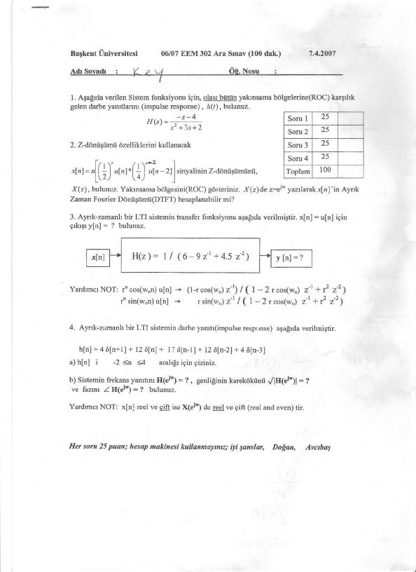
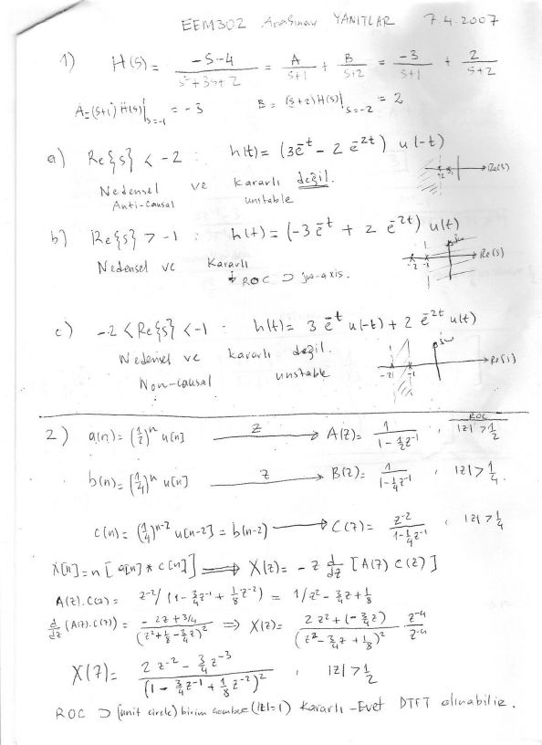
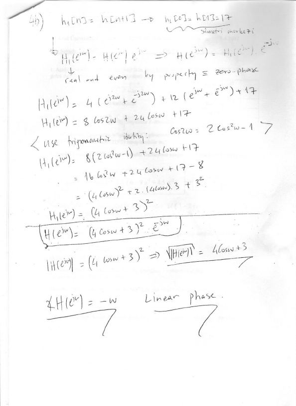

Bu yazı, Başkent Üniversitesi **06/07 EEM 302 Sinyaller ve Sistemler II** dersinin **7 Nisan 2007** tarihli ara sınavını ve sınavın el yazısı **cevap anahtarını** ("EEM302 Arasınav Yanıtlar") içeriyor. Ders daha sonra EEM 308 koduyla verilmeye devam etti. Sınav kâğıdının altında hocaların adları *Doğan* ve *Avcıbaş* olarak geçiyor; ad kısmına "Key" yazılmış bu kâğıt sınavın çözüm nüshası. Sınav 100 dakika, dört soru, her soru 25 puan; hesap makinesi kullanılmıyor. Taranmış dört sayfa yazının sonunda PDF olarak indirilebilir.

## Sorular

**1.** Aşağıda verilen sistem fonksiyonu için, *olası bütün* yakınsama bölgelerine (ROC) karşılık gelen darbe yanıtlarını (impulse response) h(t) bulunuz.

H(s) = (−s − 4) / (s² + 3s + 2)

**2.** Z-dönüşümü özelliklerini kullanarak

x[n] = n · [ (1/2)ⁿ u[n] ∗ (1/4)ⁿ⁻² u[n − 2] ]

sinyalinin z-dönüşümünü X(z) bulunuz. Yakınsama bölgesini (ROC) gösteriniz. X(z)'de z = e^{jω} yazılarak x[n]'in ayrık zaman Fourier dönüşümü (DTFT) hesaplanabilir mi?

**3.** Ayrık zamanlı bir LTI sistemin transfer fonksiyonu H(z) = 1 / (6 − 9z⁻¹ + 4,5z⁻²) olarak verilmiştir. x[n] = u[n] için çıkış y[n] = ? bulunuz.

Yardımcı not:

- rⁿ cos(ω₀n) u[n] ↔ (1 − r cos(ω₀) z⁻¹) / (1 − 2r cos(ω₀) z⁻¹ + r² z⁻²)
- rⁿ sin(ω₀n) u[n] ↔ r sin(ω₀) z⁻¹ / (1 − 2r cos(ω₀) z⁻¹ + r² z⁻²)

**4.** Ayrık zamanlı bir LTI sistemin darbe yanıtı aşağıda verilmiştir:

h[n] = 4δ[n+1] + 12δ[n] + 17δ[n−1] + 12δ[n−2] + 4δ[n−3]

1. h[n]'i −2 ≤ n ≤ 4 aralığı için çiziniz.
1. Sistemin frekans yanıtını H(e^{jω}), genliğinin karekökünü √|H(e^{jω})| ve fazını ∠H(e^{jω}) bulunuz.

Yardımcı not: x[n] reel ve çift ise X(e^{jω}) de reel ve çifttir (real and even).

## Cevap anahtarı

### Soru 1: ROC'a göre darbe yanıtları

Kısmi kesirlere ayırma:

H(s) = (−s − 4) / ((s + 1)(s + 2)) = A/(s + 1) + B/(s + 2)

A = (s + 1)H(s) |ₛ₌₋₁ = −3, B = (s + 2)H(s) |ₛ₌₋₂ = 2, yani H(s) = −3/(s + 1) + 2/(s + 2).

Kutuplar s = −1 ve s = −2'de olduğu için üç ROC mümkün:

| ROC | h(t) | Yorum |
|---|---|---|
| Re{s} < −2 | (3e⁻ᵗ − 2e⁻²ᵗ) u(−t) | Nedensel değil (anti-causal), kararlı değil |
| Re{s} > −1 | (−3e⁻ᵗ + 2e⁻²ᵗ) u(t) | Nedensel ve kararlı; ROC jω eksenini içeriyor |
| −2 < Re{s} < −1 | 3e⁻ᵗ u(−t) + 2e⁻²ᵗ u(t) | İki taraflı (non-causal), kararlı değil |

### Soru 2: Z-dönüşümü özellikleri

- a[n] = (1/2)ⁿ u[n] → A(z) = 1 / (1 − ½z⁻¹), |z| > 1/2
- b[n] = (1/4)ⁿ u[n] → B(z) = 1 / (1 − ¼z⁻¹), |z| > 1/4
- c[n] = (1/4)ⁿ⁻² u[n − 2] = b[n − 2] → C(z) = z⁻² / (1 − ¼z⁻¹), |z| > 1/4

x[n] = n·(a[n] ∗ c[n]) olduğundan, konvolüsyon ve "n ile çarpma" özellikleriyle X(z) = −z · d/dz [A(z)C(z)]:

A(z)C(z) = z⁻² / (1 − ¾z⁻¹ + ⅛z⁻²) = 1 / (z² − ¾z + ⅛)

d/dz [A(z)C(z)] = −(2z − ¾) / (z² − ¾z + ⅛)²

X(z) = (2z⁻² − ¾z⁻³) / (1 − ¾z⁻¹ + ⅛z⁻²)², |z| > 1/2

ROC birim çemberi (|z| = 1) içerdiği için sistem kararlıdır; **evet, DTFT alınabilir**.

### Soru 3: Birim basamak yanıtı

Y(z) = H(z)X(z) = 1 / (6 − 9z⁻¹ + 4,5z⁻²) · 1 / (1 − z⁻¹)

Kısmi kesirler: Y(z) = A/(1 − z⁻¹) + (B + Cz⁻¹)/(6 − 9z⁻¹ + 4,5z⁻²)

- A = (1 − z⁻¹)Y(z) |_{z⁻¹=1} = 2/3
- lim_{z→∞} Y(z) = 1/6 = A + B/6 ⇒ B = −3
- lim_{z→0} z⁻¹Y(z) = 0 = −A + (2/9)C ⇒ C = 3

Y(z) = (2/3) · 1/(1 − z⁻¹) + (3/6) · (z⁻¹ − 1)/(1 − 1,5z⁻¹ + 0,75z⁻²)

Verilen formüllerle eşleştirme: r² = 0,75 ⇒ r = √3/2; 2r cos ω₀ = 3/2 ⇒ cos ω₀ = √3/2 ⇒ ω₀ = π/6, sin ω₀ = 1/2. Buradan r cos ω₀ = 3/4 ve r sin ω₀ = √3/4.

Y(z) = (2/3) · 1/(1 − z⁻¹) − ½ [ (1 − ¾z⁻¹)/(1 − ³⁄₂z⁻¹ + ¾z⁻²) − (1/√3) · (√3/4)z⁻¹/(1 − ³⁄₂z⁻¹ + ¾z⁻²) ]

**y[n] = [ 2/3 − ½ (√3/2)ⁿ cos(nπ/6) + (1/(2√3)) (√3/2)ⁿ sin(nπ/6) ] u[n]**

(Kontrol: y[0] = 2/3 − 1/2 = 1/6, bu da doğrudan fark denkleminden 6y[0] = 1 ile tutuyor.)

### Soru 4: Doğrusal fazlı sistem

**a)** h[n]'in değerleri:

| n | −2 | −1 | 0 | 1 | 2 | 3 | 4 |
|---|---|---|---|---|---|---|---|
| h[n] | 0 | 4 | 12 | 17 | 12 | 4 | 0 |

Dizi n = 1 etrafında simetrik.

**b)** h₁[n] = h[n + 1] tanımlanırsa h₁[0] = h[1] = 17 simetri merkezi olur; h₁[n] reel ve çift olduğundan H₁(e^{jω}) de reel ve çifttir (sıfır fazlı). Kaydırma özelliğiyle H(e^{jω}) = H₁(e^{jω}) e^{−jω}.

H₁(e^{jω}) = 4(e^{j2ω} + e^{−j2ω}) + 12(e^{jω} + e^{−jω}) + 17 = 8 cos 2ω + 24 cos ω + 17

cos 2ω = 2cos²ω − 1 özdeşliği kullanılırsa:

H₁(e^{jω}) = 16 cos²ω + 24 cos ω + 9 = (4 cos ω + 3)²

**H(e^{jω}) = (4 cos ω + 3)² e^{−jω}**

|H(e^{jω})| = (4 cos ω + 3)² ⇒ √|H(e^{jω})| = 4 cos ω + 3

∠H(e^{jω}) = −ω: **doğrusal faz** (linear phase).

*Not: Kesin yazımla √|H(e^{jω})| = |4 cos ω + 3| olmalıdır; 4 cos ω + 3 ifadesi cos ω < −3/4 için negatif olur. Faz ise (4 cos ω + 3)² ≥ 0 olduğundan her yerde −ω'dır.*

## El yazısı çözüm sayfaları

![Cevap anahtarı sayfa 2: Soru 3 kısmi kesirler ve y[n], Soru 4a h[n] çizimi](s-03.jpg "Cevap anahtarı, sayfa 2")

