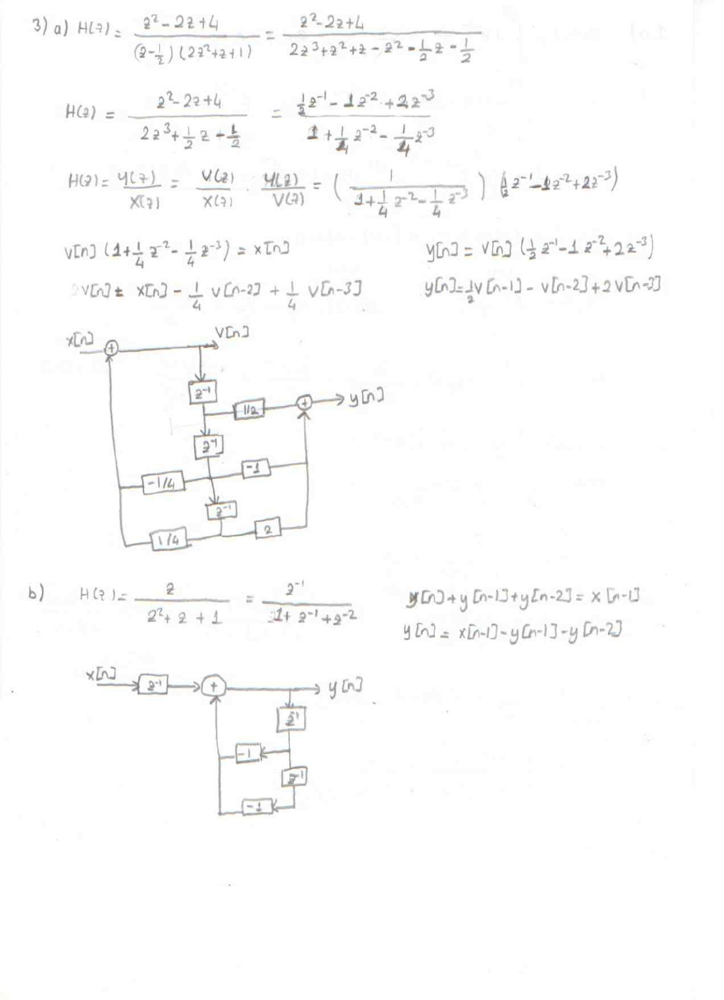
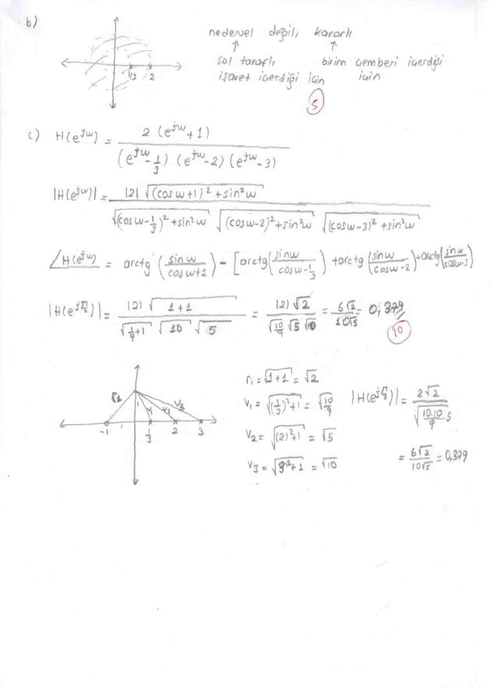

This post transcribes a four-page handwritten **answer key** for a midterm exam of the **EEM 308 Signals and Systems II** course at Başkent University. The document was among the sample questions for the spring 2014 semester, together with the quiz answer keys from the same semester; the handwriting is the same. There is no question sheet; the questions are described below as far as they can be inferred from the answers. The circled numbers show the section points. A PDF of the scanned pages can be downloaded at the end of the post.

## 1) Unilateral Laplace transform

**a)** X_I(s) = ∫₀^∞ 1·e⁻ˢᵗ dt = **1/s**, Re(s) > 0

**b)** x(t) = δ(t + 1) + δ(t) + e^{−2(t+3)} u(t + 1). Since the integral in the unilateral transform starts at 0, δ(t + 1) contributes nothing, and δ(t) gives 1:

X_I(s) = 1 + ∫₀^∞ e^{−2(t+3)} e⁻ˢᵗ dt = **1 + e⁻⁶/(s + 2)**, Re(s) > −2

**c)** x(t) = 8 cos(πt/2) u(t) ∗ [u(t) − u(t − 1)]. Convolution corresponds to the product of the transforms:

- X_I1(s) = 8s / (s² + π²/4)
- X_I2(s) = 1/s − e⁻ˢ/s = (1 − e⁻ˢ)/s

**X_I(s) = 8(1 − e⁻ˢ) / (s² + π²/4)**, Re(s) > 0

## 2) Transfer function via the eigenfunction method

The complex exponential x(t) = e^{s_k t} is an eigenfunction of an LTI system: y(t) = H(s_k) e^{s_k t}. Since y(t) = (1/6)e²ᵗ is given for x(t) = e²ᵗ, **H(2) = 1/6**.

As far as can be inferred from the answer, the question gives the relation dh/dt + 2h(t) = e^{−4t}u(t) + b·u(t); its Laplace transform is:

(s + 2)H(s) = 1/(s + 4) + b/s ⇒ H(s) = (s + b(s + 4)) / (s(s + 4)(s + 2))

H(2) = (2 + 6b)/(2·6·4) = 1/6 ⇒ 2 + 6b = 8 ⇒ **b = 1**

**H(s) = 2(s + 2) / (s(s + 4)(s + 2)) = 2 / (s(s + 4))**

## 3) Block diagrams

**a)** H(z) = (z² − 2z + 4) / ((z − ½)(2z² + z + 1)). Expanding the denominator gives 2z³ + ½z − ½; dividing the numerator and denominator by 2z³:

H(z) = (½z⁻¹ − z⁻² + 2z⁻³) / (1 + ¼z⁻² − ¼z⁻³)

With the intermediate variable v[n] (direct form II):

- V(z)/X(z) = 1/(1 + ¼z⁻² − ¼z⁻³) ⇒ **v[n] = x[n] − ¼v[n − 2] + ¼v[n − 3]**
- Y(z)/V(z) = ½z⁻¹ − z⁻² + 2z⁻³ ⇒ **y[n] = ½v[n − 1] − v[n − 2] + 2v[n − 3]**

**b)** H(z) = z/(z² + z + 1) = z⁻¹/(1 + z⁻¹ + z⁻²) ⇒ y[n] + y[n − 1] + y[n − 2] = x[n − 1], that is, **y[n] = x[n − 1] − y[n − 1] − y[n − 2]**.

## 4) Convolution (via the z-transform)

With Y(z) = X(z)H(z):

- X(z) = 1 + 2z⁻¹ − z⁻² − 2z⁻³ + z⁻⁴ + 2z⁻⁵
- H(z) = z⁻¹ + 2z⁻²

Y(z) = z⁻¹ + 4z⁻² + 3z⁻³ − 4z⁻⁴ − 3z⁻⁵ + 4z⁻⁶ + 4z⁻⁷

| n | 0 | 1 | 2 | 3 | 4 | 5 | 6 | 7 |
|---|---|---|---|---|---|---|---|---|
| y[n] | 0 | 1 | 4 | 3 | −4 | −3 | 4 | 4 |

## 5) Partial fractions, causality, and frequency response (8 + 7 + 5 + 5 + 10 points)

**a)** H(z) = 2(z + 1) / ((z − ⅓)(z − 2)(z − 3)) = A/(z − ⅓) + B/(z − 2) + C/(z − 3)

- A = 2(4/3) / ((−5/3)(−8/3)) = 3/5
- B = 2(3) / ((5/3)(−1)) = −18/5
- C = 2(4) / ((8/3)(1)) = 3

Since the system is assumed stable, the ROC must contain the unit circle: **1/3 < |z| < 2**. The impulse response in the answer key:

h[n] = (3/5)(1/3)ⁿ u[n] − [3·(3)ⁿ − (18/5)(2)ⁿ] u[−n − 1]

*Note: This expression was obtained by inverting the A/(z − a) terms as if they were A/(1 − az⁻¹), and it gives a result one sample ahead of the correct answer (the inverse transform of z·H(z)). Since A/(z − a) = A z⁻¹/(1 − az⁻¹), the correct result is h[n] = (3/5)(1/3)ⁿ⁻¹ u[n − 1] + [(18/5)·2ⁿ⁻¹ − 3ⁿ] u[−n] = (9/5)(1/3)ⁿ u[n − 1] + [(9/5)·2ⁿ − 3ⁿ] u[−n]. This result was verified by numerically comparing the sum Σ h[n] e^{−jωn} on the unit circle with H(e^{jω}).*

**b)** The system is **not causal** (the ROC is an annulus, and the impulse response contains a left-sided signal) and is **stable** (the ROC contains the unit circle).

**c)** Frequency response:

H(e^{jω}) = 2(e^{jω} + 1) / ((e^{jω} − ⅓)(e^{jω} − 2)(e^{jω} − 3))

|H(e^{jω})| = 2√((cos ω + 1)² + sin²ω) / [√((cos ω − ⅓)² + sin²ω) · √((cos ω − 2)² + sin²ω) · √((cos ω − 3)² + sin²ω)]

∠H(e^{jω}) = arctan(sin ω/(cos ω + 1)) − [arctan(sin ω/(cos ω − ⅓)) + arctan(sin ω/(cos ω − 2)) + arctan(sin ω/(cos ω − 3))]

At ω = π/2 (z = j), the lengths of the vectors drawn from the zero and the poles to the point z = j are: r₁ = √2 for the zero, and v₁ = √(10/9), v₂ = √5, v₃ = √10 for the poles. Thus:

**|H(e^{jπ/2})| = 2√2 / (√(10/9)·√5·√10) = 6√2/(10√5) ≈ 0.379**

