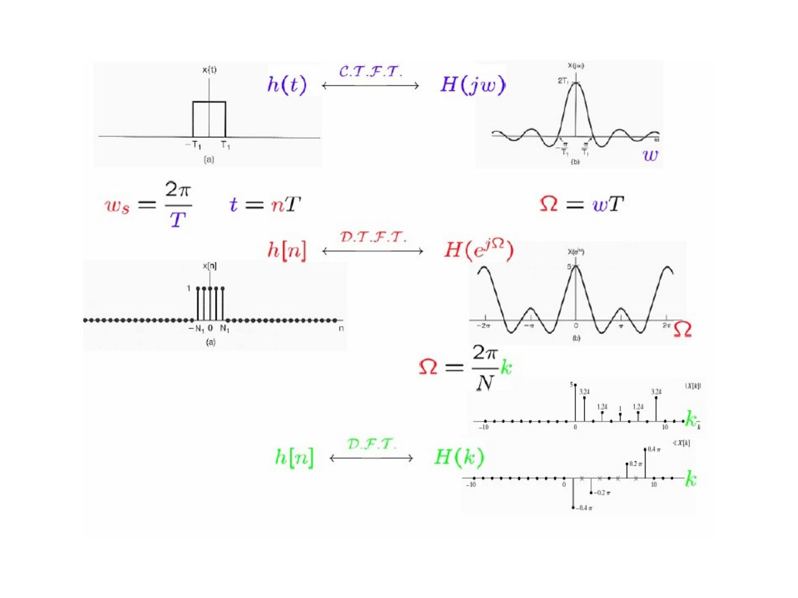
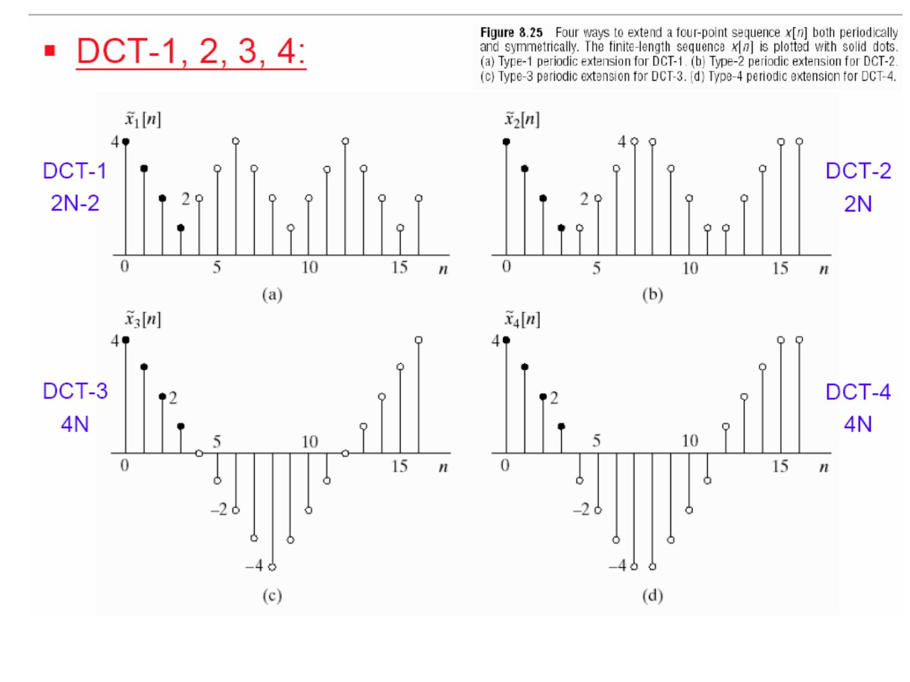
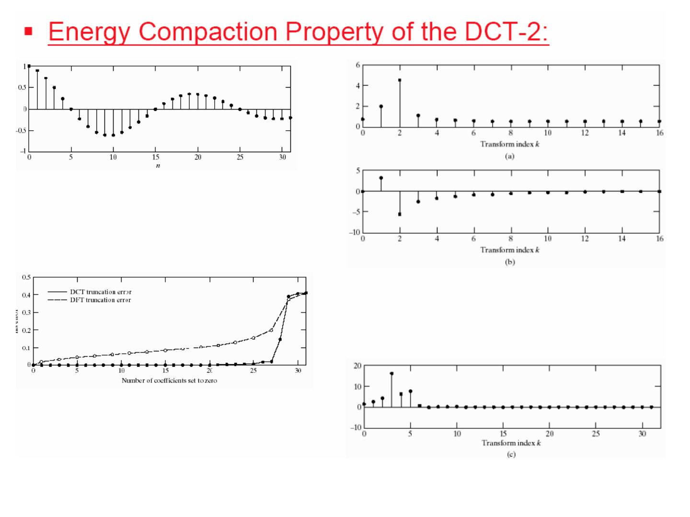

Bu yazı, Başkent Üniversitesi **EEM308 Sinyaller ve Sistemler II** dersinin arşiv klasöründe bulunan, yazarı slaytlarda belirtilmemiş İngilizce ders slaytlarından **Ayrık Fourier Dönüşümü (Discrete Fourier Transform, DFT)** sunumudur (39 slayt). Dosya son olarak 15 Şubat 2010'da kaydedilmiş; PowerPoint dosyasının özelliklerinde yazar olarak *İsmail Avcıbaş* adı görünüyor, ancak slaytların neredeyse tamamı başka bir ders sunumundan alınmış ekran görüntüleridir ve asıl hazırlayanın kim olduğu (kurum, hoca) slaytlarda yazmıyor. Kırmızı başlıklı, mavi vurgulu madde düzeni bir üniversitenin "Signals and Systems / DSP" ders slaytlarına benziyor. Tablo ve şekiller Oppenheim, Schafer & Buck'ın *Discrete-Time Signal Processing* (1999) kitabının 8. bölümünden (Tablo 8.1, 8.2, Şekil 8.25) alınmış. Slayt içeriği İngilizce olarak metne döküldü; gerekli birkaç şekil için slayt görselleri eklendi. Orijinal PowerPoint dosyası yazının sonunda indirilebilir.

*Bu içerik üçüncü taraf bir kaynağa aittir; arşiv ve nostalji amacıyla kaynak belirtilerek paylaşılmıştır. Hak sahibinin talebi hâlinde kaldırılır.*

*Not: Dosyanın ilk slaytında başlık olarak "SAMPLING" yazıyor; dosya örnekleme sunumunun kopyası üzerine hazırlanmış ve başlık değiştirilmemiş. İçerik tamamen DFT'dir.*

## Course outline

- Fourier Series of CT Periodic Signals
  - Fourier Series of DT Periodic Signals
- CT Fourier Transform
  - DT Fourier Transform
- Laplace Transform
  - z-Transform
- **Discrete Fourier Transform**

## From CTFT to DTFT to DFT

The same rectangular pulse is shown in three domains:

- h(t) ↔ H(jω) (CTFT)
- sampling with t = nT, ω_s = 2π/T and Ω = ωT gives h[n] ↔ H(e^{jΩ}) (DTFT)
- sampling the DTFT at Ω = (2π/N)k gives h[n] ↔ H(k) (DFT)

Table of contents of *"Discrete-Time Signal Processing"* by Oppenheim, Schafer and Buck, 1999:

1. Introduction
1. Discrete-Time Signals and Systems
1. The z-Transform
1. Sampling of Continuous-Time Signals
1. Transform Analysis of Linear Time-Invariant Systems
1. Structures for Discrete-Time Systems
1. Filter Design Techniques
1. **The Discrete Fourier Transform** (bu sunumun konusu)
1. Computation of the Discrete Fourier Transform
1. Fourier Analysis of Signals Using the Discrete Fourier Transform
1. Discrete Hilbert Transforms

Outline of the lecture:

- The Discrete Fourier Series of Periodic Sequences
- Properties of the Discrete Fourier Series
- The Fourier Transform of Periodic Signals
- The Discrete Fourier Transform of Finite-Duration Sequences
- Properties of the Discrete Fourier Transform
- The Discrete Cosine Transform

## The Discrete Fourier Series of periodic sequences

### Review: DTFT

For the rectangular pulse x[n] = 1 for |n| ≤ N₁ and 0 for |n| > N₁:

x[n] ↔ X(e^{jω}) = sin(ω(N₁ + 1/2)) / sin(ω/2)

- The **synthesis** equation: x[n] = (1/2π) ∫_{2π} X(e^{jω}) e^{jωn} dω
- The **analysis** equation: X(e^{jω}) = Σ_{n=−∞}^{+∞} x[n] e^{−jωn}

### Review: DT Fourier series

For the periodic square wave x[n] = 1 for −N₁ ≤ n ≤ N₁ and 0 for the other values in one period ⟨N⟩:

a_k = (1/N) Σ_{n=−N₁}^{N₁} e^{−jk(2π/N)n}

- The **synthesis** equation: x[n] = Σ_{k=⟨N⟩} a_k e^{jkω₀n} = Σ_{k=⟨N⟩} a_k e^{jk(2π/N)n}
- The **analysis** equation: a_k = (1/N) Σ_{n=⟨N⟩} x[n] e^{−jkω₀n} = (1/N) Σ_{n=⟨N⟩} x[n] e^{−jk(2π/N)n}, and a_k = a_{k+N}

### Periodic and finite-length sequences: the DFS pair

With W_N = e^{−j(2π/N)}, a periodic sequence x̃[n] with period N and its DFS coefficients X̃[k] satisfy x̃[n] ↔ X̃[k] (DFS):

- The **synthesis** equation: x̃[n] = (1/N) Σ_{k=0}^{N−1} X̃[k] W_N^{−kn}
- The **analysis** equation: X̃[k] = Σ_{n=0}^{N−1} x̃[n] W_N^{kn}

(Example in the figure: a period-10 sequence with five ones; |X̃[k]| has the value 5 at k = 0, and the phase is indeterminate where the magnitude is zero.)

### Periodic complex exponentials

W_N = e^{−j(2π/N)}

e_k[n] = e^{−j(2π/N)kn} = (W_N)^{kn} = W_N^{kn}

e_k[n + rN] = e^{−j(2π/N)k(n+rN)} = e^{−j(2π/N)kn} e^{−j(2πr)} = e_k[n]  (periodic in n)

e_{k+lN}[n] = e^{−j(2π/N)(k+lN)n} = e^{−j(2π/N)kn} e^{−j(2πl)} = e_k[n]  (periodic in k)

## Properties of the Discrete Fourier Series

Let x̃[n] and ỹ[n] be periodic sequences with period N, x̃[n] ↔ X̃[k] and ỹ[n] ↔ Ỹ[k] (DFS).

- **Linearity:** z̃[n] = A x̃[n] + B ỹ[n] ↔ Z̃[k] = A X̃[k] + B Ỹ[k]
- **Shift of a sequence:** x̃[n − m] ↔ W_N^{km} X̃[k], and W_N^{−ln} x̃[n] ↔ X̃[k − l]
- **Duality:** writing the synthesis equation as N x̃[−n] = Σ_{k=0}^{N−1} X̃[k] W_N^{kn} and swapping n and k, N x̃[−k] = Σ_{n=0}^{N−1} X̃[n] W_N^{kn}. Hence X̃[n] ↔ N x̃[−k].

Table 8.1 (Oppenheim–Schafer) summarises the DFS properties:

| # | Periodic sequence (period N) | DFS coefficients (period N) |
|---|---|---|
| 1 | x̃[n] | X̃[k], periodic with period N |
| 3 | a x̃₁[n] + b x̃₂[n] | a X̃₁[k] + b X̃₂[k] |
| 4 | X̃[n] | N x̃[−k] |
| 5 | x̃[n − m] | W_N^{km} X̃[k] |
| 6 | W_N^{−ln} x̃[n] | X̃[k − l] |
| 7 | Σ_{m=0}^{N−1} x̃₁[m] x̃₂[n − m] (periodic convolution) | X̃₁[k] X̃₂[k] |
| 8 | x̃₁[n] x̃₂[n] | (1/N) Σ_{l=0}^{N−1} X̃₁[l] X̃₂[k − l] (periodic convolution) |
| 9 | x̃*[n] | X̃*[−k] |
| 10 | x̃*[−n] | X̃*[k] |
| 11 | Re{x̃[n]} | X̃_e[k] = ½(X̃[k] + X̃*[−k]) |
| 12 | j Im{x̃[n]} | X̃_o[k] = ½(X̃[k] − X̃*[−k]) |
| 13 | x̃_e[n] = ½(x̃[n] + x̃*[−n]) | Re{X̃[k]} |
| 14 | x̃_o[n] = ½(x̃[n] − x̃*[−n]) | j Im{X̃[k]} |

For real x̃[n] (properties 15–17): X̃[k] = X̃*[−k], Re{X̃[k]} = Re{X̃[−k]}, Im{X̃[k]} = −Im{X̃[−k]}, |X̃[k]| = |X̃[−k]|, ∠X̃[k] = −∠X̃[−k]; the even part ½(x̃[n] + x̃[−n]) ↔ Re{X̃[k]} and the odd part ½(x̃[n] − x̃[−n]) ↔ j Im{X̃[k]}.

## The Fourier transform of periodic signals

Compare a periodic sequence x̃[n] with one period x[n] (zero outside 0 ≤ n ≤ N−1):

- x̃[n] ↔ X̃[k] (DFS): x̃[n] = (1/N) Σ_{k=0}^{N−1} X̃[k] e^{j(2π/N)kn}, X̃[k] = Σ_{n=0}^{N−1} x̃[n] e^{−j(2π/N)kn}
- x[n] ↔ X(e^{jω}) (DTFT): x[n] = (1/2π) ∫_{2π} X(e^{jω}) e^{jωn} dω, X(e^{jω}) = Σ_{n=−∞}^{+∞} x[n] e^{−jωn}

So the DFS coefficients are **samples of the DTFT of one period**:

X̃[k] = X(e^{j(2π/N)k}) = X(e^{jω}) |_{ω = (2π/N)k}

![Periyot 10, beş birimlik darbe dizisinin |X(e^jω)| ve ∠X(e^jω) eğrileri ile bunların ω = 2πk/10 noktalarındaki örnekleri X̃[k]](s-17.jpg "DFS katsayıları DTFT'nin örnekleridir")

## The DFT of finite-duration sequences

A finite-length sequence x[n] (length N) is treated as one period of x̃[n]. With W_N = e^{−j(2π/N)}:

X[k] = X̃[k] for 0 ≤ k ≤ N−1, 0 otherwise;  x[n] = x̃[n] for 0 ≤ n ≤ N−1, 0 otherwise.

Hence the **DFT pair** x[n] ↔ X[k]:

- X[k] = Σ_{n=0}^{N−1} x[n] W_N^{kn}, 0 ≤ k ≤ N−1 (0 otherwise)
- x[n] = (1/N) Σ_{k=0}^{N−1} X[k] W_N^{−kn}, 0 ≤ n ≤ N−1 (0 otherwise)

![Beş noktalı darbe x[n] (n = 0…4), N = 5 ve N = 10 için periyodik uzantılar ve DFT genlik/faz değerleri (5; 3,24; 1,24; ±0,2π; ±0,4π)](s-19.jpg "Sonlu uzunluklu bir dizinin DFT'si; N seçimine bağlılık")

In the example, with N = 5 the periodic extension is a constant and the DFT is X[0] = 5, X[k] = 0 for k ≠ 0; with N = 10 the DFT samples the DTFT at ten points (|X[k]| = 5, 3.24, 0, 1.24, 0, 1, …).

## Properties of the DFT

- **Linearity:** for x[n] ↔ X[k] and y[n] ↔ Y[k], z[n] = A x[n] + B y[n] ↔ Z[k] = A X[k] + B Y[k].

*Not: Slaytta DFT doğrusallığı için de "x[n], y[n]: periodic sequences with period N" yazıyor (DFS slaytından kopyalanmış); DFT için doğrusu "N uzunluklu sonlu diziler"dir (uzunlukları farklıysa kısa olan sıfırla N'ye tamamlanır).*

### Circular shift of a sequence

x[((n − m))_N], 0 ≤ n ≤ N−1  ↔  e^{−j(2πk/N)m} X[k]

Derivation through the DFS: x̃[n] = x[((n))_N] ↔ X̃[k] = X[((k))_N]; ỹ[n] = y[((n))_N] ↔ Ỹ[k] = Y[((k))_N]. If Y[k] = e^{−j(2πk/N)m} X[k], then Ỹ[k] = e^{−j(2π((k))_N/N)m} X̃[((k))_N] = e^{−j(2πk/N)m} X̃[k], so ỹ[n] = x̃[n − m] and

y[n] = ỹ[n] = x[((n − m))_N] for 0 ≤ n ≤ N−1, 0 otherwise.

![Dairesel kaydırma: x[n], periyodik uzantısı x̃[n], kaydırılmış x̃[n+2] ve bir periyodun alınmasıyla elde edilen x₁[n]](s-23.jpg "Dairesel kaydırma")

### Duality

For the DFS: x̃[n] = x[((n))_N] ↔ X̃[k] and X̃[n] ↔ N x̃[−k]. Let ỹ[n] = X̃[n], i.e. y[n] = X[n]; then Ỹ[k] = N x̃[−k] and

Y[k] = N x̃[−k] = N x[((−k))_N] for 0 ≤ k ≤ N−1, 0 otherwise.

So for the DFT: x[n] ↔ X[k] and **X[n] ↔ N x[((−k))_N]**, 0 ≤ k ≤ N−1.

*Not: Slayttaki Y[k] ifadesinde aralık "0 ≤ n ≤ N − 1" yazılmış; Y[k] k'nin fonksiyonu olduğundan doğrusu 0 ≤ k ≤ N − 1'dir.*

(The figure example: x[n] = 1 for n = 0…4, N = 10; Re{X[k]} and Im{X[k]} are samples of the DTFT; the dual sequence x₁[n] = X[n] has the DFT X₁[k] = 10 x[((−k))₁₀], i.e. 10 at k = 0, 6, 7, 8, 9.)

### Circular convolution

z[n] = Σ_{m=0}^{N−1} x[m] y[((n − m))_N] = x[n] Ⓝ y[n]

- x[n] Ⓝ y[n] ↔ X[k] Y[k]
- x[n] y[n] ↔ (1/N) X[k] Ⓝ Y[k]

![İki uzunluk-L darbenin N noktalı dairesel konvolüsyonu: x₂[((−n))_N], x₂[((2−n))_N] ve sonuç x₃[n] = x₁[n] Ⓝ x₂[n]](s-29.jpg "Dairesel konvolüsyon örneği")

When both pulses have length N, their N-point circular convolution is the constant N over 0 ≤ n ≤ N−1; when the pulses have length L and N = 2L, the circular convolution equals the linear convolution (a triangle with peak L).

### Table 8.2: properties of the N-point DFT

| # | Finite-length sequence (length N) | N-point DFT (length N) |
|---|---|---|
| 1 | x[n] | X[k] |
| 3 | a x₁[n] + b x₂[n] | a X₁[k] + b X₂[k] |
| 4 | X[n] | N x[((−k))_N] |
| 5 | x[((n − m))_N] | W_N^{km} X[k] |
| 6 | W_N^{−ln} x[n] | X[((k − l))_N] |
| 7 | Σ_{m=0}^{N−1} x₁(m) x₂[((n − m))_N] | X₁[k] X₂[k] |
| 8 | x₁[n] x₂[n] | (1/N) Σ_{l=0}^{N−1} X₁(l) X₂[((k − l))_N] |
| 9 | x*[n] | X*[((−k))_N] |
| 10 | x*[((−n))_N] | X*[k] |
| 11 | Re{x[n]} | X_ep[k] = ½{X[((k))_N] + X*[((−k))_N]} |
| 12 | j Im{x[n]} | X_op[k] = ½{X[((k))_N] − X*[((−k))_N]} |
| 13 | x_ep[n] = ½{x[n] + x*[((−n))_N]} | Re{X[k]} |
| 14 | x_op[n] = ½{x[n] − x*[((−n))_N]} | j Im{X[k]} |

For real x[n] (15–17): X[k] = X*[((−k))_N], Re{X[k]} = Re{X[((−k))_N]}, Im{X[k]} = −Im{X[((−k))_N]}, |X[k]| = |X[((−k))_N]|, ∠X[k] = −∠X[((−k))_N]; x_ep[n] = ½{x[n] + x[((−n))_N]} ↔ Re{X[k]}, x_op[n] = ½{x[n] − x[((−n))_N]} ↔ j Im{X[k]}.

## The Discrete Cosine Transform

General orthogonal-transform form (compare with the DFS pair X̃[k] = Σ x̃[n] W_N^{kn}, x̃[n] = (1/N) Σ X̃[k] W_N^{−kn}):

- A[k] = Σ_{n=0}^{N−1} x[n] φ_k*[n]
- x[n] = (1/N) Σ_{k=0}^{N−1} A[k] φ_k[n]
- (1/N) Σ_{n=0}^{N−1} φ_k[n] φ_m*[n] = 1 for m = k, 0 for m ≠ k

For the DCT the basis sequences φ_k[n] are cosines: **even symmetric and periodic**.

### DCT-1, 2, 3, 4

A four-point sequence can be extended both periodically and symmetrically in four ways (Oppenheim–Schafer, Figure 8.25): type-1 extension (period 2N − 2) for DCT-1, type-2 (period 2N) for DCT-2, type-3 and type-4 (period 4N) for DCT-3 and DCT-4.

### DCT-1

X^{c1}[k] = 2 Σ_{n=0}^{N−1} α[n] x[n] cos(πkn / (N − 1)),  0 ≤ k ≤ N−1

x[n] = (1/(N − 1)) Σ_{k=0}^{N−1} α[k] X^{c1}[k] cos(πkn / (N − 1)),  0 ≤ n ≤ N−1

α[n] = 1/2 for n = 0 and N − 1;  1 for 1 ≤ n ≤ N − 2

### DCT-2

X^{c2}[k] = 2 Σ_{n=0}^{N−1} x[n] cos(πk(2n + 1) / 2N),  0 ≤ k ≤ N−1

x[n] = (1/N) Σ_{k=0}^{N−1} β[k] X^{c2}[k] cos(πk(2n + 1) / 2N),  0 ≤ n ≤ N−1

β[k] = 1/2 for k = 0;  1 for 1 ≤ k ≤ N − 1

*Not: Slaytta iki ters dönüşüm formülünün yanında da aralık "0 ≤ k ≤ N−1" yazılmış; ters dönüşüm n'nin fonksiyonu olduğundan doğrusu 0 ≤ n ≤ N−1'dir. Ayrıca baz dizileri slaytta φ_k[n] = cos(k, n) gibi kısaltılmış; açık biçimleri yukarıdaki kosinüslerdir.*

### Energy compaction property of the DCT-2

The example compares the DFT and DCT-2 of the same 32-point test sequence: the DCT-2 coefficients are concentrated in a few low indices, and when coefficients are set to zero, the DCT truncation error stays near zero much longer than the DFT truncation error.

- Hence, the major application of the DCT-2 is in **signal compression**,
- due to its **energy concentration** property.
