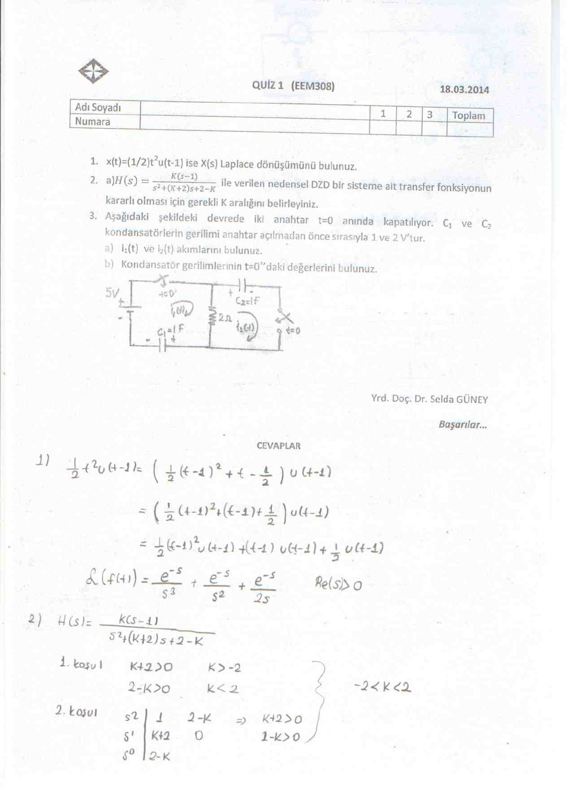
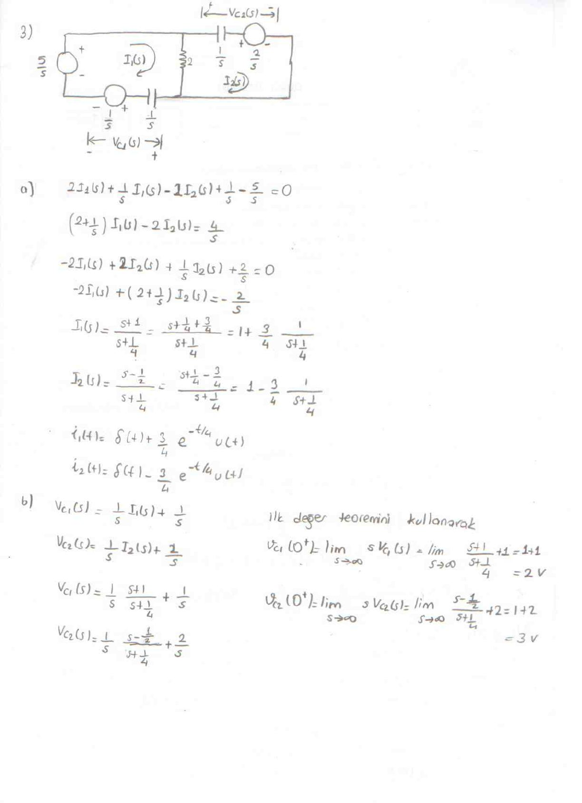
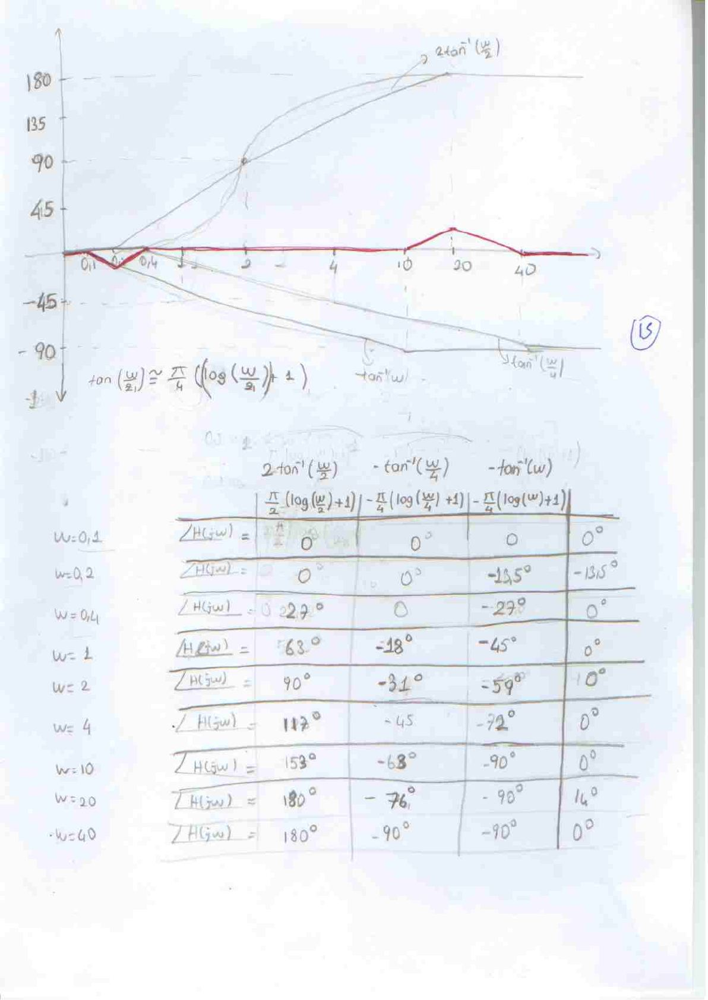
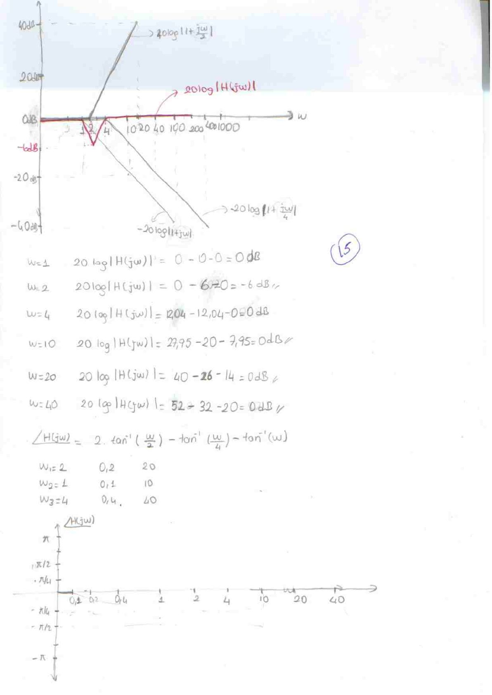

This post collects the **answer keys** of the three quizzes given in the spring 2014 semester of the **EEM 308 Signals and Systems II** course at Başkent University. The quizzes are by **Asst. Prof. Dr. Selda Güney**; the Quiz 1 paper is dated 18 March 2014 and comes with the question text, while Quiz II and III exist only as handwritten answers. The circled numbers show the points for each part. The eight scanned pages can be downloaded as a PDF at the end of the post.

## Quiz 1 (18 March 2014)

### Questions

1. If x(t) = (1/2)t² u(t − 1), find the Laplace transform X(s).
1. Determine the range of K required for the transfer function of the causal LTI system given by H(s) = K(s − 1) / (s² + (K + 2)s + 2 − K) to be stable.
1. In the circuit below, two switches are closed at t = 0. The voltages of capacitors C₁ and C₂ before the switches are closed are 1 V and 2 V, respectively. a) Find the currents i₁(t) and i₂(t). b) Find the values of the capacitor voltages at t = 0⁺.

### Answers

**1)** t² must be written in terms of (t − 1):

(1/2)t² u(t − 1) = [ (1/2)(t − 1)² + (t − 1) + 1/2 ] u(t − 1)

By the time-shifting property:

**X(s) = e⁻ˢ/s³ + e⁻ˢ/s² + e⁻ˢ/(2s)**, Re(s) > 0

**2)** The roots of the second-order denominator must lie in the left half-plane. Condition that the coefficients be positive: K + 2 > 0 ⇒ K > −2 and 2 − K > 0 ⇒ K < 2. The Routh table gives the same conditions (s²: 1, 2 − K; s¹: K + 2; s⁰: 2 − K). Result: **−2 < K < 2**.

**3)** The circuit is converted to the s-domain: the source is 5/s, the capacitors are shown as 1/s impedances with series sources 1/s and 2/s representing the initial voltages.

a) Mesh equations:

- (2 + 1/s) I₁(s) − 2 I₂(s) = 4/s
- −2 I₁(s) + (2 + 1/s) I₂(s) = −2/s

Solution:

- I₁(s) = (s + 1)/(s + 1/4) = 1 + (3/4) · 1/(s + 1/4) ⇒ **i₁(t) = δ(t) + (3/4) e^{−t/4} u(t)**
- I₂(s) = (s − 1/2)/(s + 1/4) = 1 − (3/4) · 1/(s + 1/4) ⇒ **i₂(t) = δ(t) − (3/4) e^{−t/4} u(t)**

b) V_C1(s) = (1/s) I₁(s) + 1/s and V_C2(s) = (1/s) I₂(s) + 2/s. By the initial value theorem:

- v_C1(0⁺) = lim_{s→∞} s V_C1(s) = lim (s + 1)/(s + 1/4) + 1 = **2 V**
- v_C2(0⁺) = lim_{s→∞} s V_C2(s) = lim (s − 1/2)/(s + 1/4) + 2 = **3 V**

The δ(t) terms in the currents correspond to the capacitor voltages changing instantaneously at the moment the switches close.

## Quiz II

Only the answer key exists for this quiz; the question texts can be inferred from the answers.

### 1) Difference equation with initial conditions (30 points)

3y[n] − 4y[n − 1] + y[n − 2] = x[n], x[n] = (1/2)ⁿ u[n], y[−1] = 1, y[−2] = 2. y[n] = ?

The unilateral z-transform is taken:

3Y(z) − 4[z⁻¹Y(z) + y[−1]] + [z⁻²Y(z) + z⁻¹y[−1] + y[−2]] = X(z)

Y(z)(3 − 4z⁻¹ + z⁻²) = 2 − z⁻¹ + z/(z − 1/2)

Y(z) = 2(3z² − 2z + 1/2) / (3(z − 1)(z − 1/2)(z − 1/3)) = (3/2) · 1/(1 − z⁻¹) − 1/(1 − ½z⁻¹) + (1/2) · 1/(1 − ⅓z⁻¹)

**y[n] = [ 3/2 − (1/2)ⁿ + (1/2)(1/3)ⁿ ] u[n]**

(Check: from the equation, y[0] = (1 + 4·1 − 2)/3 = 1 and y[1] = (1/2 + 4·1 − 1)/3 = 7/6; the formula also gives 1 and 3/2 − 1/2 + 1/6 = 7/6.)

### 2) Transfer function and Bode diagram (10 + 15 + 15 points)

For the system whose input is x(t) = δ(t) + 3e⁻²ᵗ u(t) − 8e⁻³ᵗ u(t):

X(s) = 1 + 3/(s + 2) − 8/(s + 3) = (s² − 1)/((s + 2)(s + 3)) = (s + 1)(s − 1)/((s + 2)(s + 3))

Since the transform of the output is Y(s) = (s − 1)(s + 2)/((s + 4)(s + 3)):

**H(s) = Y(s)/X(s) = (s + 2)² / ((s + 1)(s + 4))**

Bode form:

H(jω) = (jω + 2)² / ((jω + 1)(jω + 4)) = (1 + jω/2)² / ((1 + jω)(1 + jω/4))

20 log|H(jω)| = 40 log|1 + jω/2| − 20 log|1 + jω| − 20 log|1 + jω/4|

The corner frequencies are ω₁ = 2 (double zero), ω₂ = 1 and ω₃ = 4 (poles). Asymptotic magnitude values:

| ω (rad/s) | 1 | 2 | 4 | 10 | 20 | 40 |
|---|---|---|---|---|---|---|
| Magnitude (dB) | 0 | −6 | 0 | 0 | 0 | 0 |

Phase: ∠H(jω) = 2 tan⁻¹(ω/2) − tan⁻¹(ω/4) − tan⁻¹(ω). In the answer key, each term is drawn with the linear approximation tan⁻¹(ω/ω₁) ≈ (π/4)(log(ω/ω₁) + 1) between one tenth and ten times the corner frequency (ranges 0.2–20 rad/s for 2 tan⁻¹(ω/2), 0.1–10 rad/s for tan⁻¹(ω), and 0.4–40 rad/s for tan⁻¹(ω/4)).

### 3) All-pass system and group delay (15 + 30 + 15 points)

H(jω) = ∏ₙ₌₁ᴺ (1 − njω)/(1 + njω)

|H(jω)| = ∏ √(1 + n²ω²) / √(1 + n²ω²) = **1** (all-pass system)

In the answer key, the phase is given as ∠H(jω) = Σ 2 tan⁻¹(nω) and the group delay as τ(ω) = −d∠H/dω = −2 Σ n/((nω)² + 1).

*Note: Since the phase of the numerator (1 − njω) is −tan⁻¹(nω) and that of the denominator is +tan⁻¹(nω), the correct expressions are ∠H(jω) = −2 Σₙ₌₁ᴺ tan⁻¹(nω) and τ(ω) = 2 Σₙ₌₁ᴺ n/(1 + n²ω²) > 0; in the answer key the sign of the phase is reversed, so the group delay also comes out negative.*

## Quiz III

### 1) Oscillatory and non-oscillatory systems

In the first-order system 1/(1 − ae^{−jω}), the response is non-oscillatory if a > 0 and oscillatory if a < 0.

- H₁(e^{jω}) = 1 / ((1 − ½e^{−jω})(1 − ⅓e^{−jω})(1 − ¼e^{−jω})): all a's are positive, the system is **non-oscillatory**.
- H₂(e^{jω}) = 1 / ((1 + ½e^{−jω})(1 − ⅓e^{−jω})(1 − ¼e^{−jω})): in the first factor a = −1/2 < 0, the system is **oscillatory**.
- H₃(e^{jω}) = 1 / ((1 − ½e^{−jω})(1 − ¾e^{−jω} + (9/16)e^{−j2ω})): the second factor has the form 1 − 2r cos θ e^{−jω} + r²e^{−j2ω}, with r = 3/4, cos θ = 1/2. Since θ ≠ 0, the **oscillatory effect is visible**.

### 2) Three-point averaging filter

a) For the system y[n] = b{a x[n − 1] + x[n] + a x[n + 1]}, Y(e^{jω}) = b[a e^{−jω} + 1 + a e^{jω}] X(e^{jω}), hence

**H(e^{jω}) = b(1 + 2a cos ω)**

b) For the gain to be 1 at zero frequency, H(e^{j0}) = b(1 + 2a) = 1 ⇒ **b = 1/(1 + 2a)**.

c) For a = 1/2, b = 1/2, H(e^{jω}) = (1/2)(1 + cos ω): a low-pass filter that equals 1 at ω = 0 and 0 at ω = π.

### 3) Discrete-time sampling and decimation

a) x_p[n] = x[n] (n = 0, ±2, ±4, …), 0 (n = ±1, ±3, ±5, …), and the decimated sequence is x_d[n] = x[2n].

b) The spectrum of x_p[n], X_p(e^{jω}), consists of copies of X(e^{jω}) repeated at intervals of π and scaled by 1/2 (drawn in the answer with the points ±π/4 and ±3π/4); X_d(e^{jω}) = X_p(e^{jω/2}) is this spectrum stretched by a factor of two along the frequency axis (points ±π/2).

![Quiz III: plot of H(e^jω) = (1 + cos ω)/2, the sequences x[n], xp[n], xd[n], and their spectra](s-08.jpg "Quiz III, questions 2c and 3")
