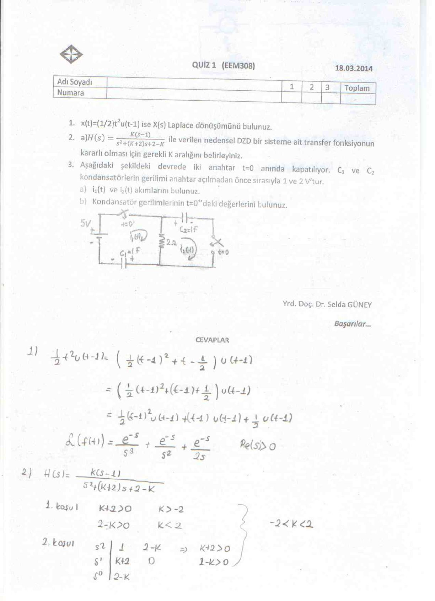
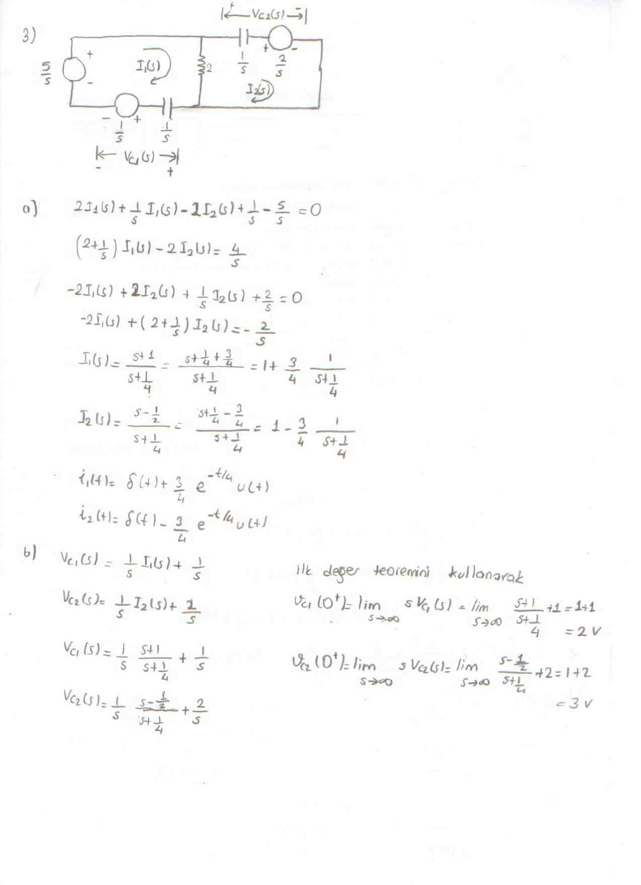
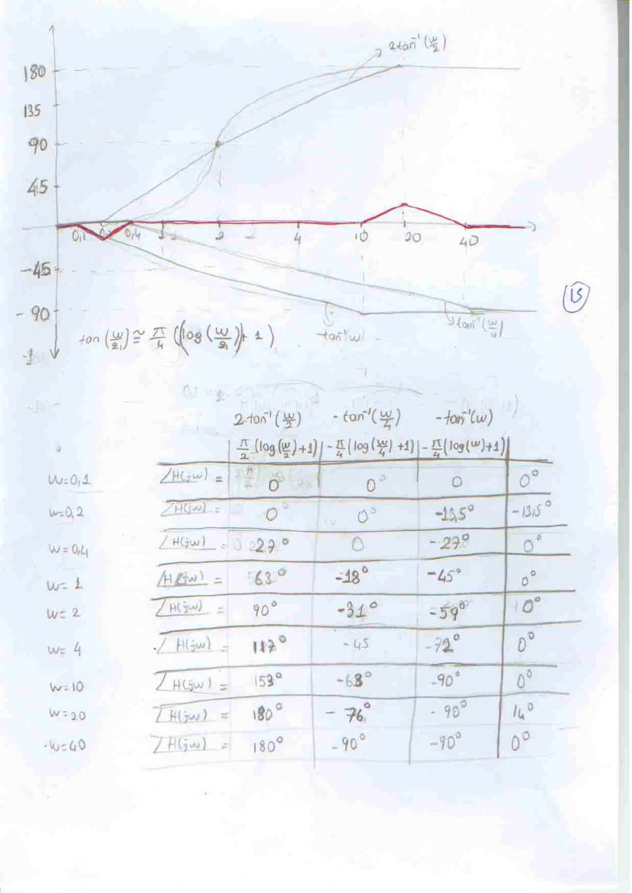
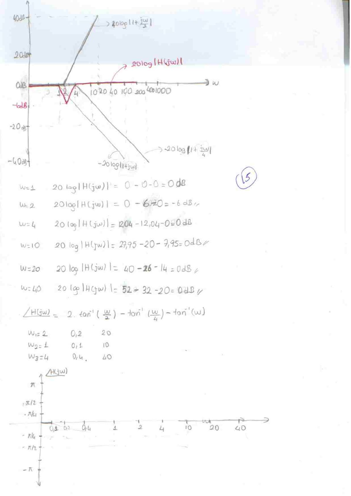

Bu yazı, Başkent Üniversitesi **EEM 308 Sinyaller ve Sistemler II** dersinin 2014 bahar döneminde yapılan üç kısa sınavın (quiz) **cevap anahtarlarını** bir araya getiriyor. Sınavlar **Yrd. Doç. Dr. Selda Güney**'in; Quiz 1 kâğıdı 18 Mart 2014 tarihli ve soru metniyle birlikte, Kısa Sınav II ve III ise yalnızca el yazısı cevaplar olarak var. Daire içindeki sayılar her bölümün puanını gösteriyor. Taranmış sekiz sayfa yazının sonunda PDF olarak indirilebilir.

## Quiz 1 (18 Mart 2014)

### Sorular

1. x(t) = (1/2)t² u(t − 1) ise X(s) Laplace dönüşümünü bulunuz.
1. H(s) = K(s − 1) / (s² + (K + 2)s + 2 − K) ile verilen nedensel DZD bir sisteme ait transfer fonksiyonunun kararlı olması için gerekli K aralığını belirleyiniz.
1. Aşağıdaki devrede iki anahtar t = 0 anında kapatılıyor. C₁ ve C₂ kondansatörlerinin gerilimi anahtar açılmadan önce sırasıyla 1 ve 2 V'tur. a) i₁(t) ve i₂(t) akımlarını bulunuz. b) Kondansatör gerilimlerinin t = 0⁺'daki değerlerini bulunuz.

### Cevaplar

**1)** t²'yi (t − 1) cinsinden yazmak gerekir:

(1/2)t² u(t − 1) = [ (1/2)(t − 1)² + (t − 1) + 1/2 ] u(t − 1)

Zamanda öteleme özelliğiyle:

**X(s) = e⁻ˢ/s³ + e⁻ˢ/s² + e⁻ˢ/(2s)**, Re(s) > 0

**2)** İkinci dereceden paydanın kökleri sol yarı düzlemde olmalı. Katsayıların pozitif olması koşulu: K + 2 > 0 ⇒ K > −2 ve 2 − K > 0 ⇒ K < 2. Routh tablosu da aynı koşulları verir (s²: 1, 2 − K; s¹: K + 2; s⁰: 2 − K). Sonuç: **−2 < K < 2**.

**3)** Devre s-domenine çevrilir: kaynak 5/s, kondansatörler 1/s empedansı ve başlangıç gerilimlerini temsil eden 1/s ile 2/s seri kaynaklarıyla gösterilir.

a) Çevre (mesh) denklemleri:

- (2 + 1/s) I₁(s) − 2 I₂(s) = 4/s
- −2 I₁(s) + (2 + 1/s) I₂(s) = −2/s

Çözüm:

- I₁(s) = (s + 1)/(s + 1/4) = 1 + (3/4) · 1/(s + 1/4) ⇒ **i₁(t) = δ(t) + (3/4) e^{−t/4} u(t)**
- I₂(s) = (s − 1/2)/(s + 1/4) = 1 − (3/4) · 1/(s + 1/4) ⇒ **i₂(t) = δ(t) − (3/4) e^{−t/4} u(t)**

b) V_C1(s) = (1/s) I₁(s) + 1/s ve V_C2(s) = (1/s) I₂(s) + 2/s. İlk değer teoremiyle:

- v_C1(0⁺) = lim_{s→∞} s V_C1(s) = lim (s + 1)/(s + 1/4) + 1 = **2 V**
- v_C2(0⁺) = lim_{s→∞} s V_C2(s) = lim (s − 1/2)/(s + 1/4) + 2 = **3 V**

Akımlardaki δ(t) terimleri, anahtar kapandığı anda kondansatör gerilimlerinin ani olarak değişmesine karşılık geliyor.

## Kısa Sınav II

Bu sınavın yalnızca cevap anahtarı var; soru metinleri cevaplardan anlaşılıyor.

### 1) Başlangıç koşullu fark denklemi (30 puan)

3y[n] − 4y[n − 1] + y[n − 2] = x[n], x[n] = (1/2)ⁿ u[n], y[−1] = 1, y[−2] = 2. y[n] = ?

Tek taraflı z-dönüşümü alınır:

3Y(z) − 4[z⁻¹Y(z) + y[−1]] + [z⁻²Y(z) + z⁻¹y[−1] + y[−2]] = X(z)

Y(z)(3 − 4z⁻¹ + z⁻²) = 2 − z⁻¹ + z/(z − 1/2)

Y(z) = 2(3z² − 2z + 1/2) / (3(z − 1)(z − 1/2)(z − 1/3)) = (3/2) · 1/(1 − z⁻¹) − 1/(1 − ½z⁻¹) + (1/2) · 1/(1 − ⅓z⁻¹)

**y[n] = [ 3/2 − (1/2)ⁿ + (1/2)(1/3)ⁿ ] u[n]**

(Kontrol: denklemden y[0] = (1 + 4·1 − 2)/3 = 1 ve y[1] = (1/2 + 4·1 − 1)/3 = 7/6; formül de 1 ve 3/2 − 1/2 + 1/6 = 7/6 veriyor.)

### 2) Transfer fonksiyonu ve Bode diyagramı (10 + 15 + 15 puan)

Girişi x(t) = δ(t) + 3e⁻²ᵗ u(t) − 8e⁻³ᵗ u(t) olan sistemin:

X(s) = 1 + 3/(s + 2) − 8/(s + 3) = (s² − 1)/((s + 2)(s + 3)) = (s + 1)(s − 1)/((s + 2)(s + 3))

Çıkışın dönüşümü Y(s) = (s − 1)(s + 2)/((s + 4)(s + 3)) olduğundan:

**H(s) = Y(s)/X(s) = (s + 2)² / ((s + 1)(s + 4))**

Bode biçimi:

H(jω) = (jω + 2)² / ((jω + 1)(jω + 4)) = (1 + jω/2)² / ((1 + jω)(1 + jω/4))

20 log|H(jω)| = 40 log|1 + jω/2| − 20 log|1 + jω| − 20 log|1 + jω/4|

Kırılma frekansları ω₁ = 2 (çift sıfır), ω₂ = 1 ve ω₃ = 4 (kutuplar). Asimptotik genlik değerleri:

| ω (rad/s) | 1 | 2 | 4 | 10 | 20 | 40 |
|---|---|---|---|---|---|---|
| Genlik (dB) | 0 | −6 | 0 | 0 | 0 | 0 |

Faz: ∠H(jω) = 2 tan⁻¹(ω/2) − tan⁻¹(ω/4) − tan⁻¹(ω). Cevap anahtarında her terim, kırılma frekansının onda biri ile on katı arasında tan⁻¹(ω/ω₁) ≈ (π/4)(log(ω/ω₁) + 1) doğrusal yaklaşımıyla çizilmiş (2 tan⁻¹(ω/2) için 0,2–20, tan⁻¹(ω) için 0,1–10, tan⁻¹(ω/4) için 0,4–40 rad/s aralıkları).

### 3) Tüm geçiren sistem ve grup gecikmesi (15 + 30 + 15 puan)

H(jω) = ∏ₙ₌₁ᴺ (1 − njω)/(1 + njω)

|H(jω)| = ∏ √(1 + n²ω²) / √(1 + n²ω²) = **1** (tüm geçiren sistem)

Cevap anahtarında faz ∠H(jω) = Σ 2 tan⁻¹(nω) ve grup gecikmesi τ(ω) = −d∠H/dω = −2 Σ n/((nω)² + 1) olarak verilmiş.

*Not: Payın (1 − njω) fazı −tan⁻¹(nω), paydanınki +tan⁻¹(nω) olduğundan doğrusu ∠H(jω) = −2 Σₙ₌₁ᴺ tan⁻¹(nω) ve τ(ω) = 2 Σₙ₌₁ᴺ n/(1 + n²ω²) > 0'dır; cevap anahtarında fazın işareti ters alınmış, bu yüzden grup gecikmesi de negatif çıkmış.*

## Kısa Sınav III

### 1) Salınımlı ve salınımsız sistemler

Birinci dereceden 1/(1 − ae^{−jω}) sisteminde a > 0 ise yanıt salınımsız, a < 0 ise salınımlıdır.

- H₁(e^{jω}) = 1 / ((1 − ½e^{−jω})(1 − ⅓e^{−jω})(1 − ¼e^{−jω})): tüm a'lar pozitif, sistem **salınımsız**.
- H₂(e^{jω}) = 1 / ((1 + ½e^{−jω})(1 − ⅓e^{−jω})(1 − ¼e^{−jω})): ilk çarpanda a = −1/2 < 0, sistem **salınımlı**.
- H₃(e^{jω}) = 1 / ((1 − ½e^{−jω})(1 − ¾e^{−jω} + (9/16)e^{−j2ω})): ikinci çarpan 1 − 2r cos θ e^{−jω} + r²e^{−j2ω} biçiminde, r = 3/4, cos θ = 1/2. θ ≠ 0 olduğu için **salınım etkisi gözükür**.

### 2) Üç noktalı ortalama süzgeç

a) y[n] = b{a x[n − 1] + x[n] + a x[n + 1]} sisteminde Y(e^{jω}) = b[a e^{−jω} + 1 + a e^{jω}] X(e^{jω}), dolayısıyla

**H(e^{jω}) = b(1 + 2a cos ω)**

b) Sıfır frekansta kazancın 1 olması için H(e^{j0}) = b(1 + 2a) = 1 ⇒ **b = 1/(1 + 2a)**.

c) a = 1/2, b = 1/2 için H(e^{jω}) = (1/2)(1 + cos ω): ω = 0'da 1, ω = π'de 0 olan bir alçak geçiren süzgeç.

### 3) Ayrık zamanlı örnekleme ve ondalıklama

a) x_p[n] = x[n] (n = 0, ±2, ±4, …), 0 (n = ±1, ±3, ±5, …) ve ondalıklanmış dizi x_d[n] = x[2n].

b) x_p[n]'nin spektrumu X_p(e^{jω}), X(e^{jω})'nın π aralıklarla tekrarlanan ve 1/2 ile ölçeklenen kopyalarından oluşur (cevapta ±π/4 ve ±3π/4 noktalarıyla çizilmiş); X_d(e^{jω}) = X_p(e^{jω/2}) ise bu spektrumun frekans ekseninde iki kat genişletilmiş hâlidir (±π/2 noktaları).

![Kısa Sınav III: H(e^jω) = (1 + cos ω)/2 grafiği, x[n], xp[n], xd[n] dizileri ve spektrumları](s-08.jpg "Kısa Sınav III, 2c ve 3. soru")
