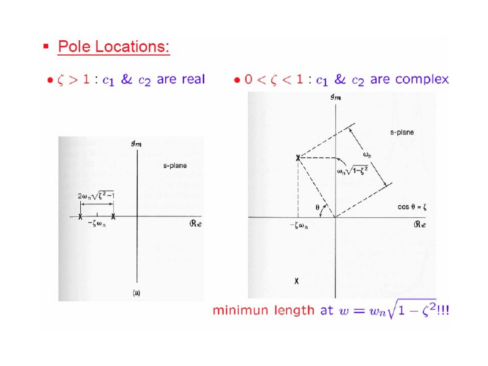
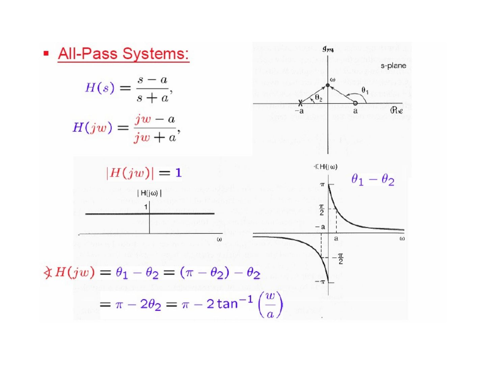
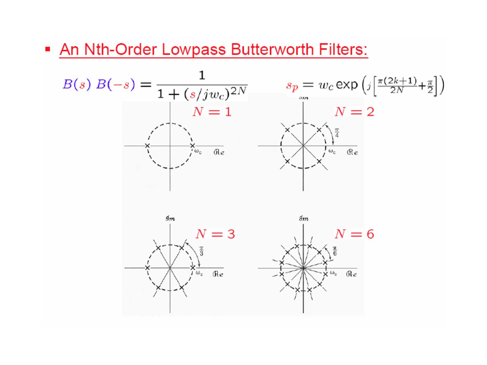
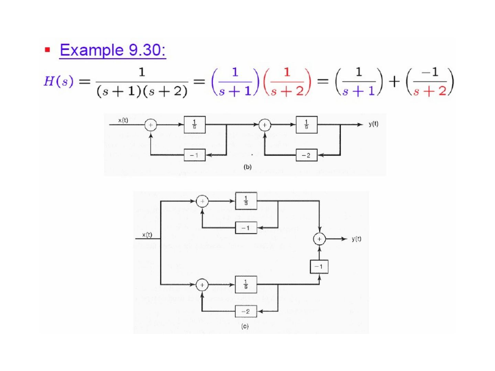

Bu yazı, Başkent Üniversitesi **EEM308 Sinyaller ve Sistemler II** dersinin arşiv klasöründe bulunan, yazarı slaytlarda belirtilmemiş İngilizce ders slaytlarından **"Chapter IX – Laplace Transform"** sunumudur (88 slayt). Dosya son olarak 21 Temmuz 2009'da kaydedilmiş; PowerPoint dosyasının özelliklerinde yazar olarak *İsmail Avcıbaş* adı görünüyor, ancak slaytların tamamı başka bir ders sunumundan alınmış ekran görüntüleridir ve asıl hazırlayanın kim olduğu (kurum, hoca) slaytlarda yazmıyor. Kırmızı başlıklı, mavi vurgulu madde düzeni bir üniversitenin "Signals and Systems" ders slaytlarına benziyor; örnek ve tablo numaraları (Example 9.1 … 9.38, Table 9.1–9.3) ile şekiller Oppenheim & Willsky'nin *Signals & Systems* kitabının 9. bölümünü izliyor. Slayt içeriği İngilizce olarak metne döküldü; gerekli birkaç şekil için slayt görselleri eklendi. Orijinal PowerPoint dosyası yazının sonunda indirilebilir.

*Bu içerik üçüncü taraf bir kaynağa aittir; arşiv ve nostalji amacıyla kaynak belirtilerek paylaşılmıştır. Hak sahibinin talebi hâlinde kaldırılır.*

Outline:

- The Laplace Transform
- The Region of Convergence for Laplace Transforms
- The Inverse Laplace Transform
- Geometric Evaluation of the Fourier Transform
- Properties of the Laplace Transform
- Some Laplace Transform Pairs
- Analysis & Characterization of LTI Systems Using the Laplace Transform
- System Function Algebra and Block Diagram Representations
- The Unilateral Laplace Transform

## The Laplace transform

### The Laplace transform of a general signal x(t)

- Fourier: X(jω) ≜ ∫_{−∞}^{∞} x(t) e^{−jωt} dt; x(t) ↔ X(jω), X(jω) = F{x(t)}, x(t) = F⁻¹{X(jω)}
- Laplace, with s = σ + jω: X(s) ≜ ∫_{−∞}^{∞} x(t) e^{−st} dt; x(t) ↔ X(s), X(s) = L{x(t)}, x(t) = L⁻¹{X(s)}

X(s)|_{s=jω} = L{x(t)}|_{s=jω} = F{x(t)} = X(jω)

### Laplace transform & Fourier transform

L{x(t)} = X(s) = X(σ + jω) = ∫_{−∞}^{∞} x(t) e^{−(σ+jω)t} dt = ∫_{−∞}^{∞} [x(t)e^{−σt}] e^{−jωt} dt = F{x(t)e^{−σt}}

For σ > 0 the signal is multiplied by a decaying exponential, for σ < 0 by a growing exponential.

### Example 9.1: x(t) = e^{−at}u(t)

X(jω) = ∫_0^∞ e^{−at} e^{−jωt} dt = [e^{−(a+jω)t} / (−(a + jω))]_0^∞ = 1/(jω + a), a > 0

X(σ + jω) = ∫_0^∞ e^{−(σ+a)t} e^{−jωt} dt = 1/((σ + a) + jω), σ + a > 0

⇒ X(s) = 1/(s + a), **Re{s} > −a**

### Example 9.2: x(t) = −e^{−at}u(−t)

X(s) = −∫_{−∞}^{0} e^{−at} e^{−st} dt = 1/(s + a), **Re{s} < −a**

### Region of convergence (ROC)

- e^{−at}u(t) ↔ 1/(s + a), Re{s} > −a
- −e^{−at}u(−t) ↔ 1/(s + a), Re{s} < −a

The ROC is where the Fourier transform of x(t)e^{−σt} converges; the two signals have the same algebraic X(s) and differ only in the ROC.

 ve −e^{−at}u(−t) için ROC")

### Example 9.3: x(t) = 3e^{−2t}u(t) − 2e^{−t}u(t)

X(s) = 3∫ e^{−2t}u(t)e^{−st} dt − 2∫ e^{−t}u(t)e^{−st} dt = 3/(s + 2) − 2/(s + 1)

- e^{−t}u(t) ↔ 1/(s + 1), Re{s} > −1
- e^{−2t}u(t) ↔ 1/(s + 2), Re{s} > −2

⇒ 3e^{−2t}u(t) − 2e^{−t}u(t) ↔ 3/(s + 2) − 2/(s + 1) = (s − 1)/((s + 2)(s + 1)), Re{s} > −1

The jω-axis is included in the ROC, so the Fourier transform exists (s = jω).

### Example 9.4: x(t) = e^{−2t}u(t) + e^{−t}(cos 3t)u(t)

x(t) = [e^{−2t} + ½e^{−t}(e^{j3t} + e^{−j3t})] u(t); using e^{−at}u(t) ↔ 1/(s + a), Re{s} > −Re{a}:

- e^{−2t}u(t) ↔ 1/(s + 2), Re{s} > −2
- e^{−(1−3j)t}u(t) ↔ 1/(s + (1 − 3j)), Re{s} > −1
- e^{−(1+3j)t}u(t) ↔ 1/(s + (1 + 3j)), Re{s} > −1

X(s) = 1/(s + 2) + ½[1/(s + (1 − 3j)) + 1/(s + (1 + 3j))] = (2s² + 5s + 12) / ((s² + 2s + 10)(s + 2)), Re{s} > −1

= 2(s + 1.25 − 2.11j)(s + 1.25 + 2.11j) / ((s + 1 − 3j)(s + 1 + 3j)(s + 2)). The jω-axis is in the ROC ⇒ the Fourier transform exists.

### Example 9.5: x(t) = δ(t) − (4/3)e^{−t}u(t) + (1/3)e^{2t}u(t)

Since ∫ δ(t)e^{−st} dt = 1:

X(s) = 1 − (4/3)·1/(s + 1) + (1/3)·1/(s − 2) = (s − 1)² / ((s + 1)(s − 2)), Re{s} > 2

The jω-axis is **not** included in the ROC: does the Fourier transform exist? Why? (question on the slide)

## Properties of the ROC

1. The ROC of X(s) consists of **strips parallel to the jω-axis** in the s-plane.
1. For rational Laplace transforms, the ROC does **not** contain any poles.
1. If x(t) is of **finite duration** and is absolutely integrable (∫_{T₁}^{T₂} |x(t)| dt < ∞), then the ROC is the **entire s-plane**: |X(s)| ≤ ∫_{T₁}^{T₂} |x(t)e^{−st}| dt < e^{−σT₁ (or T₂)} ∫_{T₁}^{T₂} |x(t)| dt.
1. If x(t) is **right-sided**, and if the line Re{s} = σ₀ is in the ROC, then all values of s for which Re{s} > σ₀ will also be in the ROC: if ∫_{T₁}^{∞} |x(t)| e^{−σ₀t} dt < ∞, then for σ₁ > σ₀, ∫_{T₁}^{∞} |x(t)| e^{−σ₁t} dt ≤ e^{−(σ₁−σ₀)T₁} ∫_{T₁}^{∞} |x(t)| e^{−σ₀t} dt.
1. If x(t) is **left-sided**, and if the line Re{s} = σ₀ is in the ROC, then all values of s for which Re{s} < σ₀ will also be in the ROC (the argument is similar to that for property 4).
1. If x(t) is **two-sided**, and if the line Re{s} = σ₀ is in the ROC, then the ROC will consist of a **strip** in the s-plane that includes the line Re{s} = σ₀ (x(t) = x_R(t) + x_L(t); the ROC is σ_R < Re{s} < σ_L).
1. If the Laplace transform X(s) of x(t) is **rational**, then its ROC is bounded by poles or extends to ∞. In addition, no poles of X(s) are contained in the ROC.
1. If X(s) is rational: if x(t) is right-sided, the ROC is the region in the s-plane to the **right of the rightmost pole**; if x(t) is left-sided, the ROC is the region to the **left of the leftmost pole**.

### Example 9.7: x(t) = e^{−b|t|}

x(t) = e^{−bt}u(t) + e^{+bt}u(−t)

- e^{−bt}u(t) ↔ 1/(s + b), Re{s} > −b
- e^{+bt}u(−t) ↔ −1/(s − b), Re{s} < +b

- b > 0: e^{−b|t|} ↔ 1/(s + b) − 1/(s − b) = −2b / ((s + b)(s − b)), −b < Re{s} < +b
- b ≤ 0: no common ROC — x(t) has no Laplace transform

For X(s) = 1/((s + 2)(s + 1)) there are three possible ROCs (Re{s} > −1, Re{s} < −2, −2 < Re{s} < −1). Which one has a Fourier transform? (question on the slide)

 için olası ROC'ler")

## The inverse Laplace transform

### By the use of contour integration

X(σ + jω) = F{x(t)e^{−σt}} = ∫ x(t)e^{−σt}e^{−jωt} dt for all s = σ + jω in the ROC

x(t)e^{−σt} = F⁻¹{X(σ + jω)} = (1/2π) ∫_{−∞}^{∞} X(σ + jω) e^{jωt} dω

⇒ x(t) = (1/2π) ∫_{−∞}^{∞} X(σ + jω) e^{(σ+jω)t} dω; with s = σ + jω, ds = j dω:

**x(t) = (1/2πj) ∫_{σ−j∞}^{σ+j∞} X(s) e^{st} ds**

### By the technique of partial fraction expansion

X(s) = A₁/(s + a₁) + A₂/(s + a₂) + … + A_m/(s + a_m)

x(t) = A₁e^{−a₁t}u(t) − A₂e^{−a₂t}u(−t) + … + x_m(t) (each term right-sided or left-sided depending on the ROC), using e^{−at}u(t) ↔ 1/(s + a), Re{s} > −a and −e^{−at}u(−t) ↔ 1/(s + a), Re{s} < −a.

### Example 9.9

X(s) = 1/((s + 1)(s + 2)), Re{s} > −1 ⇒ X(s) = 1/(s + 1) − 1/(s + 2)

⇒ [e^{−t} − e^{−2t}] u(t) ↔ 1/((s + 1)(s + 2)), Re{s} > −1

Examples 9.9, 9.10, 9.11 — the inverse of each term depends on the ROC:

| Term | Re{s} < −2 | −2 < Re{s} < −1 | −1 < Re{s} |
|---|---|---|---|
| 1/(s + 1) | −e^{−t}u(−t) | −e^{−t}u(−t) | e^{−t}u(t) |
| 1/(s + 2) | −e^{−2t}u(−t) | e^{−2t}u(t) | e^{−2t}u(t) |

*Not: Slayttaki birleşik tablo 1/(s+1) + 1/(s+2) toplamı için yazılmış; Örnek 9.9'daki X(s) = 1/(s+1) − 1/(s+2) için ikinci terimin işareti eksi alınmalıdır (ör. −1 < Re{s} için x(t) = [e^{−t} − e^{−2t}]u(t)).*

## Geometric evaluation of the Fourier transform

### First-order systems

h(t) = (1/τ)e^{−t/τ}u(t) ↔ H(s) = (1/τ)/(s + 1/τ), Re{s} > −1/τ; H(jω) = (1/τ)/(jω + 1/τ)

The Bode plot of 20 log₁₀|H(jω)| is flat up to ω = 1/τ (3 dB point) and then falls; the phase goes from 0 to −π/2. Geometrically, |H(jω)| is inversely proportional to the length of the vector from the pole −1/τ to jω.

### Second-order systems

h(t) = M[e^{c₁t} − e^{c₂t}]u(t), with c₁ = −ζω_n + ω_n√(ζ² − 1), c₂ = −ζω_n − ω_n√(ζ² − 1), M = ω_n / (2√(ζ² − 1))

⇒ H(jω) = ω_n² / ((jω)² + 2ζω_n(jω) + ω_n²) ⇒ H(s) = ω_n² / (s² + 2ζω_n s + ω_n²) = ω_n² / ((s − c₁)(s − c₂))

- ζ > 1: c₁ and c₂ are real (separated by 2ω_n√(ζ² − 1) around −ζω_n)
- 0 < ζ < 1: c₁ and c₂ are complex, at distance ω_n from the origin, with cos θ = ζ; the vector from the pole has minimum length at ω = ω_n√(1 − ζ²).

**Relative bandwidth B:** at ω = ω_n√(1 − ζ²) ± ζω_n the length of the pole vector grows from A to √2·A, so |H(jω)| at these points is ≈ (or ≤) 1/√2 of its value at ω_n√(1 − ζ²) ⇒ **B = 2ζ**, and the phase changes by Δ∠H(jω) = π/2 across this band.

The frequency-response plots show |H(jω)| and ∠H(jω) for ω_n = 1 and ζ = 0.1, 0.2, 0.4 (sharper peaks for smaller ζ), and the Bode plots for ζ from 0.1 to 1.5.

### Nth-order systems

H(jω) = ((1/τ)/(jω + 1/τ)) Π_i (ω_ni² / ((jω)² + 2ζ_i ω_ni (jω) + ω_ni²))

H(s) = (b/(s − a)) (Π_i ω_ni² / (s² + 2ζ_i ω_ni s + ω_ni²))

|H(jω)| = Π_i |H_i(jω)|, ∠H(jω) = Σ_i ∠H_i(jω)

### All-pass systems

H(s) = (s − a)/(s + a), H(jω) = (jω − a)/(jω + a) ⇒ |H(jω)| = 1

∠H(jω) = θ₁ − θ₂ = (π − θ₂) − θ₂ = π − 2θ₂ = π − 2 tan⁻¹(ω/a)

## Properties of the Laplace transform

Throughout, X(s) = ∫ x(t)e^{−st} dt, x(t) = (1/2πj) ∫_{σ−j∞}^{σ+j∞} X(s)e^{st} ds, x(t) ↔ X(s) with ROC = R.

- **Linearity:** a x₁(t) + b x₂(t) ↔ a X₁(s) + b X₂(s), with ROC containing R₁ ∩ R₂
- **Example 9.13:** x(t) = x₁(t) − x₂(t) with X₁(s) = 1/(s + 1), Re{s} > −1 and X₂(s) = 1/((s + 1)(s + 2)), Re{s} > −1: X(s) = 1/(s + 1) − 1/((s + 1)(s + 2)) = 1/(s + 2) — the pole at −1 cancels and the ROC grows to Re{s} > −2.
- **Time shifting:** x(t − t₀) ↔ e^{−st₀}X(s), ROC = R
- **Shifting in the s-domain:** e^{s₀t}x(t) ↔ X(s − s₀), ROC = R + Re{s₀}, since X(s − s₀) = ∫ x(t)e^{−(s−s₀)t} dt
- **Time scaling:** x(at) ↔ (1/|a|) X(s/a), ROC = aR (the strip is scaled by a; for a < 0 it is also reversed); in particular x(−t) ↔ X(−s), ROC = −R
- **Conjugation:** x*(t) ↔ X*(s*), ROC = R
- **Convolution:** x₁(t) ∗ x₂(t) = ∫ x₁(τ)x₂(t − τ) dτ ↔ X₁(s)X₂(s), ROC containing R₁ ∩ R₂
- **Differentiation in the time domain:** dx(t)/dt ↔ sX(s), ROC containing R
- **Differentiation in the s-domain:** −t x(t) ↔ dX(s)/ds, ROC = R
- **Integration in the time domain:** ∫_{−∞}^{t} x(τ) dτ = x(t) ∗ u(t) ↔ (1/s) X(s), ROC containing R ∩ {Re{s} > 0}
- **The initial-value theorem:** if x(t) = 0 for t < 0 ⇒ x(0⁺) = lim_{s→∞} sX(s)
- **The final-value theorem:** if x(t) = 0 for t < 0 and x(t) has a finite limit as t → ∞ ⇒ lim_{t→∞} x(t) = lim_{s→0} sX(s)

Both theorems follow from L{dx(t)/dt} = ∫_0^∞ (dx(t)/dt) e^{−st} dt = sX(s) − x(0⁺) by letting s → ∞ and s → 0.

## Some Laplace transform pairs (Table 9.2)

| # | Signal | Transform | ROC |
|---|---|---|---|
| 1 | δ(t) | 1 | All s |
| 2 | u(t) | 1/s | Re{s} > 0 |
| 3 | −u(−t) | 1/s | Re{s} < 0 |
| 4 | t^{n−1}/(n − 1)! · u(t) | 1/sⁿ | Re{s} > 0 |
| 5 | −t^{n−1}/(n − 1)! · u(−t) | 1/sⁿ | Re{s} < 0 |
| 6 | e^{−αt}u(t) | 1/(s + α) | Re{s} > −α |
| 7 | −e^{−αt}u(−t) | 1/(s + α) | Re{s} < −α |
| 8 | t^{n−1}/(n − 1)! · e^{−αt}u(t) | 1/(s + α)ⁿ | Re{s} > −α |
| 9 | −t^{n−1}/(n − 1)! · e^{−αt}u(−t) | 1/(s + α)ⁿ | Re{s} < −α |
| 10 | δ(t − T) | e^{−sT} | All s |
| 11 | [cos ω₀t]u(t) | s/(s² + ω₀²) | Re{s} > 0 |
| 12 | [sin ω₀t]u(t) | ω₀/(s² + ω₀²) | Re{s} > 0 |
| 13 | [e^{−αt} cos ω₀t]u(t) | (s + α)/((s + α)² + ω₀²) | Re{s} > −α |
| 14 | [e^{−αt} sin ω₀t]u(t) | ω₀/((s + α)² + ω₀²) | Re{s} > −α |
| 15 | u_n(t) = dⁿδ(t)/dtⁿ | sⁿ | All s |
| 16 | u_{−n}(t) = u(t) ∗ … ∗ u(t) (n times) | 1/sⁿ | Re{s} > 0 |

## Analysis & characterization of LTI systems using the Laplace transform

X(s) → LTI system → Y(s) = H(s)X(s), where H(s) = L{h(t)} is the **system function** or **transfer function**.

### Causality

- For a causal LTI system, h(t) = 0 for t < 0, and thus h(t) is right-sided.
- The ROC associated with the system function of a causal system is a **right-half plane**.
- For a system with a rational system function, causality is equivalent to the ROC being the right-half plane to the right of the rightmost pole.

Examples 9.17, 9.18, 9.19:

| h(t) | H(s) | ROC | Comment |
|---|---|---|---|
| e^{−t}u(t) | 1/(s + 1) | −1 < Re{s} | causal; rational; ROC right-sided |
| e^{−\|t\|} | −2/(s² − 1) | −1 < Re{s} < +1 | not causal; rational; ROC not right-sided |
| e^{−(t+1)}u(t + 1) | e^{s}/(s + 1) | −1 < Re{s} | not causal; not rational; ROC right-sided |

### Anti-causality

- For an anti-causal LTI system, h(t) = 0 for t > 0, and thus h(t) is left-sided.
- The ROC of an anti-causal system is a **left-half plane**.
- For a rational system function, anti-causality is equivalent to the ROC being the left-half plane to the left of the leftmost pole.

### Stability

- An LTI system is stable **if and only if** the ROC of its system function H(s) includes the **entire jω-axis** (Re{s} = 0).
- A causal system with rational system function H(s) is stable if and only if all of the poles of H(s) lie in the **left half** of the s-plane, i.e. all of the poles have negative real parts.

### Example 9.20

H(s) = (s − 1)/((s + 1)(s − 2)) has three possible ROCs:

- Re{s} > 2: h(t) = (⅔e^{−t} + ⅓e^{2t}) u(t) — causal, (unstable)
- −1 < Re{s} < 2: h(t) = ⅔e^{−t}u(t) − ⅓e^{2t}u(−t) — stable, (not causal)
- Re{s} < −1: h(t) = −(⅔e^{−t} + ⅓e^{2t}) u(−t) — unstable, anticausal

**Examples 9.17, 9.21:** h(t) = e^{−t}u(t) ↔ 1/(s + 1), −1 < Re{s}: causal, stable, rational; h(t) = e^{2t}u(t) ↔ 1/(s − 2), 2 < Re{s}: causal, unstable, rational.

### LTI systems described by linear constant-coefficient differential equations

Σ_{k=0}^{N} a_k d^k y(t)/dt^k = Σ_{k=0}^{M} b_k d^k x(t)/dt^k

Taking the Laplace transform: Σ a_k s^k Y(s) = Σ b_k s^k X(s), so

H(s) = Y(s)/X(s) = Σ_{k=0}^{M} b_k s^k / Σ_{k=0}^{N} a_k s^k = (b_M s^M + … + b₁s + b₀)/(a_N s^N + … + a₁s + a₀) (numerator → zeros, denominator → poles).

**Example 9.23:** dy(t)/dt + 3y(t) = x(t) ⇒ sY(s) + 3Y(s) = X(s) ⇒ H(s) = 1/(s + 3).

- If causal: Re{s} > −3, h(t) = e^{−3t}u(t)
- If anti-causal: Re{s} < −3, h(t) = −e^{−3t}u(−t)

**Example 9.24 (series RLC circuit, output across C):** LC d²y/dt² + RC dy/dt + y(t) = x(t) ⇒ H(s) = (1/LC) / (s² + (R/L)s + 1/LC) = (1/LC)/((s − a)(s − b)). If R, L, C > 0, then Re{a}, Re{b} < 0, i.e. the poles have negative real parts.

**Example 9.25:** an LTI system has input x(t) = e^{−3t}u(t) (X(s) = 1/(s + 3), −3 < Re{s}) and output y(t) = [e^{−t} − e^{−2t}]u(t) (Y(s) = 1/((s + 1)(s + 2)), −1 < Re{s}). Then

H(s) = Y(s)/X(s) = (s + 3)/((s + 1)(s + 2)) = (s + 3)/(s² + 3s + 2), ROC: −1 < Re{s} ⇒ causal, stable

⇒ d²y/dt² + 3 dy/dt + 2y(t) = dx/dt + 3x(t), with y(0⁻) = 0, x(0⁻) = 0.

### Butterworth, Chebyshev and elliptic lowpass filters

**Butterworth:** |H_c(jΩ)|² = 1 / (1 + (jΩ/jΩ_c)^{2N}); |H_c(jΩ)|² = 1/2 at Ω = Ω_c, and the transition gets sharper as N grows (N = 2, 4, 8).

For an Nth-order Butterworth filter B(s), |B(jω)|² = 1/(1 + (jω/jω_c)^{2N}). If the impulse response is real, B*(jω) = B(−jω), so

|B(jω)|² = B(jω)B*(jω) = B(jω)B(−jω) = 1/(1 + (jω/jω_c)^{2N}) ⇒ B(s)B(−s) = 1/(1 + (s/jω_c)^{2N})

The poles are at s_p = (−1)^{1/2N}(jω_c): |s_p| = ω_c, ∠s_p = π(2k + 1)/2N + π/2, i.e. s_p = ω_c exp(j[π(2k + 1)/2N + π/2]) — 2N points equally spaced on a circle of radius ω_c (shown for N = 1, 2, 3, 6).

- Both s = s_p and s = −s_p are poles of B(s)B(−s).
- If the system is stable & causal, the poles of H(s) are those in the left-half plane.

| N | B(s) | Differential equation |
|---|---|---|
| 1 | ω_c/(s + ω_c) | dy/dt + ω_c y(t) = ω_c x(t) |
| 2 | ω_c²/(s² + √2ω_c s + ω_c²) | d²y/dt² + √2ω_c dy/dt + ω_c² y(t) = ω_c² x(t) |
| 3 | ω_c³/(s³ + 2ω_c s² + 2ω_c² s + ω_c³) | |

(B(−s) is obtained by replacing s with −s, e.g. ω_c/(−s + ω_c).) The first- and second-order filters can be built as an RC circuit (dv_c/dt + (1/RC)v_c(t) = (1/RC)v_s(t)) and a series RLC circuit (LC d²y/dt² + RC dy/dt + y(t) = x(t)).

**Chebyshev filters:** |H_c(jΩ)|² = 1 / (1 + ε²V_N²(Ω/Ω_c)), where V_N(x) = cos(N cos⁻¹x) is the Nth-order Chebyshev polynomial (V₀(x) = 1, V₁(x) = x, V₂(x) = 2x² − 1, …). The passband has equiripple between 1 and 1 − ε.

**Elliptic filters:** |H_c(jΩ)|² = 1 / (1 + ε²U_N²(Ω)), U_N(x): Jacobian elliptic function. Both the passband (1 to 1 − δ₁, up to Ω_p) and the stopband (below δ₂, from Ω_s) are equiripple.

## System function algebra and block diagram representations

- **Parallel interconnection:** h(t) = h₁(t) + h₂(t), H(s) = H₁(s) + H₂(s)
- **Series interconnection:** h(t) = h₁(t) ∗ h₂(t), H(s) = H₁(s)H₂(s)
- **Feedback interconnection:** Y = H₁E, Z = H₂Y, E = X − Z ⇒ H(s) = H₁(s)/(1 + H₁(s)H₂(s))

**Example 9.28:** causal LTI system H(s) = 1/(s + 3) ⇒ Y(s) = X(s)/(s + 3) ⇒ dy/dt + 3y(t) = x(t) ⇒ dy/dt = x(t) − 3y(t): an integrator 1/s with feedback gain −3.

**Example 9.29:** H(s) = (s + 2)/(s + 3) = (1/(s + 3))(s + 2) ⇒ Z(s) ≜ X(s)/(s + 3) and Y(s) = (s + 2)Z(s).

**Example 9.30:** H(s) = 1/((s + 1)(s + 2)) = 1/(s² + 3s + 2) ⇒ s²Y + 3sY + 2Y = X. With F = sY and E = sF = s²Y: E = −3F − 2Y + X (direct form with two integrators). Also H(s) = (1/(s + 1))(1/(s + 2)) (cascade) = 1/(s + 1) − 1/(s + 2) (parallel).

**Example 9.31:** H(s) = (2s² + 4s − 6)/(s² + 3s + 2) = (1/(s² + 3s + 2))(2s² + 4s − 6) ⇒ Z(s) ≜ X(s)/(s² + 3s + 2), Y(s) = (2s² + 4s − 6)Z(s). Equivalent forms:

- direct form: (2s² + 4s − 6)/(s² + 3s + 2)
- cascade: (2(s − 1)/(s + 2)) ((s + 3)/(s + 1)) or (2(s − 1)/(s + 1)) ((s + 3)/(s + 2))
- parallel: 2 + 6/(s + 2) − 8/(s + 1)

## The unilateral Laplace transform

- **Bilateral LT:** X(s) ≜ ∫_{−∞}^{∞} x(t)e^{−st} dt; x(t) ↔ X(s), X(s) = L{x(t)}, x(t) = L⁻¹{X(s)}
- **Unilateral LT** (for causal systems with nonzero initial conditions): 𝒳(s) ≜ ∫_{0⁻}^{∞} x(t)e^{−st} dt; x(t) ↔ 𝒳(s) (UL), 𝒳(s) = UL{x(t)}, x(t) = UL⁻¹{𝒳(s)}; ROC: a right-half plane

Table 9.3 (properties of the unilateral Laplace transform) highlights the differences from the bilateral transform: the convolution property assumes x₁(t) = x₂(t) ≡ 0 for t < 0, and differentiation in the time domain gives s𝒳(s) − x(0⁻).

**Differentiation property:**

UL{dx(t)/dt} = ∫_{0⁻}^{∞} (dx(t)/dt) e^{−st} dt = [x(t)e^{−st}]_{0⁻}^{∞} + s∫_{0⁻}^{∞} x(t)e^{−st} dt = s𝒳(s) − x(0⁻)

UL{d²x(t)/dt²} = s²𝒳(s) − s x(0⁻) − x′(0⁻)

### Example 9.38

d²y/dt² + 3 dy/dt + 2y(t) = x(t), with y(0⁻) = β, y′(0⁻) = γ, x(t) = αu(t)

⇒ [s²𝒴(s) − βs − γ] + 3[s𝒴(s) − β] + 2𝒴(s) = α/s

⇒ 𝒴(s) = β(s + 3)/((s + 1)(s + 2)) + γ/((s + 1)(s + 2)) + α/(s(s + 1)(s + 2))

The first two terms form the **zero-input response**, the last one the **zero-state response**.

If α = 2, β = 3, γ = −5:

𝒴(s) = 1/s − 1/(s + 1) + 3/(s + 2) ⇒ y(t) = [1 − e^{−t} + 3e^{−2t}] u(t), for t > 0

## Summary

The chapter covered: the Laplace transform; the ROC for LT; the inverse LT; geometric evaluation of the FT; properties of the LT (linearity, time shifting, shifting in the s-domain, time scaling, conjugation, convolution, differentiation in the time domain, differentiation in the s-domain, integration in the time domain, initial- and final-value theorems); some LT pairs; analysis & characterization of LTI systems using the LT; system function algebra and block diagram representations; the unilateral LT. The course map on the last slide is the same as in the z-transform chapter: FS (Chap 3), FT (CT Chap 4, DT Chap 5), LT (CT, Chap 9), zT (DT, Chap 10); Time-Frequency (Chap 6), CT-DT (Chap 7), Communication (Chap 8), Control (Chap 11).
