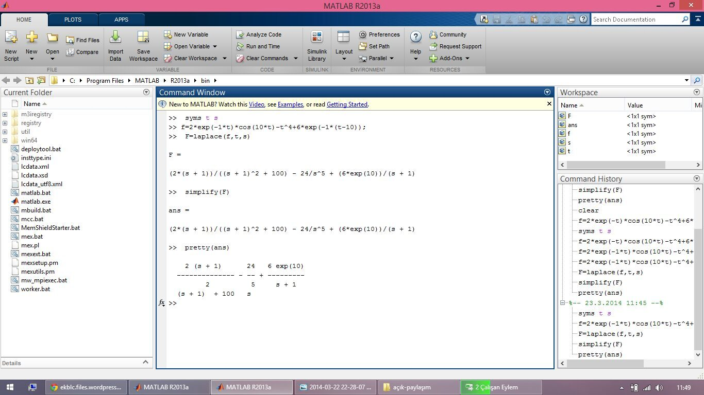
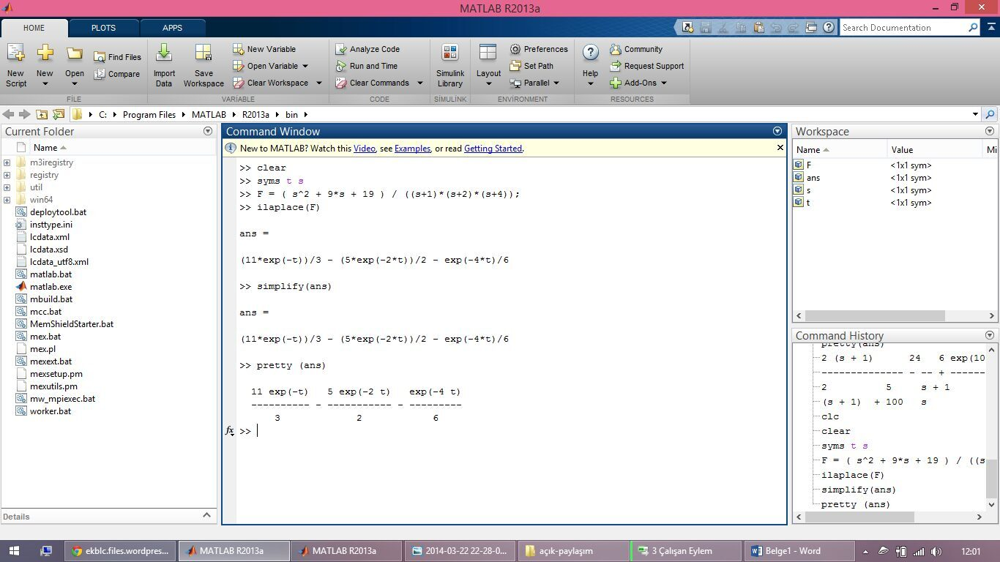

This post collects the homework assignments given in the spring semesters of 2013 and 2014 in the **EEM 308 Signals and Systems II** course at Başkent University:

- **2013:** *Homework No. 1* (Laplace transform, due 8 March 2013) and *Homework No. 2* (z-transform, due 29 March 2013), issued on the department's official homework form; both dated 28 February 2013.
- **2014:** Four short handwritten assignments (Homework 1–4, March 2014) and the seven-question, MATLAB-heavy "EEM 308 Homework" given toward the end of the semester (due date: the day of the EEM 308 final exam).

For the 2014 assignments, there were also photographs of a student's handwritten solutions and MATLAB screenshots; the results from them are presented below with notes (the solutions contain no name or student number; document properties were cleaned). The photographs are kept in the archive and not published; the assignment documents and the MATLAB solution can be downloaded as a ZIP at the end of the post.

## 2013 – Homework 1: Laplace Transform

**Question 1:** Find the time-domain definition x(t) of the function defined in the s-domain, using the inverse Laplace transform.

X(s) = (5s + 13) / (s(s² + 4s + 13)); region of convergence: Re(s) > 0

**Question 2:** Likewise, find x(t).

X(s) = (s² + 6s + 7) / (s² + 3s + 2); region of convergence: Re(s) > −1

**Question 3:** Find the voltage V_c(t) for the circuit below using the Laplace transform method.


**Question 4:** For the system whose dynamics are given in the time domain, with input x(t) and output y(t), find the transfer function H(s) in the s-domain relating input to output. The initial conditions are zero.

d²y(t)/dt² + 10 dy/dt + 5y(t) = x(t)

At the end of the homework sheet, the block representations x(t) → [h(t)] → y(t) and X(s) → [H(s)] → Y(s) are shown.

## 2013 – Homework 2: System Response via the z-Transform

**Question 1:** The input signal x[n] = aⁿ is applied to a discrete-time linear time-invariant system. The impulse response of the system is known to be h[n] = a⁻ⁿ u[−n]. Find the system response y[n] using the z-transform method. (Note: 0 < a < 1)

## 2014 – Homework 1–4

**Homework 1** (MATLAB: `laplace`, `ilaplace`, `syms`, `residue`): Find the Laplace transform of the function f(t) = 2e⁻ᵗ cos 10t − t⁴ + 6e^{−(t−10)}.

**Homework 2:** If F(s) = (s² + 9s + 19) / ((s + 1)(s + 2)(s + 4)), what is f(t)?

**Homework 3:** y‴(t) + 4y″(t) + 6y′(t) + 4y(t) = 0, ẏ(0) = 0, ÿ(0) = −1. Find Y(s) by hand.

**Homework 4:** In a circuit consisting of a series-connected source e(t), R, L and C, e(t) = −2v(t), R = 1 Ω, L = 0.5 H, C = 0.2 F, v(0) = 5 V, v̇(0) = 0. Plot v(t) as a function of t; what is v(t)?

### Results from the Student Solution

**Homework 1 (MATLAB):**

```matlab
syms t s
f = 2*exp(-1*t)*cos(10*t) - t^4 + 6*exp(-1*(t-10));
F = laplace(f, t, s)
simplify(F)
pretty(ans)
```

```
F =
(2*(s + 1))/((s + 1)^2 + 100) - 24/s^5 + (6*exp(10))/(s + 1)
```

That is, F(s) = 2(s + 1)/((s + 1)² + 100) − 24/s⁵ + 6e¹⁰/(s + 1). The last term is obtained by writing e^{−(t−10)} = e¹⁰·e⁻ᵗ.

**Homework 2 (MATLAB):**

```matlab
clear
syms t s
F = ( s^2 + 9*s + 19 ) / ((s+1)*(s+2)*(s+4));
ilaplace(F)
```

```
ans =
(11*exp(-t))/3 - (5*exp(-2*t))/2 - exp(-4*t)/6
```

f(t) = (11/3)e⁻ᵗ − (5/2)e⁻²ᵗ − (1/6)e⁻⁴ᵗ, t ≥ 0. Hand check: the residue at s = −1 is (1 − 9 + 19)/(1·3) = 11/3, at s = −2 it is (4 − 18 + 19)/((−1)·2) = −5/2, and at s = −4 it is (16 − 36 + 19)/((−3)(−2)) = −1/6.





**Homework 3 (by hand):** Take the Laplace transform of each term:

[s³Y(s) − s²y(0) − sẏ(0) − ÿ(0)] + 4[s²Y(s) − sy(0) − ẏ(0)] + 6[sY(s) − y(0)] + 4Y(s) = 0

Substituting ẏ(0) = 0 and ÿ(0) = −1:

**Y(s) = (s²y(0) + 4s·y(0) + 6y(0) − 1) / (s³ + 4s² + 6s + 4)**

Since y(0) is not given, the result depends on y(0); if y(0) = 0 is taken, Y(s) = −1/(s³ + 4s² + 6s + 4).

*Note: On the student's first page, Y(s) = 1/(s³ + 4s² + 6s + 4) is written for the case y(0) = 0; since ÿ(0) = −1, the numerator should be −1. The general expression on the second page (above) is correct. The denominator factors as s³ + 4s² + 6s + 4 = (s + 2)(s² + 2s + 2).*

**Homework 4:** In the student's solution, the condition e(t) = −2v(t) was written like a derivative expression, leading to the result v(t) = (e(t) + 5)/(2s); this result is incorrect.

*Note: KVL in the series circuit: e(t) = R·i + L·di/dt + v, i = C·dv/dt. Substituting e = −2v gives LC·v″ + RC·v′ + 3v = 0, i.e. 0.1v″ + 0.2v′ + 3v = 0 ⇒ v″ + 2v′ + 30v = 0. The characteristic roots are s = −1 ± j√29. With v(0) = 5, v̇(0) = 0, the Laplace transform gives V(s) = 5(s + 2)/(s² + 2s + 30) and v(t) = 5e⁻ᵗ [cos(√29 t) + (1/√29) sin(√29 t)], t ≥ 0: an oscillation with amplitude decaying as e⁻ᵗ and angular frequency √29 ≈ 5.39 rad/s.*

## 2014 – MATLAB Homework (7 Questions)

The homework, with the points given in circles next to each question:

1. **(20)** Express the following transfer function in product form, plot its poles and zeros, and state the region of convergence. H(z) = (2z⁴ + 16z³ + 44z² + 56z + 32) / (3z⁴ + 3z³ − 15z² + 18z − 12). Hint: `tf2zp`, `zp2sos`, `zplane` (to be solved in MATLAB).
1. **(40)** Create a rational transfer function similar to the one above, with numerator and denominator degree equal to the last digit of your student number; repeat what you did in Question 1 for this function (those whose last digit is 0 should use 8).
1. **(40)** Obtain the transfer function of the system with poles p₁ = −0.45, p₂ = 0.67, p₃ = 0.81 + j0.72, zeros equal to the 5th, 6th and 7th digits of your student number, and gain K = 2.2. Plot the unit impulse and unit step responses.
1. **(20)** Using MATLAB, expand the function G(z) = 18z³ / (18z³ + 3z² − 4z − 1) in the z-domain into partial fractions.
1. **(20)** Plot the Bode magnitude and phase diagrams of the signal with discrete-time Fourier transform X(e^{jω}) = (0.008 − 0.033e^{−jω} + 0.05e^{−j2ω} − 0.033e^{−j3ω} + 0.008e^{−j4ω}) / (1 + 2.37e^{−jω} + 2.7e^{−j2ω} + 1.6e^{−j3ω} + 0.41e^{−j4ω}).
1. **(20)** For the system given by H(z) = (z − 0.2) / (z²(z − 0.7)), if the input x[n] = (0.9)ⁿ u[n] is applied, obtain y[n] (compute by hand).
1. **(40)** Two filters are connected in cascade. If the unit impulse response of the first filter is h₁[n] = 0.75δ[n] − 1.75δ[n−1] + 1.75δ[n−2] − 0.25δ[n−3] and that of the second is h₂[n] = 0.25δ[n] + 0.25δ[n−1] + 0.25δ[n−2] + 0.25δ[n−3]: a) Find H₁(z) and H₂(z), find their zeros and poles with MATLAB, and determine separately whether each is a low-pass or a high-pass filter. b) Obtain H(z) = H₁(z)H₂(z); plot its zeros, poles, and magnitude and phase responses in MATLAB. State whether the filter is a low-pass, high-pass, band-pass or band-stop filter.

### MATLAB Results from a Student Solution

**Question 1:**

```matlab
pay = [2 16 44 56 32];
payda = [3 3 -15 18 -12];
[z,p,k] = tf2zp(pay,payda)
zplane(pay,payda)
```

```
z =
  -4.0000
  -2.0000
  -1.0000 + 1.0000i
  -1.0000 - 1.0000i

p =
  -3.2361
   1.2361
   0.5000 + 0.8660i
   0.5000 - 0.8660i

k =
    0.6667
```

In product form: H(z) = (2/3) · (z + 4)(z + 2)(z² + 2z + 2) / ((z² + 2z − 4)(z² − z + 1)). The poles are −1 ± √5 (≈ 1.2361 and −3.2361) and 0.5 ± j0.866 (on the unit circle, e^{±jπ/3}).

*Note: The student's solution does not state the ROC. Since the largest pole magnitude is |−3.2361|, if the system is assumed causal, the ROC is |z| > 3.2361; because this ROC does not include the unit circle, the causal system is not stable.*

**Question 4:**

```matlab
n = [18];
d = [18 3 -4 -1];
[r,p,k] = residue(n,d)
```

```
r =
    1.4400
   -1.4400
   -1.2000
p =
    0.5000
   -0.3333
   -0.3333
k =
     []
```

*Note: `residue(18, [18 3 -4 -1])` actually expands 18/(18z³ + 3z² − 4z − 1) = G(z)/z³ in powers of z: 1.44/(z − 0.5) − 1.44/(z + 1/3) − 1.2/(z + 1/3)². For an expansion in terms of z⁻¹, `residuez(18, [18 3 -4 -1])` should be used; this gives G(z) = 0.36/(1 − 0.5z⁻¹) + 0.24/(1 + ⅓z⁻¹) + 0.4/(1 + ⅓z⁻¹)² (both expansions were verified numerically).*

**Question 5:** The solution uses `x = tf(pay,payda)` and `bode(x), grid`.

*Note: The numerator vector in the solution is written as `[0.008 -0.033 0.05 -0.033 0.080]`; in the question the last coefficient is 0.008. Also, `tf(pay,payda)` creates a continuous-time (s-domain) system; for the discrete-time Fourier transform, use `freqz(pay,payda)`, or `tf(pay,payda,1,'Variable','z^-1')` with a sampling time specified.*
